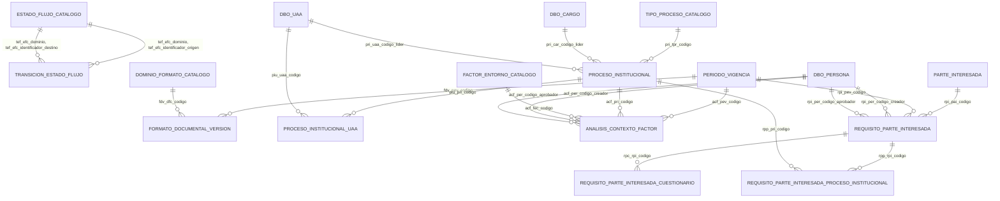
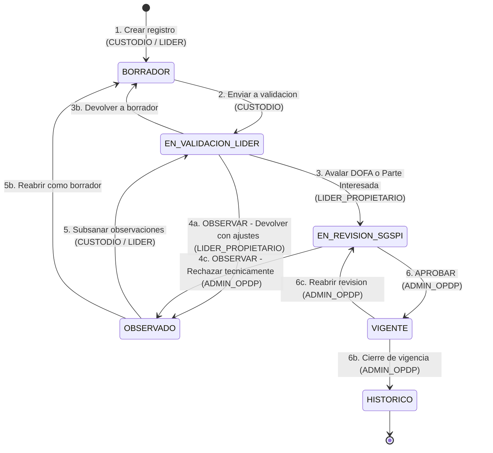
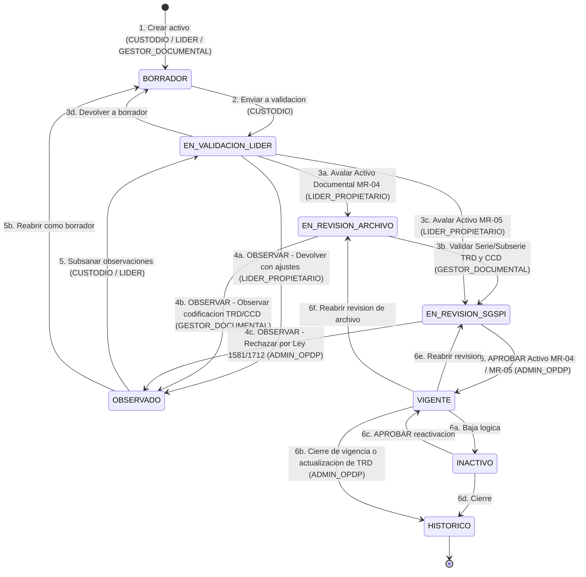
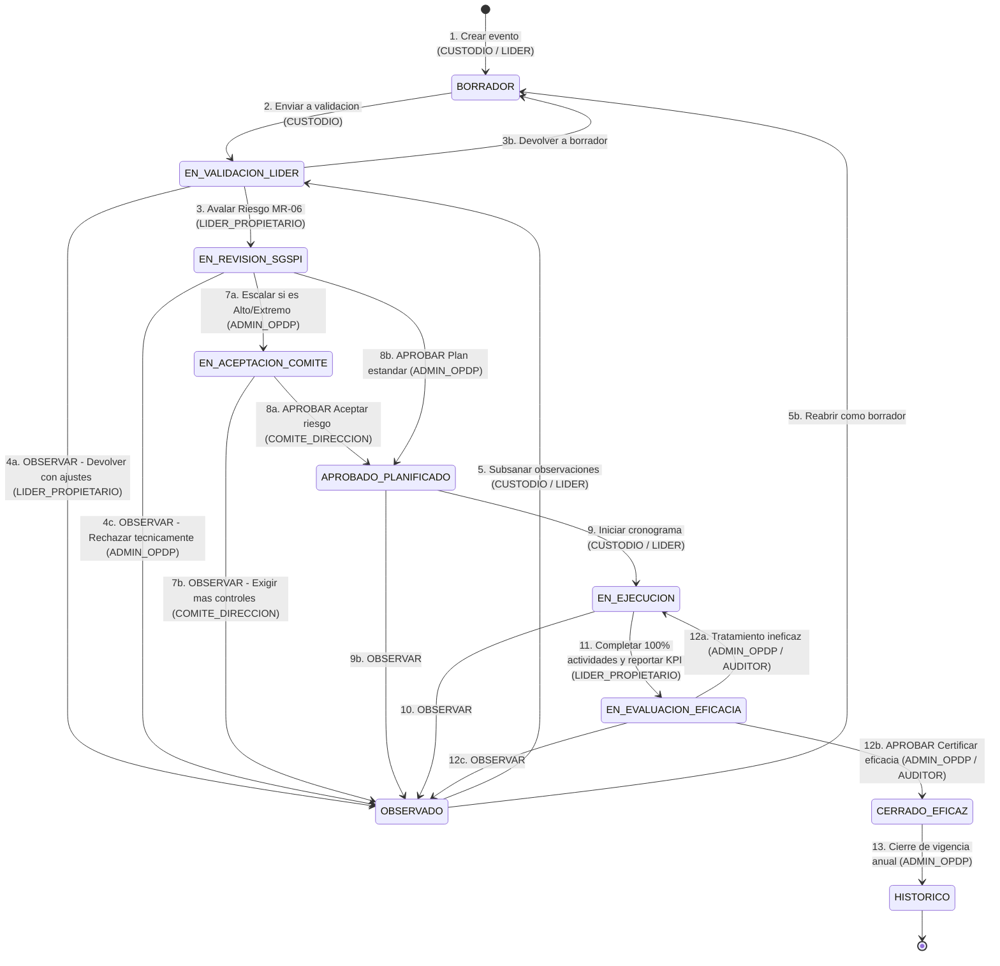
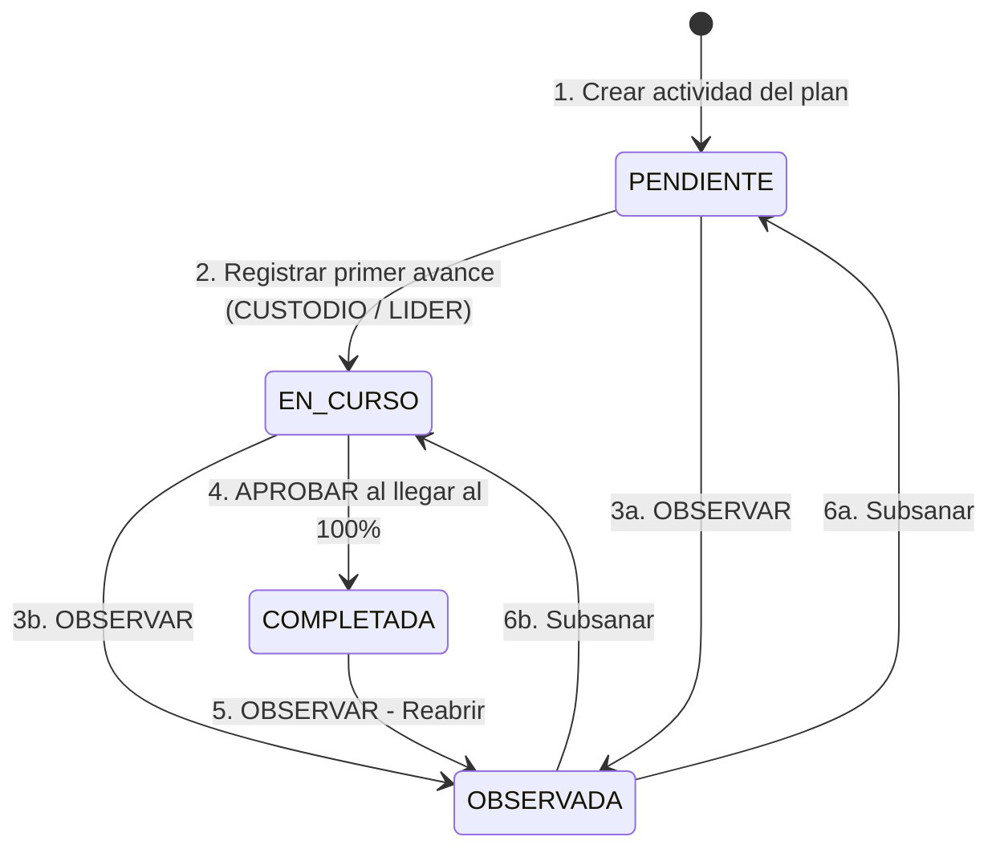

# Especificación de Arquitectura de Software y Análisis de Sistemas: Migración del SGSPI (Universidad Surcolombiana) a Plataforma Web/Móvil

**Organización:** Universidad Surcolombiana (USCO)  
**Sistema Objetivo:** Sistema de Gestión de Seguridad y Privacidad de la Información (SGSPI)  
**Motor de Base de Datos Objetivo:** Microsoft SQL Server 2019 (Compatibilidad 150, Esquema `sgspi` integrado con `dbo` de `academia3000`)  
**Versión del modelo de datos:** 2.0 — alineada con `DDL_SGSPI_SQLSERVER2019_v2.sql` (53 tablas)  
**Estándar de Nomenclatura de Base de Datos (Convención Institucional USCO):**
1. **Llaves Primarias y Foráneas con sufijo `_codigo`:** Cero uso de `_id`; todas las llaves primarias y foráneas terminan en `_codigo` (ej. `pev_codigo`, `pri_codigo`, `aci_codigo`, `eia_codigo`, `plt_codigo`, `uaa_codigo`, `per_codigo`, `sus_codigo`, `car_codigo`).
2. **Prefijo Acrónimo de 3 Letras por Tabla (`<acr>_`):** Cada tabla posee un acrónimo único de 3 letras y todas sus columnas, incluidas las llaves foráneas, inician con el acrónimo de la tabla local (ej. `aci_nombre_activo`, `aci_valor_confidencialidad`, `eia_fuente_generadora`, `plt_justificacion_estrategia`).
3. **Nombre de las Llaves Foráneas `<acr_local>_<acr_remoto>_codigo[_rol]`:** La FK simple lleva el acrónimo local y el remoto (ej. `acf_pev_codigo`) y, cuando hay que distinguir el papel o la tabla referencia varias veces a la misma tabla remota, agrega el rol (ej. `eia_aci_codigo_primario`, `eia_aci_codigo_soporte`, `acf_per_codigo_creador`).
4. **Restricciones con Nombre Explícito:** Toda restricción tiene nombre con prefijo según su tipo: PK_ (llave primaria, ej. `PK_aci_activo_informacion`), FK_ (llave foránea, ej. `FK_acf_periodo_vigencia`), UQ_/UX_ (unicidad o índice único filtrado, ej. `UQ_acf_vigencia_naturaleza_numero`, `UX_efc_estado_inicial`), CK_ (verificación, ej. `CK_acf_valor_prioridad`) y DF_<columna> (valores por defecto).

**Formatos Controlados Integrados (Flujo Secuencial 1 → 5 + Flujo Paralelo `ES-GSPI-MR-04`):**
1. `ES-GSPI-MR-01` — Matriz de Contexto de la Organización (DOFA por Proceso - Ej. Gestión de Tecnologías)
2. `CONSOLIDADO DOFA` — Contexto Consolidado Institucional (`D1..D124`, `F1..F30`, `A1..A101`, `O1..O37`)
3. `ES-GSPI-MR-03` — Matriz de Identificación de Partes Interesadas Pertinentes SGSPI (v4)
4. **`ES-GSPI-MR-04` *(Flujo Paralelo No Secuencial)*** — Matriz de Inventario y Clasificación de Activos de la Información Documental (Versión 1, Vigencia 2025: 194 activos documentales consolidados / 240 asignaciones CCD-TRD en 39 series documentales; Ley 594/2000, Ley 1712/2014, Decreto 103/2015, Decreto 1080/2015, Ley 1581/2012, ISO 27001)
5. `ES-GSPI-MR-05` — Matriz de Inventario y Clasificación de Activos de la Información (511 activos tecnológicos, de proceso, infraestructura y soporte + 17 sistemas de información)
6. `ES-GSPI-MR-06` — Matriz de Riesgos y Oportunidades (Enfoque Basado en Activos), Plan de Tratamiento y Declaración de Aplicabilidad (SoA ISO 27001:2022 / ISO 27701:2025)

---

## Tabla de Contenido
1. [Flujos de Trabajo (Orden Secuencial 1 → 5 + Proceso Paralelo `ES-GSPI-MR-04`)](#1-flujos-de-trabajo-orden-secuencial-1--5--proceso-paralelo-es-gspi-mr-04)
2. [Diccionario de Datos Extraído (Con Acrónimos y `_codigo`)](#2-diccionario-de-datos-extraído-con-acrónimos-y-_codigo)
3. [Entidades Principales y Mapa de Acrónimos (`sgspi` + `dbo`)](#3-entidades-principales-y-mapa-de-acrónimos-sgspi--dbo)
4. [Modelo Entidad-Relación (ER) Normalizado en 3NF](#4-modelo-entidad-relación-er-normalizado-en-3nf)
5. [Campos Calculados en Tiempo de Ejecución (Microsoft SQL Server 2019)](#5-campos-calculados-en-tiempo-de-ejecución-microsoft-sql-server-2019)
6. [Reglas de Negocio y Validaciones](#6-reglas-de-negocio-y-validaciones)
7. [Actores Actuales del Sistema (Integrados con `dbo.grupo` y `dbo.usuario_grupo`)](#7-actores-actuales-del-sistema-integrados-con-dbogrupo-y-dbousuario_grupo)
8. [Ciclo de Vida del Registro](#8-ciclo-de-vida-del-registro)
9. [Casos de Uso Principales por Rol (CRUD, Aprobaciones y Reportería)](#9-casos-de-uso-principales-por-rol-crud-aprobaciones-y-reportería)
10. [Máquina de Estados para el Registro Principal](#10-máquina-de-estados-para-el-registro-principal)
11. [Matriz Básica de Permisos (RBAC) y Seguridad](#11-matriz-básica-de-permisos-rbac-y-seguridad)
12. [Script DDL T-SQL de Producción (v2) y Verificación](#12-script-ddl-t-sql-de-producción-v2-y-verificación)

---

## 1. Flujos de Trabajo (Orden Secuencial 1 → 5 + Proceso Paralelo `ES-GSPI-MR-04`)

El proceso operativo del SGSPI articula dos flujos convergentes:
- **Flujo Secuencial (Pasos 1 $\rightarrow$ 5):** Contexto DOFA (`ES-GSPI-MR-01` / `Consolidado`) $\rightarrow$ Partes Interesadas (`ES-GSPI-MR-03`) $\rightarrow$ Inventario General de Activos (`ES-GSPI-MR-05`) $\rightarrow$ Riesgos, Tratamiento y SoA (`ES-GSPI-MR-06`).
- **Flujo Paralelo No Secuencial (`ES-GSPI-MR-04`):** El inventario de **Activos de la Información Documental** se alimenta directamente de las **Tablas de Retención Documental (TRD)** y el **Cuadro de Clasificación Documental (CCD)** (Ley 594 de 2000), el **Índice de Información Clasificada y Reservada** (Ley 1712 de 2014 / Decreto 103 de 2015) y el **Registro de Bases de Datos Personales** (Ley 1581 de 2012). Puede actualizarse en cualquier momento del año. `activo_documental` es un subtipo 1:1 de `activo_informacion` con llave primaria compartida (`ado_codigo` = `aci_codigo`, `FK_ado_activo_informacion`): cada activo documental es también un activo del inventario `ES-GSPI-MR-05`, de modo que su valoración CID, sus procesos (`activo_informacion_proceso_institucional`) y sus responsables (`activo_informacion_responsable`) se toman del supertipo, y se enlaza con `ES-GSPI-MR-06` (`eia_codigo`) a través de `eia_aci_codigo_primario` y `eia_aci_codigo_soporte`.

```mermaid
flowchart LR
    subgraph Fase1["Paso 1 y 2: Contexto Organizacional (ISO 27001 Cl. 4.1)"]
        D1["1. DOFA por Proceso<br/>(ES-GSPI-MR-01)<br/>analisis_contexto_factor [acf]"]
        D2["2. Consolidado DOFA<br/>(vw_consolidado_dofa)<br/>D1..D124, F1..F30, A1..A101, O1..O37"]
        D1 -->|"Vista SQL agregada<br/>de los 21 procesos"| D2
    end

    subgraph Fase2["Paso 3: Partes Interesadas (ISO 27001 Cl. 4.2)"]
        D3["3. Matriz Partes Interesadas<br/>(ES-GSPI-MR-03)<br/>41 Partes [pai] / 169 Requisitos [rpi]"]
    end

    subgraph FaseParalela["Flujo Paralelo: Activos Documentales y TRD (Ley 594 / Ley 1712 / Ley 1581)"]
        TRD["Cuadro de Clasificación<br/>Documental CCD / TRD<br/>39 Series [sdo] / Subseries [sbd]<br/>240 Asignaciones [adu] en Unidades [upc]"]
        D4_DOC["4A. Activos Documentales<br/>(ES-GSPI-MR-04 - Paralelo)<br/>194 Activos Documentales [ado]<br/>+ Índice Reserva y PII"]
        TRD -->|"Códigos TRD calculados en vista<br/>cod1..cod4 + COD5 + COD6"| D4_DOC
    end

    subgraph Fase3["Paso 4: Gestión de Activos (ISO 27001 Anexo A: A.5.9 / A.5.12)"]
        D4["4B. Inventario General<br/>de Activos (ES-GSPI-MR-05)<br/>511 Activos [aci] + 17 Sistemas [sif]"]
    end

    subgraph Fase4["Paso 5: Gestión de Riesgos, Tratamiento y SoA (Cl. 6.1 / 8.2 / 8.3)"]
        D5A["5.1 Identificación y Valoración<br/>evento_incertidumbre_activo [eia]<br/>Matriz 5x5 (RA / OA)"]
        D5B["5.2 Plan de Tratamiento<br/>plan_tratamiento [plt] + Actividades [act]<br/>+ Controles [crn]"]
        D5C["5.3 Declaración de Aplicabilidad<br/>evaluacion_aplicabilidad_control [eac]<br/>93 ISO 27001 + 71 ISO 27701"]
        D5A -->|"Escenarios en Zona<br/>Moderada, Alta o Extrema"| D5B
        D5B -->|"Trazabilidad de Controles<br/>y Evidencias"| D5C
    end

    %% Enlaces inter-subgrafos
    D2 -->|"Catálogo Maestro<br/>proceso_institucional [pri]"| D3
    D3 -->|"Procesos [pri], UAA [uaa]<br/>y Cargos [car]"| D4
    D3 -.->|"Procesos [pri] y UAA [uaa]<br/>Procesos [aip] y Responsables [air]<br/>tomados del supertipo [aci]"| D4_DOC
    D4_DOC <-->|"Subtipo 1:1 de [aci]<br/>PK compartida ado_codigo = aci_codigo"| D4
    D4 -->|"Activos Primarios y Soporte<br/>+ Valoración CID y PII"| D5A
    D4_DOC -.->|"Insumo de Privacidad (Ley 1581)<br/>e Índice de Reserva (Ley 1712)"| D5A
```



---

## 2. Diccionario de Datos Extraído (Con Acrónimos y `_codigo`)

### 2.1 Mapeo de Columnas Excel $\rightarrow$ Columnas con Acrónimo en SQL Server 2019

#### A. Documentos 1 y 2: `DOFA por Proceso (ES-GSPI-MR-01)` y `CONSOLIDADO DOFA`
| Columna en Excel | Tabla (`[acr]`) y Columna en SQL Server 2019 | Tipo T-SQL | Ejemplo Real del Dataset |
| :--- | :--- | :--- | :--- |
| `VIGENCIA` | `periodo_vigencia.pev_anio` (`pev_codigo`) | `SMALLINT` | `2025` |
| `TIPO DE PROCESO` | `tipo_proceso_catalogo.tpr_nombre` (`tpr_codigo`) | `NVARCHAR(50)` | `ESTRATÉGICO`, `APOYO`, `EVALUACIÓN`, `MISIONAL` |
| `PROCESO` | `proceso_institucional.pri_nombre` (`pri_codigo`) | `NVARCHAR(150)` | `SISTEMA GESTIÓN DE INFORMACION, TECNOLOGÍAS Y CONTROL DOCUMENTAL` |
| `VARIABLE` | `factor_entorno_catalogo.fec_nombre_factor` (`fec_codigo`) | `NVARCHAR(100)` | Interno: `Gobernanza`, `Cultura organizacional` / Externo: `Aspecto Tecnológico`, `Aspecto Normativo` |
| *(Código D1..O37)* | `analisis_contexto_factor.acf_identificador_factor` (expuesto en `vw_consolidado_dofa`) = inicial de `acf_naturaleza_factor` + `acf_numero_factor` (`SMALLINT`, único por vigencia y naturaleza: `UQ_acf_vigencia_naturaleza_numero`) | `NVARCHAR(15)` Calculada `PERSISTED` | `D1`..`D124`, `F1`..`F30`, `A1`..`A101`, `O1`..`O37` |
| `DEBILIDAD` / `FORTALEZA` / `AMENAZA` / `OPORTUNIDAD` | `analisis_contexto_factor.acf_naturaleza_factor` + `acf_descripcion_situacion` | `NVARCHAR(15)` (`DEBILIDAD`, `FORTALEZA`, `AMENAZA`, `OPORTUNIDAD`; `CK_acf_naturaleza_factor`) + `NVARCHAR(1000)` | `DEBILIDAD`: `"Múltiples equipos de soporte, desarrollo y redes con roles no unificados."` |
| `PRIORIZACIÓN` | `analisis_contexto_factor.acf_valor_prioridad` (dato almacenado) + `acf_nivel_prioridad` (etiqueta calculada) | `TINYINT` (1..3, `CK_acf_valor_prioridad`) + `NVARCHAR(5)` Calculada `PERSISTED` | `Alta` = `3` → `ALTA`, `Media` = `2` → `MEDIA`, `Baja` = `1` → `BAJA` |
| `IMPACTO SOBRE EL SGSPI` | `analisis_contexto_factor.acf_impacto_sistema_gestion` | `NVARCHAR(1000)` | `"Riesgo de brechas de coordinación y duplicidad de controles."` |
| `ACCIÓN SUGERIDA` | `analisis_contexto_factor.acf_accion_propuesta` | `NVARCHAR(1000)` | `"Definir claramente roles y responsabilidades en seguridad de la información."` |

#### B. Documento 3: `ES-GSPI-MR-03 MATRIZ DE PARTES INTERESADAS SGSPI v4`
| Columna en Excel | Tabla (`[acr]`) y Columna en SQL Server 2019 | Tipo T-SQL | Ejemplo Real del Dataset |
| :--- | :--- | :--- | :--- |
| `PARTES INTERESADAS` | `parte_interesada.pai_nombre` (`pai_codigo`) | `NVARCHAR(150)` | `Consejo Superior`, `Estudiantes`, `Ministerio de Educación Nacional- MEN`, `Hackers individuales` |
| `CATEGORIA DE LAS PARTES INTERESADAS` | `parte_interesada.pai_origen` | `NVARCHAR(15)` | `Interna`, `Externa` |
| `PREG.` | `requisito_parte_interesada_cuestionario (rpc_rpi_codigo, rpc_numero_pregunta)` | Tabla Puente (`SMALLINT` atómico, `CK_rpc_numero_pregunta_positivo`) | `6-7-8` se almacena como tres filas (`6`, `7`, `8`); `N/A` no genera filas |
| `INTERÉS (REQUISITOS) NECESIDADES Y EXPECTATIVAS` | `requisito_parte_interesada.rpi_necesidad_expectativa` | `NVARCHAR(1000)` | `"Garantizar la confidencialidad e integridad de la información contenida en los audios..."` |
| `PODER` / `INTERÉS` | `requisito_parte_interesada.rpi_valor_poder`, `rpi_valor_interes` (dato almacenado) + `rpi_nivel_poder`, `rpi_nivel_interes` (etiquetas calculadas) | `TINYINT` (1..3, `CK_rpi_valores_escala`) + `NVARCHAR(5)` Calculadas `PERSISTED` | `Alto` = `3` → `ALTA` \| `Medio` = `2` → `MEDIA` \| `Bajo` = `1` → `BAJA` |
| `CLASIFICACIÓN SEGÚN EL IMPACTO` | `requisito_parte_interesada.rpi_clasificacion_impacto` | `NVARCHAR(12)` Calculada `PERSISTED` (`CUIDADO`, `ATENCION`, `MITIGANTE`, `SIN_PROBLEMA`) | `CUIDADO "Tratar como requisito legal y otros requisitos"` (el texto explicativo es de la hoja Excel; la columna almacena `CUIDADO`) |
| `ESTADO DE CUMPLIMIENTO` | `requisito_parte_interesada.rpi_valor_cumplimiento` (dato almacenado, admite `NULL`) + `rpi_nivel_cumplimiento` (etiqueta calculada) | `TINYINT NULL` (1..3) + `NVARCHAR(5)` Calculada `PERSISTED` | `Alto` = `3` → `ALTA`, `Medio` = `2` → `MEDIA`, `Bajo` = `1` → `BAJA` |
| `PRIORIDAD PARA LA TOMA DE ACCIONES` | `requisito_parte_interesada.rpi_valor_prioridad_accion` (= 4 − `rpi_valor_cumplimiento`) + `rpi_prioridad_accion` | `TINYINT NULL` + `NVARCHAR(5)` Calculadas `PERSISTED` | `Prioridad alta` → `ALTA`, `Prioridad media` → `MEDIA`, `Prioridad baja` → `BAJA` (cumplimiento bajo implica prioridad alta) |
| `HERRAMIENTA DE SEGUIMIENTO` | `requisito_parte_interesada.rpi_mecanismo_seguimiento` | `NVARCHAR(255)` | `Capacitaciones y SIAC`, `Uso de Plataformas del MEN` |
| `AFECTACIÓN A PROCESOS` *(21 columnas)* | `requisito_parte_interesada_proceso_institucional (rpp_rpi_codigo, rpp_pri_codigo, rpp_fecha_registro)` | Tabla Puente N:M (PK compuesta) | Asocia cada requisito `rpi_codigo` con los procesos `pri_codigo` impactados |

#### C1. Documento Paralelo 4A: `ES-GSPI-MR-04 MATRIZ DE INVENTARIO Y CLASIFICACIÓN DE ACTIVOS DE LA INFORMACIÓN DOCUMENTAL (Versión 1 - Vigencia 2025)`
- **Volumen y Frecuencia Analizados:**
  - **Bloque 1 (Matriz Consolidada):** **194 activos documentales consolidados** (`ID = 1..194`) estructurados en **39 columnas** y **4 secciones normativas**: *(1) Identificación del Activo (Ley 594/2000, Ley 1712/2014, Decreto 103/2015, Decreto 1080/2015, ISO 27001)*, *(2) Clasificación del Activo (ISO 27001)*, *(3) Datos Personales (Ley 1581 de 2012)* y *(4) Índice de Información Clasificada y Reservada (Decreto 103 de 2015)*.
  - **Bloque 2 (Catálogos Desplegables):** **18 listas de validación** (`Periodicidad`, `Soporte de registro`, `Medio de conservación`, `Tipo`, `Idioma`, `Confidencialidad/C`, `Integridad/I`, `Disponibilidad/D`, `Información publicada`, `Contiene datos personales`, `Tipos de datos personales`, `Autorización PII`, `Objeto legítimo de excepción`, `Fundamento constitucional/jurídico`, `Excepción total o parcial` y 3 umbrales ICC).
  - **Bloque 3 (Desglose Jerárquico CCD / TRD):** **240 filas de asignación archivística** (`XX = 1..240`) distribuidas en **39 Series Documentales únicas (`COD5 = 1..39`)** y sus Subseries (`COD6`) a través de 4 niveles organizacionales (`cod1/seccion` $\rightarrow$ `cod2/subseccion` $\rightarrow$ `cod3/subseccion N1` $\rightarrow$ `cod4/subseccion N2`).
  - **Anomalía Crítica Detectada en la Hoja de Cálculo:** En 191 de los 194 registros donde la etiqueta `Disponibilidad` es `Alto`, la columna numérica `D` fue digitada erróneamente como `1` en lugar de `3` (solo las filas 34, 35 y 36 tienen `D = 3`), sesgando la columna `Criticidad del activo` a `MEDIA` en las 194 filas. Al almacenar únicamente el entero `1..3` en `aci_valor_disponibilidad` (y en `aci_valor_confidencialidad` / `aci_valor_integridad`) del supertipo `activo_informacion` y proyectar las etiquetas y la criticidad mediante las columnas calculadas `PERSISTED` `aci_nivel_disponibilidad`, `aci_puntaje_criticidad` y `aci_nivel_criticidad`, esta inconsistencia se elimina de raíz (`CK_aci_valores_cid`).

| Columna en Excel (`ES-GSPI-MR-04`) | Tabla (`[acr]`) y Columna en SQL Server 2019 | Tipo T-SQL | Ejemplo Real del Dataset / Catálogo |
| :--- | :--- | :--- | :--- |
| `ID` | `activo_documental.ado_codigo` (subtipo 1:1; PK compartida con `activo_informacion.aci_codigo`, `FK_ado_activo_informacion`) + `activo_informacion.aci_codigo_inventario` | `INT` (sin `IDENTITY`; el `IDENTITY` está en `aci_codigo`) + `NVARCHAR(30)` | `1` a `194` |
| `XX` *(Bloque 3 Desglose TRD)* | `activo_documental_unidad_productora (adu_ado_codigo, adu_upc_codigo, adu_esta_activo)` | Tabla Puente N:M (PK compuesta `PK_adu_activo_documental_unidad_productora`; `INT`, `INT`, `BIT`) | 240 filas de asignación (`XX = 1..240`) |
| `cod1` / `seccion` .. `cod4` / `subseccion N2` | `unidad_productora_cuadro_clasificacion_documental (upc_codigo, upc_nodo_jerarquico, upc_nodo_padre, upc_nivel_jerarquico, upc_codigo_archivistico, upc_prefijo_archivistico, upc_uaa_codigo, upc_nombre_unidad)` | `INT` + `HIERARCHYID` + `HIERARCHYID` y `SMALLINT` calculadas `PERSISTED` + `NVARCHAR(50)` + `NVARCHAR(50)` calculada `PERSISTED` + `INT` + `NVARCHAR(150)` | `1=RECTORIA` $\rightarrow$ `1.1=SECRETARIA GENERAL` $\rightarrow$ `1.1.1=AREA GESTION DOCUMENTAL` / `5.1.1.2=SECRETARIA ACADEMICA` |
| `COD5` / `SERIE` | `serie_documental_catalogo (sdo_codigo, sdo_numero_ccd, sdo_nombre_serie, sdo_tiene_subseries)`; asignada al activo en `activo_documental.ado_sdo_codigo` | `SMALLINT` + `SMALLINT` + `NVARCHAR(150)` + `BIT` | `1=ACCIONES CONSTITUCIONALES`, `3=ACTAS`, `4=ACUERDOS`, ..., `39=RESOLUCIONES` (39 series) |
| `COD6` / `SUBSERIE` | `subserie_documental_catalogo (sbd_codigo, sbd_sdo_codigo, sbd_numero_ccd, sbd_nombre_subserie)`; asignada en `activo_documental.ado_sbd_codigo` (FK compuesta `FK_ado_subserie_documental` con `ado_sdo_codigo`) | `INT` + `SMALLINT` + `SMALLINT` + `NVARCHAR(200)`; `ado_sbd_codigo` `INT NULL` | `1=ACTAS DE COMITÉ DE CONCILIACIÓN Y DEFENSA JUDICIAL`, `NULL` en series sin subserie (`RESOLUCIONES`, `NÓMINAS`); si la serie tiene `sdo_tiene_subseries = 1` la subserie es obligatoria (trigger `TR_ado_auditoria_y_actualizacion`, error 50015) |
| `Serie documental` / `Subserie documental` | Calculado en `vw_desglose_ccd_trd_mr04` (`adu_codigo_serie_trd_calculado`, `adu_codigo_subserie_trd_calculado`) y en `vw_inventario_activo_documental_mr04` (`ado_codigos_serie_documental_trd`, `ado_codigos_subserie_documental_trd`, agregados con `STRING_AGG`) | Calculado en Tiempo de Ejecución | `<upc_prefijo_archivistico>.<sdo_numero_ccd>.<sbd_numero_ccd>` (ej. `1.1.1.21.20`, o multivaluado en filas transversales) |
| `NOMBRE` / `Descripción` | `activo_informacion.aci_nombre_activo` + `aci_descripcion_detallada` (supertipo; la vista `vw_inventario_activo_documental_mr04` los expone como `ado_nombre_activo` y `ado_descripcion`) | `NVARCHAR(255)` + `NVARCHAR(1000)` | `HISTORIAS LABORALES`: `"Acto administrativo de nombramiento, Posesión, Certificados..."` |
| `Proceso` *(Multivaluado en Excel)* | `activo_informacion_proceso_institucional (aip_aci_codigo, aip_pri_codigo)` (se toma del supertipo: `aip_aci_codigo` = `ado_codigo`) | Tabla Puente N:M (PK compuesta) | Desnormalizado en Excel con comas; normalizado en 3NF hacia `sgspi.proceso_institucional` (la vista lo expone como `ado_procesos_asociados`) |
| `Dependencia / Oficina` + `Propietario del activo` + `Custodio del activo` | `activo_informacion_responsable (air_aci_codigo, air_car_codigo, air_uaa_codigo, air_tipo_responsabilidad, air_esta_activo)` (se toma del supertipo: `air_aci_codigo` = `ado_codigo`; la vista expone `ado_dependencias_oficinas`, `ado_propietarios_activo`, `ado_custodios_activo`) | Tabla Puente N:M (PK compuesta; `INT`, `INT`, `INT`, `NVARCHAR(20)` con `CK_air_tipo_responsabilidad`, `BIT`) | `PROPIETARIO`: `Rector`, `Secretario General`, `Decano` \| `CUSTODIO`: `Profesional de Gestión`, `Secretaria Ejecutiva` |
| `Tipo` | `activo_informacion.aci_tac_codigo` $\rightarrow$ `tipo_activo_catalogo (tac_codigo, tac_tac_codigo_padre, tac_nivel_taxonomia, tac_nombre)`, jerarquía de 3 niveles (1 = Categoría ISO 27005, 2 = Tipo, 3 = Subtipo); la vista lo expone como `ado_tipo_activo_documental` | `SMALLINT (FK)`; `tac_nivel_taxonomia` `TINYINT` | `Informacion y datos de la Universidad`, `Sistemas de información y aplicaciones de Software`, `Servicios` |
| `Periodicidad de generación` | `activo_documental.ado_pdc_codigo` $\rightarrow$ `periodicidad_catalogo.pdc_nombre` (`pdc_orden`) | `SMALLINT (FK)` + `NVARCHAR(40)` | `A solicitud`, `Diaria`, `Semanal`, `Mensual`, `Bimensual`, `Trimestral`, `Cuatrimestral`, `Semestral`, `Anual`, `Eventual` |
| `Soporte de registro` / `Medio de conservación` | `activo_documental_soporte_registro (ads_ado_codigo, ads_src_codigo)` $\rightarrow$ `soporte_registro_catalogo.src_nombre` / `activo_documental_medio_conservacion (adm_ado_codigo, adm_mcc_codigo)` $\rightarrow$ `medio_conservacion_catalogo.mcc_nombre` | Tablas Puente N:M + `NVARCHAR(30)` / `NVARCHAR(30)` | Soporte: `Físico`, `Digital`, `Físico/Digital` \| Medio: `Físico`, `Electrónico`, `Físico/Electrónico` (los valores combinados se modelan como varias filas del puente) |
| `Formato` / `Idioma` | `activo_documental_formato_archivo (adf_ado_codigo, adf_fac_codigo)` $\rightarrow$ `formato_archivo_catalogo.fac_nombre` / `activo_documental_idioma (adi_ado_codigo, adi_idi_codigo)` $\rightarrow$ `idioma_catalogo (idi_codigo_iso, idi_nombre)` | Tablas Puente N:M + `NVARCHAR(60)` / `NVARCHAR(50)` | `Documento de texto` \| `Español`, `Ingles`, `Español/Ingles`, `Frances` |
| `Fecha de ingreso a la TRD` / `al archivo` | `activo_documental.ado_fecha_ingreso_tabla_retencion` / `ado_fecha_ingreso_archivo` | `DATE NULL` | `NULL` (cuando en Excel es `No Aplica`) o fecha `YYYY-MM-DD` |
| `C` / `I` / `D` *(1..3)* y etiquetas de texto | `activo_informacion.aci_valor_confidencialidad`, `aci_valor_integridad`, `aci_valor_disponibilidad` (supertipo) + calculadas `aci_nivel_confidencialidad`, `aci_nivel_integridad`, `aci_nivel_disponibilidad` | `TINYINT (1..3)` + `NVARCHAR(5)` Calculadas `PERSISTED` | `3 = Pública Reservada / Confidencial =Alta`, `2 = Clasificada / Uso Interno = Medio`, `1 = Información Pública / Pública =Bajo` |
| `Criticidad del activo` | `activo_informacion.aci_puntaje_criticidad` + `aci_nivel_criticidad` (supertipo) | `TINYINT` + `NVARCHAR(5)` Columnas Calculadas `PERSISTED` | Suma `3..9`: `>= 7 ALTA`, `5..6 MEDIA`, `3..4 BAJA` |
| `Información publicada` / `Lugar de consulta o ubicación` | `activo_documental.ado_epc_codigo` $\rightarrow$ `estado_publicacion_catalogo.epc_nombre` + `activo_documental.ado_lugar_consulta_ubicacion` | `SMALLINT (FK)` + `NVARCHAR(60)` / `NVARCHAR(255)` | `Publicada ( Externo - Internet)` (`https://www.usco.edu.co/es/transparencia/`), `Publicada ( Interno - Intranet)`, `No publicada` |
| `¿Contiene datos personales?` / `¿de niños, niñas o adolescentes?` | `activo_informacion.aci_contiene_datos_personales` / `aci_contiene_datos_menores` | `BIT` / `BIT NULL` | `Si` = `1`, `No` = `0`, `No Aplica` = `NULL` en `aci_contiene_datos_menores` (`CK_aci_coherencia_pii`) |
| `Tipos de datos personales` / `Finalidad` / `Autorización` | `activo_informacion.aci_categoria_dato_personal`, `aci_finalidad_recoleccion_pii`, `aci_existe_autorizacion_pii` | `NVARCHAR(20)` / `NVARCHAR(500)` / `BIT NULL` | `PRIVADOS` (`Dato personal privado`), `PUBLICOS` (`Dato personal público`), `SEMIPRIVADOS` (`Dato semiprivado`), `SENSIBLES` (`Dato sensible`), `NULL` (`No Aplica`) (`CK_aci_categoria_pii`) |
| `Información clasificada o reservada (Ley 1712 de 2014)` | `activo_informacion.aci_clasificacion_transparencia` | `NVARCHAR(20)` | `PUBLICA`, `CLASIFICADA`, `RESERVADA`, `NO_CLASIFICADA` (`CK_aci_transparencia`) |
| `Objeto legítimo` / `Fundamento constitucional` / `Fundamento jurídico` / `Excepción total o parcial` / `Fecha` / `Tiempo` | `activo_informacion.aci_cet_codigo` (FK compuesta `FK_aci_causal_excepcion` $\rightarrow$ `causal_excepcion_transparencia (cet_codigo, cet_nivel_reserva_aplicable, cet_numeral_causal, cet_descripcion_causal, cet_norma_referencia)`), `aci_fundamento_constitucional_legal`, `aci_fundamento_juridico_excepcion`, `aci_alcance_excepcion`, `aci_fecha_clasificacion_reserva`, `aci_es_reserva_indefinida`, `aci_anios_plazo_reserva` + calculada `aci_fecha_vencimiento_reserva` | `SMALLINT` + `NVARCHAR(150)` + `NVARCHAR(150)` + `NVARCHAR(15)` + `DATE NULL` + `BIT NULL` + `SMALLINT NULL` + `DATE NULL` calculada | `Ley 1712 de 2014` \| `TOTAL` (`Reserva total`), `PARCIAL` (`Reserva parcial`), `NULL` (`Sin reserva`, `No Aplica`) \| `Indefinida` = `aci_es_reserva_indefinida = 1` (`CK_aci_coherencia_indice_reserva`) |

#### C2. Documento 4B: `ES-GSPI-MR-05 MATRIZ DE INVENTARIO Y CLASIFICACIÓN DE ACTIVOS`
| Columna en Excel | Tabla (`[acr]`) y Columna en SQL Server 2019 | Tipo T-SQL | Ejemplo Real del Dataset |
| :--- | :--- | :--- | :--- |
| `ID ACTIVO INFORMACION` | `activo_informacion.aci_codigo` + `aci_codigo_inventario` | `INT IDENTITY` + `NVARCHAR(30)` | `1` a `511` |
| `Nombre del Activo de Información` | `activo_informacion.aci_nombre_activo` | `NVARCHAR(255)` | `Sistema Financiero (Linix)`, `BD Académica3000`, `Historias Laborales` |
| `Tipo` / `Clase` / `Descripción del Activo` | `activo_informacion.aci_tac_codigo` $\rightarrow$ `tipo_activo_catalogo (tac_codigo, tac_tac_codigo_padre, tac_nivel_taxonomia, tac_nombre)`: jerarquía de 3 niveles (1 = Categoría ISO 27005, 2 = Tipo, 3 = Subtipo) autorreferenciada (`FK_tac_padre`) | `SMALLINT (FK)` | `Primario` $\rightarrow$ `Información` $\rightarrow$ `Aplicaciones Estandar del Negocio` |
| `Proceso al que pertenece` | `activo_informacion_proceso_institucional (aip_aci_codigo, aip_pri_codigo)` | Tabla Puente N:M (PK compuesta) | `FORMACIÓN`, `GESTIÓN FINANCIERA Y DE RECURSOS FÍSICOS` |
| `Dependencia` | `activo_informacion.aci_uaa_codigo` $\rightarrow$ `dbo.uaa (uaa_codigo)` | `INT NULL (FK a dbo.uaa)` | `Oficina Asesora Jurídica`, `Centro de Información, Tecnología y Control documental` |
| `Sede` | `activo_informacion_sede (ais_aci_codigo, ais_sus_codigo)` $\rightarrow$ `dbo.sub_sede (sus_codigo)`; `aci_es_transversal_sedes` marca el caso de todas las sedes | Tabla Puente N:M (PK compuesta) + `BIT` | `Sede Central`, `Sede Postgrados`, `Todas las sedes` |
| `Propietario del Activo` / `Custodio del Activo` | `activo_informacion_responsable (air_aci_codigo, air_car_codigo, air_uaa_codigo, air_tipo_responsabilidad, air_esta_activo)` | Tabla Puente N:M (PK compuesta) | `PROPIETARIO`: `Vicerrector Académico` \| `CUSTODIO`: `Director Registro y Control` |
| `Tipo de Información Ley 1712 de 2014` | `activo_informacion.aci_clasificacion_transparencia` | `NVARCHAR(20)` | `PUBLICA`, `CLASIFICADA`, `RESERVADA`, `NO_CLASIFICADA` (`CK_aci_transparencia`) |
| `¿Contiene datos personales (Ley 1581)?` | `activo_informacion.aci_contiene_datos_personales` | `BIT` | `1 (SI)`, `0 (NO)` |
| `Confidencialidad` / `Integridad` / `Disponibilidad` | `aci_valor_confidencialidad`, `aci_valor_integridad`, `aci_valor_disponibilidad` (+ etiquetas calculadas `aci_nivel_confidencialidad`, `aci_nivel_integridad`, `aci_nivel_disponibilidad`) | `TINYINT (1..3)` | `3 (Alta)`, `2 (Media)`, `1 (Baja)` |
| `calculo criticidad` / `Criticidad` | `aci_puntaje_criticidad` y `aci_nivel_criticidad` | Columnas Calculadas `PERSISTED` | `9` $\rightarrow$ `Alta` \| `6` $\rightarrow$ `Media` \| `3` $\rightarrow$ `Baja` |
| `IMPACTO SOCIAL` / `ECONÓMICO` / `AMBIENTAL` (ICC) | `aci_supera_umbral_social_icc`, `aci_supera_umbral_economico_icc`, `aci_supera_umbral_ambiental_icc` | `BIT` | `0 (NO)` / `1 (SI)` $\rightarrow$ calcula `aci_es_infraestructura_critica_icc` |

#### D. Documento 5: `ES-GSPI-MR-06 RIESGOS, TRATAMIENTO Y SOA (ISO 27001 / 27701)`
| Sub-Matriz | Tabla (`[acr]`) en SQL Server 2019 | Columnas Clave con Acrónimo y `_codigo` |
| :--- | :--- | :--- |
| **5.1 Identificación y Valoración** | `sgspi.evento_incertidumbre_activo` (`[eia]`), con valoración inherente por FK compuesta `FK_eia_valoracion_inherente` hacia `sgspi.matriz_valoracion_riesgo` (`[mvr]`; zona en `mvr_zrc_codigo` $\rightarrow$ `sgspi.zona_riesgo_catalogo`) | `eia_codigo`, `eia_pev_codigo`, `eia_identificador_evento` (`RA-01..15`, `OA-01..09`), `eia_naturaleza_evento`, `eia_pri_codigo`, `eia_aci_codigo_primario`, `eia_aci_codigo_soporte`, `eia_tac_codigo_componente` (categoría de nivel 1 de `tipo_activo_catalogo`; `eia_tac_nivel_componente` calculada constante 1), `eia_fuente_generadora`, `eia_controles_existentes`, `eia_condicion_vulnerabilidad`, `eia_efecto_consecuencia`, `eia_escenario_operacional`, `eia_epr_codigo_inherente`, `eia_eim_codigo_inherente`, `eia_estado_registro`. |
| **5.2 Plan de Tratamiento** | `sgspi.plan_tratamiento` (`[plt]`) + `sgspi.estrategia_tratamiento_catalogo` (`[etc]`) + `sgspi.actividad_tratamiento` (`[act]`) + `sgspi.seguimiento_actividad` (`[sga]`) | `plt_codigo`, `plt_eia_codigo`, `plt_naturaleza_evento`, `plt_etc_codigo` (estrategia; `FK_plt_estrategia_tratamiento` junto con `plt_naturaleza_evento`), `plt_justificacion_estrategia`, `plt_epr_codigo_residual_meta`, `plt_eim_codigo_residual_meta`, `plt_fecha_inicio`, `plt_fecha_fin`, `plt_recursos_humanos_tecnicos`, `plt_recursos_economicos_desc`, `plt_presupuesto_estimado_cop`, `plt_restricciones_limitaciones`, `plt_nombre_indicador_kpi`, `plt_unidad_medida_kpi`, `plt_meta_indicador_kpi`, `plt_valor_alcanzado_kpi`, `plt_porcentaje_cumplimiento_kpi` (calculada), `plt_es_tratamiento_eficaz`, `act_codigo`, `act_plt_codigo`, `act_numero_orden`, `sga_codigo`, `sga_act_codigo`. |
| **5.3 Controles y SoA ISO 27001 / 27701** | `sgspi.control_referencia_normativa` (`[crn]`) + `sgspi.estandar_normativo_catalogo` (`[enc]`) + `sgspi.atributo_control_catalogo` (`[aac]`) / `sgspi.control_referencia_normativa_atributo` (`[cra]`) para los atributos ISO 27002 + `sgspi.plan_tratamiento_control_referencia_normativa` (`[ptc]`) + `sgspi.evaluacion_aplicabilidad_control` (`[eac]`) | `crn_codigo`, `crn_enc_codigo` (estándar; `enc_identificador`, `enc_familia_norma`), `crn_rol_privacidad_pii`, `crn_identificador_control`, `crn_nombre_control`, `crn_objetivo_requisito`, `aac_tipo_atributo`, `aac_valor`, `cra_crn_codigo`, `cra_aac_codigo`, `ptc_plt_codigo`, `ptc_crn_codigo`, `eac_codigo`, `eac_pev_codigo`, `eac_crn_codigo`, `eac_es_aplicable`, `eac_justificacion_aplicabilidad`, `eac_documento_soporte_normativo`, `eac_car_codigo`, `eac_frecuencia_revision`, `eac_evidencia_objetiva_esperada`, `eac_estado_implementacion`. |
---

## 3. Entidades Principales y Mapa de Acrónimos (`sgspi` + `dbo`)

### 3.1 Tablas Maestras Reutilizadas del Esquema Corporativo `[dbo]` (`academia3000`)
| Acrónimo | Tabla en `[dbo]` | Llave Primaria / Columnas usadas | Rol en el SGSPI |
| :---: | :--- | :--- | :--- |
| **`sus`** | `dbo.sub_sede` | `sus_codigo` (`INT`) | Campus físicos (Sede Central, Sede Postgrados, Sede Salud/Quirinal); destino de `ais_sus_codigo`. |
| **`esp`** | `dbo.espacio` | `esp_codigo` (`INT`) | Espacios físicos, centros de cómputo, cuartos de cableado y oficinas; destino de `aci_esp_codigo`. |
| **`uaa`** | `dbo.uaa` | `uaa_codigo` (`INT`), `uaa_nombre` | Unidades Académico-Administrativas (Facultades, Oficinas, Vicerrectorías, Centros). |
| **`car`** | `dbo.cargo` | `car_codigo` (`INT`), `car_nombre` | Catálogo oficial de cargos institucionales (Propietarios, Custodios, Líderes). |
| **`per`** | `dbo.persona` | `per_codigo` (`INT`), `per_identificacion`, `per_nombre`, `per_apellido`, `per_email_interno` | Maestro único de personas (Funcionarios, Docentes, Contratistas): creadores, aprobadores, firmantes y evaluadores. |
| **`gru`** | `dbo.grupo` | `gru_codigo` (`INT`), `gru_nombre`, `gru_estado` | Grupos/Roles de seguridad RBAC institucionales. |
| **`usg`** | `dbo.usuario_grupo` | `usg_codigo` (`INT`), `usg_grupo`, `usg_uaa`, `usg_usuario`, `usg_estado` | Asignación de usuarios a grupos RBAC por UAA (Row-Level Security). |
| **`ugen`** | `dbo.usuario_general` | `uid`, `up` | Cuenta de usuario (`uid`, referenciada por `usg_usuario`) enlazada a la persona mediante `up`; solo la lee la vista `sgspi.vw_usuario_rol_alcance_sgspi`. |

> Las tablas `dbo.sede`, `dbo.uaa_cargo` y `dbo.uaa_personal` no son referenciadas por el DDL v2 (ni por llaves foráneas ni por vistas), por lo que no forman parte de las dependencias del SGSPI. El script de despliegue verifica, antes de crear objetos, que existan las tablas y columnas de `[dbo]` listadas arriba.

### 3.2 Mapa de las 53 Tablas Propias del Esquema `[sgspi]` y sus Acrónimos

> Las tablas `sgspi.activo_documental`, `sgspi.evento_incertidumbre_activo` y `sgspi.evaluacion_aplicabilidad_control` son tablas temporales (`SYSTEM_VERSIONING`); sus tablas de historial (`sgspi.activo_documental_historial`, `sgspi.evento_incertidumbre_activo_historial` y `sgspi.evaluacion_aplicabilidad_control_historial`) las administra el motor y no se cuentan entre las 53 tablas propias.

#### Dominio 1: Transversal, gobernanza SGC y máquina de estados
| # | Acrónimo | Tabla en `[sgspi]` | Llave Primaria | Columnas Representativas |
| :-: | :---: | :--- | :--- | :--- |
| 1 | **`pev`** | `sgspi.periodo_vigencia` | `pev_codigo` | `pev_anio`, `pev_fecha_apertura`, `pev_fecha_cierre`, `pev_estado_vigencia`... |
| 2 | **`efc`** | `sgspi.estado_flujo_catalogo` | `efc_codigo` | `efc_dominio`, `efc_identificador`, `efc_es_inicial`, `efc_permite_edicion`... |
| 3 | **`tef`** | `sgspi.transicion_estado_flujo` | `tef_codigo` | `tef_efc_dominio`, `tef_efc_identificador_origen`, `tef_efc_identificador_destino`, `tef_accion_bitacora` |
| 4 | **`dfc`** | `sgspi.dominio_formato_catalogo` | `dfc_codigo` | `dfc_identificador`, `dfc_nombre`, `dfc_descripcion`, `dfc_esta_activo` |
| 5 | **`fdv`** | `sgspi.formato_documental_version` | `fdv_codigo` | `fdv_pev_codigo`, `fdv_dfc_codigo`, `fdv_codigo_formato`, `fdv_numero_version`... |
| 6 | **`tpr`** | `sgspi.tipo_proceso_catalogo` | `tpr_codigo` | `tpr_identificador`, `tpr_nombre`, `tpr_descripcion` |
| 7 | **`pri`** | `sgspi.proceso_institucional` | `pri_codigo` | `pri_identificador`, `pri_nombre`, `pri_tpr_codigo`, `pri_uaa_codigo_lider`, `pri_car_codigo_lider` |
| 8 | **`piu`** | `sgspi.proceso_institucional_uaa` | `(piu_pri_codigo, piu_uaa_codigo)` | `piu_pri_codigo`, `piu_uaa_codigo` |

#### Dominio 2: Contexto organizacional (DOFA)
| # | Acrónimo | Tabla en `[sgspi]` | Llave Primaria | Columnas Representativas |
| :-: | :---: | :--- | :--- | :--- |
| 9 | **`fec`** | `sgspi.factor_entorno_catalogo` | `fec_codigo` | `fec_nombre_factor`, `fec_ambito_entorno`, `fec_descripcion` |
| 10 | **`acf`** | `sgspi.analisis_contexto_factor` | `acf_codigo` | `acf_naturaleza_factor`, `acf_numero_factor`, `acf_identificador_factor`, `acf_valor_prioridad`, `acf_nivel_prioridad`... |

#### Dominio 3: Partes interesadas
| # | Acrónimo | Tabla en `[sgspi]` | Llave Primaria | Columnas Representativas |
| :-: | :---: | :--- | :--- | :--- |
| 11 | **`pai`** | `sgspi.parte_interesada` | `pai_codigo` | `pai_nombre`, `pai_origen`, `pai_descripcion_rol`, `pai_esta_activa` |
| 12 | **`rpi`** | `sgspi.requisito_parte_interesada` | `rpi_codigo` | `rpi_necesidad_expectativa`, `rpi_valor_poder`, `rpi_nivel_poder`, `rpi_clasificacion_impacto`... |
| 13 | **`rpc`** | `sgspi.requisito_parte_interesada_cuestionario` | `(rpc_rpi_codigo, rpc_numero_pregunta)` | `rpc_rpi_codigo`, `rpc_numero_pregunta` |
| 14 | **`rpp`** | `sgspi.requisito_parte_interesada_proceso_institucional` | `(rpp_rpi_codigo, rpp_pri_codigo)` | `rpp_rpi_codigo`, `rpp_pri_codigo`, `rpp_fecha_registro` |

#### Dominio 4: Inventario y clasificación de activos de información
| # | Acrónimo | Tabla en `[sgspi]` | Llave Primaria | Columnas Representativas |
| :-: | :---: | :--- | :--- | :--- |
| 15 | **`tac`** | `sgspi.tipo_activo_catalogo` | `tac_codigo` | `tac_tac_codigo_padre`, `tac_nivel_taxonomia`, `tac_nivel_taxonomia_padre`, `tac_nombre` |
| 16 | **`cet`** | `sgspi.causal_excepcion_transparencia` | `cet_codigo` | `cet_nivel_reserva_aplicable`, `cet_numeral_causal`, `cet_descripcion_causal`, `cet_norma_referencia` |
| 17 | **`aci`** | `sgspi.activo_informacion` | `aci_codigo` | `aci_codigo_inventario`, `aci_nombre_activo`, `aci_valor_confidencialidad`, `aci_puntaje_criticidad`, `aci_clasificacion_transparencia`... |
| 18 | **`aip`** | `sgspi.activo_informacion_proceso_institucional` | `(aip_aci_codigo, aip_pri_codigo)` | `aip_aci_codigo`, `aip_pri_codigo` |
| 19 | **`ais`** | `sgspi.activo_informacion_sede` | `(ais_aci_codigo, ais_sus_codigo)` | `ais_aci_codigo`, `ais_sus_codigo` |
| 20 | **`air`** | `sgspi.activo_informacion_responsable` | `(air_aci_codigo, air_car_codigo, air_uaa_codigo, air_tipo_responsabilidad)` | `air_car_codigo`, `air_uaa_codigo`, `air_tipo_responsabilidad`, `air_esta_activo` |
| 21 | **`sif`** | `sgspi.sistema_informacion_ficha` | `sif_codigo` | `sif_aci_codigo`, `sif_nombre_sistema`, `sif_modalidad_desarrollo`, `sif_fabricante_proveedor` |
| 22 | **`msi`** | `sgspi.modulo_sistema_informacion` | `msi_codigo` | `msi_sif_codigo`, `msi_nombre_modulo`, `msi_usuarios_objetivo` |

#### Dominio 4B: Activos de información documental y archivística (subtipo de `aci`)
| # | Acrónimo | Tabla en `[sgspi]` | Llave Primaria | Columnas Representativas |
| :-: | :---: | :--- | :--- | :--- |
| 23 | **`sdo`** | `sgspi.serie_documental_catalogo` | `sdo_codigo` | `sdo_numero_ccd` (`COD5`), `sdo_nombre_serie`, `sdo_tiene_subseries`, `sdo_esta_activa` |
| 24 | **`sbd`** | `sgspi.subserie_documental_catalogo` | `sbd_codigo` | `sbd_sdo_codigo`, `sbd_numero_ccd` (`COD6`), `sbd_nombre_subserie`, `sbd_esta_activa` |
| 25 | **`upc`** | `sgspi.unidad_productora_cuadro_clasificacion_documental` | `upc_codigo` | `upc_nodo_jerarquico`, `upc_nodo_padre`, `upc_nivel_jerarquico`, `upc_prefijo_archivistico`, `upc_uaa_codigo`, `upc_nombre_unidad` |
| 26 | **`pdc`** | `sgspi.periodicidad_catalogo` | `pdc_codigo` | `pdc_nombre`, `pdc_orden`, `pdc_esta_activa` |
| 27 | **`epc`** | `sgspi.estado_publicacion_catalogo` | `epc_codigo` | `epc_nombre`, `epc_descripcion`, `epc_esta_activo` |
| 28 | **`src`** | `sgspi.soporte_registro_catalogo` | `src_codigo` | `src_nombre`, `src_esta_activo` |
| 29 | **`mcc`** | `sgspi.medio_conservacion_catalogo` | `mcc_codigo` | `mcc_nombre`, `mcc_esta_activo` |
| 30 | **`idi`** | `sgspi.idioma_catalogo` | `idi_codigo` | `idi_codigo_iso`, `idi_nombre`, `idi_esta_activo` |
| 31 | **`fac`** | `sgspi.formato_archivo_catalogo` | `fac_codigo` | `fac_nombre`, `fac_esta_activo` |
| 32 | **`ado`** | `sgspi.activo_documental` | `ado_codigo` (PK compartida con `aci`: `ado_codigo` = `aci_codigo`) | `ado_pev_codigo`, `ado_sdo_codigo`, `ado_sbd_codigo`, `ado_pdc_codigo`, `ado_epc_codigo`, `ado_fecha_ingreso_tabla_retencion`, `ado_lugar_consulta_ubicacion` |
| 33 | **`ads`** | `sgspi.activo_documental_soporte_registro` | `(ads_ado_codigo, ads_src_codigo)` | `ads_ado_codigo`, `ads_src_codigo` |
| 34 | **`adm`** | `sgspi.activo_documental_medio_conservacion` | `(adm_ado_codigo, adm_mcc_codigo)` | `adm_ado_codigo`, `adm_mcc_codigo` |
| 35 | **`adi`** | `sgspi.activo_documental_idioma` | `(adi_ado_codigo, adi_idi_codigo)` | `adi_ado_codigo`, `adi_idi_codigo` |
| 36 | **`adf`** | `sgspi.activo_documental_formato_archivo` | `(adf_ado_codigo, adf_fac_codigo)` | `adf_ado_codigo`, `adf_fac_codigo` |
| 37 | **`adu`** | `sgspi.activo_documental_unidad_productora` | `(adu_ado_codigo, adu_upc_codigo)` | `adu_ado_codigo`, `adu_upc_codigo`, `adu_esta_activo` |

#### Dominio 5: Riesgos y oportunidades, plan de tratamiento, controles, SoA y bitácora
| # | Acrónimo | Tabla en `[sgspi]` | Llave Primaria | Columnas Representativas |
| :-: | :---: | :--- | :--- | :--- |
| 38 | **`epr`** | `sgspi.escala_probabilidad` | `epr_codigo` | `epr_codigo_letra`, `epr_nombre_nivel`, `epr_descripcion_criterio`, `epr_frecuencia_referencia` |
| 39 | **`eim`** | `sgspi.escala_impacto` | `eim_codigo` | `eim_nombre_impacto_negativo`, `eim_nombre_impacto_positivo`, `eim_descripcion_organizacional` |
| 40 | **`zrc`** | `sgspi.zona_riesgo_catalogo` | `zrc_codigo` | `zrc_nombre_nivel`, `zrc_orden` |
| 41 | **`mvr`** | `sgspi.matriz_valoracion_riesgo` | `(mvr_epr_codigo, mvr_eim_codigo)` | `mvr_codigo_posicion`, `mvr_zrc_codigo`, `mvr_directriz_tratamiento_riesgo`, `mvr_requiere_aprobacion_comite` |
| 42 | **`eia`** | `sgspi.evento_incertidumbre_activo` | `eia_codigo` | `eia_identificador_evento`, `eia_naturaleza_evento`, `eia_aci_codigo_primario`, `eia_aci_codigo_soporte`, `eia_fuente_generadora`... |
| 43 | **`etc`** | `sgspi.estrategia_tratamiento_catalogo` | `etc_codigo` | `etc_nombre_estrategia`, `etc_naturaleza_aplicable`, `etc_descripcion`, `etc_esta_activa` |
| 44 | **`plt`** | `sgspi.plan_tratamiento` | `plt_codigo` | `plt_eia_codigo`, `plt_etc_codigo`, `plt_fecha_inicio`, `plt_fecha_fin`, `plt_meta_indicador_kpi`, `plt_porcentaje_cumplimiento_kpi`... |
| 45 | **`act`** | `sgspi.actividad_tratamiento` | `act_codigo` | `act_plt_codigo`, `act_numero_orden`, `act_descripcion_actividad`, `act_porcentaje_avance`, `act_estado_actividad` |
| 46 | **`sga`** | `sgspi.seguimiento_actividad` | `sga_codigo` | `sga_act_codigo`, `sga_per_codigo`, `sga_descripcion_avance`, `sga_hash_sha256_evidencia`... |
| 47 | **`enc`** | `sgspi.estandar_normativo_catalogo` | `enc_codigo` | `enc_identificador`, `enc_familia_norma`, `enc_nombre`, `enc_anio_edicion` |
| 48 | **`crn`** | `sgspi.control_referencia_normativa` | `crn_codigo` | `crn_enc_codigo`, `crn_identificador_control`, `crn_nombre_control`, `crn_rol_privacidad_pii` |
| 49 | **`aac`** | `sgspi.atributo_control_catalogo` | `aac_codigo` | `aac_tipo_atributo`, `aac_valor`, `aac_esta_activo` |
| 50 | **`cra`** | `sgspi.control_referencia_normativa_atributo` | `(cra_crn_codigo, cra_aac_codigo)` | `cra_crn_codigo`, `cra_aac_codigo` |
| 51 | **`ptc`** | `sgspi.plan_tratamiento_control_referencia_normativa` | `(ptc_plt_codigo, ptc_crn_codigo)` | `ptc_plt_codigo`, `ptc_crn_codigo` |
| 52 | **`eac`** | `sgspi.evaluacion_aplicabilidad_control` | `eac_codigo` | `eac_pev_codigo`, `eac_crn_codigo`, `eac_es_aplicable`, `eac_estado_implementacion`... |
| 53 | **`bas`** | `sgspi.bitacora_auditoria_sistema` | `bas_codigo` | `bas_entidad_afectada`, `bas_accion_ejecutada`, `bas_hash_evento_anterior`, `bas_hash_evento_sha256`... |

---

## 4. Modelo Entidad-Relación (ER) Normalizado en 3NF

El modelo se presenta en tres diagramas por dominio; cada relación corresponde a una llave foránea del DDL v2 y su etiqueta es la columna FK local (en llaves compuestas, las columnas locales separadas por coma). Las tablas de `[dbo]` se nombran `DBO_<TABLA>`.

> Las 5 tablas con flujo de estados (`analisis_contexto_factor`, `requisito_parte_interesada`, `activo_informacion`, `evento_incertidumbre_activo` y `actividad_tratamiento`) referencian `estado_flujo_catalogo` por (`<acr>_efc_dominio`, columna de estado) mediante las llaves `FK_acf_estado_flujo`, `FK_rpi_estado_flujo`, `FK_aci_estado_flujo`, `FK_eia_estado_flujo` y `FK_act_estado_flujo`; esas relaciones se omiten de los diagramas para mantenerlos legibles. Las llaves foráneas hacia `dbo.persona` de aprobadores y firmantes sí se incluyen.

### 4.1 Transversal, contexto DOFA y partes interesadas



### 4.2 Activos de información y activos documentales

```mermaid
erDiagram
    TIPO_ACTIVO_CATALOGO ||--o{ TIPO_ACTIVO_CATALOGO : "tac_tac_codigo_padre, tac_nivel_taxonomia_padre"

    TIPO_ACTIVO_CATALOGO ||--o{ ACTIVO_INFORMACION : "aci_tac_codigo"
    CAUSAL_EXCEPCION_TRANSPARENCIA ||--o{ ACTIVO_INFORMACION : "aci_cet_codigo, aci_clasificacion_transparencia"
    DBO_UAA ||--o{ ACTIVO_INFORMACION : "aci_uaa_codigo"
    DBO_ESPACIO ||--o{ ACTIVO_INFORMACION : "aci_esp_codigo"
    DBO_PERSONA ||--o{ ACTIVO_INFORMACION : "aci_per_codigo_creador"
    DBO_PERSONA ||--o{ ACTIVO_INFORMACION : "aci_per_codigo_aprobador"

    ACTIVO_INFORMACION ||--o{ ACTIVO_INFORMACION_PROCESO_INSTITUCIONAL : "aip_aci_codigo"
    PROCESO_INSTITUCIONAL ||--o{ ACTIVO_INFORMACION_PROCESO_INSTITUCIONAL : "aip_pri_codigo"
    ACTIVO_INFORMACION ||--o{ ACTIVO_INFORMACION_SEDE : "ais_aci_codigo"
    DBO_SUB_SEDE ||--o{ ACTIVO_INFORMACION_SEDE : "ais_sus_codigo"
    ACTIVO_INFORMACION ||--o{ ACTIVO_INFORMACION_RESPONSABLE : "air_aci_codigo"
    DBO_CARGO ||--o{ ACTIVO_INFORMACION_RESPONSABLE : "air_car_codigo"
    DBO_UAA ||--o{ ACTIVO_INFORMACION_RESPONSABLE : "air_uaa_codigo"
    ACTIVO_INFORMACION ||--o| SISTEMA_INFORMACION_FICHA : "sif_aci_codigo"
    SISTEMA_INFORMACION_FICHA ||--o{ MODULO_SISTEMA_INFORMACION : "msi_sif_codigo"

    SERIE_DOCUMENTAL_CATALOGO ||--o{ SUBSERIE_DOCUMENTAL_CATALOGO : "sbd_sdo_codigo"
    UNIDAD_PRODUCTORA_CUADRO_CLASIFICACION_DOCUMENTAL ||--o{ UNIDAD_PRODUCTORA_CUADRO_CLASIFICACION_DOCUMENTAL : "upc_nodo_padre"
    DBO_UAA ||--o{ UNIDAD_PRODUCTORA_CUADRO_CLASIFICACION_DOCUMENTAL : "upc_uaa_codigo"

    ACTIVO_INFORMACION ||--|| ACTIVO_DOCUMENTAL : "ado_codigo"
    PERIODO_VIGENCIA ||--o{ ACTIVO_DOCUMENTAL : "ado_pev_codigo"
    SERIE_DOCUMENTAL_CATALOGO ||--o{ ACTIVO_DOCUMENTAL : "ado_sdo_codigo"
    SUBSERIE_DOCUMENTAL_CATALOGO ||--o{ ACTIVO_DOCUMENTAL : "ado_sdo_codigo, ado_sbd_codigo"
    PERIODICIDAD_CATALOGO ||--o{ ACTIVO_DOCUMENTAL : "ado_pdc_codigo"
    ESTADO_PUBLICACION_CATALOGO ||--o{ ACTIVO_DOCUMENTAL : "ado_epc_codigo"
    DBO_PERSONA ||--o{ ACTIVO_DOCUMENTAL : "ado_per_codigo_revisor_archivo"

    ACTIVO_DOCUMENTAL ||--o{ ACTIVO_DOCUMENTAL_UNIDAD_PRODUCTORA : "adu_ado_codigo"
    UNIDAD_PRODUCTORA_CUADRO_CLASIFICACION_DOCUMENTAL ||--o{ ACTIVO_DOCUMENTAL_UNIDAD_PRODUCTORA : "adu_upc_codigo"
    ACTIVO_DOCUMENTAL ||--o{ ACTIVO_DOCUMENTAL_SOPORTE_REGISTRO : "ads_ado_codigo"
    SOPORTE_REGISTRO_CATALOGO ||--o{ ACTIVO_DOCUMENTAL_SOPORTE_REGISTRO : "ads_src_codigo"
    ACTIVO_DOCUMENTAL ||--o{ ACTIVO_DOCUMENTAL_MEDIO_CONSERVACION : "adm_ado_codigo"
    MEDIO_CONSERVACION_CATALOGO ||--o{ ACTIVO_DOCUMENTAL_MEDIO_CONSERVACION : "adm_mcc_codigo"
    ACTIVO_DOCUMENTAL ||--o{ ACTIVO_DOCUMENTAL_IDIOMA : "adi_ado_codigo"
    IDIOMA_CATALOGO ||--o{ ACTIVO_DOCUMENTAL_IDIOMA : "adi_idi_codigo"
    ACTIVO_DOCUMENTAL ||--o{ ACTIVO_DOCUMENTAL_FORMATO_ARCHIVO : "adf_ado_codigo"
    FORMATO_ARCHIVO_CATALOGO ||--o{ ACTIVO_DOCUMENTAL_FORMATO_ARCHIVO : "adf_fac_codigo"
```



### 4.3 Riesgos y oportunidades, plan de tratamiento, controles, SoA y bitácora

```mermaid
erDiagram
    ESCALA_PROBABILIDAD ||--o{ MATRIZ_VALORACION_RIESGO : "mvr_epr_codigo"
    ESCALA_IMPACTO ||--o{ MATRIZ_VALORACION_RIESGO : "mvr_eim_codigo"
    ZONA_RIESGO_CATALOGO ||--o{ MATRIZ_VALORACION_RIESGO : "mvr_zrc_codigo"

    PERIODO_VIGENCIA ||--o{ EVENTO_INCERTIDUMBRE_ACTIVO : "eia_pev_codigo"
    PROCESO_INSTITUCIONAL ||--o{ EVENTO_INCERTIDUMBRE_ACTIVO : "eia_pri_codigo"
    ACTIVO_INFORMACION ||--o{ EVENTO_INCERTIDUMBRE_ACTIVO : "eia_aci_codigo_primario"
    ACTIVO_INFORMACION ||--o{ EVENTO_INCERTIDUMBRE_ACTIVO : "eia_aci_codigo_soporte"
    TIPO_ACTIVO_CATALOGO ||--o{ EVENTO_INCERTIDUMBRE_ACTIVO : "eia_tac_codigo_componente, eia_tac_nivel_componente"
    MATRIZ_VALORACION_RIESGO ||--o{ EVENTO_INCERTIDUMBRE_ACTIVO : "eia_epr_codigo_inherente, eia_eim_codigo_inherente"
    DBO_PERSONA ||--o{ EVENTO_INCERTIDUMBRE_ACTIVO : "eia_per_codigo_creador"
    DBO_PERSONA ||--o{ EVENTO_INCERTIDUMBRE_ACTIVO : "eia_per_codigo_validador_lider"
    DBO_PERSONA ||--o{ EVENTO_INCERTIDUMBRE_ACTIVO : "eia_per_codigo_revisor_sgspi"
    DBO_PERSONA ||--o{ EVENTO_INCERTIDUMBRE_ACTIVO : "eia_per_codigo_aprobador_comite"

    EVENTO_INCERTIDUMBRE_ACTIVO ||--o| PLAN_TRATAMIENTO : "plt_eia_codigo, plt_naturaleza_evento"
    ESTRATEGIA_TRATAMIENTO_CATALOGO ||--o{ PLAN_TRATAMIENTO : "plt_etc_codigo, plt_naturaleza_evento"
    MATRIZ_VALORACION_RIESGO ||--o{ PLAN_TRATAMIENTO : "plt_epr_codigo_residual_meta, plt_eim_codigo_residual_meta"
    DBO_PERSONA ||--o{ PLAN_TRATAMIENTO : "plt_per_codigo_evaluador"

    PLAN_TRATAMIENTO ||--o{ ACTIVIDAD_TRATAMIENTO : "act_plt_codigo"
    DBO_CARGO ||--o{ ACTIVIDAD_TRATAMIENTO : "act_car_codigo"
    DBO_UAA ||--o{ ACTIVIDAD_TRATAMIENTO : "act_uaa_codigo"
    ACTIVIDAD_TRATAMIENTO ||--o{ SEGUIMIENTO_ACTIVIDAD : "sga_act_codigo"
    DBO_PERSONA ||--o{ SEGUIMIENTO_ACTIVIDAD : "sga_per_codigo"

    ESTANDAR_NORMATIVO_CATALOGO ||--o{ CONTROL_REFERENCIA_NORMATIVA : "crn_enc_codigo"
    CONTROL_REFERENCIA_NORMATIVA ||--o{ CONTROL_REFERENCIA_NORMATIVA_ATRIBUTO : "cra_crn_codigo"
    ATRIBUTO_CONTROL_CATALOGO ||--o{ CONTROL_REFERENCIA_NORMATIVA_ATRIBUTO : "cra_aac_codigo"
    PLAN_TRATAMIENTO ||--o{ PLAN_TRATAMIENTO_CONTROL_REFERENCIA_NORMATIVA : "ptc_plt_codigo"
    CONTROL_REFERENCIA_NORMATIVA ||--o{ PLAN_TRATAMIENTO_CONTROL_REFERENCIA_NORMATIVA : "ptc_crn_codigo"

    PERIODO_VIGENCIA ||--o{ EVALUACION_APLICABILIDAD_CONTROL : "eac_pev_codigo"
    CONTROL_REFERENCIA_NORMATIVA ||--o{ EVALUACION_APLICABILIDAD_CONTROL : "eac_crn_codigo"
    DBO_CARGO ||--o{ EVALUACION_APLICABILIDAD_CONTROL : "eac_car_codigo"

    DBO_PERSONA ||--o{ BITACORA_AUDITORIA_SISTEMA : "bas_per_codigo"
    DBO_GRUPO ||--o{ BITACORA_AUDITORIA_SISTEMA : "bas_gru_codigo"
    DBO_USUARIO_GRUPO ||--o{ BITACORA_AUDITORIA_SISTEMA : "bas_usg_codigo"
```



---

## 5. Campos Calculados en Tiempo de Ejecución (Microsoft SQL Server 2019)

| # | Documento | Campo Calculado con Acrónimo | Implementación Nativa en SQL Server 2019 |
| :-: | :--- | :--- | :--- |
| **1** | **Doc 2** (`Consolidado DOFA`) | `acf_identificador_factor` (`D1..D124`, `F1..F30`, `A1..A101`, `O1..O37`) y `acf_nivel_prioridad` (`ALTA`, `MEDIA`, `BAJA`) | **Columnas calculadas `PERSISTED`** en `sgspi.analisis_contexto_factor`: `acf_identificador_factor` = `CONCAT(LEFT(acf_naturaleza_factor, 1), acf_numero_factor)` (el número `acf_numero_factor` es dato, único por vigencia y naturaleza según `UQ_acf_vigencia_naturaleza_numero`, por lo que el identificador es inmutable) y `acf_nivel_prioridad` a partir de `acf_valor_prioridad` (`1..3`). La vista **`sgspi.vw_consolidado_dofa`** solo proyecta ambas columnas. |
| **2** | **Doc 3** (`ES-GSPI-MR-03`) | `rpi_nivel_poder`, `rpi_nivel_interes`, `rpi_clasificacion_impacto` (`CUIDADO`, `ATENCION`, `MITIGANTE`, `SIN_PROBLEMA`), `rpi_nivel_cumplimiento`, `rpi_valor_prioridad_accion` y `rpi_prioridad_accion` | **Columnas calculadas `PERSISTED`** en `sgspi.requisito_parte_interesada` mediante expresiones `CASE` sobre `rpi_valor_poder`, `rpi_valor_interes` y `rpi_valor_cumplimiento` (`1..3`); `rpi_valor_prioridad_accion` = `4 - rpi_valor_cumplimiento`. |
| **3** | **Doc 4A** (`ES-GSPI-MR-04`) | `upc_nodo_padre`, `upc_nivel_jerarquico` y `upc_prefijo_archivistico` | **Columnas calculadas `PERSISTED`** en `sgspi.unidad_productora_cuadro_clasificacion_documental` sobre `upc_nodo_jerarquico` (`HIERARCHYID`): `GetAncestor(1)` (nulo para la raíz), `GetLevel()` y, si `upc_codigo_archivistico` está vacío, el prefijo derivado de la ruta del nodo (`/` y `.` reemplazados por `.` y `-`). |
| **4** | **Doc 4A** (`ES-GSPI-MR-04`) | `adu_codigo_serie_trd_calculado` y `adu_codigo_subserie_trd_calculado` (`Serie documental` y `Subserie documental`) | Vista **`sgspi.vw_desglose_ccd_trd_mr04`**, que resuelve la jerarquía de la unidad productora con `HIERARCHYID` (`upc_ruta_prefijos_ccd`, `upc_cod_seccion_raiz`) y concatena con `CONCAT_WS(N'.', upc_prefijo_archivistico, sdo_numero_ccd[, sbd_numero_ccd])` (`COD5` y `COD6`). |
| **5** | **Doc 4A** (`ES-GSPI-MR-04`) | `ado_nivel_confidencialidad`, `ado_nivel_integridad`, `ado_nivel_disponibilidad`, `ado_puntaje_criticidad` (`3..9`) y `ado_nivel_criticidad` (`ALTA`, `MEDIA`, `BAJA`) | Se proyectan en la vista **`sgspi.vw_inventario_activo_documental_mr04`** desde las columnas calculadas `PERSISTED` de `sgspi.activo_informacion` (`aci_nivel_confidencialidad`, `aci_nivel_integridad`, `aci_nivel_disponibilidad`, `aci_puntaje_criticidad`, `aci_nivel_criticidad`), porque `sgspi.activo_documental` comparte la llave primaria con `aci` (`ado_codigo` = `aci_codigo`, subtipo 1:1) y no duplica los valores `C/I/D`. Esto corrige definitivamente el error de digitación `Disponibilidad = Alto -> D = 1` de la hoja de cálculo. |
| **6** | **Doc 4A** (`ES-GSPI-MR-04`) | Consolidación multivaluada de `Serie documental`, `Subserie documental`, `Proceso`, `Dependencia / Oficina`, `Propietario del activo`, `Custodio del activo`, `Soporte`, `Medio de conservación`, `Formato` e `Idioma` | Vista **`sgspi.vw_inventario_activo_documental_mr04`** usando **`STRING_AGG(...) WITHIN GROUP (ORDER BY ...)`** sobre las tablas puente normalizadas `[adu]`, `[aip]`, `[air]`, `[ads]`, `[adm]`, `[adf]` y `[adi]` (columnas de salida `ado_codigos_serie_documental_trd`, `ado_procesos_asociados`, `ado_propietarios_activo`, `ado_custodios_activo`, `ado_soporte_registro`, `ado_medio_conservacion`, `ado_formato_documental`, `ado_idioma`). |
| **7** | **Doc 4B** (`ES-GSPI-MR-05`) | `aci_nivel_confidencialidad`, `aci_nivel_integridad`, `aci_nivel_disponibilidad`, `aci_puntaje_criticidad` (`3..9`), `aci_nivel_criticidad`, `aci_fecha_vencimiento_reserva` y `aci_es_infraestructura_critica_icc` | **Columnas calculadas `PERSISTED`** en `sgspi.activo_informacion` a partir de `aci_valor_confidencialidad + aci_valor_integridad + aci_valor_disponibilidad` (criticidad `ALTA` con suma `>= 7`, `MEDIA` con `>= 5`, `BAJA` en otro caso), de la fecha de clasificación más `aci_anios_plazo_reserva` años y de la evaluación booleana de los 3 umbrales ICC (`aci_supera_umbral_social_icc`, `aci_supera_umbral_economico_icc`, `aci_supera_umbral_ambiental_icc`). |
| **8** | **Doc 4B** (`ES-GSPI-MR-05`) | `tac_nivel_taxonomia_padre` y `eia_tac_nivel_componente` | **Columnas calculadas `PERSISTED`** que sostienen integridad referencial declarativa: `tac_nivel_taxonomia_padre` = `tac_nivel_taxonomia - 1` (la FK compuesta `FK_tac_padre` obliga a que el padre esté un nivel arriba) y `eia_tac_nivel_componente` = `1` (la FK `FK_eia_tipo_activo_componente` obliga a que el componente afectado sea una categoría de nivel 1). |
| **9** | **Doc 4B** (`ES-GSPI-MR-05`) | Tabla Dinámica Superior de Conteo de Activos por Categoría, Tipo y Criticidad | Vista **`sgspi.vw_resumen_activos_criticidad`** utilizando `GROUP BY GROUPING SETS ((tac_categoria_iso27005, tac_tipo_activo), (tac_categoria_iso27005), ())` sobre los activos en estado `VIGENTE`; los rótulos `Total general` y `Subtotal categoría` se asignan con `GROUPING()` (no con `ISNULL`). |
| **10** | **Doc 5** (`ES-GSPI-MR-06`) | `mvr_codigo_posicion` (`A1..E5`) | **Columna calculada `PERSISTED`** en `sgspi.matriz_valoracion_riesgo`: `CONCAT(CHAR(70 - mvr_epr_codigo), mvr_eim_codigo)`; el nivel de la celda se obtiene de `mvr_zrc_codigo` hacia `sgspi.zona_riesgo_catalogo`. |
| **11** | **Doc 5** (`ES-GSPI-MR-06`) | `plt_porcentaje_cumplimiento_kpi` | **Columna calculada no persistida** en `sgspi.plan_tratamiento`: `ROUND(plt_valor_alcanzado_kpi / plt_meta_indicador_kpi * 100, 2)` como `DECIMAL(9,2)`, nula si no hay valor alcanzado o la meta no es mayor que cero. |
| **12** | **Doc 5** (`ES-GSPI-MR-06`) | `eia_detalle_del_riesgo`, `eia_resultado_actual`, `plt_resultado_esperado`, `crn_controles_iso27001` y `crn_controles_iso27701` | Vista **`sgspi.vw_matriz_tratamiento_riesgos`**: une `matriz_valoracion_riesgo` con **`zona_riesgo_catalogo`** para tomar el nivel (inherente y meta) y agrega los controles con **`STRING_AGG(...) WITHIN GROUP (ORDER BY crn_codigo)`**, filtrando por `enc_familia_norma` (`ISO27001` e `ISO27701`) en lugar de comparar nombres de estándar. |
| **13** | **Doc 5** (`ES-GSPI-MR-06`) | `tipo_control`, `propiedades_seguridad`, `conceptos_ciberseguridad`, `capacidades_operacionales` y `dominios_seguridad` | Vista **`sgspi.vw_controles_atributos_iso27002`**: agrega con `STRING_AGG(...) WITHIN GROUP (ORDER BY aac_valor)` los atributos ISO/IEC 27002:2022 de cada control desde `control_referencia_normativa_atributo` y `atributo_control_catalogo`, separándolos por `aac_tipo_atributo`. |
| **14** | **Transversal** | `acf_efc_dominio`, `rpi_efc_dominio`, `aci_efc_dominio`, `eia_efc_dominio` y `act_efc_dominio` | **Columnas calculadas `PERSISTED`** con el literal del dominio de flujo (`ACF`, `RPI`, `ACI`, `EIA`, `ACT`), que completan la llave foránea compuesta (`<acr>_efc_dominio`, columna de estado) hacia `estado_flujo_catalogo`. |
| **15** | **Transversal** | `bas_hash_evento_sha256` encadenado con `bas_hash_evento_anterior` | **No es columna calculada**: ambas columnas son `CHAR(64)` almacenadas. El trigger `INSTEAD OF INSERT` **`sgspi.TR_bas_cadena_hash`** (serializado con un candado de aplicación) toma el último hash de la cadena y calcula el nuevo con la función **`sgspi.ufn_hash_evento_bitacora`** (`SHA2_256`), de modo que alterar una fila no recalcula su hash; la cadena se verifica con `sgspi.usp_verificar_cadena_bitacora`. |

---

## 6. Reglas de Negocio y Validaciones

Cada regla cita el mecanismo real del esquema `sgspi`: constraint `CK_*`, llave foránea (simple o compuesta), índice único o trigger con su código de error de negocio (`500xx`). Las reglas que el DDL no implementa se conservan y se marcan "(validación en capa de aplicación)".

### 6.1 Contexto y Matriz DOFA (Documentos 1 y 2)
- **RN-DOFA-01 y 02 (Coherencia Ámbito vs. Naturaleza):** El ámbito vive en el catálogo `sgspi.factor_entorno_catalogo` (`fec_ambito_entorno`, con `CK_fec_ambito_entorno`: `'INTERNO'` o `'EXTERNO'`) y se enlaza desde `sgspi.analisis_contexto_factor` mediante `FK_acf_factor_entorno`. `CK_acf_naturaleza_factor` limita `acf_naturaleza_factor` a `'DEBILIDAD'`, `'FORTALEZA'`, `'AMENAZA'` u `'OPORTUNIDAD'`. Que un factor `'INTERNO'` solo admita `'DEBILIDAD'`/`'FORTALEZA'` y uno `'EXTERNO'` solo `'AMENAZA'`/`'OPORTUNIDAD'` es una regla entre dos tablas que el DDL no valida (validación en capa de aplicación).
- **RN-DOFA-03 (Obligatoriedad de Acción Propuesta en Prioridad Alta):** El constraint `CK_acf_prioridad_alta_campos` impide que un factor con `acf_valor_prioridad = 3` (`acf_nivel_prioridad = 'ALTA'`, columna calculada) salga de `'BORRADOR'` si `acf_impacto_sistema_gestion` o `acf_accion_propuesta` están vacíos. La prioridad se limita a 1..3 con `CK_acf_valor_prioridad`.
- **RN-DOFA-04 (Identificador Inmutable D/F/A/O):** `acf_identificador_factor` es una columna calculada persistida (inicial de `acf_naturaleza_factor` + `acf_numero_factor`, p. ej. `D1`..`D124`). `CK_acf_numero_factor_positivo` exige `acf_numero_factor >= 1` y el índice único `UQ_acf_vigencia_naturaleza_numero` impide repetirlo dentro de una vigencia (`acf_pev_codigo`).

### 6.2 Partes Interesadas (`ES-GSPI-MR-03` - Documento 3)
- **RN-PI-01 (Cobertura de Procesos):** Si `rpi_clasificacion_impacto` es `'CUIDADO'`, se exige al menos un registro asociado en `sgspi.requisito_parte_interesada_proceso_institucional` y el campo `rpi_mecanismo_seguimiento` diligenciado (validación en capa de aplicación).
- **RN-PI-02 (Escalas y Clasificación Calculada):** `CK_rpi_valores_escala` limita `rpi_valor_poder`, `rpi_valor_interes` y `rpi_valor_cumplimiento` (opcional) a 1..3. `rpi_clasificacion_impacto` (`'CUIDADO'`, `'ATENCION'`, `'MITIGANTE'`, `'SIN_PROBLEMA'`), `rpi_nivel_cumplimiento` y `rpi_prioridad_accion` son columnas calculadas persistidas: no se digitan.

### 6.3A Activos de la Información Documental y TRD (`ES-GSPI-MR-04` - Flujo Paralelo)
`sgspi.activo_documental` es subtipo 1:1 de `sgspi.activo_informacion`: comparte la llave (`ado_codigo` = `aci_codigo`, `FK_ado_activo_informacion`). Por ello el estado del registro, la clasificación de transparencia, los datos personales y la valoración C, I, D del activo documental residen en `aci_*`.
- **RN-DOC-01 (Integridad Jerárquica TRD / CCD - Ley 594 de 2000):** Toda subserie (`sbd_codigo`) pertenece a una serie (`sbd_sdo_codigo`, `FK_sbd_serie_documental`). `FK_ado_subserie_documental` (`ado_sdo_codigo`, `ado_sbd_codigo`) es compuesta y garantiza que la subserie elegida pertenezca a la serie elegida. Si la serie tiene `sdo_tiene_subseries = 1`, el trigger `TR_ado_auditoria_y_actualizacion` rechaza `ado_sbd_codigo` nulo con el error 50015. Cuando la serie tiene `sdo_tiene_subseries = 0` (ej. `CIRCULARES`, `CONVENIOS`, `HISTORIAS LABORALES`, `NÓMINAS`, `PLANES`, `PROYECTOS`, `RESOLUCIONES`), `ado_sbd_codigo` debe ir `NULL` (validación en capa de aplicación). El código archivístico se calcula en `vw_desglose_ccd_trd_mr04` como `<upc_prefijo_archivistico>.<sdo_numero_ccd>` (`adu_codigo_serie_trd_calculado`) y `<upc_prefijo_archivistico>.<sdo_numero_ccd>.<sbd_numero_ccd>` (`adu_codigo_subserie_trd_calculado`).
- **RN-DOC-02 (Coherencia de Datos Personales - Ley 1581 de 2012):** El constraint `CK_aci_coherencia_pii` exige que, fuera de `'BORRADOR'`, si `aci_contiene_datos_personales = 1` estén diligenciados `aci_contiene_datos_menores`, `aci_categoria_dato_personal`, `aci_finalidad_recoleccion_pii` (no vacía) y `aci_existe_autorizacion_pii`; y si es `0`, todos esos campos deben ser `NULL`. `CK_aci_categoria_pii` limita la categoría a `'PUBLICOS'`, `'SEMIPRIVADOS'`, `'PRIVADOS'` o `'SENSIBLES'`. Como los datos de menores solo se registran cuando hay datos personales, `aci_contiene_datos_menores = 1` implica `aci_contiene_datos_personales = 1`.
- **RN-DOC-03 (Coherencia del Índice de Información Clasificada y Reservada - Ley 1712 de 2014 y Decreto 103 de 2015):** `CK_aci_transparencia` limita `aci_clasificacion_transparencia` a `'NO_CLASIFICADA'`, `'PUBLICA'`, `'CLASIFICADA'` o `'RESERVADA'`. El constraint `CK_aci_coherencia_indice_reserva` exige, fuera de `'BORRADOR'`: para `'CLASIFICADA'`/`'RESERVADA'`, `aci_cet_codigo`, `aci_alcance_excepcion` (`CK_aci_alcance_excepcion`: `'TOTAL'` o `'PARCIAL'`) y `aci_fecha_clasificacion_reserva`, además de `aci_es_reserva_indefinida = 1` sin `aci_anios_plazo_reserva`, o `aci_es_reserva_indefinida = 0` con plazo (`CK_aci_anios_plazo_reserva`: 1..100 años; `aci_fecha_vencimiento_reserva` se calcula). Para `'NO_CLASIFICADA'`/`'PUBLICA'`, todos los campos de reserva (incluidos `aci_fundamento_constitucional_legal` y `aci_fundamento_juridico_excepcion`) deben ser `NULL`. Que los fundamentos constitucional/legal y jurídico sean obligatorios en reserva es validación en capa de aplicación. La causal debe corresponder al nivel de reserva (ver RN-INT-08).
- **RN-DOC-04 (Restricción de Publicación Externa de Expedientes con Reserva Total y Datos Sensibles/Privados):** No se debe marcar el estado de publicación externo (`ado_epc_codigo` = `'Publicada (Externo - Internet)'` en `sgspi.estado_publicacion_catalogo`) cuando `aci_clasificacion_transparencia = 'RESERVADA'`, `aci_alcance_excepcion = 'TOTAL'`, `aci_valor_confidencialidad = 3` y `aci_categoria_dato_personal` es `'SENSIBLES'` o `'PRIVADOS'` (ej. Historias Clínicas, Historias Laborales, Procesos Disciplinarios) (validación en capa de aplicación). En el DDL, `CK_aci_reserva_confidencialidad` (ver RN-ACT-02) y `CK_aci_pii_privados_no_publico_bajo` (RN-ACT-03) cubren las combinaciones de clasificación y confidencialidad.
- **RN-DOC-05 (Ubicación o URL de Consulta Obligatoria):** `ado_lugar_consulta_ubicacion` es `NOT NULL` en el DDL. Que contenga una URL institucional válida (`https://www.usco.edu.co/...`) o referencia al Portal de Transparencia cuando el estado de publicación es externo, o el nombre de la dependencia o archivo custodio cuando es `'No publicada'`, es validación en capa de aplicación.
- **RN-DOC-06 (Doble Aval Técnico — Archivo/TRD + Privacidad/SGSPI):** El activo documental recorre `EN_REVISION_ARCHIVO` y `EN_REVISION_SGSPI` del dominio `ACI` (sección 8). La validación de estructura TRD/CCD queda registrada en `ado_per_codigo_revisor_archivo` por el rol `SGSPI_GESTOR_DOCUMENTAL`, y la aprobación de clasificación de seguridad/privacidad en `aci_per_codigo_aprobador` por `SGSPI_ADMIN_OPDP`. El DDL exige aprobador en los estados aprobados (RN-INT-06) y distinto del creador (RN-INT-05); que `ado_per_codigo_revisor_archivo` sea obligatorio y pertenezca al rol correcto es validación en capa de aplicación.

### 6.3B Inventario General y Clasificación de Activos (`ES-GSPI-MR-05` - Documento 4B)
- **RN-ACT-01 (Integridad Taxonómica ISO 27005):** `sgspi.tipo_activo_catalogo` es una taxonomía de tres niveles: `CK_tac_nivel_coherente` exige padre nulo en nivel 1 y padre no nulo (distinto de sí mismo) en niveles 2 y 3, y `FK_tac_padre` (`tac_tac_codigo_padre`, `tac_nivel_taxonomia_padre`) obliga a que el padre esté exactamente un nivel por encima (ver RN-INT-09). Que la categoría `Primario` solo agrupe `Información` y `Procesos y Actividades del Negocio`, y `Soporte` solo `Hardware`, `Software`, `Red`, `Personal`, `Sitio`, `Estructura de la organización` y `Ubicación`, es contenido del catálogo (datos) y no un constraint.
- **RN-ACT-02 (Transparencia y Reserva Legal):** El constraint `CK_aci_reserva_confidencialidad` impide que un activo con `aci_clasificacion_transparencia = 'RESERVADA'` tenga `aci_valor_confidencialidad = 1`. Si es `'CLASIFICADA'` o `'RESERVADA'` (fuera de `'BORRADOR'`), `CK_aci_coherencia_indice_reserva` exige `aci_cet_codigo` no nulo.
- **RN-ACT-03 (Protección de Datos Personales):** El constraint `CK_aci_pii_privados_no_publico_bajo` impide clasificar un activo como `'PUBLICA'` con `aci_valor_confidencialidad = 1` si `aci_contiene_datos_personales = 1` y `aci_categoria_dato_personal` es `'PRIVADOS'` o `'SENSIBLES'`, o `aci_contiene_datos_menores = 1`.
- **RN-ACT-04 (Alerta de Infraestructura Crítica Cibernética - ICC):** `aci_es_infraestructura_critica_icc` es una columna calculada que vale `1` cuando alguno de `aci_supera_umbral_social_icc`, `aci_supera_umbral_economico_icc` o `aci_supera_umbral_ambiental_icc` es `1`. La alerta obligatoria de notificación a las autoridades nacionales de ciberseguridad es validación en capa de aplicación.
- **RN-ACT-05 (Propietario y Custodio Obligatorios):** `CK_air_tipo_responsabilidad` limita `air_tipo_responsabilidad` a `'PROPIETARIO'` o `'CUSTODIO'` en `sgspi.activo_informacion_responsable`. Que todo activo en `aci_estado_registro = 'VIGENTE'` tenga al menos un propietario y un custodio activos (`air_esta_activo = 1`) es validación en capa de aplicación.
- **RN-ACT-06 (Valoración C, I, D y Criticidad):** `CK_aci_valores_cid` limita `aci_valor_confidencialidad`, `aci_valor_integridad` y `aci_valor_disponibilidad` a 1..3. `aci_puntaje_criticidad` (suma) y `aci_nivel_criticidad` (`'ALTA'` si la suma es >= 7, `'MEDIA'` si >= 5, `'BAJA'` en otro caso) son columnas calculadas. `CK_aci_cantidad_unidades_positiva` exige `aci_cantidad_unidades >= 1`.

### 6.4 Riesgos, Tratamiento y Controles SoA (`ES-GSPI-MR-06` - Documento 5)
- **RN-RSG-01 (Exclusión Mutua y Prefijo):** El constraint `CK_eia_naturaleza_prefijo` valida que todo `'RIESGO'` lleve prefijo `'RA-'` y toda `'OPORTUNIDAD'` prefijo `'OA-'`, seguido de 2 o 3 dígitos (longitud total 5 a 6). `UQ_eia_vigencia_identificador` impide repetir el identificador dentro de la vigencia.
- **RN-RSG-02 (Tipología de Activos Primario vs. Soporte):** `eia_aci_codigo_primario` debe pertenecer a categoría `'Primario'` y `eia_aci_codigo_soporte` a categoría `'Soporte'`. Las FK `FK_eia_activo_primario` y `FK_eia_activo_soporte` solo exigen que sean activos existentes; la verificación de categoría es validación en capa de aplicación. El componente afectado sí se valida en el DDL (RN-INT-11).
- **RN-RSG-03 (Gobernanza de Zonas Altas y Extremas):** Si la valoración inherente o residual cae en zona `'A'` (Alto) o `'E'` (Extremo), `mvr_requiere_aprobacion_comite = 1` en `sgspi.matriz_valoracion_riesgo` y se exige la firma de `eia_per_codigo_aprobador_comite` con rol `SGSPI_COMITE_DIRECCION`. El DDL ofrece el dato de la matriz, el estado `EN_ACEPTACION_COMITE` y la segregación de la firma (`CK_eia_sod_firmas`); que el paso por el Comité sea obligatorio para zonas A/E es validación en capa de aplicación.
- **RN-RSG-04 (Coherencia Matemática del Riesgo Residual Meta):** En mitigación de riesgos negativos, `plt_epr_codigo_residual_meta <= eia_epr_codigo_inherente` y `plt_eim_codigo_residual_meta <= eia_eim_codigo_inherente` (con reducción en al menos uno). `FK_plt_valoracion_meta` solo garantiza que la meta sea una celda existente de `matriz_valoracion_riesgo`; la comparación con la valoración inherente es validación en capa de aplicación.
- **RN-RSG-05 (Privacidad por Diseño - ISO 27701):** Si el `eia_aci_codigo_primario` tiene `aci_contiene_datos_personales = 1`, el plan de tratamiento debe vincular al menos un control de la familia normativa `'ISO27701'` (`enc_familia_norma` en `sgspi.estandar_normativo_catalogo`, p. ej. `ISO/IEC 27701:2025`) en `sgspi.plan_tratamiento_control_referencia_normativa` (validación en capa de aplicación). Los controles de esa familia se distinguen por `crn_rol_privacidad_pii` (`CK_crn_rol_privacidad_pii`: `'COMUN'`, `'PROCESADOR'`, `'CONTROLADOR'`) y se proyectan en `crn_controles_iso27701` de `vw_matriz_tratamiento_riesgos`.
- **RN-RSG-06 (Validación de Cronogramas):** Garantizada por `CK_plt_cronograma` (`plt_fecha_fin >= plt_fecha_inicio`).
- **RN-RSG-07 (Indicador KPI):** `CK_plt_valores_kpi` exige `plt_meta_indicador_kpi > 0` y `plt_valor_alcanzado_kpi >= 0` (o nulo). `plt_porcentaje_cumplimiento_kpi` es una columna calculada (valor alcanzado / meta x 100) que no desborda por meta cero.
- **RN-SOA-01 (Evidencia Obligatoria para Cumplimiento SoA):** Garantizada por `CK_eac_cumple_requiere_evidencia` en SQL Server: bloquea guardar `eac_estado_implementacion = 'CUMPLE'` si `eac_documento_soporte_normativo` o `eac_evidencia_objetiva_esperada` son nulos, vacíos o `'PENDIENTE'`. `CK_eac_estado_implementacion` limita el valor a `'NO_CUMPLE'`, `'CUMPLE_PARCIAL'` o `'CUMPLE'`.
- **RN-SOA-02 (Coherencia de Aplicabilidad):** `CK_eac_coherencia_aplicabilidad` exige que un control aplicable (`eac_es_aplicable = 1`) tenga `eac_estado_implementacion` y `eac_frecuencia_revision`, y que uno no aplicable los deje nulos y registre `eac_justificacion_aplicabilidad`. `UQ_eac_vigencia_control` permite una sola evaluación por control y vigencia.

### 6.5 Integridad transversal, flujo de estados y auditoría
- **RN-INT-01 (Contexto de Auditoría Obligatorio):** Toda operación INSERT/UPDATE sobre acf, rpi, aci, ado, eia, plt, act, eac y el seguimiento (sga) exige que la conexión haya ejecutado `sgspi.usp_establecer_contexto_auditoria`; sin contexto, los triggers `TR_*_auditoria_y_actualizacion` lanzan el error 50012. El procedimiento valida que `per_codigo` exista en `dbo.persona` (error 50013) y fija la identidad de sesión de solo lectura (no puede reasignarse en la misma sesión). No existe respaldo con el creador, revisor o evaluador del registro (AP-03). La función `sgspi.ufn_contexto_auditoria` es la única fuente de lectura del contexto.
- **RN-INT-02 (Estado Inicial Obligatorio y Carga Inicial):** Un registro nuevo solo puede crearse en el estado con `efc_es_inicial = 1` de su dominio (`BORRADOR` en ACF, RPI, ACI y EIA; `PENDIENTE` en ACT); en otro caso el trigger lanza el error 50014 (AP-04). `UX_efc_estado_inicial` garantiza un único estado inicial por dominio. La migración de inventarios existentes (194 activos, D1..D124, etc.) se hace con `sgspi.usp_habilitar_carga_inicial`, que activa el modo de carga inicial de solo lectura en la sesión y cuyo EXECUTE se concede únicamente a `sgspi_rol_administrador`.
- **RN-INT-03 (Transiciones Solo Según `transicion_estado_flujo`):** Un cambio de estado solo es válido si existe la pareja origen/destino en `sgspi.transicion_estado_flujo` (`UQ_tef_dominio_origen_destino`); un UPDATE que deje el mismo estado cuando `efc_permite_edicion = 0` también se rechaza. Ambos casos lanzan el error 50011 en los triggers de acf, rpi, aci, eia y act. Además, no se pueden modificar `plan_tratamiento` ni `actividad_tratamiento` de un evento en `CERRADO_EFICAZ` o `HISTORICO`, ni un `activo_documental` cuyo `activo_informacion` esté `HISTORICO` (error 50011). La acción registrada en la bitácora (`CREAR`, `ACTUALIZAR`, `TRANSICION_ESTADO`, `APROBAR`, `OBSERVAR`) se toma de `tef_accion_bitacora`.
- **RN-INT-04 (Prohibición de Borrado Físico):** Los triggers de acf, rpi, aci, ado, eia, plt, act y eac lanzan el error 50010 ante DELETE; la baja es lógica mediante estados (`INACTIVO`, `HISTORICO`). Además, `sgspi_rol_aplicacion` no recibe permiso DELETE (sección 11.1).
- **RN-INT-05 (Segregación de Funciones):** El aprobador no puede ser el creador: `CK_acf_sod_aprobador`, `CK_rpi_sod_aprobador`, `CK_aci_sod_aprobador`; en eventos, los firmantes (`eia_per_codigo_validador_lider`, `eia_per_codigo_revisor_sgspi`, `eia_per_codigo_aprobador_comite`) deben ser distintos de `eia_per_codigo_creador` (`CK_eia_sod_firmas`).
- **RN-INT-06 (Aprobador Obligatorio en Estados Aprobados):** `CK_acf_aprobador_requerido` y `CK_rpi_aprobador_requerido` exigen aprobador en `'VIGENTE'` e `'HISTORICO'`; `CK_aci_aprobador_requerido` lo exige en `'VIGENTE'`, `'INACTIVO'` e `'HISTORICO'`.
- **RN-INT-07 (Coherencia Estrategia/Naturaleza):** `plan_tratamiento` replica la naturaleza del evento: `FK_plt_evento_incertidumbre` (`plt_eia_codigo`, `plt_naturaleza_evento`) apunta a `UQ_eia_codigo_naturaleza` y `FK_plt_estrategia_tratamiento` (`plt_etc_codigo`, `plt_naturaleza_evento`) a `UQ_etc_codigo_naturaleza`. Así una estrategia de `'RIESGO'` no puede aplicarse a una `'OPORTUNIDAD'` (`CK_plt_naturaleza_evento`, `CK_etc_naturaleza_aplicable`). `UQ_plt_evento` limita a un plan por evento.
- **RN-INT-08 (Causal y Nivel de Reserva):** `FK_aci_causal_excepcion` (`aci_cet_codigo`, `aci_clasificacion_transparencia`) hacia `UQ_cet_codigo_nivel` obliga a que la causal pertenezca al mismo nivel (`cet_nivel_reserva_aplicable`: `'RESERVADA'` o `'CLASIFICADA'`, `CK_cet_nivel_reserva`) que la clasificación del activo.
- **RN-INT-09 (Jerarquía de la Taxonomía):** `FK_tac_padre` y `CK_tac_nivel_coherente` (ver RN-ACT-01); `tac_nivel_taxonomia_padre` es calculada (`tac_nivel_taxonomia` menos 1).
- **RN-INT-10 (Subserie Requerida):** Una serie con subseries exige `ado_sbd_codigo` (error 50015, ver RN-DOC-01).
- **RN-INT-11 (Componente Afectado de Nivel 1):** `FK_eia_tipo_activo_componente` (`eia_tac_codigo_componente`, `eia_tac_nivel_componente`) hacia `UQ_tac_codigo_nivel`, con `eia_tac_nivel_componente` calculada en `1`, obliga a que el componente afectado sea una categoría ISO 27005 de nivel 1.
- **RN-INT-12 (Una Edición Activa por Familia Normativa):** `UX_enc_familia_activa` permite una sola fila con `enc_esta_activo = 1` por `enc_familia_norma` (p. ej. una edición vigente de `ISO27001`, otra de `ISO27701`); las vistas filtran por familia.
- **RN-INT-13 (Seguimiento Append-Only y Avance Sincronizado):** `TR_sga_inmutabilidad` bloquea UPDATE y DELETE sobre `sgspi.seguimiento_actividad` (error 50016): una corrección es un nuevo seguimiento. `TR_sga_sincronizar_avance` copia el `sga_porcentaje_reportado` del último seguimiento a `act_porcentaje_avance` (`CK_sga_porcentaje_reportado`, `CK_act_porcentaje_avance`: 0..100), lo que a su vez dispara la auditoría de act.
- **RN-INT-14 (Actividad Completada al 100%):** `CK_act_completada_al_100`: `act_estado_actividad = 'COMPLETADA'` solo con `act_porcentaje_avance = 100`. `UQ_act_plan_orden` y `CK_act_numero_orden_positivo` ordenan las actividades dentro del plan.
- **RN-INT-15 (Coherencia de Eficacia):** `CK_plt_coherencia_eficacia`: `plt_es_tratamiento_eficaz`, `plt_dictamen_eficacia` (no vacío), `plt_per_codigo_evaluador` y `plt_fecha_evaluacion_eficacia` se diligencian todos juntos o ninguno.
- **RN-INT-16 (Evidencia Completa con Hash Hexadecimal):** `CK_sga_evidencia_completa`: `sga_nombre_archivo_evidencia`, `sga_uri_almacenamiento_evidencia` y `sga_hash_sha256_evidencia` van los tres informados o los tres nulos. `CK_sga_hash_formato` exige 64 caracteres hexadecimales.
- **RN-INT-17 (Bitácora Inmutable con Cadena de Hash Verificable):** `TR_bas_inmutabilidad_bitacora` rechaza UPDATE/DELETE sobre `sgspi.bitacora_auditoria_sistema` con el error 50001 (ISO/IEC 27001 A.8.15). `TR_bas_cadena_hash` (INSTEAD OF INSERT, serializado con candado; error 50017 si no se obtiene) calcula con `sgspi.ufn_hash_evento_bitacora` el `bas_hash_evento_sha256`, encadenado con `bas_hash_evento_anterior` (`UQ_bas_hash_evento_sha256`, `UX_bas_hash_evento_anterior`, `CK_bas_hash_formato`: hexadecimal en mayúsculas). `EXEC sgspi.usp_verificar_cadena_bitacora` lista los eventos con encadenamiento roto o hash alterado, incluso ante manipulación por un administrador de base de datos. `CK_bas_accion_ejecutada`, `CK_bas_json_ant` y `CK_bas_json_nue` acotan la acción y el JSON.

---

## 7. Actores Actuales del Sistema (Integrados con `dbo.grupo` y `dbo.usuario_grupo`)

El rol de cada persona se resuelve en `sgspi.vw_usuario_rol_alcance_sgspi` (`gru_rol_seguridad` = `dbo.grupo.gru_nombre`, con su `uaa_codigo` y `pri_codigo`).

| Grupo en `dbo.grupo` (`gru_nombre`) | Nombre del Rol / Actor Institucional | Cargos Reales en `dbo.cargo` (`car_nombre`) | Responsabilidad Principal |
| :--- | :--- | :--- | :--- |
| **`SGSPI_CUSTODIO_OPERADOR`** | Operador / Custodio de Activo / Ejecutor | Profesionales de gestión, Profesionales especializados, DBA, Administradores de red, Desarrolladores, Secretarías, Técnicos operativos, Contratistas | Registra borradores de contexto DOFA (`sgspi.analisis_contexto_factor`), mantiene datos técnicos/operativos de activos (`sgspi.activo_informacion`) y expedientes documentales bajo su custodia (`sgspi.activo_documental`), y carga avances/evidencias en `sgspi.seguimiento_actividad`. |
| **`SGSPI_LIDER_PROPIETARIO`** | Líder de Proceso / Propietario de Activo | Directores de oficina, Jefes de programa, Decanos, Vicerrectores, Secretario General, Líderes de los 21 procesos | Valora C, I, D y clasificación de transparencia/privacidad de sus activos (`sgspi.activo_informacion`, que incluye los documentales), identifica riesgos de su proceso (`sgspi.evento_incertidumbre_activo`) y avala en 1.ª instancia los registros de su área. |
| **`SGSPI_GESTOR_DOCUMENTAL`** | Gestor Documental / Administrador de TRD y CCD | Profesional de Gestión Documental, Coordinador de Archivo Central / Secretaría General | Administra el Cuadro de Clasificación Documental (`sgspi.serie_documental_catalogo`, `sgspi.subserie_documental_catalogo`, `sgspi.unidad_productora_cuadro_clasificacion_documental`, `sgspi.activo_documental_unidad_productora`), verifica la correspondencia archivística de `ES-GSPI-MR-04` con las TRD aprobadas (`ado_per_codigo_revisor_archivo`) y avala fechas de ingreso a tabla de retención/archivo. |
| **`SGSPI_ADMIN_OPDP`** | Administrador Funcional SGSPI y Oficial de Protección de Datos | Profesional Especializado Líder del SGSPI, Oficial de Protección de Datos Personales, Asesor Jurídico de Privacidad | Administra vigencias (`sgspi.periodo_vigencia`) y catálogos, gestiona Partes Interesadas (`sgspi.parte_interesada`, `sgspi.requisito_parte_interesada`) y SoA (`sgspi.evaluacion_aplicabilidad_control`), aprueba el Índice de Información Clasificada y Reservada y el tratamiento PII en `ES-GSPI-MR-04` y `ES-GSPI-MR-05`, y realiza la revisión metodológica. |
| **`SGSPI_COMITE_DIRECCION`** | Comité Institucional de Seguridad y Privacidad / Alta Dirección | Rector, Vicerrectores, Comité Administrativo, Comité Institucional de Seguridad y Privacidad | Aprueba políticas, Tablas de Retención Documental (TRD), Índice de Información Clasificada y Reservada, planes anuales de tratamiento (`sgspi.plan_tratamiento`) y aceptación de riesgos Altos/Extremos. |
| **`SGSPI_AUDITOR_CONTROL`** | Auditor Interno / Aseguramiento de Calidad / Ente Externo | Jefe y Auditores de Control Interno, Coordinador y Auditores SGC, Auditores externos (ICONTEC / MinTIC / Archivo General de la Nación / Contraloría) | Consulta transversal de solo lectura, verifica trazabilidad en `sgspi.bitacora_auditoria_sistema`, audita `ES-GSPI-MR-04`, `ES-GSPI-MR-05` y el SoA (`sgspi.evaluacion_aplicabilidad_control`), y certifica la eficacia final de los planes de tratamiento. |

---

## 8. Ciclo de Vida del Registro

Los estados y las transiciones no están codificados en los triggers: son datos del catálogo `sgspi.estado_flujo_catalogo` (`efc_dominio`, `efc_identificador`) y de `sgspi.transicion_estado_flujo`. Cada tabla con flujo declara su dominio en una columna calculada (`acf_efc_dominio`, `rpi_efc_dominio`, `aci_efc_dominio`, `eia_efc_dominio`, `act_efc_dominio`) y una FK compuesta (`FK_acf_estado_flujo`, etc.) hacia el catálogo. `efc_permite_edicion = 0` marca los estados cerrados: en ellos el registro no admite modificaciones y solo puede salir por una transición declarada (p. ej. reabrir `VIGENTE` hacia `EN_REVISION_SGSPI`). Existen cinco dominios; la semilla es la siguiente.

- **Dominio `ACF` — Contexto y DOFA (`ES-GSPI-MR-01`, `sgspi.analisis_contexto_factor`) y dominio `RPI` — Partes interesadas (`ES-GSPI-MR-03`, `sgspi.requisito_parte_interesada`)** (mismo flujo):
$$\text{BORRADOR} \longrightarrow \text{EN\_VALIDACION\_LIDER} \longrightarrow \text{EN\_REVISION\_SGSPI} \longrightarrow \text{VIGENTE} \longrightarrow \text{HISTORICO}$$
  Retornos: `EN_VALIDACION_LIDER` $\rightarrow$ `BORRADOR`; `OBSERVADO` $\rightarrow$ `BORRADOR` o `EN_VALIDACION_LIDER`; reapertura `VIGENTE` $\rightarrow$ `EN_REVISION_SGSPI`.

- **Dominio `ACI` — Activos de información (`ES-GSPI-MR-05`, `sgspi.activo_informacion`) y activos documentales (`ES-GSPI-MR-04`):** `sgspi.activo_documental` no tiene columna de estado propia; como subtipo 1:1 de `activo_informacion`, hereda el flujo `ACI` de su supertipo. Los activos documentales pasan por la revisión de archivo; los demás activos van directo a la revisión SGSPI (distinción aplicada por la capa de aplicación):
$$\text{BORRADOR} \longrightarrow \text{EN\_VALIDACION\_LIDER} \longrightarrow \text{EN\_REVISION\_ARCHIVO} \longrightarrow \text{EN\_REVISION\_SGSPI} \longrightarrow \text{VIGENTE} \longrightarrow \text{HISTORICO}$$
$$\text{BORRADOR} \longrightarrow \text{EN\_VALIDACION\_LIDER} \longrightarrow \text{EN\_REVISION\_SGSPI} \longrightarrow \text{VIGENTE}$$
  Adicionales: `VIGENTE` $\rightarrow$ `INACTIVO` (el único estado cerrado-lógico que sí permite edición, `efc_permite_edicion = 1`); `INACTIVO` $\rightarrow$ `VIGENTE` (con aprobación) o `HISTORICO`; reaperturas `VIGENTE` $\rightarrow$ `EN_REVISION_SGSPI` o `EN_REVISION_ARCHIVO`; `EN_VALIDACION_LIDER` $\rightarrow$ `BORRADOR`; `OBSERVADO` $\rightarrow$ `BORRADOR` o `EN_VALIDACION_LIDER`.

- **Dominio `EIA` — Eventos de incertidumbre, riesgos y oportunidades (`ES-GSPI-MR-06`, `sgspi.evento_incertidumbre_activo`):**
$$\text{BORRADOR} \longrightarrow \text{EN\_VALIDACION\_LIDER} \longrightarrow \text{EN\_REVISION\_SGSPI} \longrightarrow \text{APROBADO\_PLANIFICADO} \longrightarrow \text{EN\_EJECUCION} \longrightarrow \text{EN\_EVALUACION\_EFICACIA} \longrightarrow \text{CERRADO\_EFICAZ} \longrightarrow \text{HISTORICO}$$
  Variante: `EN_REVISION_SGSPI` $\rightarrow$ `EN_ACEPTACION_COMITE` $\rightarrow$ `APROBADO_PLANIFICADO`; retorno `EN_EVALUACION_EFICACIA` $\rightarrow$ `EN_EJECUCION`.

- **Dominio `ACT` — Actividades de tratamiento (`sgspi.actividad_tratamiento`):**
$$\text{PENDIENTE} \longrightarrow \text{EN\_CURSO} \longrightarrow \text{COMPLETADA}$$
  `COMPLETADA` exige `act_porcentaje_avance = 100` (`CK_act_completada_al_100`) y solo puede reabrirse hacia `OBSERVADA`.

- **Estados de Excepción y Control:**
  - **`OBSERVADO`** (dominios `ACF`, `RPI`, `ACI`, `EIA`; en `ACT` se llama **`OBSERVADA`**): se alcanza con la acción `OBSERVAR` desde los estados de validación y revisión (en `EIA` también desde `APROBADO_PLANIFICADO`, `EN_EJECUCION` y `EN_EVALUACION_EFICACIA`) cuando el registro es devuelto por `SGSPI_LIDER_PROPIETARIO`, `SGSPI_GESTOR_DOCUMENTAL`, `SGSPI_ADMIN_OPDP` o `SGSPI_COMITE_DIRECCION`. El motivo se pasa en el contexto de sesión (parámetro `@motivo_observacion` de `sgspi.usp_establecer_contexto_auditoria`) y el trigger lo graba en `bas_motivo_observacion` (`sgspi.bitacora_auditoria_sistema`). El DDL no impide dejar el motivo vacío; su obligatoriedad es validación en capa de aplicación.
  - **`EN_ACEPTACION_COMITE`** (solo `EIA`): estado requerido cuando un riesgo en zona `Alta (A)` o `Extrema (E)` solicita ser asumido, compartido o mantiene un nivel residual Alto/Extremo.
  - **`INACTIVO`** (solo `ACI`): baja lógica reversible de un activo vigente.

---

## 9. Casos de Uso Principales por Rol (CRUD, Aprobaciones y Reportería)

Todos los casos de uso que modifican datos se ejecutan tras `sgspi.usp_establecer_contexto_auditoria` (sección 11.1); el borrado es siempre lógico mediante estado.

| Rol (`dbo.grupo`) | Operaciones CRUD | Flujos de Aprobación / Validación | Reportería y Consultas |
| :--- | :--- | :--- | :--- |
| **`SGSPI_CUSTODIO_OPERADOR`** | • Crear/editar factores DOFA (`sgspi.analisis_contexto_factor`) en `BORRADOR`.<br>• Crear/actualizar datos técnicos de activos (`sgspi.activo_informacion`) y soporte/formato/ubicación de activos documentales (`sgspi.activo_documental`) asignados.<br>• Registrar avances y subir evidencias en `sgspi.seguimiento_actividad` (append-only). | • Enviar registros en `BORRADOR` u `OBSERVADO` a `EN_VALIDACION_LIDER` (`OBSERVADA` $\rightarrow$ `PENDIENTE`/`EN_CURSO` en actividades). | • Bandeja de actividades pendientes (`sgspi.actividad_tratamiento`, `act_fecha_compromiso`) y alertas de vencimiento.<br>• Exportación de fichas de activos y expedientes documentales bajo su custodia. |
| **`SGSPI_LIDER_PROPIETARIO`** | • CRUD de contexto (`sgspi.analisis_contexto_factor`), activos (`sgspi.activo_informacion`, incluidos los documentales) y eventos de riesgo (`sgspi.evento_incertidumbre_activo`) de su proceso.<br>• Valorar C, I, D, transparencia, datos personales (Ley 1581), reserva (Ley 1712) e ICC.<br>• Diseñar propuestas en `sgspi.plan_tratamiento`. | • **Avalar en 1.ª instancia** (`EN_VALIDACION_LIDER` $\rightarrow$ `EN_REVISION_ARCHIVO` para `ES-GSPI-MR-04` o `EN_REVISION_SGSPI` para los demás formatos).<br>• Observar/devolver borradores a sus custodios (`OBSERVADO` o `BORRADOR`).<br>• Reportar el 100% de actividades (`EN_EJECUCION` $\rightarrow$ `EN_EVALUACION_EFICACIA`). | • Tablero de control de su proceso (`pri_codigo`): activos documentales y tecnológicos por criticidad (`vw_resumen_activos_criticidad`), mapa de calor de riesgos de su área, avance de planes (`vw_matriz_tratamiento_riesgos`). |
| **`SGSPI_GESTOR_DOCUMENTAL`** | • CRUD del catálogo de Series (`sgspi.serie_documental_catalogo`), Subseries (`sgspi.subserie_documental_catalogo`), Unidades Productoras CCD (`sgspi.unidad_productora_cuadro_clasificacion_documental`) y asignaciones (`sgspi.activo_documental_unidad_productora`).<br>• Actualizar `ado_fecha_ingreso_tabla_retencion` y `ado_fecha_ingreso_archivo` en `sgspi.activo_documental`. | • **Avalar correspondencia archivística TRD/CCD** (`EN_REVISION_ARCHIVO` $\rightarrow$ `EN_REVISION_SGSPI` u `OBSERVADO`), dejando `ado_per_codigo_revisor_archivo`. | • Vista `vw_desglose_ccd_trd_mr04` (240 filas `cod1..cod6`) y `vw_inventario_activo_documental_mr04` (194 filas consolidadas). |
| **`SGSPI_ADMIN_OPDP`** | • CRUD de `sgspi.periodo_vigencia` y catálogos maestros.<br>• CRUD completo de `sgspi.requisito_parte_interesada` y `sgspi.evaluacion_aplicabilidad_control`.<br>• Vincular controles en `sgspi.plan_tratamiento_control_referencia_normativa`. | • **Aprobar en 2.ª instancia (Revisión Metodológica y de Privacidad/Reserva)** (`EN_REVISION_SGSPI` $\rightarrow$ `VIGENTE` en contexto, partes interesadas y activos, o `APROBADO_PLANIFICADO` en riesgos); el aprobador queda en `acf_per_codigo_aprobador`, `rpi_per_codigo_aprobador` o `aci_per_codigo_aprobador` y debe ser distinto del creador.<br>• Escalar riesgos `Altos/Extremos` a `EN_ACEPTACION_COMITE`.<br>• Reabrir un registro `VIGENTE` hacia `EN_REVISION_SGSPI`. | • Exportación oficial de los formatos `ES-GSPI-MR-01`, `03`, `04`, `05` y `06`.<br>• Reporte oficial del **Índice de Información Clasificada y Reservada** (Ley 1712 / Decreto 103) y Registro de Bases de Datos Personales (RNBD / Ley 1581).<br>• Verificación de la cadena de hash (`sgspi.usp_verificar_cadena_bitacora`) cuando se conecta con el rol `sgspi_rol_administrador`. |
| **`SGSPI_COMITE_DIRECCION`** | • Registrar actas, resoluciones y decisiones estratégicas del Comité. | • **Aprobar en instancia ejecutiva** riesgos escalados (`EN_ACEPTACION_COMITE` $\rightarrow$ `APROBADO_PLANIFICADO`, firma en `eia_per_codigo_aprobador_comite`) o devolverlos (`OBSERVADO`), y cierre de planeación anual. | • Cuadro de Mando Ejecutivo: Mapa de calor 5x5 global, activos críticos, índice de reserva y presupuesto. |
| **`SGSPI_AUDITOR_CONTROL`** | • **Sin permisos de creación/edición/borrado sobre datos operativos.**<br>• Registrar `eac_observaciones_auditoria` en el SoA y `plt_dictamen_eficacia` en planes de tratamiento. | • **Certificar o rechazar la eficacia final** (`EN_EVALUACION_EFICACIA` $\rightarrow$ `CERRADO_EFICAZ` o reabrir a `EN_EJECUCION`). | • Acceso completo a `sgspi.bitacora_auditoria_sistema`, historial de versiones (tablas temporales), evidencias con hash SHA-256 (`sga_hash_sha256_evidencia`) y brechas del SoA. |

---

## 10. Máquina de Estados para el Registro Principal

Los estados y transiciones son datos (`sgspi.estado_flujo_catalogo`, `sgspi.transicion_estado_flujo`); los triggers los consultan y rechazan con el error 50011 cualquier cambio no declarado. `efc_permite_edicion = 0` (p. ej. `VIGENTE`, `HISTORICO`, `COMPLETADA`, `CERRADO_EFICAZ`) indica que el registro no se puede modificar en ese estado. La acción de bitácora (`APROBAR`, `OBSERVAR`, `TRANSICION_ESTADO`) sale de `tef_accion_bitacora`. Un diagrama por familia de dominio:

**Dominios `ACF` y `RPI`** (contexto DOFA y partes interesadas):



**Dominio `ACI`** (activos de información y, por herencia, activos documentales `ES-GSPI-MR-04`):



**Dominio `EIA`** (riesgos y oportunidades, `ES-GSPI-MR-06`):



La carga de seguimientos y evidencias parciales durante `EN_EJECUCION` no cambia el estado del evento: se registra en `sgspi.seguimiento_actividad` y actualiza el avance de cada actividad.

**Dominio `ACT`** (actividades de tratamiento):



---

## 11. Matriz Básica de Permisos (RBAC) y Seguridad

**Convenciones:** `C` = Crear \| `R` = Leer \| `U` = Actualizar \| `D` = Inactivar/Eliminar lógico (cambio de estado; el DDL no permite borrado físico) \| `V` = Validar/Observar \| `A` = Aprobar/Cerrar \| `E` = Exportar/Auditar.  
**Alcance (Row-Level Security vía `sgspi.vw_usuario_rol_alcance_sgspi`):** `[Todo]` = Transversal 21 procesos \| `[Proceso/UAA]` = Solo su `pri_codigo` / `uaa_codigo` \| `[Asignado]` = Solo activos/actividades asignadas.

| Tabla / Vista en Esquema `sgspi` | `CUSTODIO_OPERADOR` | `LIDER_PROPIETARIO` | `GESTOR_DOCUMENTAL` | `ADMIN_OPDP` | `COMITE_DIRECCION` | `AUDITOR_CONTROL` |
| :--- | :---: | :---: | :---: | :---: | :---: | :---: |
| **0. `periodo_vigencia` y catálogos SGSPI** (`tipo_proceso_catalogo`, `proceso_institucional`, `proceso_institucional_uaa`, `factor_entorno_catalogo`, `dominio_formato_catalogo`, `formato_documental_version`) | `R [Todo]` | `R [Todo]` | `R [Todo]` | **`C, R, U, D, A [Todo]`** | `R [Todo]` | `R, E [Todo]` |
| **0.1 Máquina de estados: `estado_flujo_catalogo` y `transicion_estado_flujo`** | `R [Todo]` | `R [Todo]` | `R [Todo]` | **`C, R, U, D, A [Todo]`** | `R [Todo]` | `R, E [Todo]` |
| **1. `analisis_contexto_factor`** | `C, R, U [Proceso/UAA]` | **`C, R, U, D, V, E [Proceso/UAA]`** | `R [Proceso/UAA]` | **`R, V, A, E [Todo]`** | `R, E [Todo]` | `R, E [Todo]` |
| **2. `vw_consolidado_dofa`** | `R [Proceso/UAA]` | `R, E [Proceso/UAA]` | `R [Todo]` | **`R, V, A, E [Todo]`** | **`R, A, E [Todo]`** | `R, E [Todo]` |
| **3. `parte_interesada`, `requisito_parte_interesada`, `requisito_parte_interesada_proceso_institucional`, `requisito_parte_interesada_cuestionario`** | `R [Proceso/UAA]` | `R, U (cumplimiento), V [Proceso/UAA]` | `R [Todo]` | **`C, R, U, D, V, A, E [Todo]`** | `R, A, E [Todo]` | `R, E [Todo]` |
| **4A.1 Catálogos CCD/TRD (`serie_documental_catalogo`, `subserie_documental_catalogo`, `unidad_productora_cuadro_clasificacion_documental`, `activo_documental_unidad_productora`)** | `R [Todo]` | `R [Todo]` | **`C, R, U, D, V, E [Todo]`** | `R, V, A, E [Todo]` | `R, E [Todo]` | `R, E [Todo]` |
| **4A.2 `activo_documental` (`activo_documental_soporte_registro`, `activo_documental_medio_conservacion`, `activo_documental_idioma`, `activo_documental_formato_archivo` - `ES-GSPI-MR-04`) y catálogos `periodicidad_catalogo`, `estado_publicacion_catalogo`, `soporte_registro_catalogo`, `medio_conservacion_catalogo`, `idioma_catalogo`, `formato_archivo_catalogo`** | `C, R, U [Asignado]` | **`C, R, U, D, V, E [Proceso/UAA]`** | **`C, R, U (TRD), V, E [Todo]`** | **`R, U (PII/Reserva), V, A, E [Todo]`** | `R, A (Índice Reserva), E [Todo]` | `R, E [Todo]` |
| **4B.1 `activo_informacion` (`activo_informacion_proceso_institucional`, `activo_informacion_sede`, `activo_informacion_responsable` - `ES-GSPI-MR-05`) y catálogo `tipo_activo_catalogo`** | `C, R, U [Asignado]` | **`C, R, U, D, V, E [Proceso/UAA]`** | `R [Proceso/UAA]` | **`C, R, U, V, A, E [Todo]`** | `R, E [Todo]` | `R, E [Todo]` |
| **4B.2 `activo_informacion` (CID, Transparencia, PII, ICC) y catálogo `causal_excepcion_transparencia`** | `R [Asignado]` | **`C, R, U, V [Proceso/UAA]`** | `R [Proceso/UAA]` | **`R, U, V, A, E [Todo]`** | `R, A (ICC), E [Todo]` | `R, E [Todo]` |
| **4B.3 `sistema_informacion_ficha` y `modulo_sistema_informacion`** | `C, R, U [Asignado]` | **`C, R, U, V [Proceso/UAA]`** | `R [Proceso/UAA]` | **`C, R, U, V, E [Todo]`** | `R, E [Todo]` | `R, E [Todo]` |
| **5.0 Catálogos de riesgo (`escala_probabilidad`, `escala_impacto`, `zona_riesgo_catalogo`, `matriz_valoracion_riesgo`, `estrategia_tratamiento_catalogo`)** | `R [Todo]` | `R [Todo]` | `R [Todo]` | **`C, R, U, A [Todo]`** | `R [Todo]` | `R, E [Todo]` |
| **5.1 `evento_incertidumbre_activo`** | `C, R [Asignado]` | **`C, R, U, D, V, E [Proceso/UAA]`** | `R [Proceso/UAA]` | **`C, R, U, V, A, E [Todo]`** | **`R, A (Zonas A/E), E [Todo]`** | `R, E [Todo]` |
| **5.2 `plan_tratamiento` y `plan_tratamiento_control_referencia_normativa`** | `R [Asignado]` | **`C, R, U, V, E [Proceso/UAA]`** | `R [Proceso/UAA]` | **`C, R, U, V, A, E [Todo]`** | **`R, A, E [Todo]`** | `R, E [Todo]` |
| **5.3 `actividad_tratamiento` y `seguimiento_actividad` (este último solo `C, R`: append-only)** | **`C, R, U [Asignado]`** | **`C, R, U, V, E [Proceso/UAA]`** | `C, R, U [Asignado]` | **`R, V, A, E [Todo]`** | `R, E [Todo]` | **`R, V, A (Eficacia), E [Todo]`** |
| **5.4 `evaluacion_aplicabilidad_control` (SoA) y catálogos `estandar_normativo_catalogo`, `control_referencia_normativa`, `atributo_control_catalogo`, `control_referencia_normativa_atributo`** | `R [Asignado]` | `R [Proceso/UAA]` | `R [Todo]` | **`C, R, U, V, A, E [Todo]`** | **`R, A, E [Todo]`** | **`R, V, E [Todo]`** |
| **5.5 Vistas de reportería (`vw_inventario_activo_documental_mr04`, `vw_desglose_ccd_trd_mr04`, `vw_resumen_activos_criticidad`, `vw_matriz_tratamiento_riesgos`, `vw_controles_atributos_iso27002`)** | `R [Asignado]` | `R, E [Proceso/UAA]` | `R, E [Todo]` | **`R, E [Todo]`** | `R, E [Todo]` | `R, E [Todo]` |
| **6. `bitacora_auditoria_sistema`** | *Sin acceso* | *Sin acceso* | *Sin acceso* | `R, E [Todo]` | `R [Todo]` | **`R, E [Todo]`** |

### 11.1 Seguridad en base de datos

La matriz anterior se aplica en la capa de aplicación; en el motor la seguridad se refuerza con dos roles de base de datos:

- **`sgspi_rol_aplicacion`** (cuenta de servicio de la aplicación): `GRANT SELECT, INSERT, UPDATE ON SCHEMA::sgspi` y `GRANT EXECUTE ON sgspi.usp_establecer_contexto_auditoria`. No tiene DELETE sobre el esquema. Se le deniega `DENY UPDATE, DELETE, ALTER ON sgspi.bitacora_auditoria_sistema` (ALTER es lo que habilitaría `TRUNCATE TABLE` y `DISABLE TRIGGER`) y `DENY ALTER ON SCHEMA::sgspi`.
- **`sgspi_rol_administrador`**: `GRANT EXECUTE` sobre `sgspi.usp_habilitar_carga_inicial` (carga histórica controlada) y sobre `sgspi.usp_verificar_cadena_bitacora` (verificación de la cadena de hash). Los miembros de `db_owner` o `sysadmin` no pueden restringirse con DENY; frente a ellos la defensa es la cadena de hash verificable (RN-INT-17).

**Requisito por conexión:** al tomar una conexión del pool, la aplicación debe llamar `sgspi.usp_establecer_contexto_auditoria` con el `per_codigo` autenticado (obligatorio, validado contra `dbo.persona`) y, según el caso, `gru_codigo`, `usg_codigo`, la dirección IP y el motivo de observación. La identidad queda de solo lectura durante la sesión, y el `sp_reset_connection` del pool la limpia al devolver la conexión, por lo que debe fijarse de nuevo en cada uso. Sin este contexto, cualquier INSERT/UPDATE sobre las tablas con flujo falla con el error 50012 (RN-INT-01).

---

## 12. Script DDL T-SQL de Producción (v2) y Verificación

El script ejecutable completo está en [DDL_SGSPI_SQLSERVER2019_v2.sql](DDL_SGSPI_SQLSERVER2019_v2.sql). Es la **única fuente de verdad** del modelo físico: este documento ya no embebe una copia del DDL, porque la copia anterior (36 tablas) dejó de corresponder al script real.

**Inventario de objetos del esquema `sgspi` (v2):**

| Tipo | Cantidad | Objetos |
| :--- | :-: | :--- |
| Tablas | 53 | 3 de ellas temporales con historial (`activo_documental`, `evento_incertidumbre_activo`, `evaluacion_aplicabilidad_control`) |
| Vistas | 7 | `vw_usuario_rol_alcance_sgspi`, `vw_consolidado_dofa`, `vw_resumen_activos_criticidad`, `vw_matriz_tratamiento_riesgos`, `vw_desglose_ccd_trd_mr04`, `vw_inventario_activo_documental_mr04`, `vw_controles_atributos_iso27002` |
| Triggers | 12 | Auditoría y flujo (`TR_acf_auditoria_y_actualizacion`, `TR_rpi_…`, `TR_aci_…`, `TR_ado_…`, `TR_eia_…`, `TR_plt_…`, `TR_act_…`, `TR_eac_…`), bitácora (`TR_bas_cadena_hash`, `TR_bas_inmutabilidad_bitacora`) y seguimiento (`TR_sga_inmutabilidad`, `TR_sga_sincronizar_avance`) |
| Procedimientos | 3 | `usp_establecer_contexto_auditoria`, `usp_habilitar_carga_inicial`, `usp_verificar_cadena_bitacora` |
| Funciones | 2 | `ufn_contexto_auditoria`, `ufn_hash_evento_bitacora` |
| Roles de BD | 2 | `sgspi_rol_aplicacion`, `sgspi_rol_administrador` |

### 12.1 Requisitos y despliegue
- **Motor y opciones de sesión:** SQL Server 2019 o superior con nivel de compatibilidad 150, y `QUOTED_IDENTIFIER ON` / `ANSI_NULLS ON` (valor por defecto en SSMS y en los drivers ODBC/PDO; con `sqlcmd` hay que pasar `-I`). Las columnas calculadas persistidas y los índices filtrados lo exigen.
- **Dependencias del esquema corporativo `[dbo]`:** `dbo.uaa`, `dbo.cargo`, `dbo.persona`, `dbo.espacio`, `dbo.sub_sede`, `dbo.grupo`, `dbo.usuario_grupo` y `dbo.usuario_general`, con las columnas que lista la verificación previa del script.
- **Verificación previa:** el script se detiene **sin hacer cambios** (mensaje `DESPLIEGUE SGSPI DETENIDO SIN CAMBIOS`) si la compatibilidad es menor a 150, si el esquema `sgspi` ya contiene tablas o si falta alguna dependencia de `[dbo]`. Es un script de creación inicial; para una base con el modelo anterior se requiere un script de migración.
- **Ejecución:**
```bash
sqlcmd -S <servidor> -d academia3000 -I -b -i DDL_SGSPI_SQLSERVER2019_v2.sql
```

### 12.2 Contrato con la capa de aplicación
Toda conexión que modifique datos debe fijar primero el contexto de auditoría; sin él, los triggers rechazan la operación con el error `50012`. La identidad queda en solo lectura para el resto de la sesión, y el pool de conexiones la limpia al reutilizar la conexión.
```sql
EXEC sgspi.usp_establecer_contexto_auditoria
     @per_codigo         = 1234,           -- obligatorio; debe existir en dbo.persona (error 50013)
     @gru_codigo         = 7,              -- rol RBAC con que actúa
     @usg_codigo         = 55,
     @direccion_ip       = '10.10.1.25',
     @motivo_observacion = N'Falta evidencia del control A.8.24';  -- obligatorio al OBSERVAR
```
- Los registros nuevos se crean en el estado inicial de su flujo (`BORRADOR` o `PENDIENTE`); el error `50014` indica lo contrario. Para cargar inventarios históricos ya aprobados, un administrador ejecuta `sgspi.usp_habilitar_carga_inicial` en esa sesión.
- La conexión de la aplicación usa `sgspi_rol_aplicacion`; `usp_habilitar_carga_inicial` y `usp_verificar_cadena_bitacora` quedan reservados a `sgspi_rol_administrador` (ver sección 11.1).

### 12.3 Verificación
- **Pruebas de comportamiento:** [PRUEBAS_DDL_SGSPI_v2.sql](PRUEBAS_DDL_SGSPI_v2.sql) ejecuta 63 casos (flujo de estados, contexto de auditoría, segregación de funciones, integridad entre tablas, cadena de hash y vistas). Inserta datos de prueba, así que debe correrse en una base desechable recién desplegada, nunca en producción.
- **Integridad de la bitácora:** `EXEC sgspi.usp_verificar_cadena_bitacora;` devuelve los eventos cuyo enlace o hash no coincide con el recálculo (un resultado vacío indica una cadena íntegra). Para detectar también el borrado de los últimos eventos, conviene guardar periódicamente el último `bas_hash_evento_sha256` fuera de la base.

### 12.4 Cambios del modelo v2 respecto de la versión anterior
| ID | Cambio |
| :-: | :--- |
| AP-01 | La bitácora tiene una cadena de hash SHA-256 almacenada (`bas_hash_evento_anterior` + `bas_hash_evento_sha256`), calculada por `TR_bas_cadena_hash`; antes el hash era una columna calculada que se recalculaba sola al alterar la fila. |
| AP-02 | Roles de base de datos con `DENY UPDATE, DELETE, ALTER` sobre la bitácora (`ALTER` es lo que habilita `TRUNCATE` y `DISABLE TRIGGER`). |
| AP-03 | El contexto de auditoría es obligatorio en toda operación y su identidad es de solo lectura; ya no se atribuyen acciones al creador, revisor o evaluador cuando falta. |
| AP-04 | Todo registro nace en el estado inicial; `requisito_parte_interesada` y `activo_informacion` ya no nacen `VIGENTE`. |
| AP-05 | Los estados y transiciones son datos (`estado_flujo_catalogo`, `transicion_estado_flujo`) en lugar de listas en `CHECK` y triggers copiados. |
| AP-06 | Integridad declarativa entre tablas: estrategia vs. naturaleza del evento, causal vs. nivel de reserva, nivel del padre en la taxonomía, componente afectado de nivel 1, subserie obligatoria. |
| AP-07 | Los atributos ISO/IEC 27002:2022 se normalizan en `atributo_control_catalogo` y `control_referencia_normativa_atributo`. |
| AP-08 | Las enumeraciones libres pasan a catálogo o `CHECK` (`formato_archivo_catalogo`, `eia_tac_codigo_componente`, `sif_modalidad_desarrollo`). |
| AP-09 | Sin dependencias transitivas: `zona_riesgo_catalogo`, `mvr_codigo_posicion` calculada, letra de probabilidad coherente, avance sincronizado desde el seguimiento, UAA líder única. |
| AP-10 | `activo_documental` comparte PK con `activo_informacion` (`ado_codigo = aci_codigo`). |
| AP-11 | Las tablas temporales no tienen columna de fecha de actualización (la aporta `SYSTEM_TIME`). |
| AP-12 | Las marcas de auditoría usan `DATETIMEOFFSET(0)`; bitácora y `SYSTEM_TIME` en UTC. |
| AP-13 | Valores normalizados (`PUBLICA`, `NO_CLASIFICADA`) y vistas filtradas por `enc_familia_norma` en lugar del texto de la edición. |
| AP-14 | Claves naturales con `UNIQUE` en procesos, causales, módulos y actividades. |
| AP-15 | Segregación de funciones y aprobador obligatorio en estados aprobados. |
| AP-16 | Coherencia de la evaluación de eficacia, KPI sin desborde, evidencia con formato y seguimiento solo de inserción. |
| AP-17 | Todos los `DEFAULT` con nombre `DF_<columna>`. |
| AP-18 | Índices redundantes eliminados e índice para la FK compuesta serie/subserie. |
| AP-19 | Verificación previa de despliegue (ver 12.1). |
| AP-20 | `GROUPING()` en lugar de `ISNULL` para rotular subtotales. |
| AP-21 | Contexto de auditoría y hash centralizados en funciones reutilizadas por todos los triggers. |
