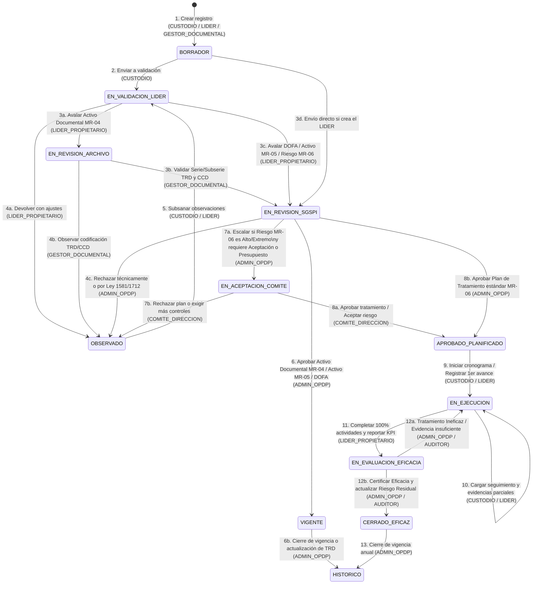

# Especificación de Arquitectura de Software y Análisis de Sistemas: Migración del SGSPI (Universidad Surcolombiana) a Plataforma Web/Móvil

**Organización:** Universidad Surcolombiana (USCO)  
**Sistema Objetivo:** Sistema de Gestión de Seguridad y Privacidad de la Información (SGSPI)  
**Motor de Base de Datos Objetivo:** Microsoft SQL Server 2019 (Compatibilidad 150, Esquema `sgspi` integrado con `dbo` de `academia3000`)  
**Estándar de Nomenclatura de Base de Datos (Convención Institucional USCO):**
1. **Llaves Primarias y Foráneas con sufijo `_codigo`:** Cero uso de `_id`; todas las llaves primarias y foráneas terminan en `_codigo` (ej. `pev_codigo`, `pri_codigo`, `aci_codigo`, `eia_codigo`, `plt_codigo`, `uaa_codigo`, `per_codigo`, `sed_codigo`, `car_codigo`).
2. **Prefijo Acrónimo de 3 Letras por Tabla (`<acr>_`):** Cada tabla posee un acrónimo único de 3 letras y todas sus columnas inician con dicho acrónimo (ej. `aci_nombre_activo`, `aci_valor_confidencialidad`, `eia_fuente_generadora`, `plt_estrategia_tratamiento`).

**Formatos Controlados Integrados (Flujo Secuencial 1 → 5 + Flujo Paralelo `ES-GSPI-MR-04`):**
1. `ES-GSPI-MR-01` — Matriz de Contexto de la Organización (DOFA por Proceso - Ej. Gestión de Tecnologías)
2. `CONSOLIDADO DOFA` — Contexto Consolidado Institucional (`D1..D124`, `F1..F30`, `A1..A101`, `O1..O37`)
3. `ES-GSPI-MR-03` — Matriz de Identificación de Partes Interesadas Pertinentes SGSPI (v4)
4. **`ES-GSPI-MR-04` *(Flujo Paralelo No Secuencial)*** — Matriz de Inventario y Clasificación de Activos de la Información Documental (Versión 1, Vigencia 2025: 194 activos documentales consolidados / 240 asignaciones CCD-TRD en 39 series documentales; Ley 594/2000, Ley 1712/2014, Decreto 103/2015, Decreto 1080/2015, Ley 1581/2012, ISO 27001)
5. `ES-GSPI-MR-05` — Matriz de Inventario y Clasificación de Activos de la Información (511 activos tecnológicos, de proceso, infraestructura y soporte + 17 sistemas de información)
6. `ES-GSPI-MR-06` — Matriz de Riesgos y Oportunidades (Enfoque Basado en Activos), Plan de Tratamiento y Declaración de Aplicabilidad (SoA ISO 27001:2022 / ISO 27701:2025)

---

## Tabla de Contenido
1. [Flujos de Trabajo (Orden Secuencial 1 → 5 + Proceso Paralelo `ES-GSPI-MR-04`)](#1-flujos-de-trabajo-orden-secuencial-1--5--proceso-paralelo-es-gspi-mr-04)
2. [Diccionario de Datos Extraído (Con Acrónimos y `_codigo`)](#2-diccionario-de-datos-extraído-con-acrónimos-y-_codigo)
3. [Entidades Principales y Mapa de Acrónimos (`sgspi` + `dbo`)](#3-entidades-principales-y-mapa-de-acrónimos-sgspi--dbo)
4. [Modelo Entidad-Relación (ER) Normalizado en 3NF](#4-modelo-entidad-relación-er-normalizado-en-3nf)
5. [Campos Calculados en Tiempo de Ejecución (Microsoft SQL Server 2019)](#5-campos-calculados-en-tiempo-de-ejecución-microsoft-sql-server-2019)
6. [Reglas de Negocio y Validaciones](#6-reglas-de-negocio-y-validaciones)
7. [Actores Actuales del Sistema](#7-actores-actuales-del-sistema)
8. [Ciclo de Vida del Registro](#8-ciclo-de-vida-del-registro)
9. [Casos de Uso Principales por Rol (CRUD, Aprobaciones y Reportería)](#9-casos-de-uso-principales-por-rol-crud-aprobaciones-y-reportería)
10. [Máquina de Estados para el Registro Principal](#10-máquina-de-estados-para-el-registro-principal)
11. [Matriz Básica de Permisos (RBAC) y Seguridad](#11-matriz-básica-de-permisos-rbac-y-seguridad)
12. [Script DDL T-SQL de Producción para Microsoft SQL Server 2019](#12-script-ddl-t-sql-de-producción-para-microsoft-sql-server-2019)

---

## 1. Flujos de Trabajo (Orden Secuencial 1 → 5 + Proceso Paralelo `ES-GSPI-MR-04`)

El proceso operativo del SGSPI articula dos flujos convergentes:
- **Flujo Secuencial (Pasos 1 $\rightarrow$ 5):** Contexto DOFA (`ES-GSPI-MR-01` / `Consolidado`) $\rightarrow$ Partes Interesadas (`ES-GSPI-MR-03`) $\rightarrow$ Inventario General de Activos (`ES-GSPI-MR-05`) $\rightarrow$ Riesgos, Tratamiento y SoA (`ES-GSPI-MR-06`).
- **Flujo Paralelo No Secuencial (`ES-GSPI-MR-04`):** El inventario de **Activos de la Información Documental** se alimenta directamente de las **Tablas de Retención Documental (TRD)** y el **Cuadro de Clasificación Documental (CCD)** (Ley 594 de 2000), el **Índice de Información Clasificada y Reservada** (Ley 1712 de 2014 / Decreto 103 de 2015) y el **Registro de Bases de Datos Personales** (Ley 1581 de 2012). Puede actualizarse en cualquier momento del año y se enlaza con `ES-GSPI-MR-05` (`aci_codigo`) y `ES-GSPI-MR-06` (`eia_codigo`).

```mermaid
flowchart LR
    subgraph Fase1["Paso 1 y 2: Contexto Organizacional (ISO 27001 Cl. 4.1)"]
        D1["1. DOFA por Proceso<br/>(ES-GSPI-MR-01)<br/>acf_analisis_contexto_factor"]
        D2["2. Consolidado DOFA<br/>(vw_consolidado_dofa)<br/>D1..D124, F1..F30, A1..A101, O1..O37"]
        D1 -->|"Vista SQL agregada<br/>de los 21 procesos"| D2
    end

    subgraph Fase2["Paso 3: Partes Interesadas (ISO 27001 Cl. 4.2)"]
        D3["3. Matriz Partes Interesadas<br/>(ES-GSPI-MR-03)<br/>41 Partes [pai] / 169 Requisitos [rpi]"]
    end

    subgraph FaseParalela["Flujo Paralelo: Activos Documentales y TRD (Ley 594 / Ley 1712 / Ley 1581)"]
        TRD["Cuadro de Clasificación<br/>Documental CCD / TRD<br/>39 Series [sdo] / Subseries [sbd]<br/>240 Asignaciones [adu] en Unidades [upc]"]
        D4_DOC["4A. Activos Documentales<br/>(ES-GSPI-MR-04 - Paralelo)<br/>194 Activos Documentales [ado]<br/>+ Índice Reserva y PII"]
        TRD -->|"Códigos TRD calculados<br/>cod1..cod4 + COD5 + COD6"| D4_DOC
    end

    subgraph Fase3["Paso 4: Gestión de Activos (ISO 27001 Anexo A: A.5.9 / A.5.12)"]
        D4["4B. Inventario General<br/>de Activos (ES-GSPI-MR-05)<br/>511 Activos [aci] + 17 Sistemas [sif]"]
    end

    subgraph Fase4["Paso 5: Gestión de Riesgos, Tratamiento y SoA (Cl. 6.1 / 8.2 / 8.3)"]
        D5A["5.1 Identificación y Valoración<br/>evento_incertidumbre_activo [eia]<br/>Matriz 5x5 (RA / OA)"]
        D5B["5.2 Plan de Tratamiento<br/>plan_tratamiento [plt] + Actividades [act]<br/>+ Controles [crn]"]
        D5C["5.3 Declaración de Aplicabilidad<br/>evaluacion_aplicabilidad_control [eac]<br/>93 ISO 27001 + 71 ISO 27701"]
        D5A -->|"Escenarios en Zona<br/>Moderada, Alta o Extrema"| D5B
        D5B -->|"Trazabilidad de Controles<br/>y Evidencias"| D5C
    end

    %% Enlaces inter-subgrafos
    D2 -->|"Catálogo Maestro<br/>pri_proceso_institucional"| D3
    D3 -->|"Procesos [pri], UAA [uaa]<br/>y Cargos [car]"| D4
    D3 -.->|"Procesos [adp], UAA y<br/>Propietarios/Custodios [adr]"| D4_DOC
    D4_DOC <-->|"Vínculo opcional aci_codigo<br/>Expedientes y Series Primarias"| D4
    D4 -->|"Activos Primarios y Soporte<br/>+ Valoración CID y PII"| D5A
    D4_DOC -.->|"Insumo de Privacidad (Ley 1581)<br/>e Índice de Reserva (Ley 1712)"| D5A
```



---

## 2. Diccionario de Datos Extraído (Con Acrónimos y `_codigo`)

### 2.1 Mapeo de Columnas Excel $\rightarrow$ Columnas con Acrónimo en SQL Server 2019

#### A. Documentos 1 y 2: `DOFA por Proceso (ES-GSPI-MR-01)` y `CONSOLIDADO DOFA`
| Columna en Excel | Tabla (`[acr]`) y Columna en SQL Server 2019 | Tipo T-SQL | Ejemplo Real del Dataset |
| :--- | :--- | :--- | :--- |
| `VIGENCIA` | `periodo_vigencia.pev_anio` (`pev_codigo`) | `SMALLINT` | `2025` |
| `TIPO DE PROCESO` | `tipo_proceso_catalogo.tpr_nombre` (`tpr_codigo`) | `NVARCHAR(50)` | `ESTRATÉGICO`, `APOYO`, `EVALUACIÓN`, `MISIONAL` |
| `PROCESO` | `proceso_institucional.pri_nombre` (`pri_codigo`) | `NVARCHAR(150)` | `SISTEMA GESTIÓN DE INFORMACION, TECNOLOGÍAS Y CONTROL DOCUMENTAL` |
| `VARIABLE` | `factor_entorno_catalogo.fec_nombre_factor` (`fec_codigo`) | `NVARCHAR(100)` | Interno: `Gobernanza`, `Cultura organizacional` / Externo: `Aspecto Tecnológico`, `Aspecto Normativo` |
| *(Código D1..O37)* | `vw_consolidado_dofa.acf_codigo_autogenerado` | Calculado (`ROW_NUMBER`) | `D1`..`D124`, `F1`..`F30`, `A1`..`A101`, `O1`..`O37` |
| `DEBILIDAD` / `FORTALEZA` / `AMENAZA` / `OPORTUNIDAD` | `analisis_contexto_factor.acf_naturaleza_factor` + `acf_descripcion_situacion` | `NVARCHAR(15)` + `NVARCHAR(MAX)` | `DEBILIDAD`: `"Múltiples equipos de soporte, desarrollo y redes con roles no unificados."` |
| `PRIORIZACIÓN` | `analisis_contexto_factor.acf_nivel_prioridad` | `NVARCHAR(10)` | `Alta`, `Media`, `Baja` |
| `IMPACTO SOBRE EL SGSPI` | `analisis_contexto_factor.acf_impacto_sistema_gestion` | `NVARCHAR(MAX)` | `"Riesgo de brechas de coordinación y duplicidad de controles."` |
| `ACCIÓN SUGERIDA` | `analisis_contexto_factor.acf_accion_propuesta` | `NVARCHAR(MAX)` | `"Definir claramente roles y responsabilidades en seguridad de la información."` |

#### B. Documento 3: `ES-GSPI-MR-03 MATRIZ DE PARTES INTERESADAS SGSPI v4`
| Columna en Excel | Tabla (`[acr]`) y Columna en SQL Server 2019 | Tipo T-SQL | Ejemplo Real del Dataset |
| :--- | :--- | :--- | :--- |
| `PARTES INTERESADAS` | `parte_interesada.pai_nombre` (`pai_codigo`) | `NVARCHAR(150)` | `Consejo Superior`, `Estudiantes`, `Ministerio de Educación Nacional- MEN`, `Hackers individuales` |
| `CATEGORIA DE LAS PARTES INTERESADAS` | `parte_interesada.pai_origen` | `NVARCHAR(15)` | `Interna`, `Externa` |
| `PREG.` | `requisito_parte_interesada.rpi_referencia_cuestionario` | `NVARCHAR(30)` | `6-7-8`, `N/A` |
| `INTERÉS (REQUISITOS) NECESIDADES Y EXPECTATIVAS` | `requisito_parte_interesada.rpi_necesidad_expectativa` | `NVARCHAR(MAX)` | `"Garantizar la confidencialidad e integridad de la información contenida en los audios..."` |
| `PODER` / `INTERÉS` | `requisito_parte_interesada.rpi_nivel_poder`, `rpi_nivel_interes` | `NVARCHAR(10)` | `Alto` \| `Medio` \| `Bajo` |
| `CLASIFICACIÓN SEGÚN EL IMPACTO` | `requisito_parte_interesada.rpi_clasificacion_impacto` | Columna Calculada `AS (...)` | `CUIDADO "Tratar como requisito legal y otros requisitos"` |
| `ESTADO DE CUMPLIMIENTO` | `requisito_parte_interesada.rpi_nivel_cumplimiento` | `NVARCHAR(10)` | `Alto`, `Medio`, `Bajo` |
| `PRIORIDAD PARA LA TOMA DE ACCIONES` | `requisito_parte_interesada.rpi_prioridad_accion` | Columna Calculada `AS (...)` | `Prioridad alta`, `Prioridad media`, `Prioridad baja` |
| `HERRAMIENTA DE SEGUIMIENTO` | `requisito_parte_interesada.rpi_mecanismo_seguimiento` | `NVARCHAR(255)` | `Capacitaciones y SIAC`, `Uso de Plataformas del MEN` |
| `AFECTACIÓN A PROCESOS` *(21 columnas)* | `requisito_parte_interesada_proceso_institucional (rpp_codigo, rpi_codigo, pri_codigo)` | Tabla Puente N:M | Asocia cada requisito `rpi_codigo` con los procesos `pri_codigo` impactados |

#### C1. Documento Paralelo 4A: `ES-GSPI-MR-04 MATRIZ DE INVENTARIO Y CLASIFICACIÓN DE ACTIVOS DE LA INFORMACIÓN DOCUMENTAL (Versión 1 - Vigencia 2025)`
- **Volumen y Frecuencia Analizados:**
  - **Bloque 1 (Matriz Consolidada):** **194 activos documentales consolidados** (`ID = 1..194`) estructurados en **39 columnas** y **4 secciones normativas**: *(1) Identificación del Activo (Ley 594/2000, Ley 1712/2014, Decreto 103/2015, Decreto 1080/2015, ISO 27001)*, *(2) Clasificación del Activo (ISO 27001)*, *(3) Datos Personales (Ley 1581 de 2012)* y *(4) Índice de Información Clasificada y Reservada (Decreto 103 de 2015)*.
  - **Bloque 2 (Catálogos Desplegables):** **18 listas de validación** (`Periodicidad`, `Soporte de registro`, `Medio de conservación`, `Tipo`, `Idioma`, `Confidencialidad/C`, `Integridad/I`, `Disponibilidad/D`, `Información publicada`, `Contiene datos personales`, `Tipos de datos personales`, `Autorización PII`, `Objeto legítimo de excepción`, `Fundamento constitucional/jurídico`, `Excepción total o parcial` y 3 umbrales ICC).
  - **Bloque 3 (Desglose Jerárquico CCD / TRD):** **240 filas de asignación archivística** (`XX = 1..240`) distribuidas en **39 Series Documentales únicas (`COD5 = 1..39`)** y sus Subseries (`COD6`) a través de 4 niveles organizacionales (`cod1/seccion` $\rightarrow$ `cod2/subseccion` $\rightarrow$ `cod3/subseccion N1` $\rightarrow$ `cod4/subseccion N2`).
  - **Anomalía Crítica Detectada en la Hoja de Cálculo:** En 191 de los 194 registros donde la etiqueta `Disponibilidad` es `Alto`, la columna numérica `D` fue digitada erróneamente como `1` en lugar de `3` (solo las filas 34, 35 y 36 tienen `D = 3`), sesgando la columna `Criticidad del activo` a `MEDIA` en las 194 filas. Al almacenar únicamente el entero `1..3` y proyectar las etiquetas y la criticidad mediante columnas calculadas `PERSISTED`, esta inconsistencia se elimina de raíz.

| Columna en Excel (`ES-GSPI-MR-04`) | Tabla (`[acr]`) y Columna en SQL Server 2019 | Tipo T-SQL | Ejemplo Real del Dataset / Catálogo |
| :--- | :--- | :--- | :--- |
| `ID` | `activo_documental.ado_codigo` | `INT IDENTITY` | `1` a `194` |
| `XX` *(Bloque 3 Desglose TRD)* | `activo_documental_unidad_productora.adu_codigo` | `INT IDENTITY` | `1` a `240` |
| `cod1` / `seccion` .. `cod4` / `subseccion N2` | `unidad_productora_cuadro_clasificacion_documental (upc_codigo, upc_codigo_padre, uaa_codigo, upc_nivel_jerarquico, upc_prefijo_archivistico, upc_nombre_unidad)` | `INT` + `NVARCHAR(20)` | `1=RECTORIA` $\rightarrow$ `1.1=SECRETARIA GENERAL` $\rightarrow$ `1.1.1=AREA GESTION DOCUMENTAL` / `5.1.1.2=SECRETARIA ACADEMICA` |
| `COD5` / `SERIE` | `serie_documental_catalogo (sdo_codigo, sdo_numero_ccd, sdo_nombre_serie, sdo_tiene_subseries)` | `SMALLINT` + `NVARCHAR(150)` | `1=ACCIONES CONSTITUCIONALES`, `3=ACTAS`, `4=ACUERDOS`, ..., `39=RESOLUCIONES` (39 series) |
| `COD6` / `SUBSERIE` | `subserie_documental_catalogo (sbd_codigo, sdo_codigo, sbd_numero_ccd, sbd_nombre_subserie)` | `INT` + `NVARCHAR(200)` | `1=ACTAS DE COMITÉ DE CONCILIACIÓN Y DEFENSA JUDICIAL`, `NULL` en series sin subserie (`RESOLUCIONES`, `NÓMINAS`) |
| `Serie documental` / `Subserie documental` | Calculado en `vw_desglose_ccd_trd_mr04` y `vw_inventario_activo_documental_mr04` (`STRING_AGG`) | Calculado en Tiempo de Ejecución | `<upc_prefijo_archivistico>.<sdo_numero_ccd>.<sbd_numero_ccd>` (ej. `1.1.1.21.20`, o multivaluado en filas transversales) |
| `NOMBRE` / `Descripción` | `activo_documental.ado_nombre_activo` + `ado_descripcion` | `NVARCHAR(255)` + `NVARCHAR(MAX)` | `HISTORIAS LABORALES`: `"Acto administrativo de nombramiento, Posesión, Certificados..."` |
| `Proceso` *(Multivaluado en Excel)* | `activo_documental_proceso_institucional (adp_codigo, ado_codigo, pri_codigo)` | Tabla Puente N:M | Desnormalizado en Excel con comas; normalizado en 3NF hacia `sgspi.proceso_institucional` |
| `Dependencia / Oficina` + `Propietario del activo` + `Custodio del activo` | `activo_documental_responsable (adr_codigo, ado_codigo, car_codigo, uaa_codigo, uac_codigo, uap_codigo, adr_tipo_responsabilidad, adr_esta_activo)` | Tabla Puente N:M | `PROPIETARIO`: `Rector`, `Secretario General`, `Decano` \| `CUSTODIO`: `Profesional de Gestión`, `Secretaria Ejecutiva` |
| `Tipo` | `activo_documental.ado_tipo_activo_documental` | `NVARCHAR(80)` | `Informacion y datos de la Universidad`, `Sistemas de información y aplicaciones de Software`, `Servicios` |
| `Periodicidad de generación` | `activo_documental.ado_periodicidad_generacion` | `NVARCHAR(30)` | `A solicitud`, `Diaria`, `Semanal`, `Mensual`, `Bimensual`, `Trimestral`, `Cuatrimestral`, `Semestral`, `Anual`, `Eventual` |
| `Soporte de registro` / `Medio de conservación` | `ado_soporte_registro` / `ado_medio_conservacion` | `NVARCHAR(20)` / `NVARCHAR(25)` | Soporte: `Físico`, `Digital`, `Físico/Digital` \| Medio: `Físico`, `Electrónico`, `Físico/Electrónico` |
| `Formato` / `Idioma` | `ado_formato_documental` / `ado_idioma` | `NVARCHAR(100)` / `NVARCHAR(30)` | `Documento de texto` \| `Español`, `Ingles`, `Español/Ingles`, `Frances` |
| `Fecha de ingreso a la TRD` / `al archivo` | `ado_fecha_ingreso_tabla_retencion` / `ado_fecha_ingreso_archivo` | `DATE NULL` | `NULL` (cuando en Excel es `No Aplica`) o fecha `YYYY-MM-DD` |
| `C` / `I` / `D` *(1..3)* y etiquetas de texto | `ado_valor_confidencialidad`, `ado_valor_integridad`, `ado_valor_disponibilidad` + calculadas `ado_nivel_*` | `TINYINT (1..3)` + Calculadas `AS (...)` | `3 = Pública Reservada / Confidencial =Alta`, `2 = Clasificada / Uso Interno = Medio`, `1 = Información Pública / Pública =Bajo` |
| `Criticidad del activo` | `ado_puntaje_criticidad` + `ado_nivel_criticidad` | Columnas Calculadas `PERSISTED` | Suma `3..9`: `>= 7 ALTA`, `5..6 MEDIA`, `3..4 BAJA` |
| `Información publicada` / `Lugar de consulta o ubicación` | `ado_estado_publicacion` + `ado_lugar_consulta_ubicacion` | `NVARCHAR(40)` + `NVARCHAR(255)` | `Publicada ( Externo - Internet)` (`https://www.usco.edu.co/es/transparencia/`), `Publicada ( Interno - Intranet)`, `No publicada` |
| `¿Contiene datos personales?` / `¿de niños, niñas o adolescentes?` | `ado_contiene_datos_personales` / `ado_contiene_datos_menores` | `NVARCHAR(15)` | `Si`, `No`, `No Aplica` |
| `Tipos de datos personales` / `Finalidad` / `Autorización` | `ado_tipo_dato_personal`, `ado_finalidad_recoleccion_pii`, `ado_existe_autorizacion_pii` | `NVARCHAR(40)` / `NVARCHAR(500)` / `NVARCHAR(15)` | `Dato personal privado`, `Dato personal público`, `Dato semiprivado`, `Dato sensible`, `No Aplica` |
| `Objeto legítimo` / `Fundamento constitucional` / `Fundamento jurídico` / `Excepción total o parcial` / `Fecha` / `Tiempo` | `cet_codigo`, `ado_objeto_legitimo_excepcion`, `ado_fundamento_constitucional_legal`, `ado_fundamento_juridico_excepcion`, `ado_alcance_reserva`, `ado_fecha_clasificacion_reserva`, `ado_tiempo_clasificacion_reserva` | `SMALLINT` + `NVARCHAR` + `DATE NULL` | `Ley 1712 de 2014` \| `Reserva total`, `Reserva parcial`, `Sin reserva`, `No Aplica` \| `Indefinida` |

#### C2. Documento 4B: `ES-GSPI-MR-05 MATRIZ DE INVENTARIO Y CLASIFICACIÓN DE ACTIVOS`
| Columna en Excel | Tabla (`[acr]`) y Columna en SQL Server 2019 | Tipo T-SQL | Ejemplo Real del Dataset |
| :--- | :--- | :--- | :--- |
| `ID ACTIVO INFORMACION` | `activo_informacion.aci_codigo` + `aci_codigo_inventario` | `INT IDENTITY` + `NVARCHAR(30)` | `1` a `511` |
| `Nombre del Activo de Información` | `activo_informacion.aci_nombre_activo` | `NVARCHAR(255)` | `Sistema Financiero (Linix)`, `BD Académica3000`, `Historias Laborales` |
| `Tipo` / `Clase` / `Descripción del Activo` | `tipo_activo_catalogo (tac_codigo, tac_categoria_iso27005, tac_tipo_activo, tac_subtipo_activo)` | `SMALLINT (FK)` | `Primario` $\rightarrow$ `Información` $\rightarrow$ `Aplicaciones Estandar del Negocio` |
| `Proceso al que pertenece` | `activo_informacion_proceso_institucional (aip_codigo, aci_codigo, pri_codigo)` | Tabla Puente N:M | `FORMACIÓN`, `GESTIÓN FINANCIERA Y DE RECURSOS FÍSICOS` |
| `Dependencia` | `activo_informacion.uaa_codigo` $\rightarrow$ `dbo.uaa (uaa_codigo)` | `INT (FK a dbo.uaa)` | `Oficina Asesora Jurídica`, `Centro de Información, Tecnología y Control documental` |
| `Sede` | `activo_informacion_sede (ais_codigo, aci_codigo, sed_codigo, sus_codigo)` $\rightarrow$ `dbo.sede` / `dbo.sub_sede` | Tabla Puente N:M | `Sede Central`, `Sede Postgrados`, `Todas las sedes` |
| `Propietario del Activo` / `Custodio del Activo` | `activo_informacion_responsable (air_codigo, aci_codigo, car_codigo, uaa_codigo, uac_codigo, uap_codigo, air_tipo_responsabilidad)` | Tabla Puente N:M | `PROPIETARIO`: `Vicerrector Académico` \| `CUSTODIO`: `Director Registro y Control` |
| `Tipo de Información Ley 1712 de 2014` | `activo_informacion.aci_clasificacion_transparencia` | `NVARCHAR(20)` | `PÚBLICA`, `CLASIFICADA`, `RESERVADA`, `NO CLASIFICADA` |
| `¿Contiene datos personales (Ley 1581)?` | `activo_informacion.aci_contiene_datos_personales` | `BIT` | `1 (SI)`, `0 (NO)` |
| `Confidencialidad` / `Integridad` / `Disponibilidad` | `aci_valor_confidencialidad`, `aci_valor_integridad`, `aci_valor_disponibilidad` | `TINYINT (3, 2, 1)` | `3 (Alta)`, `2 (Media)`, `1 (Baja)` |
| `calculo criticidad` / `Criticidad` | `aci_puntaje_criticidad` y `aci_nivel_criticidad` | Columnas Calculadas `PERSISTED` | `9` $\rightarrow$ `Alta` \| `6` $\rightarrow$ `Media` \| `3` $\rightarrow$ `Baja` |
| `IMPACTO SOCIAL` / `ECONÓMICO` / `AMBIENTAL` (ICC) | `aci_supera_umbral_social_icc`, `aci_supera_umbral_economico_icc`, `aci_supera_umbral_ambiental_icc` | `BIT` | `0 (NO)` / `1 (SI)` $\rightarrow$ calcula `aci_es_infraestructura_critica_icc` |

#### D. Documento 5: `ES-GSPI-MR-06 RIESGOS, TRATAMIENTO Y SOA (ISO 27001 / 27701)`
| Sub-Matriz | Tabla (`[acr]`) en SQL Server 2019 | Columnas Clave con Acrónimo y `_codigo` |
| :--- | :--- | :--- |
| **5.1 Identificación y Valoración** | `sgspi.evento_incertidumbre_activo` (`[eia]`) | `eia_codigo`, `pev_codigo`, `eia_identificador_evento` (`RA-01..15`, `OA-01..09`), `eia_naturaleza_evento`, `pri_codigo`, `eia_aci_codigo_primario`, `eia_aci_codigo_soporte`, `eia_tipo_componente_afectado`, `eia_fuente_generadora`, `eia_controles_existentes`, `eia_condicion_vulnerabilidad`, `eia_efecto_consecuencia`, `eia_escenario_operacional`, `eia_epr_codigo_inherente`, `eia_eim_codigo_inherente`, `eia_estado_registro`. |
| **5.2 Plan de Tratamiento** | `sgspi.plan_tratamiento` (`[plt]`) + `sgspi.actividad_tratamiento` (`[act]`) + `sgspi.seguimiento_actividad` (`[sga]`) | `plt_codigo`, `eia_codigo`, `plt_estrategia_tratamiento`, `plt_justificacion_estrategia`, `plt_epr_codigo_residual_meta`, `plt_eim_codigo_residual_meta`, `plt_fecha_inicio`, `plt_fecha_fin`, `plt_recursos_humanos_tecnicos`, `plt_recursos_economicos_desc`, `plt_presupuesto_estimado_cop`, `plt_restricciones_limitaciones`, `plt_nombre_indicador_kpi`, `plt_es_tratamiento_eficaz`, `act_codigo`, `sga_codigo`. |
| **5.3 Controles y SoA ISO 27001 / 27701** | `sgspi.control_referencia_normativa` (`[crn]`) + `sgspi.plan_tratamiento_control_referencia_normativa` (`[ptc]`) + `sgspi.evaluacion_aplicabilidad_control` (`[eac]`) | `crn_codigo`, `crn_estandar_normativo`, `crn_rol_privacidad_pii`, `crn_identificador_control`, `crn_nombre_control`, `crn_objetivo_requisito`, `ptc_codigo`, `eac_codigo`, `eac_es_aplicable`, `eac_justificacion_aplicabilidad`, `eac_documento_soporte_normativo`, `car_codigo`, `eac_frecuencia_revision`, `eac_evidencia_objetiva_esperada`, `eac_estado_implementacion`. |

---

## 3. Entidades Principales y Mapa de Acrónimos (`sgspi` + `dbo`)

### 3.1 Tablas Maestras Reutilizadas del Esquema Corporativo `[dbo]` (`academia3000`)
| Acrónimo | Tabla en `[dbo]` | Llave Primaria | Rol en el SGSPI |
| :---: | :--- | :--- | :--- |
| **`sed`** | `dbo.sede` | `sed_codigo` (`INT`) | Sedes principales de la USCO (Neiva, Pitalito, Garzón, La Plata). |
| **`sus`** | `dbo.sub_sede` | `sus_codigo` (`INT`) | Campus físicos (Sede Central, Sede Postgrados, Sede Salud/Quirinal). |
| **`esp`** | `dbo.espacio` | `esp_codigo` (`INT`) | Espacios físicos, centros de cómputo, cuartos de cableado y oficinas. |
| **`uaa`** | `dbo.uaa` | `uaa_codigo` (`INT`) | Unidades Académico-Administrativas (Facultades, Oficinas, Vicerrectorías, Centros). |
| **`car`** | `dbo.cargo` | `car_codigo` (`INT`) | Catálogo oficial de cargos institucionales (Propietarios, Custodios, Líderes). |
| **`uac`** | `dbo.uaa_cargo` | `uac_codigo` (`INT`) | Planta de cargos asignados a cada UAA. |
| **`uap`** | `dbo.uaa_personal` | `uap_codigo` (`INT`) | Vinculación activa del funcionario/contratista en una UAA y cargo. |
| **`per`** | `dbo.persona` | `per_codigo` (`INT`) | Maestro único de personas (Funcionarios, Docentes, Contratistas). |
| **`gru`** | `dbo.grupo` | `gru_codigo` (`INT`) | Grupos/Roles de seguridad RBAC institucionales. |
| **`usg`** | `dbo.usuario_grupo` | `usg_codigo` (`INT`) | Asignación de usuarios a grupos RBAC por UAA (Row-Level Security). |

### 3.2 Mapa de las 36 Tablas Propias del Esquema `[sgspi]` y sus Acrónimos
| # | Acrónimo | Tabla en `[sgspi]` | Llave Primaria | Prefijo de Columnas |
| :-: | :---: | :--- | :--- | :--- |
| 1 | **`pev`** | `sgspi.periodo_vigencia` | `pev_codigo` | `pev_anio`, `pev_fecha_apertura`, `pev_estado_vigencia`... |
| 2 | **`fdv`** | `sgspi.formato_documental_version` | `fdv_codigo` | `fdv_dominio_funcional`, `fdv_codigo_formato`, `fdv_numero_version`... |
| 3 | **`tpr`** | `sgspi.tipo_proceso_catalogo` | `tpr_codigo` | `tpr_identificador`, `tpr_nombre`, `tpr_descripcion` |
| 4 | **`pri`** | `sgspi.proceso_institucional` | `pri_codigo` | `pri_identificador`, `pri_nombre`, `pri_uaa_codigo_lider`... |
| 5 | **`piu`** | `sgspi.proceso_institucional_uaa` | `piu_codigo` | `pri_codigo`, `uaa_codigo`, `piu_es_responsable_principal` |
| 6 | **`fec`** | `sgspi.factor_entorno_catalogo` | `fec_codigo` | `fec_nombre_factor`, `fec_ambito_entorno`, `fec_descripcion` |
| 7 | **`acf`** | `sgspi.analisis_contexto_factor` | `acf_codigo` | `acf_ambito_entorno`, `acf_naturaleza_factor`, `acf_nivel_prioridad`... |
| 8 | **`pai`** | `sgspi.parte_interesada` | `pai_codigo` | `pai_nombre`, `pai_origen`, `pai_descripcion_rol`, `pai_esta_activa` |
| 9 | **`rpi`** | `sgspi.requisito_parte_interesada` | `rpi_codigo` | `rpi_necesidad_expectativa`, `rpi_nivel_poder`, `rpi_nivel_interes`... |
| 10 | **`rpp`** | `sgspi.requisito_parte_interesada_proceso_institucional` | `rpp_codigo` | `rpi_codigo`, `pri_codigo`, `rpp_fecha_registro` |
| 11 | **`tac`** | `sgspi.tipo_activo_catalogo` | `tac_codigo` | `tac_categoria_iso27005`, `tac_tipo_activo`, `tac_subtipo_activo` |
| 12 | **`cet`** | `sgspi.causal_excepcion_transparencia`| `cet_codigo` | `cet_nivel_reserva_aplicable`, `cet_numeral_causal`, `cet_descripcion_causal` |
| 13 | **`aci`** | `sgspi.activo_informacion` | `aci_codigo` | `aci_nombre_activo`, `aci_valor_confidencialidad`, `aci_puntaje_criticidad`... |
| 14 | **`aip`** | `sgspi.activo_informacion_proceso_institucional` | `aip_codigo` | `aci_codigo`, `pri_codigo` |
| 15 | **`ais`** | `sgspi.activo_informacion_sede` | `ais_codigo` | `aci_codigo`, `sed_codigo`, `sus_codigo` |
| 16 | **`air`** | `sgspi.activo_informacion_responsable` | `air_codigo` | `aci_codigo`, `car_codigo`, `uaa_codigo`, `uac_codigo`, `uap_codigo`, `air_tipo_responsabilidad`, `air_esta_activo` |
| 17 | **`sif`** | `sgspi.sistema_informacion_ficha` | `sif_codigo` | `sif_nombre_sistema`, `sif_modalidad_desarrollo`, `sif_fabricante_proveedor` |
| 18 | **`msi`** | `sgspi.modulo_sistema_informacion` | `msi_codigo` | `sif_codigo`, `msi_nombre_modulo`, `msi_usuarios_objetivo` |
| 19 | **`sdo`** | `sgspi.serie_documental_catalogo` | `sdo_codigo` | `sdo_numero_ccd` (`COD5`), `sdo_nombre_serie`, `sdo_tiene_subseries`, `sdo_esta_activa` |
| 20 | **`sbd`** | `sgspi.subserie_documental_catalogo` | `sbd_codigo` | `sdo_codigo`, `sbd_numero_ccd` (`COD6`), `sbd_nombre_subserie`, `sbd_esta_activa` |
| 21 | **`upc`** | `sgspi.unidad_productora_cuadro_clasificacion_documental` | `upc_codigo` | `upc_codigo_padre`, `uaa_codigo`, `upc_nivel_jerarquico`, `upc_prefijo_archivistico`, `upc_nombre_unidad` |
| 22 | **`ado`** | `sgspi.activo_documental` | `ado_codigo` | `ado_nombre_activo`, `ado_periodicidad_generacion`, `ado_fecha_ingreso_tabla_retencion`, `ado_valor_confidencialidad`, `ado_alcance_reserva`... |
| 23 | **`adu`** | `sgspi.activo_documental_unidad_productora` | `adu_codigo` | `ado_codigo`, `upc_codigo`, `adu_esta_activo` |
| 24 | **`adp`** | `sgspi.activo_documental_proceso_institucional` | `adp_codigo` | `ado_codigo`, `pri_codigo` |
| 25 | **`adr`** | `sgspi.activo_documental_responsable` | `adr_codigo` | `ado_codigo`, `car_codigo`, `uaa_codigo`, `uac_codigo`, `uap_codigo`, `adr_tipo_responsabilidad`, `adr_esta_activo` |
| 26 | **`epr`** | `sgspi.escala_probabilidad` | `epr_codigo` | `epr_codigo_letra`, `epr_nombre_nivel`, `epr_frecuencia_referencia` |
| 27 | **`eim`** | `sgspi.escala_impacto` | `eim_codigo` | `eim_nombre_impacto_negativo`, `eim_nombre_impacto_positivo` |
| 28 | **`mvr`** | `sgspi.matriz_valoracion_riesgo` | `(epr_codigo, eim_codigo)` | `mvr_codigo_posicion`, `mvr_codigo_zona`, `mvr_nivel_valoracion` |
| 29 | **`eia`** | `sgspi.evento_incertidumbre_activo` | `eia_codigo` | `eia_identificador_evento`, `eia_naturaleza_evento`, `eia_fuente_generadora`... |
| 30 | **`plt`** | `sgspi.plan_tratamiento` | `plt_codigo` | `plt_estrategia_tratamiento`, `plt_fecha_inicio`, `plt_fecha_fin`... |
| 31 | **`act`** / **`sga`**| `actividad_tratamiento` / `seguimiento_actividad` | `act_codigo` / `sga_codigo` | `act_descripcion_actividad`, `act_porcentaje_avance` / `sga_descripcion_avance`... |
| 32 | **`crn`** / **`ptc`** / **`eac`** / **`bas`** | `control_referencia_normativa`, `plan_tratamiento_control_referencia_normativa`, `evaluacion_aplicabilidad_control`, `bitacora_auditoria_sistema` | `crn_codigo`, `ptc_codigo`, `eac_codigo`, `bas_codigo` | `crn_identificador_control`, `eac_estado_implementacion`, `bas_accion_ejecutada`... |

---

## 4. Modelo Entidad-Relación (ER) Normalizado en 3NF

```mermaid
erDiagram
    TIPO_PROCESO_CATALOGO ||--o{ PROCESO_INSTITUCIONAL : "tpr_codigo"
    DBO_CARGO ||--o{ PROCESO_INSTITUCIONAL : "pri_car_codigo_lider"
    DBO_UAA ||--o{ PROCESO_INSTITUCIONAL : "pri_uaa_codigo_lider"
    PROCESO_INSTITUCIONAL ||--o{ PROCESO_INSTITUCIONAL_UAA : "pri_codigo"
    DBO_UAA ||--o{ PROCESO_INSTITUCIONAL_UAA : "uaa_codigo"
    DBO_SEDE ||--o{ DBO_SUB_SEDE : "sed_codigo"
    DBO_SEDE ||--o{ DBO_UAA : "sed_codigo"

    PERIODO_VIGENCIA ||--o{ FORMATO_DOCUMENTAL_VERSION : "pev_codigo"
    PERIODO_VIGENCIA ||--o{ ANALISIS_CONTEXTO_FACTOR : "pev_codigo"
    PROCESO_INSTITUCIONAL ||--o{ ANALISIS_CONTEXTO_FACTOR : "pri_codigo"
    FACTOR_ENTORNO_CATALOGO ||--o{ ANALISIS_CONTEXTO_FACTOR : "fec_codigo"
    DBO_PERSONA ||--o{ ANALISIS_CONTEXTO_FACTOR : "acf_per_codigo_creador"

    PARTE_INTERESADA ||--o{ REQUISITO_PARTE_INTERESADA : "pai_codigo"
    PERIODO_VIGENCIA ||--o{ REQUISITO_PARTE_INTERESADA : "pev_codigo"
    REQUISITO_PARTE_INTERESADA ||--o{ REQUISITO_PARTE_INTERESADA_PROCESO_INSTITUCIONAL : "rpi_codigo"
    PROCESO_INSTITUCIONAL ||--o{ REQUISITO_PARTE_INTERESADA_PROCESO_INSTITUCIONAL : "pri_codigo"

    SERIE_DOCUMENTAL_CATALOGO ||--o{ SUBSERIE_DOCUMENTAL_CATALOGO : "sdo_codigo"
    UNIDAD_PRODUCTORA_CUADRO_CLASIFICACION_DOCUMENTAL ||--o{ UNIDAD_PRODUCTORA_CUADRO_CLASIFICACION_DOCUMENTAL : "upc_codigo_padre"
    DBO_UAA ||--o{ UNIDAD_PRODUCTORA_CUADRO_CLASIFICACION_DOCUMENTAL : "uaa_codigo"
    PERIODO_VIGENCIA ||--o{ ACTIVO_DOCUMENTAL : "pev_codigo"
    SERIE_DOCUMENTAL_CATALOGO ||--o{ ACTIVO_DOCUMENTAL : "sdo_codigo"
    SUBSERIE_DOCUMENTAL_CATALOGO ||--o{ ACTIVO_DOCUMENTAL : "sbd_codigo"
    CAUSAL_EXCEPCION_TRANSPARENCIA ||--o{ ACTIVO_DOCUMENTAL : "cet_codigo"
    ACTIVO_INFORMACION ||--o{ ACTIVO_DOCUMENTAL : "aci_codigo"
    ACTIVO_DOCUMENTAL ||--o{ ACTIVO_DOCUMENTAL_UNIDAD_PRODUCTORA : "ado_codigo"
    UNIDAD_PRODUCTORA_CUADRO_CLASIFICACION_DOCUMENTAL ||--o{ ACTIVO_DOCUMENTAL_UNIDAD_PRODUCTORA : "upc_codigo"
    ACTIVO_DOCUMENTAL ||--o{ ACTIVO_DOCUMENTAL_PROCESO_INSTITUCIONAL : "ado_codigo"
    PROCESO_INSTITUCIONAL ||--o{ ACTIVO_DOCUMENTAL_PROCESO_INSTITUCIONAL : "pri_codigo"
    ACTIVO_DOCUMENTAL ||--o{ ACTIVO_DOCUMENTAL_RESPONSABLE : "ado_codigo"
    DBO_CARGO ||--o{ ACTIVO_DOCUMENTAL_RESPONSABLE : "car_codigo"
    DBO_UAA ||--o{ ACTIVO_DOCUMENTAL_RESPONSABLE : "uaa_codigo"

    TIPO_ACTIVO_CATALOGO ||--o{ ACTIVO_INFORMACION : "tac_codigo"
    CAUSAL_EXCEPCION_TRANSPARENCIA ||--o{ ACTIVO_INFORMACION : "cet_codigo"
    DBO_UAA ||--o{ ACTIVO_INFORMACION : "uaa_codigo"
    DBO_ESPACIO ||--o{ ACTIVO_INFORMACION : "esp_codigo"
    ACTIVO_INFORMACION ||--o{ ACTIVO_INFORMACION_PROCESO_INSTITUCIONAL : "aci_codigo"
    PROCESO_INSTITUCIONAL ||--o{ ACTIVO_INFORMACION_PROCESO_INSTITUCIONAL : "pri_codigo"
    ACTIVO_INFORMACION ||--o{ ACTIVO_INFORMACION_SEDE : "aci_codigo"
    DBO_SEDE ||--o{ ACTIVO_INFORMACION_SEDE : "sed_codigo"
    DBO_SUB_SEDE ||--o{ ACTIVO_INFORMACION_SEDE : "sus_codigo"
    ACTIVO_INFORMACION ||--o{ ACTIVO_INFORMACION_RESPONSABLE : "aci_codigo"
    DBO_CARGO ||--o{ ACTIVO_INFORMACION_RESPONSABLE : "car_codigo"
    ACTIVO_INFORMACION ||--o| SISTEMA_INFORMACION_FICHA : "aci_codigo"
    SISTEMA_INFORMACION_FICHA ||--o{ MODULO_SISTEMA_INFORMACION : "sif_codigo"

    PERIODO_VIGENCIA ||--o{ EVENTO_INCERTIDUMBRE_ACTIVO : "pev_codigo"
    PROCESO_INSTITUCIONAL ||--o{ EVENTO_INCERTIDUMBRE_ACTIVO : "pri_codigo"
    ACTIVO_INFORMACION ||--o{ EVENTO_INCERTIDUMBRE_ACTIVO : "eia_aci_codigo_primario"
    ACTIVO_INFORMACION ||--o{ EVENTO_INCERTIDUMBRE_ACTIVO : "eia_aci_codigo_soporte"
    MATRIZ_VALORACION_RIESGO ||--o{ EVENTO_INCERTIDUMBRE_ACTIVO : "eia_epr_eim_inherente"
    DBO_PERSONA ||--o{ EVENTO_INCERTIDUMBRE_ACTIVO : "eia_per_codigo_creador"

    EVENTO_INCERTIDUMBRE_ACTIVO ||--|| PLAN_TRATAMIENTO : "eia_codigo"
    MATRIZ_VALORACION_RIESGO ||--o{ PLAN_TRATAMIENTO : "plt_epr_eim_residual_meta"
    PLAN_TRATAMIENTO ||--o{ ACTIVIDAD_TRATAMIENTO : "plt_codigo"
    DBO_CARGO ||--o{ ACTIVIDAD_TRATAMIENTO : "car_codigo"
    ACTIVIDAD_TRATAMIENTO ||--o{ SEGUIMIENTO_ACTIVIDAD : "act_codigo"
    DBO_PERSONA ||--o{ SEGUIMIENTO_ACTIVIDAD : "per_codigo"
    PLAN_TRATAMIENTO ||--o{ PLAN_TRATAMIENTO_CONTROL_REFERENCIA_NORMATIVA : "plt_codigo"
    CONTROL_REFERENCIA_NORMATIVA ||--o{ PLAN_TRATAMIENTO_CONTROL_REFERENCIA_NORMATIVA : "crn_codigo"

    PERIODO_VIGENCIA ||--o{ EVALUACION_APLICABILIDAD_CONTROL : "pev_codigo"
    CONTROL_REFERENCIA_NORMATIVA ||--o{ EVALUACION_APLICABILIDAD_CONTROL : "crn_codigo"
    DBO_PERSONA ||--o{ BITACORA_AUDITORIA_SISTEMA : "per_codigo"
    DBO_GRUPO ||--o{ BITACORA_AUDITORIA_SISTEMA : "gru_codigo"
```



---

## 5. Campos Calculados en Tiempo de Ejecución (Microsoft SQL Server 2019)

| # | Documento | Campo Calculado con Acrónimo | Implementación Nativa en SQL Server 2019 |
| :-: | :--- | :--- | :--- |
| **1** | **Doc 2** (`Consolidado DOFA`) | `acf_codigo_autogenerado` (`D1..D124`, `F1..F30`, `A1..A101`, `O1..O37`) | Vista **`sgspi.vw_consolidado_dofa`** usando `CONCAT(LEFT(acf_naturaleza_factor, 1), ROW_NUMBER() OVER (PARTITION BY pev_codigo, acf_naturaleza_factor ORDER BY tpr_codigo, pri_codigo, acf_codigo))`. |
| **2** | **Doc 3** (`ES-GSPI-MR-03`) | `rpi_clasificacion_impacto` y `rpi_prioridad_accion` | **Columnas calculadas nativas** en `sgspi.requisito_parte_interesada` mediante expresiones `CASE WHEN` sobre `(rpi_nivel_poder, rpi_nivel_interes)` y `rpi_nivel_cumplimiento`. |
| **3** | **Doc 4A** (`ES-GSPI-MR-04`) | `adu_codigo_serie_trd_calculado` y `adu_codigo_subserie_trd_calculado` (`Serie documental` y `Subserie documental`) | Vista **`sgspi.vw_desglose_ccd_trd_mr04`** que concatena dinámicamente el prefijo jerárquico de la unidad productora (`upc_prefijo_archivistico` de niveles `cod1..cod4`) con `sdo_numero_ccd` (`COD5`) y `sbd_numero_ccd` (`COD6`): `CONCAT(upc_prefijo_archivistico, '.', sdo_numero_ccd, '.', sbd_numero_ccd)`. |
| **4** | **Doc 4A** (`ES-GSPI-MR-04`) | `ado_nivel_confidencialidad`, `ado_nivel_integridad`, `ado_nivel_disponibilidad`, `ado_puntaje_criticidad` (`3..9`) y `ado_nivel_criticidad` (`ALTA`, `MEDIA`, `BAJA`) | **Columnas calculadas `PERSISTED`** en `sgspi.activo_documental` a partir de los enteros `ado_valor_confidencialidad`, `ado_valor_integridad` y `ado_valor_disponibilidad` (`1..3`), corrigiendo definitivamente el error de digitación `Disponibilidad = Alto -> D = 1` de la hoja de cálculo. |
| **5** | **Doc 4A** (`ES-GSPI-MR-04`) | Consolidación multivaluada de `Serie documental`, `Subserie documental`, `Proceso`, `Dependencia / Oficina`, `Propietario del activo` y `Custodio del activo` | Vista **`sgspi.vw_inventario_activo_documental_mr04`** usando **`STRING_AGG(...) WITHIN GROUP (ORDER BY ...)`** sobre las tablas puente normalizadas `[adu]`, `[adp]` y `[adr]`. |
| **6** | **Doc 4B** (`ES-GSPI-MR-05`) | `aci_nivel_confidencialidad`, `aci_nivel_integridad`, `aci_nivel_disponibilidad`, `aci_puntaje_criticidad` (`3..9`), `aci_nivel_criticidad` y `aci_es_infraestructura_critica_icc` | **Columnas calculadas `PERSISTED`** en `sgspi.activo_informacion` a partir de `aci_valor_confidencialidad + aci_valor_integridad + aci_valor_disponibilidad` y evaluación booleana de los 3 umbrales ICC. |
| **7** | **Doc 4B** (`ES-GSPI-MR-05`) | Tabla Dinámica Superior de Conteo de Activos por Categoría, Tipo y Criticidad | Vista **`sgspi.vw_resumen_activos_criticidad`** utilizando `GROUP BY GROUPING SETS ((tac_categoria_iso27005, tac_tipo_activo), (tac_categoria_iso27005), ())`. |
| **8** | **Doc 5** (`ES-GSPI-MR-06`) | `eia_detalle_del_riesgo`, `eia_resultado_actual`, `plt_resultado_esperado`, `crn_controles_iso27001` y `crn_controles_iso27701` | Vista **`sgspi.vw_matriz_tratamiento_riesgos`** usando `JOIN` contra `matriz_valoracion_riesgo` y la función nativa **`STRING_AGG(...) WITHIN GROUP (ORDER BY crn_codigo)`**. |

---

## 6. Reglas de Negocio y Validaciones

### 6.1 Contexto y Matriz DOFA (Documentos 1 y 2)
- **RN-DOFA-01 y 02 (Coherencia Ámbito vs. Naturaleza):** En `sgspi.analisis_contexto_factor`, el constraint `CK_acf_ambito_naturaleza` exige que si `acf_ambito_entorno = 'INTERNO'`, `acf_naturaleza_factor` sea exclusivamente `'DEBILIDAD'` o `'FORTALEZA'`; si es `'EXTERNO'`, sea `'AMENAZA'` u `'OPORTUNIDAD'`.
- **RN-DOFA-03 (Obligatoriedad de Acción Propuesta en Prioridad Alta):** El constraint `CK_acf_prioridad_alta_campos` impide que un factor con `acf_nivel_prioridad = 'Alta'` avance de `'BORRADOR'` si `acf_impacto_sistema_gestion` o `acf_accion_propuesta` están vacíos.

### 6.2 Partes Interesadas (`ES-GSPI-MR-03` - Documento 3)
- **RN-PI-01 (Cobertura de Procesos):** Si `rpi_clasificacion_impacto` comienza por `'CUIDADO'`, la capa de aplicación exige al menos un registro asociado en `sgspi.requisito_parte_interesada_proceso_institucional` (`rpp_codigo`) y el campo `rpi_mecanismo_seguimiento` diligenciado.

### 6.3A Activos de la Información Documental y TRD (`ES-GSPI-MR-04` - Flujo Paralelo)
- **RN-DOC-01 (Integridad Jerárquica TRD / CCD - Ley 594 de 2000):** Toda subserie (`sbd_codigo`) pertenece obligatoriamente a una serie (`sdo_codigo`). Cuando la serie tiene `sdo_tiene_subseries = 0` (ej. `CIRCULARES`, `CONVENIOS`, `HISTORIAS LABORALES`, `NÓMINAS`, `PLANES`, `PROYECTOS`, `RESOLUCIONES`), `sbd_codigo` es `NULL` y el código archivístico se genera como `<upc_prefijo_archivistico>.<sdo_numero_ccd>`. Cuando tiene subserie, se exige `sbd_codigo IS NOT NULL` y el código se calcula como `<upc_prefijo_archivistico>.<sdo_numero_ccd>.<sbd_numero_ccd>`.
- **RN-DOC-02 (Coherencia de Datos Personales - Ley 1581 de 2012):** El constraint `CK_ado_coherencia_pii` exige que si `ado_contiene_datos_personales = 'Si'` y el registro sale de `'BORRADOR'`, entonces `ado_tipo_dato_personal <> 'No Aplica'` y `ado_finalidad_recoleccion_pii <> 'No Aplica'`. Si `ado_contiene_datos_menores = 'Si'`, `ado_contiene_datos_personales` debe ser `'Si'`.
- **RN-DOC-03 (Coherencia del Índice de Información Clasificada y Reservada - Ley 1712 de 2014 y Decreto 103 de 2015):** El constraint `CK_ado_coherencia_indice_reserva` garantiza que si `ado_valor_confidencialidad IN (2, 3)` (`Clasificada / Uso Interno = Medio` o `Pública Reservada / Confidencial =Alta`), los campos `ado_objeto_legitimo_excepcion`, `ado_fundamento_constitucional_legal` y `ado_fundamento_juridico_excepcion` sean distintos de `'No Aplica'` y `ado_alcance_reserva` sea `'Reserva total'` o `'Reserva parcial'`. Por el contrario, si `ado_valor_confidencialidad = 1` (`Información Pública`), `ado_alcance_reserva` solo puede ser `'Sin reserva'` o `'No Aplica'`.
- **RN-DOC-04 (Restricción de Publicación Externa de Expedientes con Reserva Total y Datos Sensibles/Privados):** El constraint `CK_ado_reserva_total_no_internet` impide marcar `ado_estado_publicacion = 'Publicada ( Externo - Internet)'` cuando `ado_alcance_reserva = 'Reserva total'`, `ado_valor_confidencialidad = 3` y el expediente contiene `'Dato sensible'` o `'Dato personal privado'` (ej. Historias Clínicas, Historias Laborales, Procesos Disciplinarios).
- **RN-DOC-05 (Ubicación o URL de Consulta Obligatoria):** Si `ado_estado_publicacion = 'Publicada ( Externo - Internet)'`, la capa de aplicación valida que `ado_lugar_consulta_ubicacion` contenga una URL institucional válida (`https://www.usco.edu.co/...`) o referencia al Portal de Transparencia; si es `'No publicada'`, exige el nombre de la dependencia o archivo físico/electrónico custodio.
- **RN-DOC-06 (Doble Aval Técnico — Archivo/TRD + Privacidad/SGSPI):** Todo activo documental (`ado_codigo`) requiere validación de estructura TRD/CCD por parte del rol `SGSPI_GESTOR_DOCUMENTAL` (`ado_per_codigo_revisor_archivo`) y aprobación de clasificación de seguridad/privacidad por `SGSPI_ADMIN_OPDP` (`ado_per_codigo_aprobador_sgspi`).

### 6.3B Inventario General y Clasificación de Activos (`ES-GSPI-MR-05` - Documento 4B)
- **RN-ACT-01 (Integridad Taxonómica ISO 27005):** El constraint `CK_tac_categoria_coherencia` garantiza que `Primario` solo admita `Información` y `Procesos y Actividades del Negocio`, y `Soporte` solo admita `Hardware`, `Software`, `Red`, `Personal`, `Sitio`, `Estructura de la organización` y `Ubicación`.
- **RN-ACT-02 (Transparencia y Reserva Legal):** El constraint `CK_aci_reserva_confidencialidad` impide que un activo con `aci_clasificacion_transparencia = 'RESERVADA'` tenga `aci_valor_confidencialidad = 1 (Baja)`. Si es `CLASIFICADA` o `RESERVADA`, requiere `cet_codigo` no nulo.
- **RN-ACT-03 (Protección de Datos Personales):** El constraint `CK_aci_pii_privados_no_publico_bajo` impide clasificar un activo como `PÚBLICA` con confidencialidad `Baja (1)` si `aci_contiene_datos_personales = 1` y contiene datos `'PRIVADOS'` o `aci_contiene_datos_menores = 1`.
- **RN-ACT-04 (Alerta de Infraestructura Crítica Cibernética - ICC):** Cuando la columna calculada `aci_es_infraestructura_critica_icc = 1`, el sistema emite alerta obligatoria de notificación a las autoridades nacionales de ciberseguridad.
- **RN-ACT-05 (Propietario y Custodio Obligatorios):** Todo activo en `aci_estado_registro = 'VIGENTE'` debe tener al menos un `'PROPIETARIO'` y un `'CUSTODIO'` en `sgspi.activo_informacion_responsable` (`air_codigo`).

### 6.4 Riesgos, Tratamiento y Controles SoA (`ES-GSPI-MR-06` - Documento 5)
- **RN-RSG-01 (Exclusión Mutua y Prefijo):** El constraint `CK_eia_naturaleza_prefijo` valida que todo `'RIESGO'` lleve prefijo `'RA-%'` y toda `'OPORTUNIDAD'` lleve prefijo `'OA-%'`.
- **RN-RSG-02 (Tipología de Activos Primario vs. Soporte):** `eia_aci_codigo_primario` debe pertenecer a categoría `'Primario'` y `eia_aci_codigo_soporte` a categoría `'Soporte'`.
- **RN-RSG-03 (Gobernanza de Zonas Altas y Extremas):** Si la valoración inherente o residual cae en zona `'A'` (Alto) o `'E'` (Extremo) (`mvr_requiere_aprobacion_comite = 1`), se exige la firma de `eia_per_codigo_aprobador_comite` con rol `COMITE_DIRECCION`.
- **RN-RSG-04 (Coherencia Matemática del Riesgo Residual Meta):** En mitigación de riesgos negativos, `plt_epr_codigo_residual_meta <= eia_epr_codigo_inherente` y `plt_eim_codigo_residual_meta <= eia_eim_codigo_inherente` (con reducción en al menos uno).
- **RN-RSG-05 (Privacidad por Diseño - ISO 27701):** Si el `eia_aci_codigo_primario` tiene `aci_contiene_datos_personales = 1`, el plan de tratamiento debe vincular al menos un control con `crn_estandar_normativo = 'ISO/IEC 27701:2025'` en `sgspi.plan_tratamiento_control_referencia_normativa` (`ptc_codigo`).
- **RN-RSG-06 (Validación de Cronogramas):** Garantizada por `CK_plt_cronograma` (`plt_fecha_fin >= plt_fecha_inicio`).
- **RN-SOA-01 (Evidencia Obligatoria para Cumplimiento SoA):** Garantizada por `CK_eac_cumple_requiere_evidencia` en SQL Server: bloquea guardar `eac_estado_implementacion = 'CUMPLE'` si `eac_documento_soporte_normativo` o `eac_evidencia_objetiva_esperada` son nulos, vacíos o `'PENDIENTE'`.

---

## 7. Actores Actuales del Sistema (Integrados con `dbo.grupo` y `dbo.usuario_grupo`)

| Grupo en `dbo.grupo` (`gru_nombre`) | Nombre del Rol / Actor Institucional | Cargos Reales en `dbo.cargo` (`car_nombre`) | Responsabilidad Principal |
| :--- | :--- | :--- | :--- |
| **`SGSPI_CUSTODIO_OPERADOR`** | Operador / Custodio de Activo / Ejecutor | Profesionales de gestión, Profesionales especializados, DBA, Administradores de red, Desarrolladores, Secretarías, Técnicos operativos, Contratistas | Registra borradores de contexto DOFA (`acf`), mantiene datos técnicos/operativos de activos (`aci`) y expedientes documentales bajo su custodia (`ado`), y carga avances/evidencias en `sgspi.seguimiento_actividad` (`sga`). |
| **`SGSPI_LIDER_PROPIETARIO`** | Líder de Proceso / Propietario de Activo | Directores de oficina, Jefes de programa, Decanos, Vicerrectores, Secretario General, Líderes de los 21 procesos | Valora $C, I, D$ y clasificación de transparencia/privacidad de sus activos (`aci` y `ado`), identifica riesgos de su proceso (`eia`) y avala en 1.ª instancia los registros de su área. |
| **`SGSPI_GESTOR_DOCUMENTAL`** | Gestor Documental / Administrador de TRD y CCD | Profesional de Gestión Documental, Coordinador de Archivo Central / Secretaría General | Administra el Cuadro de Clasificación Documental (`[sdo]`, `[sbd]`, `[upc]`, `[adu]`), verifica la correspondencia archivística de `ES-GSPI-MR-04` con las TRD aprobadas y avala fechas de ingreso a tabla de retención/archivo. |
| **`SGSPI_ADMIN_OPDP`** | Administrador Funcional SGSPI y Oficial de Protección de Datos | Profesional Especializado Líder del SGSPI, Oficial de Protección de Datos Personales, Asesor Jurídico de Privacidad | Administra vigencias (`pev`) y catálogos, gestiona Partes Interesadas (`pai`/`rpi`) y SoA (`eac`), aprueba el Índice de Información Clasificada y Reservada y tratamiento PII en `ES-GSPI-MR-04` y `ES-GSPI-MR-05`, y realiza la revisión metodológica. |
| **`SGSPI_COMITE_DIRECCION`** | Comité Institucional de Seguridad y Privacidad / Alta Dirección | Rector, Vicerrectores, Comité Administrativo, Comité Institucional de Seguridad y Privacidad | Aprueba políticas, Tablas de Retención Documental (TRD), Índice de Información Clasificada y Reservada, planes anuales de tratamiento (`plt`) y aceptación de riesgos Altos/Extremos. |
| **`SGSPI_AUDITOR_CONTROL`** | Auditor Interno / Aseguramiento de Calidad / Ente Externo | Jefe y Auditores de Control Interno, Coordinador y Auditores SGC, Auditores externos (ICONTEC / MinTIC / Archivo General de la Nación / Contraloría) | Consulta transversal de solo lectura, verifica trazabilidad en `sgspi.bitacora_auditoria_sistema` (`bas`), audita `ES-GSPI-MR-04`, `ES-GSPI-MR-05` y el SoA (`eac`), y certifica la eficacia final de los planes de tratamiento. |

---

## 8. Ciclo de Vida del Registro

- **Flujo General y de Riesgos (`ES-GSPI-MR-01`, `03`, `05`, `06`):**
$$\text{BORRADOR} \longrightarrow \text{EN\_VALIDACION\_LIDER} \longrightarrow \text{EN\_REVISION\_SGSPI} \longrightarrow \text{APROBADO\_PLANIFICADO} \longrightarrow \text{EN\_EJECUCION} \longrightarrow \text{EN\_EVALUACION\_EFICACIA} \longrightarrow \text{CERRADO\_EFICAZ} \longrightarrow \text{HISTORICO}$$

- **Flujo Paralelo de Activos Documentales (`ES-GSPI-MR-04` - `sgspi.activo_documental`):**
$$\text{BORRADOR} \longrightarrow \text{EN\_VALIDACION\_LIDER} \longrightarrow \text{EN\_REVISION\_ARCHIVO} \longrightarrow \text{EN\_REVISION\_SGSPI} \longrightarrow \text{VIGENTE} \longrightarrow \text{HISTORICO}$$

- **Estados de Excepción y Control:**
  - **`OBSERVADO`**: Cuando un registro es devuelto por `SGSPI_LIDER_PROPIETARIO`, `SGSPI_GESTOR_DOCUMENTAL`, `SGSPI_ADMIN_OPDP` o `SGSPI_COMITE_DIRECCION` con motivo obligatorio registrado en `bas_motivo_observacion` (`sgspi.bitacora_auditoria_sistema`).
  - **`EN_ACEPTACION_COMITE`**: Estado requerido cuando un riesgo en zona `Alta (A)` o `Extrema (E)` solicita ser asumido, compartido o mantiene un nivel residual Alto/Extremo.

---

## 9. Casos de Uso Principales por Rol (CRUD, Aprobaciones y Reportería)

| Rol (`dbo.grupo`) | Operaciones CRUD | Flujos de Aprobación / Validación | Reportería y Consultas |
| :--- | :--- | :--- | :--- |
| **`SGSPI_CUSTODIO_OPERADOR`** | • Crear/editar factores DOFA (`acf`) en borrador.<br>• Crear/actualizar datos técnicos de activos (`aci`) y soporte/formato/ubicación de activos documentales (`ado`) asignados.<br>• Registrar avances y subir evidencias en `sgspi.seguimiento_actividad` (`sga`). | • Enviar registros en `BORRADOR` u `OBSERVADO` a `EN_VALIDACION_LIDER`. | • Bandeja de actividades pendientes (`act`) y alertas de vencimiento.<br>• Exportación de fichas de activos y expedientes documentales bajo su custodia. |
| **`SGSPI_LIDER_PROPIETARIO`** | • CRUD de contexto (`acf`), activos (`aci`), activos documentales (`ado`) y eventos de riesgo (`eia`) de su proceso.<br>• Valorar $C, I, D$, transparencia, datos personales (Ley 1581), reserva (Ley 1712) e ICC.<br>• Diseñar propuestas en `sgspi.plan_tratamiento` (`plt`). | • **Avalar en 1.ª instancia** (`EN_VALIDACION_LIDER` $\rightarrow$ `EN_REVISION_ARCHIVO` para `ES-GSPI-MR-04` o `EN_REVISION_SGSPI` para los demás formatos).<br>• Observar/devolver borradores a sus custodios. | • Tablero de control de su proceso (`pri_codigo`): activos documentales y tecnológicos por criticidad, mapa de calor de riesgos de su área, avance de planes. |
| **`SGSPI_GESTOR_DOCUMENTAL`** | • CRUD del catálogo de Series (`[sdo]`), Subseries (`[sbd]`), Unidades Productoras CCD (`[upc]`) y asignaciones (`[adu]`).<br>• Actualizar `ado_fecha_ingreso_tabla_retencion` y `ado_fecha_ingreso_archivo` en `sgspi.activo_documental` (`[ado]`). | • **Avalar correspondencia archivística TRD/CCD** (`EN_REVISION_ARCHIVO` $\rightarrow$ `EN_REVISION_SGSPI` u `OBSERVADO`). | • Vista `vw_desglose_ccd_trd_mr04` (240 filas `cod1..cod6`) y `vw_inventario_activo_documental_mr04` (194 filas consolidadas). |
| **`SGSPI_ADMIN_OPDP`** | • CRUD de `periodo_vigencia` (`pev`) y catálogos maestros.<br>• CRUD completo de `requisito_parte_interesada` (`rpi`) y `evaluacion_aplicabilidad_control` (`eac`).<br>• Vincular controles en `plan_tratamiento_control_referencia_normativa` (`ptc`). | • **Aprobar en 2.ª instancia (Revisión Metodológica y de Privacidad/Reserva)** (`EN_REVISION_SGSPI` $\rightarrow$ `VIGENTE` en activos o `APROBADO_PLANIFICADO` en riesgos).<br>• Escalar riesgos `Altos/Extremos` a `EN_ACEPTACION_COMITE`. | • Exportación oficial de los formatos `ES-GSPI-MR-01`, `03`, `04`, `05` y `06`.<br>• Reporte oficial del **Índice de Información Clasificada y Reservada** (Ley 1712 / Decreto 103) y Registro de Bases de Datos Personales (RNBD / Ley 1581). |
| **`SGSPI_COMITE_DIRECCION`** | • Registrar actas, resoluciones y decisiones estratégicas del Comité. | • **Aprobar en instancia ejecutiva** riesgos escalados (`EN_ACEPTACION_COMITE` $\rightarrow$ `APROBADO_PLANIFICADO`) y cierre de planeación anual. | • Cuadro de Mando Ejecutivo: Mapa de calor 5x5 global, activos críticos, índice de reserva y presupuesto. |
| **`SGSPI_AUDITOR_CONTROL`** | • **Sin permisos de creación/edición/borrado sobre datos operativos.**<br>• Registrar `eac_observaciones_auditoria` en el SoA y `plt_dictamen_eficacia` en planes de tratamiento. | • **Certificar o rechazar la eficacia final** (`EN_EVALUACION_EFICACIA` $\rightarrow$ `CERRADO_EFICAZ` o reabrir a `EN_EJECUCION`). | • Acceso completo a `sgspi.bitacora_auditoria_sistema` (`bas`), historial de versiones, evidencias con hash SHA-256 (`sga_hash_sha256_evidencia`) y brechas del SoA. |

---

## 10. Máquina de Estados para el Registro Principal



---

## 11. Matriz Básica de Permisos (RBAC) y Seguridad

**Convenciones:** `C` = Crear \| `R` = Leer \| `U` = Actualizar \| `D` = Inactivar/Eliminar lógico \| `V` = Validar/Observar \| `A` = Aprobar/Cerrar \| `E` = Exportar/Auditar.  
**Alcance (Row-Level Security vía `sgspi.vw_usuario_rol_alcance_sgspi`):** `[Todo]` = Transversal 21 procesos \| `[Proceso/UAA]` = Solo su `pri_codigo` / `uaa_codigo` \| `[Asignado]` = Solo activos/actividades asignadas.

| Tabla / Vista en Esquema `sgspi` (`[acr]`) | `CUSTODIO_OPERADOR` | `LIDER_PROPIETARIO` | `GESTOR_DOCUMENTAL` | `ADMIN_OPDP` | `COMITE_DIRECCION` | `AUDITOR_CONTROL` |
| :--- | :---: | :---: | :---: | :---: | :---: | :---: |
| **0. `periodo_vigencia` (`[pev]`) y Catálogos SGSPI** | `R [Todo]` | `R [Todo]` | `R [Todo]` | **`C, R, U, D, A [Todo]`** | `R [Todo]` | `R, E [Todo]` |
| **1. `analisis_contexto_factor` (`[acf]`)** | `C, R, U [Proceso/UAA]` | **`C, R, U, D, V, E [Proceso/UAA]`** | `R [Proceso/UAA]` | **`R, V, A, E [Todo]`** | `R, E [Todo]` | `R, E [Todo]` |
| **2. `vw_consolidado_dofa`** | `R [Proceso/UAA]` | `R, E [Proceso/UAA]` | `R [Todo]` | **`R, V, A, E [Todo]`** | **`R, A, E [Todo]`** | `R, E [Todo]` |
| **3. `parte_interesada` (`[pai]`) y `requisito_parte_interesada` (`[rpi]`, `[rpp]`)** | `R [Proceso/UAA]` | `R, U (cumplimiento), V [Proceso/UAA]` | `R [Todo]` | **`C, R, U, D, V, A, E [Todo]`** | `R, A, E [Todo]` | `R, E [Todo]` |
| **4A.1 Catálogos CCD/TRD (`[sdo]`, `[sbd]`, `[upc]`, `[adu]`)** | `R [Todo]` | `R [Todo]` | **`C, R, U, D, V, E [Todo]`** | `R, V, A, E [Todo]` | `R, E [Todo]` | `R, E [Todo]` |
| **4A.2 `activo_documental` (`[ado]`, `[adp]`, `[adr]` - `ES-GSPI-MR-04`)** | `C, R, U [Asignado]` | **`C, R, U, D, V, E [Proceso/UAA]`** | **`C, R, U (TRD), V, E [Todo]`** | **`R, U (PII/Reserva), V, A, E [Todo]`** | `R, A (Índice Reserva), E [Todo]` | `R, E [Todo]` |
| **4B.1 `activo_informacion` (`[aci]`, `[aip]`, `[ais]`, `[air]` - `ES-GSPI-MR-05`)** | `C, R, U [Asignado]` | **`C, R, U, D, V, E [Proceso/UAA]`** | `R [Proceso/UAA]` | **`C, R, U, V, A, E [Todo]`** | `R, E [Todo]` | `R, E [Todo]` |
| **4B.2 `activo_informacion` (`[aci]` - CID, Transparencia, PII, ICC)**| `R [Asignado]` | **`C, R, U, V [Proceso/UAA]`** | `R [Proceso/UAA]` | **`R, U, V, A, E [Todo]`** | `R, A (ICC), E [Todo]` | `R, E [Todo]` |
| **5.1 `evento_incertidumbre_activo` (`[eia]`)** | `C, R [Asignado]` | **`C, R, U, D, V, E [Proceso/UAA]`** | `R [Proceso/UAA]` | **`C, R, U, V, A, E [Todo]`** | **`R, A (Zonas A/E), E [Todo]`** | `R, E [Todo]` |
| **5.2 `plan_tratamiento` (`[plt]`, `[ptc]`)** | `R [Asignado]` | **`C, R, U, V, E [Proceso/UAA]`** | `R [Proceso/UAA]` | **`C, R, U, V, A, E [Todo]`** | **`R, A, E [Todo]`** | `R, E [Todo]` |
| **5.3 `actividad_tratamiento` (`[act]`) y `seguimiento_actividad` (`[sga]`)** | **`C, R, U [Asignado]`** | **`C, R, U, V, E [Proceso/UAA]`** | `C, R, U [Asignado]` | **`R, V, A, E [Todo]`** | `R, E [Todo]` | **`R, V, A (Eficacia), E [Todo]`** |
| **5.4 `evaluacion_aplicabilidad_control` (`[eac]` - SoA)** | `R [Asignado]` | `R [Proceso/UAA]` | `R [Todo]` | **`C, R, U, V, A, E [Todo]`** | **`R, A, E [Todo]`** | **`R, V, E [Todo]`** |
| **6. `bitacora_auditoria_sistema` (`[bas]`)** | *Sin acceso* | *Sin acceso* | *Sin acceso* | `R, E [Todo]` | `R [Todo]` | **`R, E [Todo]`** |

---

## 12. Script DDL T-SQL de Producción para Microsoft SQL Server 2019 (Con Acrónimos y `_codigo`)

El script ejecutable completo (incluyendo las **36 tablas** del esquema `sgspi` y las **6 vistas dinámicas**: `vw_usuario_rol_alcance_sgspi`, `vw_consolidado_dofa`, `vw_resumen_activos_criticidad`, `vw_matriz_tratamiento_riesgos`, `vw_desglose_ccd_trd_mr04` y `vw_inventario_activo_documental_mr04`) se encuentra guardado en [DDL_SGSPI_SQLSERVER2019.sql](file:///c:/Users/USER/Pictures/p_academica-main/p_academica-main/DDL_SGSPI_SQLSERVER2019.sql).

```sql
SET NOCOUNT ON;
SET XACT_ABORT ON;
GO

IF NOT EXISTS (SELECT 1 FROM sys.schemas WHERE name = N'sgspi')
BEGIN
    EXEC(N'CREATE SCHEMA sgspi AUTHORIZATION dbo;');
END
GO

-- 1.1 [pev] Periodos de Vigencia Anual del SGSPI
CREATE TABLE sgspi.periodo_vigencia (
    pev_codigo              SMALLINT IDENTITY(1,1) NOT NULL,
    pev_anio                SMALLINT NOT NULL,
    pev_fecha_apertura      DATE NOT NULL,
    pev_fecha_cierre        DATE NULL,
    pev_estado_vigencia     NVARCHAR(20) NOT NULL DEFAULT N'ABIERTA',
    pev_fecha_creacion      DATETIME2(0) NOT NULL DEFAULT SYSDATETIME(),
    CONSTRAINT PK_pev_periodo_vigencia PRIMARY KEY CLUSTERED (pev_codigo),
    CONSTRAINT UQ_pev_anio UNIQUE (pev_anio),
    CONSTRAINT CK_pev_estado_vigencia CHECK (pev_estado_vigencia IN (N'EN_CONFIGURACION', N'ABIERTA', N'CERRADA', N'HISTORICA')),
    CONSTRAINT CK_pev_fechas CHECK (pev_fecha_cierre IS NULL OR pev_fecha_cierre >= pev_fecha_apertura)
);

-- 1.2 [fdv] Control Documental de Versiones de Formatos SGC/SGSPI por Vigencia
CREATE TABLE sgspi.formato_documental_version (
    fdv_codigo                  SMALLINT IDENTITY(1,1) NOT NULL,
    pev_codigo                  SMALLINT NOT NULL,
    fdv_dominio_funcional       NVARCHAR(40) NOT NULL,
    fdv_codigo_formato          NVARCHAR(20) NOT NULL,
    fdv_numero_version          NVARCHAR(10) NOT NULL,
    fdv_nombre_oficial_formato  NVARCHAR(200) NOT NULL,
    fdv_fecha_emision_formato   DATE NULL,
    fdv_es_version_activa       BIT NOT NULL DEFAULT 1,
    CONSTRAINT PK_fdv_formato_documental_version PRIMARY KEY CLUSTERED (fdv_codigo),
    CONSTRAINT UQ_fdv_vigencia_dominio UNIQUE (pev_codigo, fdv_dominio_funcional),
    CONSTRAINT FK_fdv_periodo_vigencia FOREIGN KEY (pev_codigo) REFERENCES sgspi.periodo_vigencia (pev_codigo),
    CONSTRAINT CK_fdv_dominio_funcional CHECK (fdv_dominio_funcional IN (
        N'CONTEXTO_DOFA', N'PARTES_INTERESADAS', N'ACTIVOS_DOCUMENTALES', N'INVENTARIO_ACTIVOS', N'RIESGOS_Y_OPORTUNIDADES'
    ))
);

-- 1.3 [tpr] Catálogo de Tipos de Proceso del Sistema Integrado de Gestión (MIPG / SGC)
CREATE TABLE sgspi.tipo_proceso_catalogo (
    tpr_codigo              TINYINT IDENTITY(1,1) NOT NULL,
    tpr_identificador       NVARCHAR(20) NOT NULL,
    tpr_nombre              NVARCHAR(50) NOT NULL,
    tpr_descripcion         NVARCHAR(255) NULL,
    CONSTRAINT PK_tpr_tipo_proceso_catalogo PRIMARY KEY CLUSTERED (tpr_codigo),
    CONSTRAINT UQ_tpr_identificador UNIQUE (tpr_identificador),
    CONSTRAINT CK_tpr_nombre CHECK (tpr_nombre IN (N'ESTRATÉGICO', N'MISIONAL', N'APOYO', N'EVALUACIÓN'))
);

-- 1.4 [pri] Procesos Institucionales (Los 21 procesos del SGC / SGSPI USCO)
CREATE TABLE sgspi.proceso_institucional (
    pri_codigo              INT IDENTITY(1,1) NOT NULL,
    pri_identificador       NVARCHAR(20) NOT NULL,
    pri_nombre              NVARCHAR(150) NOT NULL,
    tpr_codigo              TINYINT NOT NULL,
    pri_uaa_codigo_lider    INT NULL, -- FK a [dbo].[uaa]([uaa_codigo])
    pri_car_codigo_lider    INT NULL, -- FK a [dbo].[cargo]([car_codigo])
    pri_esta_activo         BIT NOT NULL DEFAULT 1,
    CONSTRAINT PK_pri_proceso_institucional PRIMARY KEY CLUSTERED (pri_codigo),
    CONSTRAINT UQ_pri_nombre UNIQUE (pri_nombre),
    CONSTRAINT FK_pri_tipo_proceso FOREIGN KEY (tpr_codigo) REFERENCES sgspi.tipo_proceso_catalogo (tpr_codigo),
    CONSTRAINT FK_pri_dbo_uaa_lider FOREIGN KEY (pri_uaa_codigo_lider) REFERENCES dbo.uaa (uaa_codigo),
    CONSTRAINT FK_pri_dbo_cargo_lider FOREIGN KEY (pri_car_codigo_lider) REFERENCES dbo.cargo (car_codigo)
);

-- 1.5 [piu] Tabla Puente N:M Proceso SGC <-> Unidades Académico-Administrativas ([dbo].[uaa])
CREATE TABLE sgspi.proceso_institucional_uaa (
    piu_codigo                      INT IDENTITY(1,1) NOT NULL,
    pri_codigo                      INT NOT NULL,
    uaa_codigo                      INT NOT NULL, -- FK a [dbo].[uaa]([uaa_codigo])
    piu_es_responsable_principal    BIT NOT NULL DEFAULT 0,
    CONSTRAINT PK_piu_proceso_institucional_uaa PRIMARY KEY CLUSTERED (piu_codigo),
    CONSTRAINT UQ_piu_proceso_institucional_uaa UNIQUE (pri_codigo, uaa_codigo),
    CONSTRAINT FK_piu_proceso_institucional FOREIGN KEY (pri_codigo) REFERENCES sgspi.proceso_institucional (pri_codigo) ON DELETE CASCADE,
    CONSTRAINT FK_piu_dbo_uaa FOREIGN KEY (uaa_codigo) REFERENCES dbo.uaa (uaa_codigo)
);

-- 2.1 [fec] Catálogo de Factores de Entorno
CREATE TABLE sgspi.factor_entorno_catalogo (
    fec_codigo              SMALLINT IDENTITY(1,1) NOT NULL,
    fec_nombre_factor       NVARCHAR(100) NOT NULL,
    fec_ambito_entorno      NVARCHAR(15) NOT NULL,
    fec_descripcion         NVARCHAR(255) NULL,
    CONSTRAINT PK_fec_factor_entorno_catalogo PRIMARY KEY CLUSTERED (fec_codigo),
    CONSTRAINT UQ_fec_nombre_ambito UNIQUE (fec_nombre_factor, fec_ambito_entorno),
    CONSTRAINT CK_fec_ambito_entorno CHECK (fec_ambito_entorno IN (N'INTERNO', N'EXTERNO'))
);

-- 2.2 [acf] Análisis de Factores de Contexto por Proceso (DOFA por Proceso y Consolidado)
CREATE TABLE sgspi.analisis_contexto_factor (
    acf_codigo                  INT IDENTITY(1,1) NOT NULL,
    pev_codigo                  SMALLINT NOT NULL,
    pri_codigo                  INT NOT NULL,
    fec_codigo                  SMALLINT NOT NULL,
    acf_ambito_entorno          NVARCHAR(15) NOT NULL,
    acf_naturaleza_factor       NVARCHAR(15) NOT NULL,
    acf_descripcion_situacion   NVARCHAR(MAX) NOT NULL,
    acf_nivel_prioridad         NVARCHAR(10) NOT NULL,
    acf_impacto_sistema_gestion NVARCHAR(MAX) NULL,
    acf_accion_propuesta        NVARCHAR(MAX) NULL,
    acf_estado_registro         NVARCHAR(30) NOT NULL DEFAULT N'BORRADOR',
    acf_per_codigo_creador      INT NOT NULL, -- FK a [dbo].[persona]([per_codigo])
    acf_per_codigo_aprobador    INT NULL,     -- FK a [dbo].[persona]([per_codigo])
    acf_fecha_creacion          DATETIME2(0) NOT NULL DEFAULT SYSDATETIME(),
    acf_fecha_actualizacion     DATETIME2(0) NOT NULL DEFAULT SYSDATETIME(),
    CONSTRAINT PK_acf_analisis_contexto_factor PRIMARY KEY CLUSTERED (acf_codigo),
    CONSTRAINT FK_acf_periodo_vigencia FOREIGN KEY (pev_codigo) REFERENCES sgspi.periodo_vigencia (pev_codigo),
    CONSTRAINT FK_acf_proceso_institucional FOREIGN KEY (pri_codigo) REFERENCES sgspi.proceso_institucional (pri_codigo),
    CONSTRAINT FK_acf_factor_entorno FOREIGN KEY (fec_codigo) REFERENCES sgspi.factor_entorno_catalogo (fec_codigo),
    CONSTRAINT FK_acf_dbo_persona_creador FOREIGN KEY (acf_per_codigo_creador) REFERENCES dbo.persona (per_codigo),
    CONSTRAINT FK_acf_dbo_persona_aprobador FOREIGN KEY (acf_per_codigo_aprobador) REFERENCES dbo.persona (per_codigo),
    CONSTRAINT CK_acf_ambito_naturaleza CHECK (
        (acf_ambito_entorno = N'INTERNO' AND acf_naturaleza_factor IN (N'DEBILIDAD', N'FORTALEZA')) OR
        (acf_ambito_entorno = N'EXTERNO' AND acf_naturaleza_factor IN (N'AMENAZA', N'OPORTUNIDAD'))
    ),
    CONSTRAINT CK_acf_nivel_prioridad CHECK (acf_nivel_prioridad IN (N'Alta', N'Media', N'Baja')),
    CONSTRAINT CK_acf_prioridad_alta_campos CHECK (
        acf_estado_registro = N'BORRADOR' OR acf_nivel_prioridad <> N'Alta' OR
        (LEN(TRIM(ISNULL(acf_impacto_sistema_gestion, N''))) > 0 AND LEN(TRIM(ISNULL(acf_accion_propuesta, N''))) > 0)
    )
);

-- 3.1 [pai] y 3.2 [rpi] / 3.3 [rpp] Partes Interesadas y sus Requisitos
CREATE TABLE sgspi.parte_interesada (
    pai_codigo                  INT IDENTITY(1,1) NOT NULL,
    pai_nombre                  NVARCHAR(150) NOT NULL,
    pai_origen                  NVARCHAR(15) NOT NULL,
    pai_descripcion_rol         NVARCHAR(255) NULL,
    pai_esta_activa             BIT NOT NULL DEFAULT 1,
    CONSTRAINT PK_pai_parte_interesada PRIMARY KEY CLUSTERED (pai_codigo),
    CONSTRAINT UQ_pai_nombre UNIQUE (pai_nombre),
    CONSTRAINT CK_pai_origen CHECK (pai_origen IN (N'Interna', N'Externa'))
);

CREATE TABLE sgspi.requisito_parte_interesada (
    rpi_codigo                  INT IDENTITY(1,1) NOT NULL,
    pev_codigo                  SMALLINT NOT NULL,
    pai_codigo                  INT NOT NULL,
    rpi_referencia_cuestionario NVARCHAR(30) NULL,
    rpi_necesidad_expectativa   NVARCHAR(MAX) NOT NULL,
    rpi_nivel_poder             NVARCHAR(10) NOT NULL,
    rpi_nivel_interes           NVARCHAR(10) NOT NULL,
    rpi_clasificacion_impacto AS (
        CASE
            WHEN rpi_nivel_poder = N'Alto' AND rpi_nivel_interes IN (N'Alto', N'Medio')
                THEN N'CUIDADO "Tratar como requisito legal y otros requisitos"'
            WHEN (rpi_nivel_poder = N'Alto' AND rpi_nivel_interes = N'Bajo')
              OR (rpi_nivel_poder = N'Medio' AND rpi_nivel_interes IN (N'Alto', N'Medio'))
                THEN N'ATENCIÓN "Mantener Satisfecho"'
            WHEN (rpi_nivel_poder = N'Medio' AND rpi_nivel_interes = N'Bajo')
              OR (rpi_nivel_poder = N'Bajo' AND rpi_nivel_interes = N'Alto')
                THEN N'MITIGANTE "Mantener Informado"'
            ELSE N'SIN PROBLEMA "Monitorear por si cambia de categoria"'
        END
    ),
    rpi_nivel_cumplimiento      NVARCHAR(10) NULL,
    rpi_prioridad_accion AS (
        CASE rpi_nivel_cumplimiento
            WHEN N'Alto'  THEN N'Prioridad alta'
            WHEN N'Medio' THEN N'Prioridad media'
            WHEN N'Bajo'  THEN N'Prioridad baja'
            ELSE NULL
        END
    ),
    rpi_mecanismo_seguimiento   NVARCHAR(255) NULL,
    rpi_estado_registro         NVARCHAR(30) NOT NULL DEFAULT N'VIGENTE',
    rpi_fecha_creacion          DATETIME2(0) NOT NULL DEFAULT SYSDATETIME(),
    CONSTRAINT PK_rpi_requisito_parte_interesada PRIMARY KEY CLUSTERED (rpi_codigo),
    CONSTRAINT FK_rpi_periodo_vigencia FOREIGN KEY (pev_codigo) REFERENCES sgspi.periodo_vigencia (pev_codigo),
    CONSTRAINT FK_rpi_parte_interesada FOREIGN KEY (pai_codigo) REFERENCES sgspi.parte_interesada (pai_codigo)
);

CREATE TABLE sgspi.requisito_parte_interesada_proceso_institucional (
    rpp_codigo                  INT IDENTITY(1,1) NOT NULL,
    rpi_codigo                  INT NOT NULL,
    pri_codigo                  INT NOT NULL,
    rpp_fecha_registro          DATETIME2(0) NOT NULL DEFAULT SYSDATETIME(),
    CONSTRAINT PK_rpp_req_parte_int_proc_inst PRIMARY KEY CLUSTERED (rpp_codigo),
    CONSTRAINT UQ_rpp_requisito_proceso UNIQUE (rpi_codigo, pri_codigo),
    CONSTRAINT FK_rpp_requisito_parte_interesada FOREIGN KEY (rpi_codigo) REFERENCES sgspi.requisito_parte_interesada (rpi_codigo) ON DELETE CASCADE,
    CONSTRAINT FK_rpp_proceso_institucional FOREIGN KEY (pri_codigo) REFERENCES sgspi.proceso_institucional (pri_codigo)
);

-- 4.1 [tac], 4.2 [cet], 4.3 [aci], 4.4 [aip]/[ais]/[air], 4.5 [sif]/[msi] Inventario de Activos
CREATE TABLE sgspi.tipo_activo_catalogo (
    tac_codigo                  SMALLINT IDENTITY(1,1) NOT NULL,
    tac_categoria_iso27005      NVARCHAR(20) NOT NULL,
    tac_tipo_activo             NVARCHAR(80) NOT NULL,
    tac_subtipo_activo          NVARCHAR(120) NOT NULL,
    tac_ejemplos_referencia     NVARCHAR(255) NULL,
    CONSTRAINT PK_tac_tipo_activo_catalogo PRIMARY KEY CLUSTERED (tac_codigo),
    CONSTRAINT UQ_tac_jerarquia UNIQUE (tac_categoria_iso27005, tac_tipo_activo, tac_subtipo_activo)
);

CREATE TABLE sgspi.causal_excepcion_transparencia (
    cet_codigo                  SMALLINT IDENTITY(1,1) NOT NULL,
    cet_nivel_reserva_aplicable NVARCHAR(20) NOT NULL,
    cet_numeral_causal          NVARCHAR(10) NOT NULL,
    cet_descripcion_causal      NVARCHAR(500) NOT NULL,
    cet_norma_referencia        NVARCHAR(100) NOT NULL DEFAULT N'Ley 1712 de 2014',
    CONSTRAINT PK_cet_causal_excepcion_transparencia PRIMARY KEY CLUSTERED (cet_codigo)
);

CREATE TABLE sgspi.activo_informacion (
    aci_codigo                          INT IDENTITY(1,1) NOT NULL,
    aci_codigo_inventario               NVARCHAR(30) NOT NULL,
    aci_nombre_activo                   NVARCHAR(255) NOT NULL,
    aci_descripcion_detallada           NVARCHAR(MAX) NULL,
    tac_codigo                          SMALLINT NOT NULL,
    uaa_codigo                          INT NULL, -- FK a [dbo].[uaa]([uaa_codigo])
    esp_codigo                          INT NULL, -- FK a [dbo].[espacio]([esp_codigo])
    aci_es_transversal_sedes            BIT NOT NULL DEFAULT 0,
    aci_cantidad_unidades               INT NOT NULL DEFAULT 1,
    aci_clasificacion_transparencia     NVARCHAR(20) NOT NULL,
    cet_codigo                          SMALLINT NULL,
    aci_alcance_excepcion               NVARCHAR(15) NOT NULL DEFAULT N'No aplica',
    aci_contiene_datos_personales       BIT NOT NULL DEFAULT 0,
    aci_contiene_datos_menores          BIT NULL,
    aci_categoria_dato_personal         NVARCHAR(20) NULL,
    aci_valor_confidencialidad          TINYINT NOT NULL,
    aci_valor_integridad                TINYINT NOT NULL,
    aci_valor_disponibilidad            TINYINT NOT NULL,
    aci_nivel_confidencialidad AS (CASE aci_valor_confidencialidad WHEN 3 THEN N'Alta' WHEN 2 THEN N'Media' ELSE N'Baja' END),
    aci_nivel_integridad       AS (CASE aci_valor_integridad       WHEN 3 THEN N'Alta' WHEN 2 THEN N'Media' ELSE N'Baja' END),
    aci_nivel_disponibilidad   AS (CASE aci_valor_disponibilidad   WHEN 3 THEN N'Alta' WHEN 2 THEN N'Media' ELSE N'Baja' END),
    aci_puntaje_criticidad     AS (CAST(aci_valor_confidencialidad + aci_valor_integridad + aci_valor_disponibilidad AS TINYINT)) PERSISTED,
    aci_nivel_criticidad       AS (
        CASE
            WHEN (aci_valor_confidencialidad + aci_valor_integridad + aci_valor_disponibilidad) >= 7 THEN N'Alta'
            WHEN (aci_valor_confidencialidad + aci_valor_integridad + aci_valor_disponibilidad) >= 5 THEN N'Media'
            ELSE N'Baja'
        END
    ) PERSISTED,
    aci_supera_umbral_social_icc        BIT NOT NULL DEFAULT 0,
    aci_supera_umbral_economico_icc     BIT NOT NULL DEFAULT 0,
    aci_supera_umbral_ambiental_icc     BIT NOT NULL DEFAULT 0,
    aci_es_infraestructura_critica_icc  AS (
        CASE
            WHEN aci_supera_umbral_social_icc = 1 OR aci_supera_umbral_economico_icc = 1 OR aci_supera_umbral_ambiental_icc = 1
                THEN CAST(1 AS BIT)
            ELSE CAST(0 AS BIT)
        END
    ),
    aci_estado_registro                 NVARCHAR(30) NOT NULL DEFAULT N'VIGENTE',
    aci_per_codigo_creador              INT NOT NULL, -- FK a [dbo].[persona]([per_codigo])
    aci_per_codigo_aprobador            INT NULL,     -- FK a [dbo].[persona]([per_codigo])
    aci_fecha_creacion                  DATETIME2(0) NOT NULL DEFAULT SYSDATETIME(),
    aci_fecha_actualizacion             DATETIME2(0) NOT NULL DEFAULT SYSDATETIME(),
    CONSTRAINT PK_aci_activo_informacion PRIMARY KEY CLUSTERED (aci_codigo),
    CONSTRAINT UQ_aci_codigo_inventario UNIQUE (aci_codigo_inventario),
    CONSTRAINT FK_aci_tipo_activo FOREIGN KEY (tac_codigo) REFERENCES sgspi.tipo_activo_catalogo (tac_codigo),
    CONSTRAINT FK_aci_dbo_uaa FOREIGN KEY (uaa_codigo) REFERENCES dbo.uaa (uaa_codigo),
    CONSTRAINT FK_aci_dbo_espacio FOREIGN KEY (esp_codigo) REFERENCES dbo.espacio (esp_codigo),
    CONSTRAINT FK_aci_causal_excepcion FOREIGN KEY (cet_codigo) REFERENCES sgspi.causal_excepcion_transparencia (cet_codigo),
    CONSTRAINT FK_aci_dbo_persona_creador FOREIGN KEY (aci_per_codigo_creador) REFERENCES dbo.persona (per_codigo),
    CONSTRAINT FK_aci_dbo_persona_aprobador FOREIGN KEY (aci_per_codigo_aprobador) REFERENCES dbo.persona (per_codigo)
);

CREATE TABLE sgspi.activo_informacion_proceso_institucional (
    aip_codigo              INT IDENTITY(1,1) NOT NULL,
    aci_codigo              INT NOT NULL,
    pri_codigo              INT NOT NULL,
    CONSTRAINT PK_aip_activo_informacion_proceso_institucional PRIMARY KEY CLUSTERED (aip_codigo),
    CONSTRAINT UQ_aip_activo_informacion_proceso_institucional UNIQUE (aci_codigo, pri_codigo),
    CONSTRAINT FK_aip_activo_informacion FOREIGN KEY (aci_codigo) REFERENCES sgspi.activo_informacion (aci_codigo) ON DELETE CASCADE,
    CONSTRAINT FK_aip_proceso_institucional FOREIGN KEY (pri_codigo) REFERENCES sgspi.proceso_institucional (pri_codigo)
);

CREATE TABLE sgspi.activo_informacion_sede (
    ais_codigo              INT IDENTITY(1,1) NOT NULL,
    aci_codigo              INT NOT NULL,
    sed_codigo              INT NOT NULL, -- FK a [dbo].[sede]([sed_codigo])
    sus_codigo              INT NULL,     -- FK a [dbo].[sub_sede]([sus_codigo])
    CONSTRAINT PK_ais_activo_informacion_sede PRIMARY KEY CLUSTERED (ais_codigo),
    CONSTRAINT UQ_ais_activo_sede_subsede UNIQUE (aci_codigo, sed_codigo, sus_codigo),
    CONSTRAINT FK_ais_activo_informacion FOREIGN KEY (aci_codigo) REFERENCES sgspi.activo_informacion (aci_codigo) ON DELETE CASCADE,
    CONSTRAINT FK_ais_dbo_sede FOREIGN KEY (sed_codigo) REFERENCES dbo.sede (sed_codigo),
    CONSTRAINT FK_ais_dbo_sub_sede FOREIGN KEY (sus_codigo) REFERENCES dbo.sub_sede (sus_codigo)
);

CREATE TABLE sgspi.activo_informacion_responsable (
    air_codigo                  INT IDENTITY(1,1) NOT NULL,
    aci_codigo                  INT NOT NULL,
    car_codigo                  INT NOT NULL, -- FK a [dbo].[cargo]([car_codigo]): Cargo responsable (ISO 27001)
    uaa_codigo                  INT NOT NULL, -- FK a [dbo].[uaa]([uaa_codigo]): Dependencia del cargo
    uac_codigo                  INT NULL,     -- FK opcional a [dbo].[uaa_cargo]([uac_codigo]): Plaza de planta
    uap_codigo                  INT NULL,     -- FK opcional a [dbo].[uaa_personal]([uap_codigo]): Vinculación del funcionario actual
    air_tipo_responsabilidad    NVARCHAR(20) NOT NULL, -- 'PROPIETARIO', 'CUSTODIO'
    air_esta_activo             BIT NOT NULL DEFAULT 1,
    CONSTRAINT PK_air_activo_informacion_responsable PRIMARY KEY CLUSTERED (air_codigo),
    -- Incluye uaa_codigo y uap_codigo para permitir el mismo cargo en distintas UAA o distintos funcionarios
    CONSTRAINT UQ_air_activo_informacion_responsable UNIQUE (aci_codigo, car_codigo, uaa_codigo, uap_codigo, air_tipo_responsabilidad),
    CONSTRAINT FK_air_activo_informacion FOREIGN KEY (aci_codigo) REFERENCES sgspi.activo_informacion (aci_codigo) ON DELETE CASCADE,
    CONSTRAINT FK_air_dbo_cargo FOREIGN KEY (car_codigo) REFERENCES dbo.cargo (car_codigo),
    CONSTRAINT FK_air_dbo_uaa FOREIGN KEY (uaa_codigo) REFERENCES dbo.uaa (uaa_codigo),
    CONSTRAINT FK_air_dbo_uaa_cargo FOREIGN KEY (uac_codigo) REFERENCES dbo.uaa_cargo (uac_codigo),
    CONSTRAINT FK_air_dbo_uaa_personal FOREIGN KEY (uap_codigo) REFERENCES dbo.uaa_personal (uap_codigo),
    CONSTRAINT CK_air_tipo_responsabilidad CHECK (air_tipo_responsabilidad IN (N'PROPIETARIO', N'CUSTODIO'))
);

CREATE TABLE sgspi.sistema_informacion_ficha (
    sif_codigo                  INT IDENTITY(1,1) NOT NULL,
    aci_codigo                  INT NULL,
    sif_nombre_sistema          NVARCHAR(150) NOT NULL,
    sif_modalidad_desarrollo    NVARCHAR(50) NOT NULL,
    sif_fabricante_proveedor    NVARCHAR(150) NULL,
    sif_descripcion_general     NVARCHAR(MAX) NOT NULL,
    CONSTRAINT PK_sif_sistema_informacion_ficha PRIMARY KEY CLUSTERED (sif_codigo),
    CONSTRAINT FK_sif_activo_informacion FOREIGN KEY (aci_codigo) REFERENCES sgspi.activo_informacion (aci_codigo)
);

CREATE TABLE sgspi.modulo_sistema_informacion (
    msi_codigo                  INT IDENTITY(1,1) NOT NULL,
    sif_codigo                  INT NOT NULL,
    msi_nombre_modulo           NVARCHAR(200) NOT NULL,
    msi_usuarios_objetivo       NVARCHAR(150) NULL,
    CONSTRAINT PK_msi_modulo_sistema_informacion PRIMARY KEY CLUSTERED (msi_codigo),
    CONSTRAINT FK_msi_sistema_informacion FOREIGN KEY (sif_codigo) REFERENCES sgspi.sistema_informacion_ficha (sif_codigo) ON DELETE CASCADE
);

-- 4B.1 [sdo], 4B.2 [sbd], 4B.3 [upc], 4B.4 [ado], 4B.5 [adu], 4B.6 [adp], 4B.7 [adr] Activos Documentales y TRD (ES-GSPI-MR-04)
CREATE TABLE sgspi.serie_documental_catalogo (
    sdo_codigo                  SMALLINT IDENTITY(1,1) NOT NULL,
    sdo_numero_ccd              SMALLINT NOT NULL, -- COD5: 1..39
    sdo_nombre_serie            NVARCHAR(150) NOT NULL,
    sdo_tiene_subseries         BIT NOT NULL DEFAULT 1,
    sdo_esta_activa             BIT NOT NULL DEFAULT 1,
    CONSTRAINT PK_sdo_serie_documental_catalogo PRIMARY KEY CLUSTERED (sdo_codigo),
    CONSTRAINT UQ_sdo_numero_ccd UNIQUE (sdo_numero_ccd),
    CONSTRAINT UQ_sdo_nombre_serie UNIQUE (sdo_nombre_serie),
    CONSTRAINT CK_sdo_numero_ccd_positivo CHECK (sdo_numero_ccd >= 1)
);

CREATE TABLE sgspi.subserie_documental_catalogo (
    sbd_codigo                  INT IDENTITY(1,1) NOT NULL,
    sdo_codigo                  SMALLINT NOT NULL,
    sbd_numero_ccd              SMALLINT NOT NULL, -- COD6 dentro de cada serie
    sbd_nombre_subserie         NVARCHAR(200) NOT NULL,
    sbd_esta_activa             BIT NOT NULL DEFAULT 1,
    CONSTRAINT PK_sbd_subserie_documental_catalogo PRIMARY KEY CLUSTERED (sbd_codigo),
    CONSTRAINT UQ_sbd_serie_numero UNIQUE (sdo_codigo, sbd_numero_ccd),
    CONSTRAINT UQ_sbd_serie_nombre UNIQUE (sdo_codigo, sbd_nombre_subserie),
    CONSTRAINT FK_sbd_serie_documental FOREIGN KEY (sdo_codigo) REFERENCES sgspi.serie_documental_catalogo (sdo_codigo),
    CONSTRAINT CK_sbd_numero_ccd_positivo CHECK (sbd_numero_ccd >= 1)
);

CREATE TABLE sgspi.unidad_productora_cuadro_clasificacion_documental (
    upc_codigo                  INT IDENTITY(1,1) NOT NULL,
    upc_codigo_padre            INT NULL,
    uaa_codigo                  INT NULL, -- FK a [dbo].[uaa]([uaa_codigo])
    upc_nivel_jerarquico        TINYINT NOT NULL, -- 1=Sección (cod1), 2=Subsección (cod2), 3=Subsección N1 (cod3), 4=Subsección N2 (cod4)
    upc_prefijo_archivistico    NVARCHAR(20) NOT NULL,
    upc_nombre_unidad           NVARCHAR(150) NOT NULL,
    upc_esta_activa             BIT NOT NULL DEFAULT 1,
    CONSTRAINT PK_upc_unidad_productora_ccd PRIMARY KEY CLUSTERED (upc_codigo),
    CONSTRAINT UQ_upc_prefijo_archivistico UNIQUE (upc_prefijo_archivistico),
    CONSTRAINT FK_upc_unidad_padre FOREIGN KEY (upc_codigo_padre) REFERENCES sgspi.unidad_productora_cuadro_clasificacion_documental (upc_codigo),
    CONSTRAINT FK_upc_dbo_uaa FOREIGN KEY (uaa_codigo) REFERENCES dbo.uaa (uaa_codigo),
    CONSTRAINT CK_upc_nivel_jerarquico CHECK (upc_nivel_jerarquico BETWEEN 1 AND 4)
);

CREATE TABLE sgspi.activo_documental (
    ado_codigo                          INT IDENTITY(1,1) NOT NULL,
    pev_codigo                          SMALLINT NOT NULL,
    aci_codigo                          INT NULL,
    sdo_codigo                          SMALLINT NOT NULL,
    sbd_codigo                          INT NULL,
    ado_nombre_activo                   NVARCHAR(255) NOT NULL,
    ado_descripcion                     NVARCHAR(MAX) NOT NULL,
    ado_tipo_activo_documental          NVARCHAR(80) NOT NULL DEFAULT N'Informacion y datos de la Universidad',
    ado_periodicidad_generacion         NVARCHAR(30) NOT NULL,
    ado_soporte_registro                NVARCHAR(20) NOT NULL DEFAULT N'Físico/Digital',
    ado_medio_conservacion              NVARCHAR(25) NOT NULL DEFAULT N'Físico/Electrónico',
    ado_formato_documental              NVARCHAR(100) NOT NULL DEFAULT N'Documento de texto',
    ado_idioma                          NVARCHAR(30) NOT NULL DEFAULT N'Español',
    ado_fecha_ingreso_tabla_retencion   DATE NULL,
    ado_fecha_ingreso_archivo           DATE NULL,
    ado_valor_confidencialidad          TINYINT NOT NULL,
    ado_valor_integridad                TINYINT NOT NULL,
    ado_valor_disponibilidad            TINYINT NOT NULL,
    ado_nivel_confidencialidad AS (
        CASE ado_valor_confidencialidad
            WHEN 3 THEN N'Pública Reservada / Confidencial =Alta'
            WHEN 2 THEN N'Clasificada / Uso Interno = Medio'
            ELSE N'Información Pública / Pública =Bajo'
        END
    ),
    ado_nivel_integridad       AS (CASE ado_valor_integridad     WHEN 3 THEN N'Alto' WHEN 2 THEN N'Medio' ELSE N'Bajo' END),
    ado_nivel_disponibilidad   AS (CASE ado_valor_disponibilidad WHEN 3 THEN N'Alto' WHEN 2 THEN N'Medio' ELSE N'Bajo' END),
    ado_puntaje_criticidad     AS (CAST(ado_valor_confidencialidad + ado_valor_integridad + ado_valor_disponibilidad AS TINYINT)) PERSISTED,
    ado_nivel_criticidad       AS (
        CASE
            WHEN (ado_valor_confidencialidad + ado_valor_integridad + ado_valor_disponibilidad) >= 7 THEN N'ALTA'
            WHEN (ado_valor_confidencialidad + ado_valor_integridad + ado_valor_disponibilidad) >= 5 THEN N'MEDIA'
            ELSE N'BAJA'
        END
    ) PERSISTED,
    ado_estado_publicacion              NVARCHAR(40) NOT NULL,
    ado_lugar_consulta_ubicacion        NVARCHAR(255) NOT NULL,
    ado_contiene_datos_personales       NVARCHAR(15) NOT NULL,
    ado_contiene_datos_menores          NVARCHAR(15) NOT NULL DEFAULT N'No Aplica',
    ado_tipo_dato_personal              NVARCHAR(40) NOT NULL DEFAULT N'No Aplica',
    ado_finalidad_recoleccion_pii       NVARCHAR(500) NOT NULL DEFAULT N'No Aplica',
    ado_existe_autorizacion_pii         NVARCHAR(15) NOT NULL DEFAULT N'No Aplica',
    cet_codigo                          SMALLINT NULL,
    ado_objeto_legitimo_excepcion       NVARCHAR(150) NOT NULL DEFAULT N'No Aplica',
    ado_fundamento_constitucional_legal NVARCHAR(150) NOT NULL DEFAULT N'No Aplica',
    ado_fundamento_juridico_excepcion   NVARCHAR(150) NOT NULL DEFAULT N'No Aplica',
    ado_alcance_reserva                 NVARCHAR(30) NOT NULL DEFAULT N'No Aplica',
    ado_fecha_clasificacion_reserva     DATE NULL,
    ado_tiempo_clasificacion_reserva    NVARCHAR(50) NOT NULL DEFAULT N'No Aplica',
    ado_supera_umbral_social_icc        BIT NOT NULL DEFAULT 0,
    ado_supera_umbral_economico_icc     BIT NOT NULL DEFAULT 0,
    ado_supera_umbral_ambiental_icc     BIT NOT NULL DEFAULT 0,
    ado_es_infraestructura_critica_icc  AS (
        CASE
            WHEN ado_supera_umbral_social_icc = 1 OR ado_supera_umbral_economico_icc = 1 OR ado_supera_umbral_ambiental_icc = 1
                THEN CAST(1 AS BIT)
            ELSE CAST(0 AS BIT)
        END
    ),
    ado_estado_registro                 NVARCHAR(30) NOT NULL DEFAULT N'BORRADOR',
    ado_per_codigo_creador              INT NOT NULL, -- FK a [dbo].[persona]([per_codigo])
    ado_per_codigo_revisor_archivo      INT NULL,     -- FK a [dbo].[persona]([per_codigo])
    ado_per_codigo_aprobador_sgspi      INT NULL,     -- FK a [dbo].[persona]([per_codigo])
    ado_fecha_creacion                  DATETIME2(0) NOT NULL DEFAULT SYSDATETIME(),
    ado_fecha_actualizacion             DATETIME2(0) NOT NULL DEFAULT SYSDATETIME(),
    CONSTRAINT PK_ado_activo_documental PRIMARY KEY CLUSTERED (ado_codigo),
    CONSTRAINT UQ_ado_vigencia_serie_subserie_nombre UNIQUE (pev_codigo, sdo_codigo, sbd_codigo, ado_nombre_activo),
    CONSTRAINT FK_ado_periodo_vigencia FOREIGN KEY (pev_codigo) REFERENCES sgspi.periodo_vigencia (pev_codigo),
    CONSTRAINT FK_ado_activo_informacion FOREIGN KEY (aci_codigo) REFERENCES sgspi.activo_informacion (aci_codigo),
    CONSTRAINT FK_ado_serie_documental FOREIGN KEY (sdo_codigo) REFERENCES sgspi.serie_documental_catalogo (sdo_codigo),
    CONSTRAINT FK_ado_subserie_documental FOREIGN KEY (sbd_codigo) REFERENCES sgspi.subserie_documental_catalogo (sbd_codigo),
    CONSTRAINT FK_ado_causal_excepcion FOREIGN KEY (cet_codigo) REFERENCES sgspi.causal_excepcion_transparencia (cet_codigo),
    CONSTRAINT FK_ado_dbo_persona_creador FOREIGN KEY (ado_per_codigo_creador) REFERENCES dbo.persona (per_codigo),
    CONSTRAINT FK_ado_dbo_persona_revisor_archivo FOREIGN KEY (ado_per_codigo_revisor_archivo) REFERENCES dbo.persona (per_codigo),
    CONSTRAINT FK_ado_dbo_persona_aprobador_sgspi FOREIGN KEY (ado_per_codigo_aprobador_sgspi) REFERENCES dbo.persona (per_codigo)
);

CREATE TABLE sgspi.activo_documental_unidad_productora (
    adu_codigo                  INT IDENTITY(1,1) NOT NULL, -- XX = 1..240
    ado_codigo                  INT NOT NULL,
    upc_codigo                  INT NOT NULL,
    adu_esta_activo             BIT NOT NULL DEFAULT 1,
    CONSTRAINT PK_adu_activo_documental_unidad_productora PRIMARY KEY CLUSTERED (adu_codigo),
    CONSTRAINT UQ_adu_activo_unidad_ccd UNIQUE (ado_codigo, upc_codigo),
    CONSTRAINT FK_adu_activo_documental FOREIGN KEY (ado_codigo) REFERENCES sgspi.activo_documental (ado_codigo) ON DELETE CASCADE,
    CONSTRAINT FK_adu_unidad_productora_ccd FOREIGN KEY (upc_codigo) REFERENCES sgspi.unidad_productora_cuadro_clasificacion_documental (upc_codigo)
);

CREATE TABLE sgspi.activo_documental_proceso_institucional (
    adp_codigo                  INT IDENTITY(1,1) NOT NULL,
    ado_codigo                  INT NOT NULL,
    pri_codigo                  INT NOT NULL,
    CONSTRAINT PK_adp_activo_doc_proceso_inst PRIMARY KEY CLUSTERED (adp_codigo),
    CONSTRAINT UQ_adp_activo_doc_proceso_inst UNIQUE (ado_codigo, pri_codigo),
    CONSTRAINT FK_adp_activo_documental FOREIGN KEY (ado_codigo) REFERENCES sgspi.activo_documental (ado_codigo) ON DELETE CASCADE,
    CONSTRAINT FK_adp_proceso_institucional FOREIGN KEY (pri_codigo) REFERENCES sgspi.proceso_institucional (pri_codigo)
);

CREATE TABLE sgspi.activo_documental_responsable (
    adr_codigo                  INT IDENTITY(1,1) NOT NULL,
    ado_codigo                  INT NOT NULL,
    car_codigo                  INT NOT NULL, -- FK a [dbo].[cargo]([car_codigo]): Cargo responsable (ISO 27001 / Ley 594)
    uaa_codigo                  INT NOT NULL, -- FK a [dbo].[uaa]([uaa_codigo]): Dependencia productora o custodia
    uac_codigo                  INT NULL,     -- FK opcional a [dbo].[uaa_cargo]([uac_codigo]): Plaza de planta
    uap_codigo                  INT NULL,     -- FK opcional a [dbo].[uaa_personal]([uap_codigo]): Vinculación del funcionario actual
    adr_tipo_responsabilidad    NVARCHAR(20) NOT NULL, -- 'PROPIETARIO', 'CUSTODIO'
    adr_esta_activo             BIT NOT NULL DEFAULT 1,
    CONSTRAINT PK_adr_activo_documental_responsable PRIMARY KEY CLUSTERED (adr_codigo),
    CONSTRAINT UQ_adr_activo_documental_responsable UNIQUE (ado_codigo, car_codigo, uaa_codigo, uap_codigo, adr_tipo_responsabilidad),
    CONSTRAINT FK_adr_activo_documental FOREIGN KEY (ado_codigo) REFERENCES sgspi.activo_documental (ado_codigo) ON DELETE CASCADE,
    CONSTRAINT FK_adr_dbo_cargo FOREIGN KEY (car_codigo) REFERENCES dbo.cargo (car_codigo),
    CONSTRAINT FK_adr_dbo_uaa FOREIGN KEY (uaa_codigo) REFERENCES dbo.uaa (uaa_codigo),
    CONSTRAINT FK_adr_dbo_uaa_cargo FOREIGN KEY (uac_codigo) REFERENCES dbo.uaa_cargo (uac_codigo),
    CONSTRAINT FK_adr_dbo_uaa_personal FOREIGN KEY (uap_codigo) REFERENCES dbo.uaa_personal (uap_codigo),
    CONSTRAINT CK_adr_tipo_responsabilidad CHECK (adr_tipo_responsabilidad IN (N'PROPIETARIO', N'CUSTODIO'))
);

-- 5.1 [epr]/[eim]/[mvr], 5.2 [eia], 5.3 [plt], 5.4 [act]/[sga], 5.5 [crn], 5.6 [ptc], 5.7 [eac], 5.8 [bas]
CREATE TABLE sgspi.escala_probabilidad (
    epr_codigo                  TINYINT NOT NULL,
    epr_codigo_letra            CHAR(1) NOT NULL,
    epr_nombre_nivel            NVARCHAR(30) NOT NULL,
    epr_descripcion_criterio    NVARCHAR(255) NOT NULL,
    epr_frecuencia_referencia   NVARCHAR(100) NOT NULL,
    CONSTRAINT PK_epr_escala_probabilidad PRIMARY KEY CLUSTERED (epr_codigo),
    CONSTRAINT UQ_epr_codigo_letra UNIQUE (epr_codigo_letra)
);

CREATE TABLE sgspi.escala_impacto (
    eim_codigo                      TINYINT NOT NULL,
    eim_nombre_impacto_negativo     NVARCHAR(30) NOT NULL,
    eim_nombre_impacto_positivo     NVARCHAR(40) NOT NULL,
    eim_descripcion_organizacional  NVARCHAR(MAX) NOT NULL,
    eim_descripcion_operativa       NVARCHAR(MAX) NULL,
    CONSTRAINT PK_eim_escala_impacto PRIMARY KEY CLUSTERED (eim_codigo)
);

CREATE TABLE sgspi.matriz_valoracion_riesgo (
    epr_codigo                          TINYINT NOT NULL,
    eim_codigo                          TINYINT NOT NULL,
    mvr_codigo_posicion                 CHAR(2) NOT NULL,
    mvr_codigo_zona                     CHAR(1) NOT NULL,
    mvr_nivel_valoracion                NVARCHAR(30) NOT NULL,
    mvr_directriz_tratamiento_riesgo      NVARCHAR(255) NOT NULL,
    mvr_directriz_tratamiento_oportunidad NVARCHAR(255) NOT NULL,
    mvr_requiere_aprobacion_comite      BIT NOT NULL DEFAULT 0,
    CONSTRAINT PK_mvr_matriz_valoracion_riesgo PRIMARY KEY CLUSTERED (epr_codigo, eim_codigo),
    CONSTRAINT UQ_mvr_codigo_posicion UNIQUE (mvr_codigo_posicion),
    CONSTRAINT FK_mvr_escala_probabilidad FOREIGN KEY (epr_codigo) REFERENCES sgspi.escala_probabilidad (epr_codigo),
    CONSTRAINT FK_mvr_escala_impacto FOREIGN KEY (eim_codigo) REFERENCES sgspi.escala_impacto (eim_codigo)
);

CREATE TABLE sgspi.evento_incertidumbre_activo (
    eia_codigo                      INT IDENTITY(1,1) NOT NULL,
    pev_codigo                      SMALLINT NOT NULL,
    eia_identificador_evento        NVARCHAR(15) NOT NULL,
    eia_naturaleza_evento           NVARCHAR(15) NOT NULL,
    pri_codigo                      INT NOT NULL,
    eia_aci_codigo_primario         INT NOT NULL,
    eia_aci_codigo_soporte          INT NOT NULL,
    eia_tipo_componente_afectado    NVARCHAR(50) NOT NULL,
    eia_fuente_generadora           NVARCHAR(255) NOT NULL,
    eia_controles_existentes        NVARCHAR(MAX) NULL,
    eia_condicion_vulnerabilidad    NVARCHAR(MAX) NOT NULL,
    eia_efecto_consecuencia         NVARCHAR(MAX) NOT NULL,
    eia_escenario_operacional       NVARCHAR(255) NOT NULL,
    eia_epr_codigo_inherente        TINYINT NOT NULL,
    eia_eim_codigo_inherente        TINYINT NOT NULL,
    eia_estado_registro             NVARCHAR(30) NOT NULL DEFAULT N'BORRADOR',
    eia_per_codigo_creador          INT NOT NULL, -- FK a [dbo].[persona]([per_codigo])
    eia_per_codigo_validador_lider  INT NULL,     -- FK a [dbo].[persona]([per_codigo])
    eia_per_codigo_revisor_sgspi    INT NULL,     -- FK a [dbo].[persona]([per_codigo])
    eia_per_codigo_aprobador_comite INT NULL,     -- FK a [dbo].[persona]([per_codigo])
    eia_fecha_creacion              DATETIME2(0) NOT NULL DEFAULT SYSDATETIME(),
    eia_fecha_actualizacion         DATETIME2(0) NOT NULL DEFAULT SYSDATETIME(),
    CONSTRAINT PK_eia_evento_incertidumbre_activo PRIMARY KEY CLUSTERED (eia_codigo),
    CONSTRAINT UQ_eia_vigencia_identificador UNIQUE (pev_codigo, eia_identificador_evento),
    CONSTRAINT FK_eia_periodo_vigencia FOREIGN KEY (pev_codigo) REFERENCES sgspi.periodo_vigencia (pev_codigo),
    CONSTRAINT FK_eia_proceso_institucional FOREIGN KEY (pri_codigo) REFERENCES sgspi.proceso_institucional (pri_codigo),
    CONSTRAINT FK_eia_activo_primario FOREIGN KEY (eia_aci_codigo_primario) REFERENCES sgspi.activo_informacion (aci_codigo),
    CONSTRAINT FK_eia_activo_soporte FOREIGN KEY (eia_aci_codigo_soporte) REFERENCES sgspi.activo_informacion (aci_codigo),
    CONSTRAINT FK_eia_valoracion_inherente FOREIGN KEY (eia_epr_codigo_inherente, eia_eim_codigo_inherente)
        REFERENCES sgspi.matriz_valoracion_riesgo (epr_codigo, eim_codigo),
    CONSTRAINT FK_eia_dbo_persona_creador FOREIGN KEY (eia_per_codigo_creador) REFERENCES dbo.persona (per_codigo),
    CONSTRAINT FK_eia_dbo_persona_validador FOREIGN KEY (eia_per_codigo_validador_lider) REFERENCES dbo.persona (per_codigo),
    CONSTRAINT FK_eia_dbo_persona_revisor FOREIGN KEY (eia_per_codigo_revisor_sgspi) REFERENCES dbo.persona (per_codigo),
    CONSTRAINT FK_eia_dbo_persona_comite FOREIGN KEY (eia_per_codigo_aprobador_comite) REFERENCES dbo.persona (per_codigo)
);

CREATE TABLE sgspi.plan_tratamiento (
    plt_codigo                      INT IDENTITY(1,1) NOT NULL,
    eia_codigo                      INT NOT NULL,
    plt_estrategia_tratamiento      NVARCHAR(80) NOT NULL,
    plt_justificacion_estrategia    NVARCHAR(MAX) NOT NULL,
    plt_epr_codigo_residual_meta    TINYINT NOT NULL,
    plt_eim_codigo_residual_meta    TINYINT NOT NULL,
    plt_fecha_inicio                DATE NOT NULL,
    plt_fecha_fin                   DATE NOT NULL,
    plt_recursos_humanos_tecnicos   NVARCHAR(MAX) NOT NULL,
    plt_recursos_economicos_desc    NVARCHAR(500) NOT NULL,
    plt_presupuesto_estimado_cop    DECIMAL(18,2) NULL,
    plt_restricciones_limitaciones  NVARCHAR(MAX) NULL,
    plt_nombre_indicador_kpi        NVARCHAR(255) NOT NULL,
    plt_meta_indicador_kpi          NVARCHAR(100) NULL,
    plt_valor_alcanzado_kpi         NVARCHAR(100) NULL,
    plt_es_tratamiento_eficaz       BIT NULL,
    plt_dictamen_eficacia           NVARCHAR(MAX) NULL,
    plt_per_codigo_evaluador        INT NULL, -- FK a [dbo].[persona]([per_codigo])
    plt_fecha_evaluacion_eficacia   DATETIME2(0) NULL,
    CONSTRAINT PK_plt_plan_tratamiento PRIMARY KEY CLUSTERED (plt_codigo),
    CONSTRAINT UQ_plt_evento UNIQUE (eia_codigo),
    CONSTRAINT FK_plt_evento_incertidumbre FOREIGN KEY (eia_codigo) REFERENCES sgspi.evento_incertidumbre_activo (eia_codigo) ON DELETE CASCADE,
    CONSTRAINT FK_plt_valoracion_meta FOREIGN KEY (plt_epr_codigo_residual_meta, plt_eim_codigo_residual_meta)
        REFERENCES sgspi.matriz_valoracion_riesgo (epr_codigo, eim_codigo),
    CONSTRAINT FK_plt_dbo_persona_evaluador FOREIGN KEY (plt_per_codigo_evaluador) REFERENCES dbo.persona (per_codigo)
);

CREATE TABLE sgspi.actividad_tratamiento (
    act_codigo                  INT IDENTITY(1,1) NOT NULL,
    plt_codigo                  INT NOT NULL,
    act_numero_orden            SMALLINT NOT NULL DEFAULT 1,
    act_descripcion_actividad   NVARCHAR(500) NOT NULL,
    car_codigo                  INT NULL, -- FK a [dbo].[cargo]([car_codigo])
    uaa_codigo                  INT NULL, -- FK a [dbo].[uaa]([uaa_codigo])
    act_fecha_compromiso        DATE NOT NULL,
    act_porcentaje_avance       TINYINT NOT NULL DEFAULT 0,
    act_estado_actividad        NVARCHAR(20) NOT NULL DEFAULT N'PENDIENTE',
    CONSTRAINT PK_act_actividad_tratamiento PRIMARY KEY CLUSTERED (act_codigo),
    CONSTRAINT FK_act_plan_tratamiento FOREIGN KEY (plt_codigo) REFERENCES sgspi.plan_tratamiento (plt_codigo) ON DELETE CASCADE,
    CONSTRAINT FK_act_dbo_cargo FOREIGN KEY (car_codigo) REFERENCES dbo.cargo (car_codigo),
    CONSTRAINT FK_act_dbo_uaa FOREIGN KEY (uaa_codigo) REFERENCES dbo.uaa (uaa_codigo)
);

CREATE TABLE sgspi.seguimiento_actividad (
    sga_codigo                          INT IDENTITY(1,1) NOT NULL,
    act_codigo                          INT NOT NULL,
    per_codigo                          INT NOT NULL, -- FK a [dbo].[persona]([per_codigo])
    sga_fecha_registro                  DATETIME2(0) NOT NULL DEFAULT SYSDATETIME(),
    sga_porcentaje_reportado            TINYINT NOT NULL,
    sga_descripcion_avance              NVARCHAR(MAX) NOT NULL,
    sga_nombre_archivo_evidencia        NVARCHAR(255) NULL,
    sga_uri_almacenamiento_evidencia    NVARCHAR(500) NULL,
    sga_hash_sha256_evidencia           CHAR(64) NULL,
    CONSTRAINT PK_sga_seguimiento_actividad PRIMARY KEY CLUSTERED (sga_codigo),
    CONSTRAINT FK_sga_actividad_tratamiento FOREIGN KEY (act_codigo) REFERENCES sgspi.actividad_tratamiento (act_codigo) ON DELETE CASCADE,
    CONSTRAINT FK_sga_dbo_persona FOREIGN KEY (per_codigo) REFERENCES dbo.persona (per_codigo)
);

CREATE TABLE sgspi.control_referencia_normativa (
    crn_codigo                  SMALLINT IDENTITY(1,1) NOT NULL,
    crn_estandar_normativo      NVARCHAR(30) NOT NULL,
    crn_rol_privacidad_pii      NVARCHAR(20) NOT NULL DEFAULT N'NO_APLICA',
    crn_identificador_control   NVARCHAR(20) NOT NULL,
    crn_nombre_control          NVARCHAR(200) NOT NULL,
    crn_objetivo_requisito      NVARCHAR(MAX) NOT NULL,
    crn_tipo_control            NVARCHAR(50) NULL,
    crn_propiedades_seguridad   NVARCHAR(100) NULL,
    crn_concepto_ciberseguridad NVARCHAR(100) NULL,
    crn_capacidad_operacional   NVARCHAR(150) NULL,
    crn_dominio_seguridad       NVARCHAR(100) NULL,
    CONSTRAINT PK_crn_control_referencia_normativa PRIMARY KEY CLUSTERED (crn_codigo),
    CONSTRAINT UQ_crn_estandar_identificador UNIQUE (crn_estandar_normativo, crn_identificador_control)
);

CREATE TABLE sgspi.plan_tratamiento_control_referencia_normativa (
    ptc_codigo              INT IDENTITY(1,1) NOT NULL,
    plt_codigo              INT NOT NULL,
    crn_codigo              SMALLINT NOT NULL,
    CONSTRAINT PK_ptc_plan_tratamiento_control_ref PRIMARY KEY CLUSTERED (ptc_codigo),
    CONSTRAINT UQ_ptc_plan_control UNIQUE (plt_codigo, crn_codigo),
    CONSTRAINT FK_ptc_plan_tratamiento FOREIGN KEY (plt_codigo) REFERENCES sgspi.plan_tratamiento (plt_codigo) ON DELETE CASCADE,
    CONSTRAINT FK_ptc_control_referencia FOREIGN KEY (crn_codigo) REFERENCES sgspi.control_referencia_normativa (crn_codigo)
);

CREATE TABLE sgspi.evaluacion_aplicabilidad_control (
    eac_codigo                      INT IDENTITY(1,1) NOT NULL,
    pev_codigo                      SMALLINT NOT NULL,
    crn_codigo                      SMALLINT NOT NULL,
    eac_es_aplicable                BIT NOT NULL DEFAULT 1,
    eac_justificacion_aplicabilidad NVARCHAR(MAX) NULL,
    eac_documento_soporte_normativo NVARCHAR(500) NULL,
    car_codigo                      INT NULL, -- FK a [dbo].[cargo]([car_codigo])
    eac_frecuencia_revision         NVARCHAR(100) NOT NULL DEFAULT N'Anual y cuando se presenten cambios',
    eac_evidencia_objetiva_esperada NVARCHAR(500) NULL,
    eac_estado_implementacion       NVARCHAR(20) NOT NULL DEFAULT N'NO_CUMPLE',
    eac_observaciones_auditoria     NVARCHAR(MAX) NULL,
    eac_fecha_actualizacion         DATETIME2(0) NOT NULL DEFAULT SYSDATETIME(),
    CONSTRAINT PK_eac_evaluacion_aplicabilidad_control PRIMARY KEY CLUSTERED (eac_codigo),
    CONSTRAINT UQ_eac_vigencia_control UNIQUE (pev_codigo, crn_codigo),
    CONSTRAINT FK_eac_periodo_vigencia FOREIGN KEY (pev_codigo) REFERENCES sgspi.periodo_vigencia (pev_codigo),
    CONSTRAINT FK_eac_control_referencia FOREIGN KEY (crn_codigo) REFERENCES sgspi.control_referencia_normativa (crn_codigo),
    CONSTRAINT FK_eac_dbo_cargo FOREIGN KEY (car_codigo) REFERENCES dbo.cargo (car_codigo)
);

CREATE TABLE sgspi.bitacora_auditoria_sistema (
    bas_codigo                  BIGINT IDENTITY(1,1) NOT NULL,
    bas_fecha_evento_utc        DATETIME2(3) NOT NULL DEFAULT SYSUTCDATETIME(),
    per_codigo                  INT NOT NULL, -- FK a [dbo].[persona]([per_codigo])
    gru_codigo                  INT NULL,     -- FK a [dbo].[grupo]([gru_codigo])
    usg_codigo                  INT NULL,     -- FK a [dbo].[usuario_grupo]([usg_codigo])
    bas_direccion_ip            VARCHAR(45) NULL,
    bas_entidad_afectada        NVARCHAR(80) NOT NULL,
    bas_registro_afectado_codigo NVARCHAR(50) NOT NULL,
    bas_accion_ejecutada        NVARCHAR(30) NOT NULL,
    bas_estado_anterior         NVARCHAR(30) NULL,
    bas_estado_nuevo            NVARCHAR(30) NULL,
    bas_valores_anteriores_json NVARCHAR(MAX) NULL,
    bas_valores_nuevos_json     NVARCHAR(MAX) NULL,
    bas_motivo_observacion      NVARCHAR(500) NULL,
    CONSTRAINT PK_bas_bitacora_auditoria_sistema PRIMARY KEY CLUSTERED (bas_codigo),
    CONSTRAINT FK_bas_dbo_persona FOREIGN KEY (per_codigo) REFERENCES dbo.persona (per_codigo),
    CONSTRAINT FK_bas_dbo_grupo FOREIGN KEY (gru_codigo) REFERENCES dbo.grupo (gru_codigo),
    CONSTRAINT FK_bas_dbo_usuario_grupo FOREIGN KEY (usg_codigo) REFERENCES dbo.usuario_grupo (usg_codigo)
);
GO
```
