# 01 - Diagrama Arquitectónico General del Modelo Entidad-Relación

## Sistema de Programación Académica (`p_academica-main`)

---

## 1. Introducción y Resumen Ejecutivo Arquitectónico

El presente documento expone la arquitectura global de datos del Sistema de Programación Académica (`p_academica-main`), resultado de una ingeniería inversa rigurosa sobre los scripts DDL SQL (`sql/`) y la lógica de negocio implementada en PHP (`clases/`, `logica/`, `data_base/`).

La topología de la base de datos se estructura en torno a una **arquitectura relacional por dominios acoplados** que articula tres esquemas físicos de base de datos y un conjunto de catálogos maestros externos:

1. **Esquema `programacionacademica` (Núcleo Operativo del Módulo - 12 tablas):**
   Gobierna el ciclo de vida de la planificación semestral, las aperturas temporales de captura (ventanas por fase y por unidad académica), los grupos lógicos de unidades y los dos grandes flujos de solicitudes: Solicitudes de Cambio de Horario y Solicitudes de Préstamo Docente.
2. **Esquema `dbo` (Núcleo Corporativo Universitario - 61 tablas físicas + 12 vistas):**
   Alberga el modelo maestro de la institución universitaria, distribuido en tres grandes subdominios:
   - **Oferta Académica y Cursos:** Programas, planes de estudio, asignaturas, cursos semestrales, cupos, subgrupos y matrículas estudiantiles.
   - **Infraestructura y Horarios:** Sedes, subsedes, bloques, espacios físicos (aulas, laboratorios), grilla semanal (días, horas) y asignación transaccional de ocupación de aulas (`espacio_ocupacion`).
   - **Estructura Institucional y Docencia:** Unidades Académico-Administrativas (UAA), cargos, nómina y asignación docente (`uaa_personal`), padrón de personas, vinculaciones, escalafón docente y novedades.
3. **Esquema `proyectos` (Subsistema Satélite de Proyección Social - 2 tablas):**
   Registra el banco de proyectos de proyección social e interacción comunitaria y la descarga horaria semanal docente (`docentexproyecto_proyeccion_social`), la cual se conecta formalmente con `dbo.uaa_personal` para verificar que la suma de horas lectivas y de extensión no supere la dedicación contractual del docente.
4. **Catálogos Maestros Externos (23 referencias foráneas):**
   Tablas de soporte corporativo institucional (`pais`, `horario`, `ocupacion_tipo`, `matricula_tipo`, `nivel_academico_creditos`, `campo_detallado`, etc.) referenciadas en las restricciones de clave foránea.

---

## 2. Diagrama Entidad-Relación Arquitectónico General (Mermaid `erDiagram`)

El siguiente diagrama presenta la visión de conjunto macro del sistema. Destaca los núcleos (*hubs*) relacionales de cada dominio, las entidades límite (*boundary entities*) y los puentes cross-schema que enlazan las operaciones de programación académica con la infraestructura institucional y la oferta curricular.

```mermaid
erDiagram

    %% =========================================================================
    %% DOMINIO: NUCLEO PROGRAMACION ACADEMICA (Esquema: programacionacademica)
    %% =========================================================================
    programacion_academica {
        int pra_codigo PK "Identificador apertura de captura"
        int uaa_codigo FK "Unidad academica beneficiaria"
        int prp_codigo FK "Proceso o etapa de programacion"
        int cal_codigo FK "Calendario academico institucional"
        datetime pra_fecha_inicio "Inicio ventana de programacion"
        datetime pra_fecha_fin "Cierre ventana de programacion"
        tinyint pra_estado "Estado de la ventana [1: Activa]"
    }

    programacion_gestion {
        int prg_codigo PK "Identificador ventana gestion solicitudes"
        int uaa_codigo FK "Unidad autorizada para tramitar"
        int cal_codigo FK "Calendario academico"
        int pts_codigo FK "Tipo de solicitud permitida"
        datetime prg_fecha_inicio "Inicio periodo de gestion"
        datetime prg_fecha_fin "Cierre periodo de gestion"
        tinyint prg_estado "Estado de habilitacion"
    }

    periodo_unidad {
        int peu_codigo PK "Identificador periodo por unidad"
        int uaa_codigo FK "Unidad academico-administrativa"
        int per_codigo FK "Periodo lectivo institucional"
        date peu_fecha_inicio "Fecha inicial de vigencia para UAA"
        date peu_fecha_fin "Fecha final de vigencia para UAA"
        tinyint peu_estado "Vigencia del periodo por UAA"
    }

    grupo_uaa {
        int pgr_codigo PK "Identificador del grupo de UAA"
        varchar_100 pgr_nombre "Nombre descriptivo del grupo"
        int pgr_estado "Estado logico [1: Activo]"
    }

    solicitud_cambio_horario {
        int sch_codigo PK "Identificador de solicitud de cambio"
        int cur_codigo FK "Curso universitario afectado"
        int uaa_codigo FK "Unidad radicadora"
        int usu_codigo FK "Usuario radicador [usuario_general]"
        int sch_cambio_docente "Flag cambio docente [1: Si]"
        int sch_cambio_semanas "Flag cambio transitorio"
        int sch_estado "Estado en flujo [0 a 8]"
        datetime sch_fecha_creacion "Fecha y hora de radicacion"
    }

    solicitud_prestamo_docente {
        int spd_codigo PK "Identificador de solicitud de prestamo"
        int uaa_solicita FK "UAA requirente del docente"
        int uaa_dirigida FK "UAA duena del docente"
        int asi_codigo FK "Asignatura a cubrir"
        int periodo_codigo FK "Periodo lectivo solicitado"
        int persona_codigo FK "Docente asignado [persona]"
        int sed_codigo FK "Sede donde se impartira clase"
        tinyint spd_estado "Estado del tramite [0 a 3]"
    }

    %% =========================================================================
    %% DOMINIO: OFERTA ACADEMICA Y CURSOS (Esquema: dbo)
    %% =========================================================================
    curso {
        int cur_codigo PK "Identificador unico de curso ofrecido"
        int asi_codigo FK "Asignatura vinculada a la oferta"
        int uap_codigo FK "Docente responsable adscrito"
        int sed_codigo FK "Sede de imparticion"
        int cal_codigo FK "Calendario academico lectivo"
        int pla_codigo FK "Plan academico de origen"
        char_2 cur_grupo "Grupo o paralelo del curso"
        smallint cur_cupo "Cupo maximo de estudiantes"
        tinyint cur_estado "Estado de oferta [1: Activo]"
    }

    asignatura {
        int asi_codigo PK "Identificador unico de asignatura"
        varchar_100 asi_nombre "Nombre oficial de la materia"
        int uaa_codigo FK "Unidad duena de la asignatura"
        tinyint asi_creditos "Creditos academicos oficiales"
        smallint asi_trabajo_presencial "Horas semanales de aula"
        smallint asi_trabajo_independiente "Horas semanales autonomas"
        char_2 car_codigo FK "Caracter [Obligatoria/Electiva]"
        int for_codigo FK "Formalidad [Presencial/Virtual]"
        tinyint asi_estado "Estado curricular [1: Activa]"
    }

    plan_academico {
        int pla_codigo PK "Identificador de plan de estudios"
        int pro_codigo FK "Programa universitario asociado"
        varchar_150 pla_nombre "Nombre o resolucion del pensum"
        smallint pla_creditos "Total creditos de graduacion"
        tinyint pla_semestres "Duracion oficial en niveles"
        int nac_codigo FK "Nivel academico de creditos"
        tinyint pla_estado "Vigencia del plan curricular"
    }

    programa {
        int pro_codigo PK "Identificador del programa academico"
        int uaa_codigo PK "Unidad academica que lo administra"
        int sed_codigo PK "Sede donde se ofrece el programa"
        varchar_100 pro_nombre "Nombre oficial del programa"
        int nia_codigo FK "Nivel academico formativo"
        int cam_det_codigo FK "Campo detallado de acreditacion"
        tinyint pro_estado "Estado del programa"
    }

    estudiante {
        char_11 est_codigo PK "Carnet o codigo estudiantil"
        int per_codigo FK "Identificador biográfico de persona"
        int pro_codigo FK "Programa academico matriculado"
        int uaa_codigo FK "Facultad adscrita del estudiante"
        tinyint est_estado "Estado academico del alumno"
    }

    matricula {
        int mat_codigo PK "Identificador de registro de matricula"
        char_11 est_codigo FK "Estudiante matriculado"
        int cal_codigo FK "Calendario o ciclo lectivo"
        int mat_tipo FK "Tipo de matricula [Regular/Extemp]"
        tinyint mat_estado "Estado de cancelacion o pago"
    }

    %% =========================================================================
    %% DOMINIO: INFRAESTRUCTURA Y HORARIOS (Esquema: dbo)
    %% =========================================================================
    espacio {
        int esp_codigo PK "Identificador unico del espacio fisico"
        int blo_codigo FK "Bloque o edificio contenedor"
        int eti_codigo FK "Tipo de espacio [Aula/Laboratorio]"
        varchar_50 esp_nombre "Nombre o numeracion del espacio"
        smallint esp_capacidad "Aforo fisico maximo permitido"
        tinyint esp_estado "Disponibilidad fisica [1: Activo]"
    }

    espacio_ocupacion {
        int eso_codigo PK "Identificador de asignacion horaria"
        int esp_codigo FK "Espacio fisico reservado"
        int cur_codigo FK "Curso asignado a la franja"
        int dia_codigo FK "Dia de la semana lectivo"
        int hra_codigo FK "Franja horaria reservada"
        int cal_codigo FK "Calendario de programacion"
        int uap_codigo FK "Docente que imparte la sesion"
        tinyint eso_estado "Vigencia de la reserva horaria"
    }

    bloque {
        int blo_codigo PK "Identificador de bloque o edificio"
        int sed_codigo FK "Sede universitaria contenedora"
        varchar_50 blo_nombre "Denominacion del bloque"
        tinyint blo_estado "Estado estructural del bloque"
    }

    sede {
        int sed_codigo PK "Identificador de sede universitaria"
        int mun_codigo FK "Municipio geografico de la sede"
        varchar_50 sed_nombre "Nombre de la sede o campus"
        tinyint sed_estado "Estado operativo de la sede"
    }

    calendario {
        int cal_codigo PK "Identificador del calendario lectivo"
        int per_codigo FK "Periodo institucional contenedor"
        varchar_50 cal_nombre "Nombre del ciclo [ej. 2026-1]"
        date cal_fecha_inicio "Fecha oficial de inicio de clases"
        date cal_fecha_fin "Fecha oficial de terminacion"
        tinyint cal_estado "Estado del calendario [1: Activo]"
    }

    periodo {
        int per_codigo PK "Identificador del periodo academico"
        varchar_20 per_nombre "Descripcion [ej. Primer Semestre]"
        int pet_codigo FK "Tipo de periodo [Semestral/Anual]"
        tinyint per_estado "Estado institucional del periodo"
    }

    dia {
        int dia_codigo PK "Identificador de dia de la semana"
        varchar_15 dia_nombre "Nombre del dia [Lunes a Domingo]"
        tinyint dia_estado "Estado del dia en calendario"
    }

    hora {
        int hra_codigo PK "Identificador de franja horaria"
        varchar_15 hra_hora_inicio "Hora inicio [ej. 07:00]"
        varchar_15 hra_hora_fin "Hora fin [ej. 08:00]"
        int hor_codigo FK "Tipo o turno de horario"
        tinyint hra_estado "Estado de la franja"
    }

    %% =========================================================================
    %% DOMINIO: ESTRUCTURA INSTITUCIONAL Y DOCENCIA (Esquema: dbo)
    %% =========================================================================
    uaa {
        int uaa_codigo PK "Identificador unidad organizativa"
        varchar_100 uaa_nombre "Nombre de facultad o departamento"
        int sed_codigo FK "Sede principal de la unidad"
        int mun_codigo FK "Municipio de funcionamiento"
        tinyint uaa_estado "Estado de la unidad administrativa"
    }

    uaa_personal {
        int uap_codigo PK "Identificador de vinculacion en UAA"
        int per_codigo FK "Persona titular del cargo/docencia"
        int uaa_codigo FK "Unidad de adscripcion laboral"
        int car_codigo FK "Cargo administrativo o docente"
        int vin_codigo FK "Tipo de vinculacion laboral"
        int ded_codigo FK "Dedicacion horaria semanal"
        tinyint uap_estado "Estado de la vinculacion activa"
    }

    persona {
        int per_codigo PK "Identificador unico de persona"
        varchar_20 per_identificacion "Documento de identidad o cedula"
        varchar_50 per_nombre "Nombres de la persona"
        varchar_50 per_apellido "Apellidos de la persona"
        varchar_100 per_email "Correo electronico institucional"
        tinyint per_estado "Estado de la persona en el padron"
    }

    cargo {
        int car_codigo PK "Identificador unico del cargo"
        varchar_100 car_nombre "Denominacion funcional del cargo"
        tinyint car_estado "Vigencia del cargo en estructura"
    }

    docente_escalafon {
        int doe_codigo PK "Identificador de categorizacion"
        int per_codigo FK "Docente escalafonado [persona]"
        int esc_codigo FK "Categoria [Auxiliar/Asociado/etc]"
        date doe_fecha "Fecha de resolucion de escalafon"
        tinyint doe_estado "Estado del escalafon docente"
    }

    %% =========================================================================
    %% DOMINIO: PROYECTOS DE PROYECCION SOCIAL (Esquema: proyectos)
    %% =========================================================================
    proyecto_proyeccion_social {
        int pps_codigo PK "Identificador de proyecto social"
        varchar_250 pps_titulo "Titulo o nombre del proyecto"
        int uaa_pertenece FK "Unidad academica promotora"
        int mun_codigo FK "Municipio de impacto social"
        int pst_codigo FK "Tipo de proyecto de extension"
        tinyint pps_estado "Estado de ejecucion del proyecto"
    }

    docentexproyecto_proyeccion_social {
        int id_docentesxproyecto PK "Identificador de asignacion horaria"
        int pps_codigo FK "Proyecto de proyeccion social"
        int uap_codigo FK "Docente adscrito [uaa_personal]"
        smallint dpp_horas_descarga "Horas semanales descargadas"
        tinyint dpp_estado "Vigencia de la descarga docente"
    }

    %% =========================================================================
    %% CATALOGOS EXTERNOS INSTITUCIONALES (Referencias foraneas externas)
    %% =========================================================================
    pais {
        int pai_codigo PK "Codigo internacional de pais"
        varchar_50 pai_nombre "Nombre oficial del pais"
    }

    horario {
        int hor_codigo PK "Codigo maestro de jornada horaria"
        varchar_50 hor_nombre "Nombre de jornada [Diurna/Nocturna]"
    }

    ocupacion_tipo {
        int oct_codigo PK "Codigo del tipo de ocupacion"
        varchar_50 oct_nombre "Modalidad [Clase/Evento/Mantenimiento]"
    }

    matricula_tipo {
        int mti_codigo PK "Codigo del tipo de matricula"
        varchar_50 mti_nombre "Modalidad [Regular/Reingreso/Extemp]"
    }

    campo_detallado {
        int cam_det_codigo PK "Codigo de area CINE UNESCO"
        varchar_100 cam_det_nombre "Descripcion de area de conocimiento"
    }

    %% =========================================================================
    %% RELACIONES ENTRE DOMINIOS Y ESQUEMAS (INTERFACES CROSS-DOMAIN)
    %% =========================================================================

    %% 1. Relaciones desde programacionacademica hacia dbo
    uaa ||--o{ programacion_academica : "habilita apertura para"
    calendario ||--o{ programacion_academica : "delimita ventana de"
    uaa ||--o{ programacion_gestion : "autoriza tramites a"
    calendario ||--o{ programacion_gestion : "calendariza tramite en"
    uaa ||--o{ periodo_unidad : "desacopla vigencia de"
    periodo ||--o{ periodo_unidad : "periodo institucional de"
    curso ||--o{ solicitud_cambio_horario : "recibe solicitud de cambio"
    uaa ||--o{ solicitud_cambio_horario : "radica solicitud de cambio"
    uaa ||--o{ solicitud_prestamo_docente : "solicita profesor"
    uaa ||--o{ solicitud_prestamo_docente : "cede profesor"
    asignatura ||--o{ solicitud_prestamo_docente : "requiere cobertura para"
    periodo ||--o{ solicitud_prestamo_docente : "cubre docencia en"
    persona ||--o{ solicitud_prestamo_docente : "asigna como docente"
    sede ||--o{ solicitud_prestamo_docente : "se ejecutara en sede"

    %% 2. Relaciones del Dominio Oferta Academica
    uaa ||--o{ asignatura : "es duena curricular de"
    asignatura ||--o{ curso : "se oferta como curso en"
    uaa_personal ||--o{ curso : "responsable de dictar curso"
    calendario ||--o{ curso : "imparte curso en ciclo"
    sede ||--o{ curso : "se imparte en sede"
    plan_academico ||--o{ curso : "plan origen de curso"
    programa ||--o{ plan_academico : "estructura pensum de"
    uaa ||--o{ programa : "administra programa"
    sede ||--o{ programa : "sede de oferta de programa"
    programa ||--o{ estudiante : "matricula estudiante en"
    persona ||--o{ estudiante : "persona natural estudiante"
    estudiante ||--o{ matricula : "formaliza matricula semestral"
    calendario ||--o{ matricula : "ciclo lectivo de matricula"
    matricula_tipo ||--o{ matricula : "clasifica tipo matricula"
    campo_detallado ||--o{ programa : "clasificacion CINE acreditacion"

    %% 3. Relaciones del Dominio Infraestructura y Horarios
    sede ||--o{ bloque : "contiene bloques o edificios"
    bloque ||--o{ espacio : "aloja espacios fisicos"
    espacio ||--o{ espacio_ocupacion : "alberga sesion de clase"
    curso ||--o{ espacio_ocupacion : "ocupa franja para curso"
    dia ||--o{ espacio_ocupacion : "dia lectivo asignado"
    hora ||--o{ espacio_ocupacion : "bloque horario reservado"
    calendario ||--o{ espacio_ocupacion : "ciclo de vigencia de reserva"
    uaa_personal ||--o{ espacio_ocupacion : "docente que dicta la sesion"
    periodo ||--o{ calendario : "agrupa calendarios lectivos"
    horario ||--o{ hora : "jornada horaria de la franja"
    ocupacion_tipo ||--o{ espacio_ocupacion : "tipo de reserva institucional"

    %% 4. Relaciones del Dominio Institucional y Personal
    sede ||--o{ uaa : "sede geografica de UAA"
    persona ||--o{ uaa_personal : "persona vinculada laboralmente"
    uaa ||--o{ uaa_personal : "adscribe personal a unidad"
    cargo ||--o{ uaa_personal : "desempena cargo o rol"
    persona ||--o{ docente_escalafon : "clasifica en escalafon a"

    %% 5. Relaciones Cross-Schema hacia el Esquema proyectos
    uaa ||--o{ proyecto_proyeccion_social : "auspicia proyecto social"
    proyecto_proyeccion_social ||--o{ docentexproyecto_proyeccion_social : "descarga docente en proyecto"
    uaa_personal ||--o{ docentexproyecto_proyeccion_social : "horas de extension docente"
```



---

## 3. Catálogo de Entidades Principales por Dominio

A continuación se categorizan las entidades del modelo general, organizadas por su rol de negocio y su participación como núcleos de agregación (*hubs*):

| Dominio Funcional | Entidad | Esquema | Rol Arquitectónico | Propósito Principal |
| :--- | :--- | :---: | :---: | :--- |
| **Núcleo de Programación** | `programacion_academica` | `programacionacademica` | **Hub Transaccional** | Controla las ventanas temporales (fechas/horas de inicio y cierre) para la apertura de fases de oferta curricular por unidad y calendario. |
| **Núcleo de Programación** | `programacion_gestion` | `programacionacademica` | Entidad de Control | Administra los rangos temporales habilitados para que las coordinaciones radiquen trámites y solicitudes. |
| **Núcleo de Programación** | `periodo_unidad` | `programacionacademica` | Entidad de Configuración | Permite desacoplar el calendario general estableciendo vigencias específicas e independientes por cada facultad o UAA. |
| **Núcleo de Programación** | `solicitud_cambio_horario` | `programacionacademica` | **Hub de Solicitudes** | Encabeza el flujo de aprobación multinivel para ajustes de aula, horario y docente sobre cursos existentes. |
| **Núcleo de Programación** | `solicitud_prestamo_docente` | `programacionacademica` | **Hub de Negociación** | Modela el trámite bilateral de negociación profesoral entre unidades oferentes y solicitantes. |
| **Núcleo de Programación** | `grupo_uaa` | `programacionacademica` | Catálogo Agrupador | Define clústeres lógicos de unidades para parametrizaciones operativas masivas. |
| **Oferta Académica** | `curso` | `dbo` | **Hub Central de Oferta** | Instancia concreta de una asignatura ofertada en un ciclo lectivo, con docente asignado, sede, grupo y cupo. |
| **Oferta Académica** | `asignatura` | `dbo` | Catálogo Maestro | Especificación de materias con sus créditos, horas presenciales e independientes y unidad propietaria. |
| **Oferta Académica** | `plan_academico` | `dbo` | Maestro Curricular | Estructura formal de la malla curricular universitaria (pensum) de cada carrera. |
| **Oferta Académica** | `programa` | `dbo` | Maestro Académico | Registro de las carreras universitarias ofertadas por facultad y sede. |
| **Oferta Académica** | `estudiante` | `dbo` | Padrón de Alumnos | Registro de alumnos matriculados en programas académicos. |
| **Oferta Académica** | `matricula` | `dbo` | Transaccional Estudiantil | Formalización de la inscripción académica de un estudiante en un ciclo lectivo. |
| **Infraestructura** | `espacio` | `dbo` | **Hub Físico** | Catálogo de aulas, laboratorios y auditorios con aforo, tipología y bloque físico. |
| **Infraestructura** | `espacio_ocupacion` | `dbo` | **Hub Transaccional Horario** | Ocupación efectiva del aula por curso, día de la semana y franja horaria. Núcleo de detección de colisiones. |
| **Infraestructura** | `bloque` | `dbo` | Estructura Física | Edificio o pabellón dentro de un campus o sede. |
| **Infraestructura** | `sede` | `dbo` | Campus Geográfico | Sede universitaria territorial vinculada a un municipio. |
| **Infraestructura** | `calendario` | `dbo` | Maestro Temporal | Ciclo lectivo oficial con fechas institucionales de clases y exámenes. |
| **Infraestructura** | `periodo` | `dbo` | Periodo Global | Macro periodos académicos anuales o semestrales. |
| **Infraestructura** | `dia` y `hora` | `dbo` | Grilla Semanal | Matriz de franjas horarias y días lectivos (Lunes a Domingo). |
| **Institucional** | `uaa` | `dbo` | **Hub Institucional** | Facultades, departamentos y unidades académico-administrativas de la universidad. |
| **Institucional** | `uaa_personal` | `dbo` | **Hub Docente-Laboral** | Adscripción formal del personal a las unidades con cargo, tipo de vinculación y dedicación horaria. |
| **Institucional** | `persona` | `dbo` | Maestro Biográfico | Padrón unificado de ciudadanos (docentes, estudiantes, administrativos). |
| **Institucional** | `cargo` | `dbo` | Clasificador Laboral | Cargos institucionales y roles funcionales universitarios. |
| **Institucional** | `docente_escalafon` | `dbo` | Trayectoria Académica | Categoría en el escalafón docente universitario. |
| **Proyectos Sociales** | `proyecto_proyeccion_social` | `proyectos` | Maestro de Extensión | Banco de iniciativas y proyectos de proyección comunitaria e interacción social. |
| **Proyectos Sociales** | `docentexproyecto_proyeccion_social` | `proyectos` | **Hub Descarga Docente** | Asignación de horas docentes semanales a proyectos de extensión social. |
| **Catálogos Externos** | `pais`, `horario`, `ocupacion_tipo`, `matricula_tipo`, `campo_detallado` | `dbo` / `acreditacion` | Catálogos de Soporte | Maestros normalizados externos que garantizan la integridad referencial del sistema. |

---

## 4. Matriz de Interfaces Cross-Schema y Dependencias

Uno de los principales hallazgos de la ingeniería inversa es la presencia de **37 relaciones cross-schema formales** (explícitas en DDL e implícitas en el código de negocio), las cuales se sintetizan en los siguientes vectores de acoplamiento:

```
               ┌──────────────────────────────┐
               │    programacionacademica     │
               └──────────────┬───────────────┘
                              │
               18 FKs DDL     │     4 FKs Implícitas
               (UAA, Cursos,  │     (Usuario, Subgrupos)
               Espacios, Días)│
                              ▼
               ┌──────────────────────────────┐
               │             dbo              │
               └──────────────▲───────────────┘
                              │
               15 FKs DDL     │     Validación de Carga
               (Docente, Mun, │     en PHP (ValidarCargaDocente)
               Área, NBC)     │
                              │
               ┌──────────────┴───────────────┐
               │          proyectos           │
               └──────────────────────────────┘
```

### 4.1 Vector 1: `programacionacademica` -> `dbo` (18 FKs Explícitas + 4 Implícitas)
- **Gobernanza de Unidades:** `uaa_codigo` en `programacion_academica`, `programacion_gestion`, `periodo_unidad`, `grupo_uaa_item`, `solicitud_cambio_horario`, y el par `uaa_solicita` / `uaa_dirigida` en `solicitud_prestamo_docente`.
- **Anclaje al Calendario y Periodos:** `cal_codigo` en `programacion_academica` y `programacion_gestion`; `per_codigo` en `periodo_unidad` y `solicitud_prestamo_docente`.
- **Afectación de Cursos y Asignaturas:** `cur_codigo` en `solicitud_cambio_horario`; `asi_codigo` en `solicitud_prestamo_docente`.
- **Transición de Franjas y Aulas:** En `solicitud_cambio_horario_horario`, 8 FKs conectan directamente con `dbo.dia`, `dbo.hora`, `dbo.espacio` y `dbo.uaa_personal` bajo la semántica pareada `_anterior` vs. `_nuevo`.
- **Autoría de Trámites:** Columnas `usu_codigo` en cabeceras y comentarios que resuelven mediante convención a `dbo.usuario_general(uid)`.

### 4.2 Vector 2: `proyectos` -> `dbo` (15 FKs Explícitas)
- **Enlace de Nómina Docente:** `docentexproyecto_proyeccion_social.uap_codigo` -> `dbo.uaa_personal.uap_codigo` (`FK_docentexproyecto_proyeccion_social_uaa_personal`). Es la compuerta que permite auditar las horas dedicadas a proyección social.
- **Georreferenciación:** `proyecto_proyeccion_social.mun_codigo` -> `dbo.municipio.mun_codigo` (`FK_proyecto_proyeccion_social_municipio`).

### 4.3 Vector 3: `dbo` -> Catálogos Externos (23 FKs Maestras)
- `dbo.departamento` -> `dbo.pais(pai_codigo)`
- `dbo.espacio_ocupacion` -> `dbo.horario(hor_codigo)` y `dbo.ocupacion_tipo(oct_codigo)`
- `dbo.matricula` -> `dbo.matricula_tipo(mti_codigo)`
- `dbo.periodo` -> `dbo.periodo_tipo(pet_codigo)`
- `dbo.plan_academico` -> `dbo.nivel_academico_creditos(nac_codigo)`
- `dbo.programa` -> `acreditacion.campo_detallado(cam_det_codigo)`

---

## 5. Ciclo de Vida del Negocio y Flujo Transaccional

El ecosistema opera mediante una secuencia ordenada de fases semestrales:

```
[1. Parametrización y Apertura]
    │  - Definición de calendarios (dbo.calendario, dbo.periodo)
    │  - Ventanas por facultad/UAA (periodo_unidad, programacion_academica)
    ▼
[2. Oferta Curricular y Malla]
    │  - Creación de cursos sobre planes (dbo.curso, dbo.plan_academico)
    │  - Partición de cupos y subgrupos (dbo.curso_cupo_subgrupo)
    ▼
[3. Programación Física y Horaria]
    │  - Reserva de aulas y horarios semanales (dbo.espacio_ocupacion)
    │  - Asignación de profesores (dbo.uaa_personal)
    │  - Verificación de topes de carga (proyectos.docentexproyecto...)
    ▼
[4. Ventana de Solicitudes y Novedades]
    │  - Apertura de gestión de solicitudes (programacion_gestion)
    │  - Radicación de cambios de aula/hora (solicitud_cambio_horario)
    │  - Radicación de préstamos entre UAA (solicitud_prestamo_docente)
    ▼
[5. Aprobación y Aplicación Atómica]
    │  - Avales escalonados (Planta Física -> Vicerrectoría Académica)
    │  - Actualización atómica de dbo.espacio_ocupacion
    │  - Registro histórico y de auditoría (dbo.aud_espacio_ocupacion)
```

---

## 6. Reglas de Integridad Referencial y Concurrencia

1. **Aislamiento de Ventanas Operativas:**
   Ningún usuario puede insertar registros en `dbo.curso` o modificar asignaciones en `dbo.espacio_ocupacion` si la fecha del sistema (`GETDATE()`) se encuentra fuera del rango `[pra_fecha_inicio, pra_fecha_fin]` de `programacion_academica` o `[prg_fecha_inicio, prg_fecha_fin]` de `programacion_gestion`.
2. **Validación de Capacidad y Escenario Deportivo:**
   Si una solicitud de cambio de horario marca el flag `sch_espacio_deportivo = 1`, la validación de capacidad omite la restricción de aforo de aula cerrada y redirige la solicitud hacia escenarios deportivos institucionales.
3. **No Colisión de Agenda Docente e Infraestructura:**
   El motor garantiza que para una terna `(esp_codigo, dia_codigo, hra_codigo)` o `(uap_codigo, dia_codigo, hra_codigo)` en un mismo `cal_codigo`, solo puede existir a lo sumo una reserva activa (`eso_estado = 1`) en `dbo.espacio_ocupacion`.
4. **Respeto a Descargas de Proyección Social:**
   El cálculo de horas lectivas semanales asignadas a un docente en `dbo.curso` debe sumarse a las horas de descarga registradas en `proyectos.docentexproyecto_proyeccion_social.dpp_horas_descarga`. Si esta sumatoria excede las horas pactadas en `dbo.dedicacion.ded_horas`, el sistema bloquea la asignación profesoral.
