# 02 - Subdiagrama ER: Núcleo de Programación Académica y Solicitudes

## Esquema `programacionacademica` y Puentes con `dbo`

---

## 1. Introducción y Propósito del Módulo

El esquema `programacionacademica` es el núcleo transaccional especializado del sistema `p_academica-main`. Su arquitectura desacopla el modelo maestro corporativo de la universidad (`dbo`) para gestionar dos responsabilidades estratégicas:

1. **Gobernanza de Ventanas Operativas y Aperturas de Calendario:**
   Regula los intervalos de fecha y hora exacta en los cuales las facultades y departamentos tienen permiso para ofertar cursos (`programacion_academica`), radicar trámites administrativos (`programacion_gestion`) o aplicar calendarios lectivos diferenciales por unidad (`periodo_unidad`), agrupándolas lógicamente en clústeres operativos (`grupo_uaa` y `grupo_uaa_item`).
2. **Orquestación de Solicitudes Académicas Formales:**
   Administra flujos de trabajo con auditoría, historial cronológico de comentarios y afectación transaccional:
   - **Solicitud de Cambio de Horario (`solicitud_cambio_horario`):** Permite a coordinadores de programa modificar el día, franja horaria, espacio físico o asignación docente sobre cursos activos, soportando flujos de aprobación multinivel (Jefatura de Programa, Planta Física y Vicerrectoría Académica).
   - **Solicitud de Préstamo Docente (`solicitud_prestamo_docente`):** Facilita la cooperación interdepartamental para la cobertura profesoral entre una unidad solicitante (`uaa_solicita`) y una oferente (`uaa_dirigida`).

---

## 2. Diagrama Entidad-Relación Detallado (Mermaid `erDiagram`)

El siguiente diagrama modela la totalidad de las **12 tablas físicas** del esquema `programacionacademica`, integradas con sus **14 entidades puente** del esquema corporativo `dbo`.

```mermaid
erDiagram

    %% =========================================================================
    %% TABLAS DEL ESQUEMA programacionacademica (12 ENTIDADES)
    %% =========================================================================

    grupo_uaa {
        int pgr_codigo PK "Identificador unico de la agrupacion"
        varchar_100 pgr_nombre "Nombre descriptivo de la agrupacion"
        int pgr_estado "Estado logico [1: Activo, 0: Inactivo]"
    }

    grupo_uaa_item {
        int gui_codigo PK "Identificador unico de la asociacion"
        int pgr_codigo FK "Agrupacion contenedora [grupo_uaa]"
        int uaa_codigo FK "Unidad academica asociada [dbo.uaa]"
        int gui_estado "Estado de la asignacion [1: Activa]"
    }

    periodo_unidad {
        int peu_codigo PK "Identificador de ventana de periodo"
        int uaa_codigo FK "Unidad academica beneficiaria [dbo.uaa]"
        int per_codigo FK "Periodo lectivo institucional [dbo.periodo]"
        date peu_fecha_inicio "Fecha oficial de inicio de periodo"
        date peu_fecha_fin "Fecha oficial de cierre de periodo"
        tinyint peu_estado "Estado de vigencia [1: Activo]"
    }

    programacion_academica {
        int pra_codigo PK "Identificador de apertura de programacion"
        int uaa_codigo FK "Unidad academica autorizada [dbo.uaa]"
        int prp_codigo FK "Fase o etapa [dbo.programacion_proceso]"
        int cal_codigo FK "Calendario institucional [dbo.calendario]"
        datetime pra_fecha_inicio "Inicio exacto de ventana de oferta"
        datetime pra_fecha_fin "Cierre exacto de ventana de oferta"
        tinyint pra_estado "Estado de la ventana [1: Habilitada]"
    }

    programacion_gestion {
        int prg_codigo PK "Identificador de ventana de radicacion"
        int uaa_codigo FK "Unidad autorizada para tramites [dbo.uaa]"
        int cal_codigo FK "Calendario lectivo [dbo.calendario]"
        datetime prg_fecha_inicio "Fecha de inicio para radicar"
        datetime prg_fecha_fin "Fecha limite de radicacion"
        tinyint prg_estado "Estado de gestion [1: Habilitado]"
        int pts_codigo FK "Tipo de solicitud permitida"
    }

    programacion_tipo_solicitudes {
        int pts_codigo PK "Identificador del tipo de tramite"
        varchar_100 pts_nombre "Nombre del tramite [Cambio/Prestamo]"
        tinyint pts_estado "Estado del catalogo [1: Activo]"
    }

    solicitud_cambio_horario {
        int sch_codigo PK "Identificador unico de la solicitud"
        int cur_codigo FK "Curso universitario afectado [dbo.curso]"
        int usu_codigo FK "Usuario radicador [dbo.usuario_general]"
        int uaa_codigo FK "Unidad solicitante [dbo.uaa]"
        int sch_cambio_docente "Bandera cambio de profesor [1: Si]"
        int sch_cambio_semanas "Bandera cambio transitorio"
        int sch_estado "Estado en flujo de aprobacion [0 a 8]"
        datetime sch_fecha_creacion "Fecha y hora de radicacion"
        int sch_espacio_deportivo "Requerimiento deportivo [1: Si]"
    }

    solicitud_cambio_horario_comentario {
        int schc_codigo PK "Identificador del comentario"
        int sch_codigo FK "Solicitud vinculada [cambio horario]"
        datetime schc_fecha_creacion "Fecha y hora del concepto"
        varchar_max schc_comentario "Texto del concepto u observacion"
        int usu_codigo FK "Usuario autor [dbo.usuario_general]"
    }

    solicitud_cambio_horario_horario {
        int schh_codigo PK "Identificador del detalle de franja"
        int sch_codigo FK "Solicitud cabecera [cambio horario]"
        int schh_estado "Estado del item [1: Activo, 0: Anulado]"
        char_2 schh_subgrupo FK "Subgrupo de curso [dbo.curso_cupo_subgrupo]"
        int schh_dia_codigo_anterior FK "Dia original [dbo.dia]"
        int schh_hra_codigo_anterior FK "Hora original [dbo.hora]"
        int schh_esp_codigo_anterior FK "Aula original [dbo.espacio]"
        int schh_uap_codigo_anterior FK "Docente original [dbo.uaa_personal]"
        int schh_dia_codigo_nuevo FK "Dia propuesto [dbo.dia]"
        int schh_hra_codigo_nuevo FK "Hora propuesta [dbo.hora]"
        int schh_esp_codigo_nuevo FK "Aula propuesta [dbo.espacio]"
        int schh_uap_codigo_nuevo FK "Docente propuesto [dbo.uaa_personal]"
        date schh_fecha_inicio "Vigencia temporal inicio [opcional]"
        date schh_fecha_fin "Vigencia temporal fin [opcional]"
    }

    solicitud_prestamo_docente {
        int spd_codigo PK "Identificador de solicitud de prestamo"
        int periodo_codigo FK "Periodo academico [dbo.periodo]"
        int persona_codigo FK "Docente negociado [dbo.persona]"
        int asi_codigo FK "Asignatura a dictar [dbo.asignatura]"
        tinyint spd_estado "Estado de la negociacion [0 a 3]"
        int uaa_solicita FK "UAA requirente [dbo.uaa]"
        int uaa_dirigida FK "UAA cedente [dbo.uaa]"
        int sed_codigo FK "Sede donde se imparte [dbo.sede]"
    }

    solicitud_prestamo_docente_comentario {
        int spdc_codigo PK "Identificador del comentario de prestamo"
        int spd_codigo FK "Solicitud de prestamo asociada"
        tinyint spdc_estado "Estado de visibilidad [1: Activo]"
        int usu_codigo FK "Usuario autor [dbo.usuario_general]"
        datetime spdc_fecha_creacion "Fecha de emision del concepto"
        varchar_max spdc_mensaje "Justificacion o concepto emitido"
    }

    solicitud_prestamo_docente_horario {
        int spdh_codigo PK "Identificador de franja requerida"
        int spd_codigo FK "Solicitud de prestamo vinculada"
        int dia_codigo FK "Dia lectivo requerido [dbo.dia]"
        int hra_codigo FK "Franja horaria requerida [dbo.hora]"
        tinyint spdh_estado "Estado de la franja [1: Activa]"
    }

    %% =========================================================================
    %% TABLAS PUENTE DEL ESQUEMA dbo (BOUNDARY ENTITIES)
    %% =========================================================================

    uaa {
        int uaa_codigo PK "Identificador unidad academica"
        varchar_100 uaa_nombre "Nombre de facultad o departamento"
        int sed_codigo FK "Sede principal"
        tinyint uaa_estado "Estado de la UAA"
    }

    calendario {
        int cal_codigo PK "Identificador calendario academico"
        int per_codigo FK "Periodo institucional"
        varchar_50 cal_nombre "Descripcion del ciclo lectivo"
        tinyint cal_estado "Estado del calendario"
    }

    periodo {
        int per_codigo PK "Identificador periodo academico"
        varchar_20 per_nombre "Descripcion del periodo"
        tinyint per_estado "Estado del periodo"
    }

    programacion_proceso {
        int prp_codigo PK "Identificador de etapa de programacion"
        varchar_50 prp_nombre "Fase [Institucional/Facultad/Programa]"
        tinyint prp_estado "Estado de la fase"
    }

    curso {
        int cur_codigo PK "Identificador del curso ofertado"
        int asi_codigo FK "Asignatura dictada"
        int uap_codigo FK "Docente adscrito"
        char_2 cur_grupo "Grupo o paralelo"
        smallint cur_cupo "Capacidad de estudiantes"
        tinyint cur_estado "Estado de la oferta"
    }

    asignatura {
        int asi_codigo PK "Identificador de asignatura"
        varchar_100 asi_nombre "Nombre de la materia"
        int uaa_codigo FK "Unidad duena de la materia"
        tinyint asi_creditos "Creditos de la materia"
    }

    espacio {
        int esp_codigo PK "Identificador espacio fisico"
        int blo_codigo FK "Bloque o edificio"
        varchar_50 esp_nombre "Nombre o codigo de aula"
        smallint esp_capacidad "Aforo maximo de alumnos"
    }

    dia {
        int dia_codigo PK "Identificador dia de la semana"
        varchar_15 dia_nombre "Nombre [Lunes a Domingo]"
    }

    hora {
        int hra_codigo PK "Identificador franja horaria"
        varchar_15 hra_hora_inicio "Hora inicial"
        varchar_15 hra_hora_fin "Hora final"
    }

    uaa_personal {
        int uap_codigo PK "Identificador vinculacion docente"
        int per_codigo FK "Persona titular"
        int uaa_codigo FK "Unidad de adscripcion"
        tinyint uap_estado "Estado de vinculacion"
    }

    persona {
        int per_codigo PK "Identificador ciudadano"
        varchar_20 per_identificacion "Cedula o documento"
        varchar_50 per_nombre "Nombres del docente"
        varchar_50 per_apellido "Apellidos del docente"
    }

    sede {
        int sed_codigo PK "Identificador de campus/sede"
        varchar_50 sed_nombre "Denominacion de sede"
    }

    usuario_general {
        int uid PK "Identificador de cuenta de usuario"
        varchar_50 usuario "Nombre de usuario o login"
        int up FK "Persona asociada [persona]"
    }

    curso_cupo_subgrupo {
        int cus_cod PK "Identificador unico de cupo por subgrupo"
        int cur_codigo FK "Curso contenedor"
        char_2 cus_subgrupo "Identificador del subgrupo"
        smallint cus_cupo "Cupo del subgrupo"
    }

    %% =========================================================================
    %% RELACIONES INTERNAS AL ESQUEMA programacionacademica
    %% =========================================================================

    grupo_uaa ||--o{ grupo_uaa_item : "agrupa unidades en"
    programacion_tipo_solicitudes ||--o{ programacion_gestion : "tipifica ventana de"
    solicitud_cambio_horario ||--o{ solicitud_cambio_horario_comentario : "registra historial de"
    solicitud_cambio_horario ||--|{ solicitud_cambio_horario_horario : "contiene modificaciones de"
    solicitud_prestamo_docente ||--o{ solicitud_prestamo_docente_comentario : "registra acuerdos de"
    solicitud_prestamo_docente ||--|{ solicitud_prestamo_docente_horario : "contiene franjas de"

    %% =========================================================================
    %% RELACIONES CRUZADAS HACIA dbo (INTERFACES DE INTEGRIDAD REFERENCIAL)
    %% =========================================================================

    %% Aperturas y Parametrizacion
    uaa ||--o{ grupo_uaa_item : "pertenece a grupo"
    uaa ||--o{ periodo_unidad : "desacopla vigencia para"
    periodo ||--o{ periodo_unidad : "periodo base institucional"
    uaa ||--o{ programacion_academica : "apertura para UAA"
    calendario ||--o{ programacion_academica : "calendario de ventana"
    programacion_proceso ||--o{ programacion_academica : "fase de captura"
    uaa ||--o{ programacion_gestion : "permiso de tramite para"
    calendario ||--o{ programacion_gestion : "calendario de tramite"

    %% Solicitud de Cambio de Horario
    curso ||--o{ solicitud_cambio_horario : "recibe modificacion"
    uaa ||--o{ solicitud_cambio_horario : "radicada por UAA"
    usuario_general ||--o{ solicitud_cambio_horario : "radicada por funcionario"
    usuario_general ||--o{ solicitud_cambio_horario_comentario : "emite observacion"

    %% Transiciones en solicitud_cambio_horario_horario (Estado Anterior vs Nuevo)
    dia ||--o{ solicitud_cambio_horario_horario : "dia origen"
    dia ||--o{ solicitud_cambio_horario_horario : "dia nuevo propuesto"
    hora ||--o{ solicitud_cambio_horario_horario : "hora origen"
    hora ||--o{ solicitud_cambio_horario_horario : "hora nueva propuesta"
    espacio ||--o{ solicitud_cambio_horario_horario : "aula origen"
    espacio ||--o{ solicitud_cambio_horario_horario : "aula nueva asignada"
    uaa_personal ||--o{ solicitud_cambio_horario_horario : "docente original"
    uaa_personal ||--o{ solicitud_cambio_horario_horario : "nuevo docente propuesto"
    curso_cupo_subgrupo ||--o{ solicitud_cambio_horario_horario : "subgrupo o seccion"

    %% Solicitud de Prestamo Docente
    uaa ||--o{ solicitud_prestamo_docente : "dependencia requirente"
    uaa ||--o{ solicitud_prestamo_docente : "dependencia oferente"
    periodo ||--o{ solicitud_prestamo_docente : "ciclo del prestamo"
    asignatura ||--o{ solicitud_prestamo_docente : "materia a cubrir"
    persona ||--o{ solicitud_prestamo_docente : "profesor asignado"
    sede ||--o{ solicitud_prestamo_docente : "campus de imparticion"
    usuario_general ||--o{ solicitud_prestamo_docente_comentario : "emite acuerdo"
    dia ||--o{ solicitud_prestamo_docente_horario : "dia semanal del prestamo"
    hora ||--o{ solicitud_prestamo_docente_horario : "franja horaria del prestamo"
```



---

## 3. Catálogo e Inventario de Entidades del Núcleo

A continuación se resume la estructura técnica y de negocio de las 12 entidades del esquema `programacionacademica`:

| Entidad | Clave Primaria (PK) | Rol Funcional | Nulabilidad de FKs | Relación con `dbo` |
| :--- | :--- | :--- | :--- | :--- |
| `grupo_uaa` | `pgr_codigo` (Identity) | Agrupador Maestro | Sin FKs externas | Cabecera para parametrización masiva de facultades. |
| `grupo_uaa_item` | `gui_codigo` (Identity) | Detalle Asociativo | `pgr_codigo` (NOT NULL), `uaa_codigo` (NOT NULL) | Asocia una facultad o departamento (`dbo.uaa`) al grupo lógico. |
| `periodo_unidad` | `peu_codigo` (Identity) | Configuración Temporal | `uaa_codigo` (NOT NULL), `per_codigo` (NOT NULL) | Permite fijar fechas inicio/fin de semestre diferentes por unidad. |
| `programacion_academica` | `pra_codigo` (Identity) | Control de Apertura | `uaa_codigo` (NOT NULL), `prp_codigo` (NOT NULL), `cal_codigo` (NOT NULL) | Regula la ventana de captura para la oferta curricular institucional. |
| `programacion_gestion` | `prg_codigo` (Identity) | Control de Trámites | `uaa_codigo` (NOT NULL), `cal_codigo` (NOT NULL), `pts_codigo` (NOT NULL) | Regula el lapso hábil para radicar cambios de horario y préstamos. |
| `programacion_tipo_solicitudes` | `pts_codigo` (Identity Clustered) | Catálogo de Trámites | Sin FKs | Maestro clasificador de solicitudes académicas permitidas. |
| `solicitud_cambio_horario` | `sch_codigo` (Identity) | Cabecera de Cambio | `cur_codigo` (NOT NULL), `uaa_codigo` (NOT NULL), `usu_codigo` (NOT NULL) | Centraliza el requerimiento de ajuste sobre un curso activo. |
| `solicitud_cambio_horario_comentario` | `schc_codigo` (Identity) | Auditoría y Trazabilidad | `sch_codigo` (NOT NULL), `usu_codigo` (NOT NULL) | Almacena conceptos emitidos en cada fase de aprobación. |
| `solicitud_cambio_horario_horario` | `schh_codigo` (Identity) | Matriz de Transición | 8 FKs (4 anteriores NOT NULL, 4 nuevas opcionales) | Modela la transición atómica del horario y aula anterior a la propuesta. |
| `solicitud_prestamo_docente` | `spd_codigo` (Identity) | Cabecera de Préstamo | `uaa_solicita` (NOT NULL), `uaa_dirigida` (NOT NULL), `persona_codigo` (NULL) | Gestiona la concertación interfacultad de un profesor para una materia. |
| `solicitud_prestamo_docente_comentario` | `spdc_codigo` (Identity) | Auditoría y Conceptos | `spd_codigo` (NOT NULL), `usu_codigo` (NOT NULL) | Bitácora de concertación entre directores de departamento. |
| `solicitud_prestamo_docente_horario` | `spdh_codigo` (Identity) | Detalle Horario | `spd_codigo` (NOT NULL), `dia_codigo` (NOT NULL), `hra_codigo` (NOT NULL) | Define los bloques semanales en que se requiere al profesor prestado. |

---

## 4. Máquinas de Estados y Ciclos de Vida Operativos

### 4.1 Máquina de Estados de Cambio de Horario (`sch_estado`)
El campo `sch_estado` en `solicitud_cambio_horario` gobierna un flujo de aprobación formal descubierto a partir de la lógica en `clases/Solcambh.php`:

```
               [Radicación por Secretaría]
                           │
                 sch_estado = 7 (Solicitado Jefe Programa)
                 ┌─────────┴─────────┐
      (Rechaza)  ▼                   ▼  (Aval del Jefe)
    [8: Rechazado Jefe]    sch_estado = 1 (Solicitado Planta Física)
                           ┌─────────┴─────────┐
                (Rechaza)  ▼                   ▼  (Viabilidad Técnica)
      [3: Rechazado P. Física]   sch_estado = 2 (Aprobado P. Física)
                                 ┌─────────┴─────────┐
                      (Rechaza)  ▼                   ▼  (Aprobación Final)
         [5: Rechazado Vicerrectoría]   sch_estado = 4 (Aprobado Vicerrectoría)
                                                     │
                                                     ▼
                                        [Actualización Automática]
                                       Impacta dbo.espacio_ocupacion
```

- **`0` - Eliminado:** Solicitud descartada lógicamente por el radicador.
- **`1` - Solicitado (Planta Física):** Pendiente de revisión técnica de aulas por la Oficina de Planta Física.
- **`2` - Aprobado Planta Física:** Aula asignada; transferida a Vicerrectoría Académica para aval final.
- **`3` - Rechazado Planta Física:** Sin disponibilidad física o incompatibilidad de aforo.
- **`4` - Aprobado Vicerrectoría Académica:** Aprobación definitiva. Ejecuta el trigger/servicio que actualiza atómicamente `dbo.espacio_ocupacion` y archiva en `dbo.aud_espacio_ocupacion`.
- **`5` - Rechazado Vicerrectoría:** Negativa final por motivos reglamentarios o presupuestales.
- **`6` - Aprobado Curso Virtual:** Vía rápida para asignaturas con modalidad virtual (sin aula física).
- **`7` - Solicitado Jefe Programa:** Radicado inicialmente por secretaría, pendiente de aval académico.
- **`8` - Rechazado Jefe Programa:** Desaprobado en el primer filtro del programa.

> **Regla de Concurrencia:** Los estados `1`, `2` y `7` se consideran *"En Trámite"*. Si un curso posee una solicitud activa en estos estados, el sistema bloquea la creación de solicitudes adicionales sobre el mismo curso.

### 4.2 Máquina de Estados de Préstamo Docente (`spd_estado`)
Descubierta a partir del análisis de `clases/Soldoc.php`:
- **`0` - Eliminado:** Cancelación del requerimiento.
- **`1` - Solicitado:** Enviado formalmente al Director de la UAA dirigida (`uaa_dirigida`). En esta etapa `persona_codigo` puede ser NULL (la UAA cedente escoge el docente).
- **`2` - Aprobado:** La UAA cedente asigna el docente (`persona_codigo IS NOT NULL`), verificando que no presente colisión en `spdh_codigo` ni sobrecupo de horas.
- **`3` - Rechazado:** La UAA cedente manifiesta falta de disponibilidad docente (`persona_codigo` permanece NULL).

---

## 5. Arquitectura de Transición Pareada en Cambios de Horario

La tabla `solicitud_cambio_horario_horario` implementa un patrón de diseño avanzado de base de datos: **Registro Pareado de Transición de Estado**. Cada fila preserva los punteros al estado anterior y los proyecta hacia el nuevo estado propuesto:

```
+----------------------------------------------------------------------------------------------------+
|                         MATRIZ TRANSACCIONAL EN SOLICITUD_CAMBIO_HORARIO                           |
+----------------------------------------------------------------------------------------------------+
| ESTADO ANTERIOR (Obligatorio NOT NULL)      | ESTADO PROPUESTO / NUEVO (Nullable inicial)         |
+---------------------------------------------+------------------------------------------------------+
| schh_dia_codigo_anterior -> dbo.dia         | schh_dia_codigo_nuevo -> dbo.dia                     |
| schh_hra_codigo_anterior -> dbo.hora        | schh_hra_codigo_nuevo -> dbo.hora                    |
| schh_esp_codigo_anterior -> dbo.espacio     | schh_esp_codigo_nuevo -> dbo.espacio (NULL si virt.) |
| schh_uap_codigo_anterior -> dbo.uaa_personal| schh_uap_codigo_nuevo -> dbo.uaa_personal (si cambia)|
+----------------------------------------------------------------------------------------------------+
| VIGENCIA TEMPORAL: [schh_fecha_inicio, schh_fecha_fin] -> Soportan cambios por semanas parciales   |
+----------------------------------------------------------------------------------------------------+
```

Esta estructura garantiza:
1. **Auditoría Inmutable:** La reserva original en `dbo.espacio_ocupacion` no se sobreescribe hasta el estado `4`.
2. **Detección Preventiva de Conflictos:** Planta física puede comprobar si el `schh_esp_codigo_nuevo` está ocupado en `schh_dia_codigo_nuevo` y `schh_hra_codigo_nuevo` antes de conceder la aprobación.
3. **Cambios Transitorios por Semanas:** Al delimitar `schh_fecha_inicio` y `schh_fecha_fin`, el sistema puede reubicar una clase únicamente durante 2 o 3 semanas por obras de mantenimiento en el aula habitual.

---

## 6. Reglas de Validación de Integridad y Negocio

1. **Integridad de Usuario (`usu_codigo`):**
   Las referencias foráneas `usu_codigo` conectan de manera cruzada con `dbo.usuario_general(uid)` (usuario autenticado en la plataforma), permitiendo vincularlo biográficamente con `dbo.persona` mediante la columna `usuario_general.up`.
2. **Validación de Subgrupo:**
   La columna `schh_subgrupo` enlaza implícitamente con `dbo.curso_cupo_subgrupo(ccs_subgrupo)`, permitiendo mover de aula únicamente a un subgrupo práctico sin alterar las sesiones teóricas del grupo completo.
3. **Validación de Asignatura vs Docente en Préstamos:**
   Al aprobar un préstamo (`spd_estado = 2`), el docente asignado en `persona_codigo` debe poseer una vinculación activa en `dbo.uaa_personal` dentro de la unidad oferente (`uaa_dirigida`).
