# 03 - Subdiagrama ER: Oferta Académica, Cursos y Matrícula

## Dominio Curricular, Oferta Docente y Gestión Estudiantil

---

## 1. Introducción y Dominio Curricular

El dominio de **Oferta Académica y Cursos** modela el corazón pedagógico y formativo de la universidad. Articula la cadena de valor educativa que va desde la concepción de las carreras y planes de estudio hasta la ejecución de las clases y la matrícula de los alumnos:

1. **Estructura Curricular y Pensum:**
   Define los programas académicos (`programa`), los niveles formativos (`nivel_academico`), las mallas curriculares vigentes (`plan_academico`), las asignaturas (`asignatura`), su naturaleza pedagógica (`caracter`, `formalidad`, `nucleo`), y la matriz de casillas del pensum (`plan_academico_asignatura`) con sus reglas de prelación (`prerrequisito`) y tablas de homologación (`equivalencia`).
2. **Materialización de la Oferta Docente:**
   Cada ciclo lectivo transforma la malla en cursos concretos (`curso`), caracterizados por su modalidad (`tipo_curso`, `curso_tipo`), escala evaluativa (`tipo_escala`), asignación de cupos máximos (`cur_cupo`), autorizaciones de sobrecupo (`cupo_autorizacion`), partición en subgrupos de taller o laboratorio (`curso_cupo_subgrupo`), oferta compartida entre carreras (`curso_plan`) y sedes de ejecución física (`curso_institucion_ejecucion`).
3. **Padrón Estudiantil y Gestión de Matrícula:**
   Gobernanza del ciclo de vida del estudiante (`estudiante`, `plan_estudiante`), reglas de inscripción semestral (`matricula_configuracion`, `matricula_configuracion_detalle`), registros de matrícula (`matricula`) y permisos de sobrecréditos (`matricula_autorizacion`).

---

## 2. Diagrama Entidad-Relación Detallado (Mermaid `erDiagram`)

El siguiente diagrama agrupa **25 entidades del dominio curricular** y sus enlaces con las entidades puente institucionales.

```mermaid
erDiagram

    %% =========================================================================
    %% ENTIDADES CENTRALES DE LA OFERTA ACADEMICA (ESQUEMA: dbo)
    %% =========================================================================

    curso {
        int cur_codigo PK "Identificador secuencial del curso ofrecido"
        int asi_codigo FK "Asignatura dictada [dbo.asignatura]"
        int uap_codigo FK "Docente responsable [dbo.uaa_personal]"
        int sed_codigo FK "Sede donde se imparte [dbo.sede]"
        int cal_codigo FK "Calendario o ciclo lectivo [dbo.calendario]"
        int pla_codigo FK "Plan academico de origen [dbo.plan_academico]"
        char_2 cur_grupo FK "Grupo o paralelo [dbo.grupo]"
        smallint cur_cupo "Cupo maximo autorizado de estudiantes"
        tinyint cur_estado "Estado del curso [1: Activo, 0: Inactivo]"
        int tic_codigo FK "Modalidad pedagogica [dbo.tipo_curso]"
        tinyint cut_codigo FK "Tipo de curso [dbo.curso_tipo]"
        int tes_codigo FK "Escala de calificaciones [dbo.tipo_escala]"
        bit cur_exclusivo "Flag de exclusividad para un solo plan"
        datetime cur_fecha_inicio "Fecha de inicio de clases"
        tinyint cur_semanas "Duracion lectiva en semanas"
        int cur_ampliacion_cupo "Cupo adicional extraordinario"
    }

    asignatura {
        int asi_codigo PK "Identificador unico de la materia"
        varchar_100 asi_nombre "Nombre oficial de la asignatura"
        varchar_11 asi_nombre_corto "Nombre abreviado para listados"
        int uaa_codigo FK "Unidad duena de la materia [dbo.uaa]"
        tinyint asi_creditos "Creditos academicos oficiales"
        tinyint asi_creditos_teoria "Componente de creditos teoricos"
        tinyint asi_creditos_practica "Componente de creditos practicos"
        smallint asi_trabajo_presencial "Horas semanales de aula presencial"
        smallint asi_trabajo_independiente "Horas semanales de trabajo autonomo"
        char_2 car_codigo FK "Caracter [dbo.caracter: Obligatoria/Electiva]"
        int for_codigo FK "Modalidad [dbo.formalidad: Presencial/Virtual]"
        int nuc_codigo FK "Nucleo formativo [dbo.nucleo]"
        tinyint asi_estado "Estado curricular [1: Activa]"
    }

    plan_academico {
        int pla_codigo PK "Identificador unico del plan de estudios"
        int pro_codigo FK "Programa universitario [dbo.programa]"
        varchar_150 pla_nombre "Nombre o resolucion del pensum"
        datetime pla_fecha_vigencia "Fecha de inicio de vigencia"
        smallint pla_creditos "Creditos totales para grado"
        tinyint pla_semestres "Duracion en semestres academicos"
        int nac_codigo FK "Nivel academico de creditos"
        tinyint pla_estado "Estado del plan [1: Activo, 0: Historico]"
    }

    plan_academico_asignatura {
        int paa_codigo PK "Identificador de la casilla en la malla"
        int pla_codigo FK "Plan academico contenedor [dbo.plan_academico]"
        int asi_codigo FK "Asignatura en la malla [dbo.asignatura]"
        tinyint paa_semestre "Nivel o semestre sugerido [1 a 10]"
        tinyint paa_creditos "Creditos en este pensum especifico"
        smallint paa_horas_presenciales "Horas de aula presenciales"
        smallint paa_horas_independientes "Horas de estudio autonomo"
        int nuc_codigo FK "Nucleo de fundamentacion [dbo.nucleo]"
        int for_codigo FK "Modalidad de imparticion [dbo.formalidad]"
        tinyint paa_estado "Estado de la materia en el plan"
    }

    programa {
        int pro_codigo PK "Identificador del programa academico"
        int uaa_codigo PK "Facultad o UAA responsable [dbo.uaa]"
        int sed_codigo PK "Sede donde se imparte [dbo.sede]"
        varchar_100 pro_nombre "Nombre oficial de la carrera"
        int nia_codigo FK "Nivel academico [dbo.nivel_academico]"
        int cam_det_codigo FK "Campo detallado [acreditacion.campo_detallado]"
        tinyint pro_estado "Estado del programa"
    }

    estudiante {
        char_11 est_codigo PK "Codigo o carnet unico estudiantil"
        int per_codigo FK "Persona natural asociada [dbo.persona]"
        int pro_codigo FK "Programa en que se matriculo [dbo.programa]"
        int uaa_codigo FK "Facultad adscrita del estudiante [dbo.uaa]"
        datetime est_fecha_ingreso "Fecha oficial de admision"
        tinyint est_estado "Estado academico del alumno"
    }

    plan_estudiante {
        int ple_codigo PK "Identificador de asignacion pensum-alumno"
        char_11 est_codigo FK "Estudiante asociado [dbo.estudiante]"
        int pla_codigo FK "Plan de estudios que cursa [dbo.plan_academico]"
        datetime ple_fecha "Fecha de radicacion en el plan"
        tinyint ple_semestre "Semestre de ubicacion del estudiante"
        smallint ple_creditos_aprobados "Creditos acumulados aprobados"
        float ple_promedio "Promedio acumulado de la carrera"
        tinyint ple_estado "Vigencia de la vinculacion [1: Activo]"
    }

    matricula {
        int mat_codigo PK "Identificador de matricula academica"
        char_11 est_codigo FK "Estudiante matriculado [dbo.estudiante]"
        int cal_codigo FK "Ciclo lectivo [dbo.calendario]"
        int mat_tipo FK "Tipo de matricula [dbo.matricula_tipo]"
        datetime mat_fecha "Fecha de formalizacion de matricula"
        float mat_promedio_semestre "Promedio ponderado del semestre"
        tinyint mat_estado "Estado de matricula [1: Regular]"
    }

    matricula_configuracion {
        int mco_codigo PK "Identificador de parametros de matricula"
        int pla_codigo FK "Plan academico regulado [dbo.plan_academico]"
        int cal_codigo FK "Ciclo lectivo aplicable [dbo.calendario]"
        smallint mco_creditos_max "Tope maximo de creditos inscribibles"
        tinyint mco_estado "Vigencia de los parametros"
    }

    matricula_configuracion_detalle {
        int mcd_codigo PK "Identificador de excepcion o regla"
        int mco_codigo FK "Configuracion padre [matricula_configuracion]"
        int paa_codigo FK "Casilla curricular [plan_academico_asignatura]"
        int cur_codigo FK "Curso especifico permitido [dbo.curso]"
        int mcd_tipo "Tipo de regla o restriccion"
        tinyint mcd_estado "Estado de la regla"
    }

    matricula_autorizacion {
        int maa_codigo PK "Identificador de autorizacion especial"
        char_11 est_codigo FK "Estudiante beneficiario [dbo.estudiante]"
        int cal_codigo FK "Ciclo lectivo autorizado [dbo.calendario]"
        smallint maa_creditos "Creditos adicionales autorizados"
        tinyint maa_estado "Estado del permiso [1: Aprobado]"
    }

    curso_plan {
        int cup_codigo PK "Identificador de asociacion curso-plan"
        int cur_codigo FK "Curso ofrecido [dbo.curso]"
        int pla_codigo FK "Plan participante [dbo.plan_academico]"
        tinyint cup_estado "Estado de la oferta compartida"
    }

    curso_cupo_subgrupo {
        int cus_cod PK "Identificador de particion de cupo"
        int cur_codigo FK "Curso contenedor [dbo.curso]"
        char_2 cus_subgrupo "Identificador del subgrupo [A, B, 01]"
        smallint cus_cupo "Cupo reservado para el subgrupo"
        tinyint cus_estado "Estado del subgrupo"
    }

    curso_institucion_ejecucion {
        int cie_codigo PK "Identificador de ejecucion fisica"
        int cur_codigo FK "Curso ejecutado [dbo.curso]"
        char_2 cie_subgrupo "Subgrupo especifico ejecutado"
        int esp_codigo FK "Espacio fisico reservado [dbo.espacio]"
        int mun_codigo FK "Municipio de ejecucion [dbo.municipio]"
        int cie_estado "Estado de la ejecucion"
    }

    cupo_autorizacion {
        int cua_codigo PK "Identificador de ampliacion de cupo"
        int cua_curso FK "Curso beneficiario [dbo.curso]"
        char_2 cua_subgrupo "Subgrupo que se amplia"
        smallint cua_cupo "Cantidad de cupos extraordinarios"
        tinyint cua_estado "Estado de autorizacion [1: Aprobada]"
        datetime cua_fecha "Fecha de resolucion de cupo"
    }

    prerrequisito {
        int pre_codigo PK "Identificador de prelacion curricular"
        int pla_codigo FK "Plan donde aplica la regla [dbo.plan_academico]"
        int asi_codigo FK "Materia que exige requisito [dbo.asignatura]"
        int pre_asignatura FK "Materia requerida previa [dbo.asignatura]"
        smallint pre_creditos "Creditos minimos aprobados requeridos"
        tinyint pre_semestre "Semestre minimo cursado"
        char_1 pre_tipo "Tipo [R: Requisito, C: Correquisito]"
        tinyint pre_estado "Estado de la regla curricular"
    }

    equivalencia {
        int equ_codigo PK "Identificador de homologacion"
        int pla_codigo FK "Plan academico [dbo.plan_academico]"
        int asi_codigo FK "Materia origen [dbo.asignatura]"
        int equ_asignatura FK "Materia equivalente homologada [dbo.asignatura]"
        tinyint equ_estado "Estado de homologacion"
    }

    %% =========================================================================
    %% CATALOGOS AUXILIARES Y CLASIFICADORES DE OFERTA (dbo)
    %% =========================================================================

    caracter {
        char_2 car_codigo PK "Codigo de caracter [OB, EL, etc]"
        varchar_30 car_nombre "Nombre [Obligatoria, Electiva]"
        smallint car_estado "Estado del clasificador"
    }

    formalidad {
        int for_codigo PK "Codigo de formalidad pedagogica"
        varchar_50 for_nombre "Modalidad [Presencial, Virtual, Semipres]"
        smallint for_estado "Estado del clasificador"
    }

    nucleo {
        int nuc_codigo PK "Codigo de nucleo de fundamentacion"
        varchar_60 nuc_nombre "Nombre del nucleo curricular"
        char_1 nuc_tipo "Tipo de nucleo curricular"
        smallint nuc_estado "Estado del clasificador"
    }

    tipo_curso {
        int tic_codigo PK "Codigo modalidad de imparticion"
        varchar_20 tic_nombre "Modalidad [Teorico, Practico, Mixto]"
        smallint tic_estado "Estado del clasificador"
    }

    curso_tipo {
        tinyint cut_codigo PK "Codigo de categoria de curso"
        varchar_30 cut_nombre "Tipo [Regular, Tutorial, Vacaciones]"
        tinyint cut_estado "Estado del clasificador"
    }

    tipo_escala {
        int tes_codigo PK "Codigo de escala de calificaciones"
        varchar_20 tes_nombre "Denominacion [Numerica 0-5, Aprobado]"
        smallint tes_estado "Estado del clasificador"
    }

    nivel_academico {
        int nia_codigo PK "Codigo de nivel de formacion"
        varchar_50 nia_nombre "Nivel [Pregrado, Maestria, Doctorado]"
        int nat_codigo FK "Tipo nivel [dbo.nivel_academico_tipo]"
    }

    grupo {
        char_2 gru_codigo PK "Codigo de seccion [01, 02, etc]"
        varchar_50 gru_nombre "Nombre del grupo o paralelo"
        tinyint gru_estado "Estado de vigencia"
    }

    %% =========================================================================
    %% ENTIDADES PUENTE EXTERNAS (BOUNDARY ENTITIES)
    %% =========================================================================

    uaa {
        int uaa_codigo PK "Identificador unidad organizativa"
        varchar_100 uaa_nombre "Nombre de facultad o departamento"
    }

    uaa_personal {
        int uap_codigo PK "Identificador vinculacion docente"
        int per_codigo FK "Persona titular"
        int uaa_codigo FK "Unidad de adscripcion"
    }

    calendario {
        int cal_codigo PK "Identificador de ciclo lectivo"
        varchar_50 cal_nombre "Nombre de calendario [2026-1]"
    }

    sede {
        int sed_codigo PK "Identificador de sede universitaria"
        varchar_50 sed_nombre "Nombre de la sede"
    }

    persona {
        int per_codigo PK "Identificador de persona"
        varchar_50 per_nombre "Nombres"
        varchar_50 per_apellido "Apellidos"
    }

    espacio {
        int esp_codigo PK "Identificador espacio fisico"
        varchar_50 esp_nombre "Nombre del aula o laboratorio"
    }

    municipio {
        int mun_codigo PK "Identificador geografico de municipio"
        varchar_50 mun_nombre "Nombre del municipio"
    }

    nivel_academico_creditos {
        int nac_codigo PK "Codigo escala de creditos"
        varchar_50 nac_nombre "Reglamentacion de creditos"
    }

    matricula_tipo {
        int mti_codigo PK "Codigo de tipo de matricula"
        varchar_50 mti_nombre "Tipo [Ordinaria, Extraordinaria]"
    }

    campo_detallado {
        int cam_det_codigo PK "Codigo CINE UNESCO"
        varchar_100 cam_det_nombre "Area de conocimiento"
    }

    %% =========================================================================
    %% RELACIONES DEL MODELO CURRICULAR Y DE OFERTA
    %% =========================================================================

    %% Estructura Curricular: Programa -> Plan -> Asignaturas
    uaa ||--o{ programa : "administra programa"
    sede ||--o{ programa : "sede de imparticion"
    nivel_academico ||--o{ programa : "clasifica nivel de"
    campo_detallado ||--o{ programa : "area de acreditacion"

    programa ||--o{ plan_academico : "define pensum en"
    nivel_academico_creditos ||--o{ plan_academico : "regula creditos de"

    plan_academico ||--|{ plan_academico_asignatura : "malla compuesta por"
    asignatura ||--o{ plan_academico_asignatura : "ubicada en malla"
    nucleo ||--o{ plan_academico_asignatura : "fundamentacion de"
    formalidad ||--o{ plan_academico_asignatura : "modalidad en plan"

    %% Catálogo de Asignaturas y Clasificadores
    uaa ||--o{ asignatura : "unidad duena de materia"
    caracter ||--o{ asignatura : "caracter formativo"
    formalidad ||--o{ asignatura : "modalidad pedagogica"
    nucleo ||--o{ asignatura : "nucleo curricular"

    %% Prelaciones y Equivalencias
    plan_academico ||--o{ prerrequisito : "reglas de prelacion en"
    asignatura ||--o{ prerrequisito : "materia condicionada"
    asignatura ||--o{ prerrequisito : "materia que es requisito"
    plan_academico ||--o{ equivalencia : "tabla de homologaciones en"
    asignatura ||--o{ equivalencia : "materia origen homologacion"
    asignatura ||--o{ equivalencia : "materia destino homologacion"

    %% Oferta Concreta de Cursos Semestrales
    asignatura ||--o{ curso : "se oferta en curso"
    uaa_personal ||--o{ curso : "docente asignado a curso"
    sede ||--o{ curso : "sede de realizacion de curso"
    calendario ||--o{ curso : "ciclo lectivo de imparticion"
    plan_academico ||--o{ curso : "pensum origen del curso"
    grupo ||--o{ curso : "seccion o paralelo"
    tipo_curso ||--o{ curso : "modalidad pedagogica curso"
    curso_tipo ||--o{ curso : "categoria de imparticion"
    tipo_escala ||--o{ curso : "escala de evaluacion"

    %% Cursos Compartidos, Cupos y Ejecución
    curso ||--o{ curso_plan : "compartido con plan"
    plan_academico ||--o{ curso_plan : "adopta curso compartido"
    curso ||--o{ curso_cupo_subgrupo : "segmenta cupo en"
    curso ||--o{ cupo_autorizacion : "recibe sobrecupo"
    curso ||--o{ curso_institucion_ejecucion : "ejecucion fisica de"
    espacio ||--o{ curso_institucion_ejecucion : "aula reservada"
    municipio ||--o{ curso_institucion_ejecucion : "municipio de ejecucion"

    %% Alumnos, Pensum y Matrícula
    persona ||--o{ estudiante : "persona natural"
    programa ||--o{ estudiante : "matriculado en carrera"
    uaa ||--o{ estudiante : "adscrito a facultad"
    estudiante ||--o{ plan_estudiante : "cursa pensum"
    plan_academico ||--o{ plan_estudiante : "pensum activo de alumno"

    estudiante ||--o{ matricula : "registra matricula"
    calendario ||--o{ matricula : "ciclo de matricula"
    matricula_tipo ||--o{ matricula : "clasificacion matricula"

    plan_academico ||--o{ matricula_configuracion : "parametros de inscripcion"
    calendario ||--o{ matricula_configuracion : "ciclo de parametros"
    matricula_configuracion ||--o{ matricula_configuracion_detalle : "reglas detalladas"
    plan_academico_asignatura ||--o{ matricula_configuracion_detalle : "casilla curricular regulada"
    curso ||--o{ matricula_configuracion_detalle : "curso especifico regulado"
    estudiante ||--o{ matricula_autorizacion : "permiso sobrecreditos"
    calendario ||--o{ matricula_autorizacion : "ciclo de autorizacion"
```

---

## 3. Catálogo de Entidades Curriculares y de Oferta

A continuación se detallan los tres grupos de entidades que componen este dominio:

### 3.1 Malla Curricular y Pensum
- **`programa`:** Clave primaria compuesta `(pro_codigo, uaa_codigo, sed_codigo)` que permite ofertar la misma carrera (ej. Ingeniería de Sistemas) en múltiples sedes y facultades.
- **`plan_academico`:** Contenedor de la malla curricular (pensum). Define total de créditos reglamentarios y semestres.
- **`plan_academico_asignatura`:** Casilla de la malla que asocia una materia (`asi_codigo`) con un plan (`pla_codigo`), asignándole un semestre sugerido (`paa_semestre`) y sus horas semanales presenciales y de trabajo independiente.
- **`asignatura`:** Catálogo institucional único de materias, especificando créditos, componentes teóricos/prácticos y unidad académica propietaria.
- **`prerrequisito`:** Regla que impide la inscripción si el estudiante no ha aprobado previamente la asignatura requerida (`pre_asignatura`) o acumulado un umbral de créditos (`pre_creditos`).
- **`equivalencia`:** Tabla de homologación formal para convalidar notas entre materias de distintos planes de estudio.

### 3.2 Oferta Semestral de Cursos
- **`curso` (Hub):** Instancia física de una asignatura en un ciclo lectivo (`cal_codigo`). Asocia docente (`uap_codigo`), sede, paralelo (`cur_grupo`), y aforo máximo (`cur_cupo`).
- **`curso_plan`:** Permite que un curso sea compartido entre varios programas académicos sin duplicar la carga profesoral ni el aula.
- **`curso_cupo_subgrupo`:** Subdivide el cupo del curso general en subgrupos para talleres o prácticas de laboratorio (ej. Grupo 01 con Subgrupos A y B).
- **`cupo_autorizacion`:** Acto administrativo que autoriza sobrecupo temporal o permanente sobre un curso.
- **`curso_institucion_ejecucion`:** Vincula la ejecución de un curso con un aula física (`dbo.espacio`) y municipio geográfico (`dbo.municipio`).

### 3.3 Gestión Estudiantil y Matrícula
- **`estudiante`:** Registro del alumno, carnet, programa y facultad. Ubicado físicamente en el script `sql/dbo/vistas/estudiante.sql` (definido como tabla física `CREATE TABLE`).
- **`plan_estudiante`:** Traza el plan curricular oficial asignado al estudiante, su avance semestral y su promedio acumulado.
- **`matricula`:** Registro transaccional de inscripción semestral en un calendario determinado.
- **`matricula_configuracion` y `matricula_configuracion_detalle`:** Matriz de control que estipula el tope máximo de créditos inscribibles por estudiante y restringe cursos específicos.
- **`matricula_autorizacion`:** Permiso excepcional otorgado a un alumno para matricular créditos por encima del límite institucional.

---

## 4. Reglas de Negocio Curriculares y de Matrícula

1. **Exclusividad de Cursos (`cur_exclusivo`):**
   Si `cur_exclusivo = 1`, únicamente los alumnos pertenecientes al `pla_codigo` asociado al curso pueden inscribirlo durante la fase regular de matrícula. En la fase de *"Repesca"* (proceso 4 en `programacion_academica`), la exclusividad se desactiva para permitir créditos electivos interfacultades.
2. **Validación de Capacidad y Subgrupos:**
   La suma de cupos de los subgrupos en `dbo.curso_cupo_subgrupo.cus_cupo` no puede superar el cupo total autorizado en `dbo.curso.cur_cupo` más los sobrecupos concedidos en `dbo.cupo_autorizacion.cua_cupo`.
3. **Control de Prerrequisitos en Cascada:**
   El motor de matrícula valida recursivamente que todas las dependencias tipificadas como `pre_tipo = 'R'` en `dbo.prerrequisito` figuren con calificación aprobatoria en el historial académico del estudiante antes de consolidar la inscripción en `dbo.matricula`.
