# 04 - Subdiagrama ER: Infraestructura, Espacios Físicos y Horarios

## Dominio de Planta Física, Aulas, Grilla Horaria y Ocupación

---

## 1. Introducción y Dominio de Planta Física

El dominio de **Infraestructura y Horarios** modela la dimensión física, territorial y temporal de la vida universitaria. Su objetivo prioritario es permitir una administración eficiente y libre de conflictos de las aulas, laboratorios y auditorios mediante la sincronización precisa de:

1. **Topología Territorial y Jerarquía Multicampus:**
   Modela la distribución geográfica desde el país (`pais`) y departamento (`departamento`), hasta los municipios (`municipio`), sedes universitarias (`sede`), subsedes (`sub_sede`), bloques o edificios (`bloque`), y aulas o espacios físicos individuales (`espacio`), tipificados funcionalmente (`espacio_tipo`).
2. **Matriz Temporal y Grilla Semanal:**
   Estructura la base temporal recurrente de los horarios institucionales: días de la semana (`dia`), bloques horarios estándar (`hora`), turnos y jornadas (`horario`), anclados a los calendarios semestrales (`calendario`), periodos anuales (`periodo`) y el cronograma oficial de fechas y suspensiones (`agenda_periodo`, `agenda_periodo_novedad`).
3. **El Núcleo Transaccional de Ocupación (`espacio_ocupacion`):**
   Es la entidad pivote donde convergen el espacio físico, el curso académico, el docente responsable, el día de la semana y la franja horaria. Sobre esta entidad opera el motor de validación para garantizar la exclusividad física y evitar colisiones horarias.

---

## 2. Diagrama Entidad-Relación Detallado (Mermaid `erDiagram`)

El siguiente diagrama modela las **15 entidades del dominio de infraestructura y tiempos**, sus interacciones con las entidades puente del sistema y los catálogos maestros externos.

```mermaid
erDiagram

    %% =========================================================================
    %% JERARQUIA FISICA Y TERRITORIAL (ESQUEMA: dbo)
    %% =========================================================================

    espacio {
        int esp_codigo PK "Identificador unico del espacio fisico"
        int blo_codigo FK "Bloque o edificio contenedor [dbo.bloque]"
        int eti_codigo FK "Tipo de espacio [dbo.espacio_tipo]"
        varchar_50 esp_nombre "Nombre o numeracion oficial del aula"
        smallint esp_capacidad "Aforo maximo recomendado de estudiantes"
        smallint esp_cupo_maximo "Cupo maximo con sobreaforo"
        float esp_area "Metros cuadrados de superficie"
        tinyint esp_estado "Disponibilidad del aula [1: Activa]"
    }

    espacio_tipo {
        int eti_codigo PK "Identificador del tipo de espacio"
        varchar_50 eti_nombre "Nombre [Aula Regular, Lab, Auditorio]"
        tinyint eti_estado "Estado del clasificador [1: Activo]"
    }

    bloque {
        int blo_codigo PK "Identificador del bloque o pabellon"
        int sed_codigo FK "Sede universitaria contenedora [dbo.sede]"
        int sus_codigo FK "Sub-sede especifica [dbo.sub_sede]"
        varchar_50 blo_nombre "Denominacion o numero del bloque"
        tinyint blo_estado "Estado de la edificacion [1: Activo]"
    }

    sub_sede {
        int sus_codigo PK "Identificador de la sub-sede o seccional"
        int sed_codigo FK "Sede universitaria padre [dbo.sede]"
        varchar_50 sus_nombre "Nombre de la sub-sede"
        tinyint sus_estado "Estado de la sub-sede"
    }

    sede {
        int sed_codigo PK "Identificador unico de campus o sede"
        int mun_codigo FK "Municipio territorial [dbo.municipio]"
        varchar_50 sed_nombre "Denominacion del campus o sede"
        tinyint sed_estado "Estado operativo de la sede"
    }

    municipio {
        int mun_codigo PK "Identificador DANE del municipio"
        int dep_codigo FK "Departamento territorial [dbo.departamento]"
        varchar_50 mun_nombre "Nombre del municipio o ciudad"
        tinyint mun_estado "Estado territorial"
    }

    departamento {
        int dep_codigo PK "Identificador del departamento"
        int pai_codigo FK "Pais soberano [dbo.pais]"
        varchar_50 dep_nombre "Nombre del departamento o estado"
        tinyint dep_estado "Estado territorial"
    }

    %% =========================================================================
    %% NUCLEO TRANSACCIONAL DE ASIGNACION (ESQUEMA: dbo)
    %% =========================================================================

    espacio_ocupacion {
        int eso_codigo PK "Identificador de la asignacion de aula"
        int esp_codigo FK "Espacio fisico reservado [dbo.espacio]"
        int cur_codigo FK "Curso universitario atendido [dbo.curso]"
        int dia_codigo FK "Dia lectivo semanal [dbo.dia]"
        int hra_codigo FK "Franja horaria reservada [dbo.hora]"
        int cal_codigo FK "Calendario academico [dbo.calendario]"
        int uap_codigo FK "Docente titular a cargo [dbo.uaa_personal]"
        smallint eso_capacidad "Cupo de estudiantes para la sesion"
        varchar_50 eso_actividad "Actividad [Clase, Parcial, Monitoria]"
        int oct_codigo FK "Tipo de ocupacion [dbo.ocupacion_tipo]"
        int hor_codigo FK "Jornada de la ocupacion [dbo.horario]"
        date eso_fecha_inicio "Vigencia temporal inicial [opcional]"
        date eso_fecha_fin "Vigencia temporal final [opcional]"
        tinyint eso_estado "Vigencia de la reserva [1: Activa]"
    }

    curso_institucion_ejecucion {
        int cie_codigo PK "Identificador de sede de ejecucion"
        int cur_codigo FK "Curso ejecutado [dbo.curso]"
        char_2 cie_subgrupo "Subgrupo especifico si aplica"
        int esp_codigo FK "Espacio fisico sede [dbo.espacio]"
        int mun_codigo FK "Municipio de imparticion [dbo.municipio]"
        int cie_estado "Estado del registro"
    }

    %% =========================================================================
    %% ESTRUCTURA TEMPORAL Y GRILLA SEMANAL (ESQUEMA: dbo)
    %% =========================================================================

    dia {
        int dia_codigo PK "Identificador secuencial del dia"
        varchar_15 dia_nombre "Denominacion [Lunes a Domingo]"
        tinyint dia_estado "Disponibilidad del dia lectivo"
    }

    hora {
        int hra_codigo PK "Identificador unico de la franja horaria"
        varchar_15 hra_hora_inicio "Hora exacta de inicio [ej. 07:00]"
        varchar_15 hra_hora_fin "Hora exacta de culminacion [ej. 08:00]"
        int hor_codigo FK "Jornada horaria [dbo.horario]"
        tinyint hra_estado "Estado de la franja horaria"
    }

    calendario {
        int cal_codigo PK "Identificador unico del ciclo lectivo"
        int per_codigo FK "Periodo institucional [dbo.periodo]"
        varchar_50 cal_nombre "Nombre institucional [ej. 2026-1]"
        date cal_fecha_inicio "Fecha oficial de inicio de semestre"
        date cal_fecha_fin "Fecha oficial de terminacion de semestre"
        tinyint cal_estado "Estado del calendario [1: Activo]"
    }

    periodo {
        int per_codigo PK "Identificador unico de periodo macro"
        varchar_20 per_nombre "Descripcion [Primer Semestre]"
        int pet_codigo FK "Tipo de periodo [dbo.periodo_tipo]"
        tinyint per_estado "Estado del periodo"
    }

    agenda_periodo {
        int idagenda PK "Identificador del hito en el cronograma"
        int cal_codigo FK "Calendario academico [dbo.calendario]"
        int per_codigo FK "Periodo institucional [dbo.periodo]"
        datetime agp_fecha_inicio "Fecha inicio del hito o ventana"
        datetime agp_fecha_fin "Fecha limite del hito o ventana"
        tinyint agp_estado "Vigencia del hito"
    }

    agenda_periodo_novedad {
        int apn_codigo PK "Identificador de la suspension o novedad"
        int idagenda FK "Hito del cronograma [dbo.agenda_periodo]"
        varchar_200 apn_descripcion "Motivo [Feriado, Semana Cultural]"
        datetime apn_fecha_inicio "Fecha inicio de la novedad"
        datetime apn_fecha_fin "Fecha culminacion de la novedad"
        tinyint apn_estado "Estado de la novedad"
    }

    %% =========================================================================
    %% ENTIDADES PUENTE EXTERNAS Y CATALOGOS (BOUNDARY ENTITIES)
    %% =========================================================================

    curso {
        int cur_codigo PK "Identificador del curso ofertado"
        int asi_codigo FK "Asignatura"
        int uap_codigo FK "Docente adscrito"
        char_2 cur_grupo "Grupo o paralelo"
    }

    uaa {
        int uaa_codigo PK "Identificador unidad organizativa"
        varchar_100 uaa_nombre "Nombre de facultad o departamento"
    }

    uaa_personal {
        int uap_codigo PK "Identificador vinculacion docente"
        int per_codigo FK "Persona titular"
        int uaa_codigo FK "Unidad de adscripcion"
    }

    pais {
        int pai_codigo PK "Codigo de pais"
        varchar_50 pai_nombre "Nombre del pais"
    }

    horario {
        int hor_codigo PK "Codigo maestro de turno/jornada"
        varchar_50 hor_nombre "Jornada [Diurna, Nocturna, Mixta]"
    }

    ocupacion_tipo {
        int oct_codigo PK "Codigo de tipo de ocupacion"
        varchar_50 oct_nombre "Modalidad [Docencia, Evento, Mantenimiento]"
    }

    periodo_tipo {
        int pet_codigo PK "Codigo de tipo de periodo"
        varchar_50 pet_nombre "Periodicidad [Semestral, Anual]"
    }

    %% =========================================================================
    %% RELACIONES DEL MODELO DE INFRAESTRUCTURA Y HORARIOS
    %% =========================================================================

    %% Jerarquía Geográfica: Pais -> Departamento -> Municipio -> Sede
    pais ||--o{ departamento : "contiene departamentos"
    departamento ||--o{ municipio : "contiene municipios"
    municipio ||--o{ sede : "sede ubicada en"
    sede ||--o{ sub_sede : "subdivide territorialmente en"
    sede ||--o{ bloque : "contiene bloques de edificios"
    sub_sede ||--o{ bloque : "agrupa bloques"

    %% Distribución Física: Bloque -> Espacio -> Tipos
    bloque ||--o{ espacio : "aloja espacios fisicos"
    espacio_tipo ||--o{ espacio : "clasifica funcionalidad de"

    %% Reserva y Asignación de Aulas (espacio_ocupacion)
    espacio ||--o{ espacio_ocupacion : "reservado en sesion"
    curso ||--o{ espacio_ocupacion : "sesion de clase de curso"
    dia ||--o{ espacio_ocupacion : "dia de la semana de reserva"
    hora ||--o{ espacio_ocupacion : "franja horaria de reserva"
    calendario ||--o{ espacio_ocupacion : "ciclo lectivo de la reserva"
    uaa_personal ||--o{ espacio_ocupacion : "docente que dicta en aula"
    ocupacion_tipo ||--o{ espacio_ocupacion : "clasifica modalidad de uso"
    horario ||--o{ espacio_ocupacion : "jornada horaria de ocupacion"

    %% Ejecución Física y Sedes de Cursos
    curso ||--o{ curso_institucion_ejecucion : "ejecucion fisica de curso"
    espacio ||--o{ curso_institucion_ejecucion : "espacio asignado para ejecucion"
    municipio ||--o{ curso_institucion_ejecucion : "municipio de ejecucion"

    %% Calendario, Jornada y Cronograma
    periodo_tipo ||--o{ periodo : "tipifica periodicidad"
    periodo ||--o{ calendario : "periodo contenedor de ciclo"
    horario ||--o{ hora : "jornada de franja horaria"

    calendario ||--o{ agenda_periodo : "cronograma oficial de"
    periodo ||--o{ agenda_periodo : "cronograma de periodo"
    agenda_periodo ||--o{ agenda_periodo_novedad : "suspensiones o feriados"
```



---

## 3. Catálogo de Entidades y Jerarquía Multicampus

A continuación se resume el inventario de entidades del dominio de infraestructura y tiempos:

| Entidad | Esquema | Rol Arquitectónico | Propósito Principal |
| :--- | :---: | :---: | :--- |
| `espacio` | `dbo` | **Hub Físico** | Catálogo de aulas, laboratorios y auditorios con capacidad de aforo y bloque contenedor. |
| `espacio_tipo` | `dbo` | Clasificador | Tipologías funcionales (Aula Regular, Laboratorio, Auditorio, Escenario Deportivo). |
| `espacio_ocupacion` | `dbo` | **Hub Transaccional** | Asignación efectiva de aula por curso, día, hora, calendario y docente titular. |
| `bloque` | `dbo` | Agrupador Físico | Pabellones o edificios dentro de un campus o sede universitaria. |
| `sub_sede` | `dbo` | Seccional | Subdivisión territorial de una sede institucional. |
| `sede` | `dbo` | Campus | Sede universitaria territorial vinculada a un municipio. |
| `municipio` | `dbo` | Geográfico | Municipio o ciudad de funcionamiento de los campus. |
| `departamento` | `dbo` | Territorial | Departamento o estado territorial contenedor. |
| `dia` | `dbo` | Grilla Semanal | Días lectivos de la semana (Lunes a Domingo). |
| `hora` | `dbo` | Grilla Horaria | Franjas horarias estándar con horas de inicio y fin. |
| `calendario` | `dbo` | Ciclo Lectivo | Calendarios académicos oficiales (ej. 2026-1). |
| `periodo` | `dbo` | Periodo Macro | Periodos institucionales anuales o semestrales. |
| `agenda_periodo` | `dbo` | Cronograma | Hitos y fechas de apertura y cierre de procesos académicos. |
| `agenda_periodo_novedad` | `dbo` | Novedades | Suspensiones académicas, feriados y semanas especiales. |
| `curso_institucion_ejecucion` | `dbo` | Ejecución | Enlace de impartición física entre curso, espacio y municipio. |

La arquitectura física modela una relación jerárquica estricta de agregación que permite auditar el inventario físico universitario desde la escala regional hasta el aula específica:

```
[dbo.pais] (Ej. Colombia)
    │
    ▼
[dbo.departamento] (Ej. Huila)
    │
    ▼
[dbo.municipio] (Ej. Neiva, Pitalito, Garzón, La Plata)
    │
    ▼
[dbo.sede] (Ej. Sede Central, Campus Los Cerezos)
    │
    ├──▶ [dbo.sub_sede] (Seccionales territoriales)
    │        │
    ▼        ▼
[dbo.bloque] (Ej. Edificio de Aulas, Bloque de Ingenierías, Facultad de Salud)
    │
    ▼
[dbo.espacio] (Ej. Aula 204, Sala de Cómputo 3, Laboratorio de Física)
    ▲
    │
[dbo.espacio_tipo] (Categorización: Regular, Aula Virtual, Laboratorio, Escenario Deportivo)
```

---

## 4. El Núcleo Transaccional de Ocupación (`espacio_ocupacion`)

La tabla `dbo.espacio_ocupacion` es el núcleo operativo de la infraestructura universitaria. En ella se materializa cada sesión semanal de docencia o evento institucional:

### 4.1 Atributos Críticos y Roles
- **`esp_codigo`:** Identificador del aula física reservada (`dbo.espacio`).
- **`cur_codigo`:** Curso académico al que se le concede el aula (`dbo.curso`).
- **`dia_codigo`:** Día lectivo recurrente de la semana (`dbo.dia`: 1 = Lunes a 7 = Domingo).
- **`hra_codigo`:** Franja horaria reservada (`dbo.hora`: bloque de inicio y fin).
- **`cal_codigo`:** Calendario semestral sobre el cual está vigente la reserva (`dbo.calendario`).
- **`uap_codigo`:** Docente que imparte la clase en el aula (`dbo.uaa_personal`).
- **`eso_capacidad`:** Número de estudiantes matriculados asignados a la sesión.
- **`eso_fecha_inicio` y `eso_fecha_fin`:** Ventana de fechas para controlar asignaciones temporales o transitorias (ej. cursos de mitad de semestre).

### 4.2 Detección y Prevención de Colisiones de Aula y Tiempo
Para asegurar que no existan traslapes físicos ni de agenda profesoral, el sistema evalúa dos invariantes de unicidad relacional:
1. **Invariante de Aula:**
   $$\forall e_1, e_2 \in \text{espacio\_ocupacion} \implies \neg (e_1.\text{esp\_codigo} = e_2.\text{esp\_codigo} \land e_1.\text{dia\_codigo} = e_2.\text{dia\_codigo} \land e_1.\text{hra\_codigo} = e_2.\text{hra\_codigo} \land e_1.\text{cal\_codigo} = e_2.\text{cal\_codigo} \land e_1.\text{eso\_estado} = 1 \land e_2.\text{eso\_estado} = 1)$$
2. **Invariante de Docente:**
   $$\forall e_1, e_2 \in \text{espacio\_ocupacion} \implies \neg (e_1.\text{uap\_codigo} = e_2.\text{uap\_codigo} \land e_1.\text{dia\_codigo} = e_2.\text{dia\_codigo} \land e_1.\text{hra\_codigo} = e_2.\text{hra\_codigo} \land e_1.\text{cal\_codigo} = e_2.\text{cal\_codigo} \land e_1.\text{eso\_estado} = 1 \land e_2.\text{eso\_estado} = 1)$$

---

## 5. Grilla Horaria Semanal y Calendario Institucional

- **`dia` (Días Lectivos):** Define el ciclo recurrente semanal. Permite programar de lunes a sábado la docencia regular y los domingos para programas de posgrado y educación continua.
- **`hora` (Franjas Horarias):** Define las franjas horarias estándar con horas de inicio (`hra_hora_inicio`) y fin (`hra_hora_fin`). Está clasificada por jornada (`dbo.horario`: Diurna, Nocturna).
- **`agenda_periodo`:** Contiene los hitos oficiales del cronograma institucional (fechas de inicio de clases, cancelación de asignaturas, digitación de notas de primer, segundo y tercer corte).
- **`agenda_periodo_novedad`:** Registra interrupciones del calendario institucional (días cívicos, suspensiones académicas, semanas de inducción), permitiendo recalcular las semanas hábiles efectivas de los cursos.

---

## 6. Reglas de Negocio e Integridad Física

1. **Restricción de Aforo Físico:**
   El cupo total asignado a un curso en `dbo.curso.cur_cupo` no puede superar la capacidad máxima autorizada en `dbo.espacio.esp_capacidad` para las clases presenciales. Si el grupo excede el aforo, debe solicitarse cambio a un espacio de mayor capacidad o partición en subgrupos.
2. **Prioridad de Asignación por Tipología:**
   Cursos de naturaleza práctica o con horas de laboratorio solo pueden ser reservados en espacios cuyo `espacio_tipo.eti_codigo` corresponda a salas de cómputo o laboratorios especializados.
3. **Bloqueo por Mantenimiento:**
   Si un espacio tiene `esp_estado = 0`, el motor de programación bloquea cualquier intento de inserción o actualización en `dbo.espacio_ocupacion`.
