# 05 - Subdiagrama ER: Estructura Institucional, Docencia y Proyección Social

## Dominio Organizacional, Personal Docente, Escalafón y Extensión Universitaria

---

## 1. Introducción y Dominio Institucional

El dominio **Institucional y Docencia** modela la columna vertebral humana, organizativa y laboral de la universidad. Articula la estructura de facultades y departamentos con el personal docente, su trayectoria académica, su régimen contractual y su dedicación a labores de extensión y proyección comunitaria:

1. **Estructura Orgánica y Jerarquía Administrativa:**
   Modelada en torno a las Unidades Académico-Administrativas (`uaa`: vicerrectorías, facultades, departamentos académicos y programas), su catálogo de cargos habilitados (`cargo`, `uaa_cargo`), dependencias territoriales (`departamento`, `municipio`, `sede`), y políticas web de configuración (`web_parametro`).
2. **Talento Humano, Contratación y Escalafón Docente:**
   Distingue conceptualmente entre la persona natural biográfica (`persona`) y su vinculación laboral concreta en una unidad (`uaa_personal`). Esta última gobierna la relación contractual (`vinculacion`: Planta, Ocasional, Catedrático), la dedicación horaria semanal (`dedicacion`: Tiempo Completo 40h, Medio Tiempo 20h, Cátedra), el escalafón docente alcanzado (`escalafon`, `docente_escalafon`: Auxiliar, Asistente, Asociado, Titular), y las licencias o comisiones de servicio (`novedad`, `persona_novedad`).
3. **Subsistema Satélite de Proyección Social (`proyectos`):**
   Gestiona las actividades de extensión e interacción social comunitaria (`proyecto_proyeccion_social`) y la correspondiente descarga horaria semanal otorgada a los docentes (`docentexproyecto_proyeccion_social`), la cual se conecta formalmente mediante clave foránea hacia `dbo.uaa_personal` para verificar que la carga total (docencia + investigación + proyección) no vulnere las leyes laborales ni los estatutos universitarios.

---

## 2. Diagrama Entidad-Relación Detallado (Mermaid `erDiagram`)

El siguiente diagrama modela las **22 entidades del dominio institucional y de docencia**, integradas con las tablas del esquema `proyectos` y sus entidades puente.

```mermaid
erDiagram

    %% =========================================================================
    %% ESTRUCTURA INSTITUCIONAL Y UNIDADES ORGANIZATIVAS (ESQUEMA: dbo)
    %% =========================================================================

    uaa {
        int uaa_codigo PK "Identificador unico de la unidad organizativa"
        varchar_100 uaa_nombre "Nombre oficial de la facultad o departamento"
        varchar_20 uaa_nombre_corto "Sigla o acronimo oficial"
        int sed_codigo FK "Sede principal de operacion [dbo.sede]"
        int mun_codigo FK "Municipio territorial [dbo.municipio]"
        varchar_100 uaa_email "Correo electronico institucional de contacto"
        int uaa_tipo "Nivel jerarquico [Facultad/Departamento/Admin]"
        tinyint uaa_estado "Estado de la unidad [1: Activa]"
    }

    cargo {
        int car_codigo PK "Identificador unico del cargo"
        varchar_100 car_nombre "Denominacion [Profesor, Director, Decano]"
        tinyint car_tipo "Naturaleza [Docente, Directivo, Administrativo]"
        tinyint car_estado "Vigencia del cargo en estructura"
    }

    uaa_cargo {
        int uac_codigo PK "Identificador de cargo habilitado en UAA"
        int uaa_codigo FK "Unidad organizativa [dbo.uaa]"
        int car_codigo FK "Cargo habilitado en la unidad [dbo.cargo]"
        tinyint uac_estado "Estado de habilitacion"
    }

    programa {
        int pro_codigo PK "Identificador del programa academico"
        int uaa_codigo PK "Facultad adscrita [dbo.uaa]"
        int sed_codigo PK "Sede donde se imparte [dbo.sede]"
        varchar_100 pro_nombre "Nombre oficial de la carrera"
        int nia_codigo FK "Nivel academico formativo [dbo.nivel_academico]"
        tinyint pro_estado "Estado del programa"
    }

    nivel_academico {
        int nia_codigo PK "Identificador de nivel de formacion"
        varchar_50 nia_nombre "Denominacion [Pregrado, Maestria, Doctorado]"
    }

    departamento {
        int dep_codigo PK "Identificador de departamento territorial"
        int pai_codigo FK "Pais soberano [dbo.pais]"
        varchar_50 dep_nombre "Nombre del departamento territorial"
        tinyint dep_estado "Estado territorial"
    }

    web_parametro {
        int wep_codigo PK "Identificador de parametro del sistema"
        varchar_50 wep_nombre "Clave o variable de configuracion"
        varchar_200 wep_valor "Valor asignado al parametro"
        tinyint wep_estado "Estado del parametro"
    }

    %% =========================================================================
    %% TALENTO HUMANO, NÓMINA Y DOCENCIA (ESQUEMA: dbo)
    %% =========================================================================

    persona {
        int per_codigo PK "Identificador unico de la persona natural"
        varchar_20 per_identificacion "Cedula de ciudadania o documento"
        varchar_50 per_nombre "Nombres del funcionario o docente"
        varchar_50 per_apellido "Apellidos del funcionario o docente"
        varchar_100 per_email "Correo electronico institucional"
        varchar_20 per_telefono "Telefono de contacto"
        tinyint per_estado "Estado del padron [1: Activo]"
    }

    uaa_personal {
        int uap_codigo PK "Identificador de asignacion laboral en UAA"
        int per_codigo FK "Persona natural contratada [dbo.persona]"
        int uaa_codigo FK "Unidad de adscripcion laboral [dbo.uaa]"
        int car_codigo FK "Cargo desempenado [dbo.cargo]"
        int vin_codigo FK "Tipo de vinculacion [dbo.vinculacion]"
        int ded_codigo FK "Dedicacion horaria [dbo.dedicacion]"
        datetime uap_fecha_inicio "Fecha oficial de contratacion"
        datetime uap_fecha_fin "Fecha de terminacion contractual"
        tinyint uap_estado "Estado de vinculacion activa [1: Activa]"
    }

    vinculacion {
        int vin_codigo PK "Identificador de modalidad contractual"
        varchar_50 vin_nombre "Modalidad [Planta, Ocasional, Catedra]"
        tinyint vin_estado "Estado del clasificador contractual"
    }

    dedicacion {
        int ded_codigo PK "Identificador de dedicacion horaria"
        varchar_50 ded_nombre "Dedicacion [Tiempo Completo, Medio Tiempo]"
        smallint ded_horas "Horas semanales reglamentarias [40, 20, etc]"
        tinyint ded_estado "Estado del clasificador"
    }

    escalafon {
        int esc_codigo PK "Identificador de categoria del escalafon"
        varchar_50 esc_nombre "Categoria [Auxiliar, Asistente, Titular]"
        int esc_puntos "Puntos salariales de la categoria"
        tinyint esc_estado "Estado de la categoria"
    }

    docente_escalafon {
        int doe_codigo PK "Identificador de resolucion de escalafon"
        int per_codigo FK "Docente clasificado [dbo.persona]"
        int esc_codigo FK "Categoria alcanzada [dbo.escalafon]"
        date doe_fecha "Fecha de expedicion de resolucion"
        varchar_50 doe_resolucion "Numero de acto administrativo"
        tinyint doe_estado "Estado del escalafon docente"
    }

    novedad {
        int nov_codigo PK "Identificador del tipo de novedad laboral"
        int not_codigo FK "Clasificacion [dbo.novedad_tipo]"
        varchar_50 nov_nombre "Novedad [Comision, Incapacidad, Licencia]"
        tinyint nov_estado "Estado del clasificador"
    }

    persona_novedad {
        int pen_codigo PK "Identificador de novedad transitoria"
        int per_codigo FK "Persona beneficiaria [dbo.persona]"
        int nov_codigo FK "Tipo de novedad [dbo.novedad]"
        date pen_fecha_inicio "Fecha inicial de la novedad"
        date pen_fecha_fin "Fecha final de la novedad"
        tinyint pen_estado "Vigencia de la novedad laboral"
    }

    grupo {
        char_2 gru_codigo PK "Codigo de agrupacion de seguridad"
        varchar_50 gru_nombre "Nombre de rol o grupo funcional"
        tinyint gru_estado "Estado del grupo"
    }

    usuario_grupo {
        int usg_codigo PK "Identificador de membresia de seguridad"
        char_2 gru_codigo FK "Grupo o rol de seguridad [dbo.grupo]"
        int uid FK "Usuario acreditado"
        tinyint usg_estado "Estado de membresia"
    }

    %% =========================================================================
    %% PROYECTOS DE INVESTIGACIÓN INSTITUCIONAL (ESQUEMA: dbo)
    %% =========================================================================

    proyecto {
        int pry_codigo PK "Identificador del proyecto de investigacion"
        int prt_codigo FK "Tipo de proyecto [dbo.proyecto_tipo]"
        int pre_codigo FK "Estado del proyecto [dbo.proyecto_estado]"
        varchar_250 pry_nombre "Nombre o titulo de la investigacion"
        datetime pry_fecha_inicio "Fecha de inicio del proyecto"
        datetime pry_fecha_fin "Fecha de cierre del proyecto"
        tinyint pry_estado "Estado del proyecto"
    }

    proyecto_tipo {
        int prt_codigo PK "Identificador de clasificacion de proyecto"
        varchar_50 prt_nombre "Tipo [Interno, Colciencias, Regalías]"
        tinyint prt_estado "Estado del tipo"
    }

    persona_proyecto {
        int pep_codigo PK "Identificador de participacion en proyecto"
        int pry_codigo PK "Proyecto contenedor [dbo.proyecto]"
        int per_codigo FK "Investigador adscrito [dbo.persona]"
        int prr_codigo FK "Rol del investigador [dbo.proyecto_rol]"
        smallint pep_horas "Horas semanales dedicadas a investigacion"
        tinyint pep_estado "Estado de la participacion"
    }

    %% =========================================================================
    %% PROYECTOS DE PROYECCION SOCIAL Y EXTENSIÓN (ESQUEMA: proyectos)
    %% =========================================================================

    proyecto_proyeccion_social {
        int pps_codigo PK "Identificador de iniciativa social"
        varchar_250 pps_titulo "Titulo formal del proyecto de extension"
        int uaa_pertenece FK "Unidad academica promotora [dbo.uaa]"
        int mun_codigo FK "Municipio de impacto social [dbo.municipio]"
        int are_codigo FK "Area de extension [proyectos.ps_area_extension]"
        int pps_semillero FK "Semillero adscrito [proyectos.ps_semilleros]"
        tinyint pps_estado "Estado de ejecucion del proyecto"
    }

    docentexproyecto_proyeccion_social {
        int id_docentesxproyecto PK "Identificador de asignacion profesoral"
        int pps_codigo FK "Proyecto social [proyectos.proyecto_proyeccion_social]"
        int uap_codigo FK "Docente contratado [dbo.uaa_personal]"
        int prp_codigo FK "Rol [proyectos.proyeccion_rolxproyecto]"
        smallint dpp_horas_descarga "Horas semanales descargadas de docencia"
        int nco_codigo FK "Area Colciencias [proyectos.ps_nbc_colciencias]"
        tinyint dpp_estado "Vigencia de la descarga docente"
    }

    %% =========================================================================
    %% ENTIDADES PUENTE EXTERNAS Y CATALOGOS (BOUNDARY ENTITIES)
    %% =========================================================================

    sede {
        int sed_codigo PK "Identificador de campus/sede"
        varchar_50 sed_nombre "Nombre de la sede"
    }

    municipio {
        int mun_codigo PK "Identificador de municipio"
        varchar_50 mun_nombre "Nombre del municipio"
    }

    curso {
        int cur_codigo PK "Curso ofertado en semestre"
        int uap_codigo FK "Docente que imparte clase"
    }

    solicitud_prestamo_docente {
        int spd_codigo PK "Solicitud de prestamo interfacultad"
        int persona_codigo FK "Profesor objeto de prestamo"
    }

    novedad_tipo {
        int not_codigo PK "Codigo de categoria de novedad"
        varchar_50 not_nombre "Nombre de la categoria"
    }

    proyecto_estado {
        int pre_codigo PK "Codigo de estado de investigacion"
        varchar_50 pre_nombre "Estado [Formulacion, Ejecucion, Liquidado]"
    }

    proyecto_rol {
        int prr_codigo PK "Codigo del rol de investigacion"
        varchar_50 prr_nombre "Rol [Investigador Principal, Coinvestigador]"
    }

    ps_area_extension {
        int are_codigo PK "Codigo area extension social"
        varchar_100 are_nombre "Area tematica comunitaria"
    }

    proyeccion_rolxproyecto {
        int prp_codigo PK "Codigo del rol en proyeccion social"
        varchar_50 prp_nombre "Rol [Director Proyecto, Asesor]"
    }

    ps_nbc_colciencias {
        int nco_codigo PK "Codigo NBC Colciencias"
        varchar_100 nco_nombre "Nucleo basico de conocimiento"
    }

    ps_semilleros {
        int pss_codigo PK "Codigo de semillero de investigacion"
        varchar_100 pss_nombre "Nombre del semillero"
    }

    pais {
        int pai_codigo PK "Codigo internacional de pais"
        varchar_50 pai_nombre "Nombre oficial"
    }

    %% =========================================================================
    %% RELACIONES DEL DOMINIO INSTITUCIONAL Y DOCENCIA
    %% =========================================================================

    %% Estructura Organizacional: Sede -> UAA -> Cargos y Programas
    sede ||--o{ uaa : "sede principal de unidad"
    municipio ||--o{ uaa : "municipio de funcionamiento"
    pais ||--o{ departamento : "pais contenedor"
    uaa ||--o{ uaa_cargo : "cargos habilitados en facultad"
    cargo ||--o{ uaa_cargo : "cargo disponible para estructura"

    uaa ||--o{ programa : "administra programa academico"
    sede ||--o{ programa : "sede de oferta de carrera"
    nivel_academico ||--o{ programa : "nivel de formacion de carrera"

    %% Vinculación del Personal: Persona vs UAA_Personal
    persona ||--o{ uaa_personal : "persona vinculada en nomina"
    uaa ||--o{ uaa_personal : "adscribe personal a unidad"
    cargo ||--o{ uaa_personal : "cargo desempeñado en contrato"
    vinculacion ||--o{ uaa_personal : "modalidad contractual de docencia"
    dedicacion ||--o{ uaa_personal : "horas semanales pactadas"

    %% Escalafón y Novedades del Personal
    persona ||--o{ docente_escalafon : "clasificado en escalafon"
    escalafon ||--o{ docente_escalafon : "categoria salarial asignada"
    persona ||--o{ persona_novedad : "persona afectada por novedad"
    novedad ||--o{ persona_novedad : "tipo de novedad reportada"
    novedad_tipo ||--o{ novedad : "clasificacion de novedad"

    %% Seguridad y Grupos de Usuario
    grupo ||--o{ usuario_grupo : "grupo de permisos"

    %% Investigaciones Institucionales
    proyecto_tipo ||--o{ proyecto : "tipo de investigacion"
    proyecto_estado ||--o{ proyecto : "estado de ejecucion"
    proyecto ||--o{ persona_proyecto : "participa en investigacion"
    persona ||--o{ persona_proyecto : "investigador adscrito"
    proyecto_rol ||--o{ persona_proyecto : "rol en investigacion"

    %% Proyección Social y Descarga Docente (Cross-Schema: proyectos -> dbo)
    uaa ||--o{ proyecto_proyeccion_social : "auspicia proyecto social"
    municipio ||--o{ proyecto_proyeccion_social : "municipio impactado"
    ps_area_extension ||--o{ proyecto_proyeccion_social : "area tematica extension"
    ps_semilleros ||--o{ proyecto_proyeccion_social : "semillero participante"

    proyecto_proyeccion_social ||--o{ docentexproyecto_proyeccion_social : "descarga docente en proyecto"
    uaa_personal ||--o{ docentexproyecto_proyeccion_social : "horas descargadas de docencia"
    proyeccion_rolxproyecto ||--o{ docentexproyecto_proyeccion_social : "rol desempeñado en proyecto"
    ps_nbc_colciencias ||--o{ docentexproyecto_proyeccion_social : "clasificacion NBC"

    %% Enlaces con Oferta y Solicitudes
    uaa_personal ||--o{ curso : "docente a cargo de dictar curso"
    persona ||--o{ solicitud_prestamo_docente : "docente objeto de prestamo"
```



---

## 3. Catálogo de Entidades Organizacionales y de Personal

### 3.1 Estructura Orgánica y Facultades
- **`uaa` (Hub Institucional):** Representa a las Facultades, Escuelas, Departamentos Académicos y dependencias administrativas. Es la entidad dueña de las asignaturas, administradora de los programas y receptora de las aperturas de calendario.
- **`cargo` y `uaa_cargo`:** Define la planta orgánica de cargos (Decano, Director de Programa, Profesor Titular, Coordinador Académico) y su disponibilidad autorizada por unidad.
- **`programa`:** Carreras de pregrado y posgrado administradas por una UAA y ofrecidas en una sede física.

### 3.2 Talento Humano y Nómina Docente
- **`persona` (Padrón Biográfico):** Entidad maestra que almacena los datos de identidad ciudadana de cada individuo.
- **`uaa_personal` (Hub Docente-Laboral):** Representa la vinculación jurídico-laboral de una persona en una facultad específica. Contiene la clave foránea hacia el cargo (`dbo.cargo`), tipo de vinculación (`dbo.vinculacion`: Planta, Ocasional) y dedicación (`dbo.dedicacion`: Tiempo Completo, Medio Tiempo).
- **`docente_escalafon`:** Mantiene el histórico de categorizaciones del docente (Auxiliar, Asistente, Asociado, Titular) con número de resolución oficial y puntaje asignado.
- **`persona_novedad`:** Registra licencias remuneradas, comisiones de estudio, incapacidades médicas o suspensiones transitorias que inhabilitan al docente para dictar clases durante un periodo determinado.

### 3.3 Investigaciones y Proyección Social
- **`proyecto` y `persona_proyecto`:** Modela la participación docente en proyectos formales de investigación científica, cuantificando horas semanales dedicadas (`pep_horas`).
- **`proyecto_proyeccion_social` (Esquema `proyectos`):** Banco de iniciativas de extensión social universitaria orientadas al desarrollo regional y comunitario.
- **`docentexproyecto_proyeccion_social` (Esquema `proyectos`):** Tabla de descarga docente donde se asignan las horas semanales de dedicación (`dpp_horas_descarga`) vinculadas a la nómina del profesor (`uap_codigo`).

---

## 4. Articulación Arquitectónica: `persona` vs `uaa_personal`

Una de las decisiones arquitectónicas más significativas del sistema universitario es el desacoplamiento entre el ciudadano (`dbo.persona`) y su contrato laboral (`dbo.uaa_personal`):

```
                       ┌─────────────────────────┐
                       │       dbo.persona       │
                       │   per_codigo (Identity) │
                       │   per_identificacion    │
                       └────────────┬────────────┘
                                    │ 1
                                    │
                                    ▼ N
                       ┌─────────────────────────┐
                       │    dbo.uaa_personal     │
                       │   uap_codigo (Identity) │
                       │   per_codigo (FK)       │
                       │   uaa_codigo (FK)       │
                       │   ded_codigo (FK)       │
                       └────────────┬────────────┘
                                    │
           ┌────────────────────────┼────────────────────────┐
           ▼                        ▼                        ▼
┌─────────────────────┐  ┌─────────────────────┐  ┌─────────────────────┐
│      dbo.curso      │  │dbo.espacio_ocupacion│  │proyectos.docentexp..│
│     (Dicta clase)   │  │ (Ocupa aula/agenda) │  │(Descarga Proyección)│
└─────────────────────┘  └─────────────────────┘  └─────────────────────┘
```

**Ventajas de esta separación:**
1. **Multiadscripción y Contratos Múltiples:** Un docente de cátedra puede dictar simultáneamente en el Departamento de Matemáticas (Facultad de Ciencias) y en el Departamento de Sistemas (Facultad de Ingeniería) con dos contratos (`uap_codigo`) independientes, manteniendo un único expediente biográfico (`per_codigo`).
2. **Trazabilidad Contractual Histórica:** Cuando un docente pasa de vinculación Ocasional a Planta, se genera un nuevo registro en `uaa_personal` preservando el historial de cursos y evaluaciones previas.

---

## 5. Validación de Carga Docente y Articulación con `proyectos`

El servicio de negocio `ValidarCargaDocenteService.php` consulta tanto el esquema corporativo `dbo` como el esquema de extensión `proyectos` para asegurar que ningún docente sea sobreasignado:

$$\text{Carga Total Semanal} = \sum \text{Horas Docencia en Aula} + \sum \text{Horas en Proyectos de Extensión} + \sum \text{Horas en Investigación}$$

Donde:
- Las **Horas de Docencia en Aula** se obtienen de las asignaciones activas en `dbo.curso` y `dbo.espacio_ocupacion` para el docente (`uap_codigo`).
- Las **Horas de Extensión** se leen de `proyectos.docentexproyecto_proyeccion_social.dpp_horas_descarga` asociadas al mismo `uap_codigo`.
- Las **Horas de Investigación** se calculan a partir de `dbo.persona_proyecto.pep_horas`.

Si la suma excede la dedicación pactada en `dbo.dedicacion.ded_horas` (ej. 40 horas semanales para Tiempo Completo), el sistema rechaza la asignación del curso y genera una alerta de sobrecarga académica.

---

## 6. Reglas de Negocio, Carga y Régimen Docente

1. **Incompatibilidad de Novedad Activa:**
   Si una persona registra una novedad laboral vigente (`persona_novedad.pen_estado = 1`) por incapacidad o comisión de estudios durante el periodo lectivo, el sistema bloquea su asignación como docente titular en `dbo.curso` y en `programacionacademica.solicitud_prestamo_docente`.
2. **Tope de Horas Contractuales:**
   Ningún docente puede tener asignadas en `dbo.curso` y `dbo.espacio_ocupacion` más horas presenciales que las estipuladas en su dedicación contractual (`dbo.dedicacion.ded_horas`), descontando las horas formalmente descargadas en `proyectos.docentexproyecto_proyeccion_social`.
3. **Multiadscripción y Padrón Único:**
   Toda asignación docente requiere obligatoriamente una vinculación activa previa en `dbo.uaa_personal`. Múltiples registros en `uaa_personal` para un mismo `per_codigo` deben ser validados de manera agregada para prevenir incompatibilidades horarias entre facultades.
