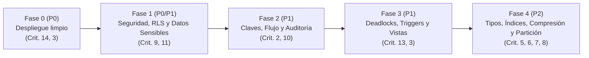

# Revisión de Diseño BD y Plan de Corrección — `DDL_SGSPI_SQLSERVER2019_v2.sql`

- **Objeto auditado:** [DDL_SGSPI_SQLSERVER2019_v2.sql](file:///c:/Users/USER/Pictures/p_academica-main/p_academica-main/DDL_SGSPI_SQLSERVER2019_v2.sql) (11,632 líneas; 98 tablas: 49 negocio + 49 `aud_*`, 164 índices explícitos, 190 FKs, 113 bloques `CREATE OR ALTER TRIGGER` para 109 triggers únicos, 7 vistas, 3 funciones inline).
- **Contexto contrastado:** [auditoria_servidor.sql](file:///c:/Users/USER/Pictures/p_academica-main/p_academica-main/sql/sgspi/auditoria_servidor.sql), [base_desechable.sql](file:///c:/Users/USER/Pictures/p_academica-main/p_academica-main/sql/sgspi/base_desechable.sql) y definiciones `[dbo]` en `sql/dbo/` ([usuario_general.sql](file:///c:/Users/USER/Pictures/p_academica-main/p_academica-main/sql/dbo/vistas/usuario_general.sql), [persona.sql](file:///c:/Users/USER/Pictures/p_academica-main/p_academica-main/sql/dbo/persona.sql), [grupo.sql](file:///c:/Users/USER/Pictures/p_academica-main/p_academica-main/sql/dbo/grupo.sql), [usuario_grupo.sql](file:///c:/Users/USER/Pictures/p_academica-main/p_academica-main/sql/dbo/usuario_grupo.sql), [uaa.sql](file:///c:/Users/USER/Pictures/p_academica-main/p_academica-main/sql/dbo/uaa.sql), [cargo.sql](file:///c:/Users/USER/Pictures/p_academica-main/p_academica-main/sql/dbo/cargo.sql)).
- **Umbral de plan de corrección:** Calificación baja = **< 7.0 / 10** (**11 de 14 criterios**).
- **Promedio general:** **5.9 / 10**.

> [!CAUTION]
> **Bloqueante inmediato de despliegue:** El script **no compila limpio** en SQL Server 2019. En [L8929-L9115](file:///c:/Users/USER/Pictures/p_academica-main/p_academica-main/DDL_SGSPI_SQLSERVER2019_v2.sql#L8929-L9115) hay 4 triggers duplicados y el primer `TR_adu_auditoria` ([L9041-L9115](file:///c:/Users/USER/Pictures/p_academica-main/p_academica-main/DDL_SGSPI_SQLSERVER2019_v2.sql#L9041-L9115)) redeclara `@per_actor` (Error 134, nivel 15) e inserta en `aud_activo_documental_idioma` usando columnas inexistentes (`idi_codigo`, `adi_esta_activo`, Error 207). Con `sqlcmd -b` el despliegue aborta; sin `-b`, los 4 triggers se recrean en [L9125-L9307](file:///c:/Users/USER/Pictures/p_academica-main/p_academica-main/DDL_SGSPI_SQLSERVER2019_v2.sql#L9125-L9307) y engañan el conteo final (`COUNT(*) <> 109`).

---

## 1. Resumen de Calificaciones (14 Criterios)

| # | Criterio | Nota | Estado | Hallazgo principal |
|---|----------|------|--------|--------------------|
| 1 | Normalización y dependencias | **8.0 / 10** | Aceptable | 3FN/BCNF sólida; tabla ancha `activo_informacion` (43 cols) y 9 etiquetas de UI persistidas sin uso en índices. |
| 2 | Claves y restricciones | **6.0 / 10** | **Baja** | ~25 `UNIQUE` sin filtro chocan con borrado lógico; `tef_esta_activa`/`efc_esta_activo` ignorados; firmas obsoletas tras reapertura; `presupuesto` admite negativos. |
| 3 | Detección de antipatrones estructurales | **5.5 / 10** | **Baja** | 4,430 líneas de triggers repetitivos (4 duplicados, 1 roto); doble trigger sin orden en 10 puentes; `STRING_AGG` sin `NVARCHAR(MAX)` (Error 9829). |
| 4 | Cardinalidad y opcionalidad | **7.5 / 10** | Aceptable | Supertipo/subtipo y cardinalidades condicionales bien modelados; `sif`/`msi` desacoplados del ciclo de vida de `aci`. |
| 5 | Tipos de datos y precisión | **6.5 / 10** | **Baja** | `NVARCHAR` vs `VARCHAR` con `[dbo]` (`CONVERT_IMPLICIT`); `aud_*` en `INT` (no `BIGINT`); `aud_plan_tratamiento` roza 8,060 B (`ROW_OVERFLOW`). |
| 6 | Estrategia de almacenamiento y clustering | **5.0 / 10** | **Baja** | 100% en `PRIMARY`, cero `DATA_COMPRESSION`, 29 columnas `PERSISTED` inflando filas y `aud_*` copiando filas completas (~7.9 KB). |
| 7 | Estrategia de indexación | **5.5 / 10** | **Baja** | 10 FKs sin índice no filtrado (`plt`, `sif`, 5 estados); sin índices de bandeja por estado/activo ni `fecha_cambio` en `aud_*`; Key Lookups en `TR_eia` y `TR_sga`. |
| 8 | Volumetría y particionamiento | **4.5 / 10** | **Baja** | Crecimiento infinito de 49 tablas `aud_*` sin particionamiento, archivo en frío ni retención ejecutable; tope artificial de 999 en `eia`. |
| 9 | Aislamiento y privilegios mínimos | **5.0 / 10** | **Baja** | `GRANT SELECT ON SCHEMA::sgspi` a `sgspi_rol_base` expone 49 `aud_*` y todo `eia` a custodios; bypass de alcance en escritura en `rpi`, `sif` y `msi`. |
| 10 | Trazabilidad y auditoría | **6.5 / 10** | **Baja** | No-op `UPDATE` cambia `fecha_actualizacion`/`ROWVERSION` sin auditar; `ufn_persona_sesion()` consulta `UNION` de 7 tablas sin filtrar `state` activo y se invoca 2× por DML. |
| 11 | Protección de datos sensibles | **4.5 / 10** | **Baja** | Cero RLS en lectura, cero DDM, cero `ADD SENSITIVITY CLASSIFICATION`; mapa de vulnerabilidades (`eia`) y URIs de evidencia legibles por cualquier rol base. |
| 12 | Convenciones y claridad semántica | **8.5 / 10** | Aceptable | Excelente disciplina institucional (`_codigo`, prefijos, cabecera); inconsistencia menor `esta_activo` (35) vs `esta_activa` (14) y alias sin prefijo en 1 vista. |
| 13 | Concurrencia y bloqueos | **5.0 / 10** | **Baja** | 2 ciclos de deadlock AB–BA (`aci`↔`air`/`ado` y `eia`↔`plt`/`act`/`ptc`); carrera en `act_porcentaje_avance`; doble/triple `UPDATE` y doble bump de `ROWVERSION`. |
| 14 | Compatibilidad de despliegue | **4.5 / 10** | **Baja** | Error de compilación en [L9041](file:///c:/Users/USER/Pictures/p_academica-main/p_academica-main/DDL_SGSPI_SQLSERVER2019_v2.sql#L9041); faltan 5 opciones `SET` para índices filtrados/calculados; `sp_addextendedproperty` no idempotente; `Sch-M` prolongado sobre `dbo.persona`/`dbo.uaa`. |

---

## 2. Evaluación Detallada por Criterio

### 1. Normalización y dependencias — **8.0 / 10**
- **Fortalezas:** Herencia 1:1 con PK compartida ([L1017-L1033](file:///c:/Users/USER/Pictures/p_academica-main/p_academica-main/DDL_SGSPI_SQLSERVER2019_v2.sql#L1017-L1033)), catálogos normalizados sin CSV (`[aac]/[cra]` [L1499-L1517](file:///c:/Users/USER/Pictures/p_academica-main/p_academica-main/DDL_SGSPI_SQLSERVER2019_v2.sql#L1499-L1517), `[fac]/[adf]` [L1005-L1102](file:///c:/Users/USER/Pictures/p_academica-main/p_academica-main/DDL_SGSPI_SQLSERVER2019_v2.sql#L1005-L1102)), eliminación de transitivas (`zona_riesgo_catalogo` [L1160](file:///c:/Users/USER/Pictures/p_academica-main/p_academica-main/DDL_SGSPI_SQLSERVER2019_v2.sql#L1160), `mvr_codigo_posicion` [L1199](file:///c:/Users/USER/Pictures/p_academica-main/p_academica-main/DDL_SGSPI_SQLSERVER2019_v2.sql#L1199)).
- **Observaciones menores:** `activo_informacion` ([L652-L775](file:///c:/Users/USER/Pictures/p_academica-main/p_academica-main/DDL_SGSPI_SQLSERVER2019_v2.sql#L652-L775)) acumula 43 columnas (22 nulables entre Reserva Ley 1712, PII Ley 1581 e ICC); 9 etiquetas derivadas (`ALTA`/`MEDIA`/`BAJA`) están `PERSISTED` sin indexarse ([L459](file:///c:/Users/USER/Pictures/p_academica-main/p_academica-main/DDL_SGSPI_SQLSERVER2019_v2.sql#L459), [L538-L553](file:///c:/Users/USER/Pictures/p_academica-main/p_academica-main/DDL_SGSPI_SQLSERVER2019_v2.sql#L538-L553), [L685-L689](file:///c:/Users/USER/Pictures/p_academica-main/p_academica-main/DDL_SGSPI_SQLSERVER2019_v2.sql#L685-L689)); `act_porcentaje_avance` ([L1396](file:///c:/Users/USER/Pictures/p_academica-main/p_academica-main/DDL_SGSPI_SQLSERVER2019_v2.sql#L1396)) es un derivado materializado por trigger con carrera bajo concurrencia.

### 2. Claves y restricciones — **6.0 / 10** *(Baja)*
1. **Choque `UNIQUE` vs borrado lógico (AP-22):** Solo `UX_plt_evento_activo` ([L1375](file:///c:/Users/USER/Pictures/p_academica-main/p_academica-main/DDL_SGSPI_SQLSERVER2019_v2.sql#L1375)) y `UX_enc_familia_activa` ([L1477](file:///c:/Users/USER/Pictures/p_academica-main/p_academica-main/DDL_SGSPI_SQLSERVER2019_v2.sql#L1477)) filtran por activo. El resto (`UQ_aci_codigo_inventario` [L707](file:///c:/Users/USER/Pictures/p_academica-main/p_academica-main/DDL_SGSPI_SQLSERVER2019_v2.sql#L707), `UQ_eac_vigencia_control` [L1553](file:///c:/Users/USER/Pictures/p_academica-main/p_academica-main/DDL_SGSPI_SQLSERVER2019_v2.sql#L1553), `UQ_act_plan_orden` [L1404](file:///c:/Users/USER/Pictures/p_academica-main/p_academica-main/DDL_SGSPI_SQLSERVER2019_v2.sql#L1404), `UQ_sif_nombre_sistema`, `UQ_msi_sistema_nombre`, `UQ_eia_vigencia_naturaleza_numero` [L1251](file:///c:/Users/USER/Pictures/p_academica-main/p_academica-main/DDL_SGSPI_SQLSERVER2019_v2.sql#L1251), `UX_acf_vigencia_naturaleza_numero` [L492](file:///c:/Users/USER/Pictures/p_academica-main/p_academica-main/DDL_SGSPI_SQLSERVER2019_v2.sql#L492)) bloquean recrear un registro tras anularlo con `esta_activo = 0`.
2. **Flags de baja lógica ignorados en la máquina de estados:** Ninguno de los 5 triggers (`acf`, `rpi`, `aci`, `eia`, `act`) valida `tef.tef_esta_activa = 1` ni `efc.efc_esta_activo = 1` ([L3103](file:///c:/Users/USER/Pictures/p_academica-main/p_academica-main/DDL_SGSPI_SQLSERVER2019_v2.sql#L3103)); `UX_efc_estado_inicial` ([L291](file:///c:/Users/USER/Pictures/p_academica-main/p_academica-main/DDL_SGSPI_SQLSERVER2019_v2.sql#L291)) no filtra `efc_esta_activo = 1`; y `UQ_tef_dominio_origen_destino_rol` ([L302](file:///c:/Users/USER/Pictures/p_academica-main/p_academica-main/DDL_SGSPI_SQLSERVER2019_v2.sql#L302)) admite coexistencia entre `tef_rol_requerido IS NULL` y un rol específico para el mismo arco.
3. **Firmas obsoletas tras reapertura:** Reabrir a `OBSERVADO`/`BORRADOR` nunca limpia `per_codigo_aprobador`, `per_codigo_revisor_archivo`, `per_codigo_validador_lider`, `per_codigo_revisor_sgspi` ni `per_codigo_aprobador_comite`. En `activo_documental`, un activo devuelto a `OBSERVADO` y reeditado puede pasar `EN_VALIDACION_LIDER -> EN_REVISION_SGSPI -> VIGENTE` saltándose `EN_REVISION_ARCHIVO` porque conserva la firma anterior ([L3752-L3755](file:///c:/Users/USER/Pictures/p_academica-main/p_academica-main/DDL_SGSPI_SQLSERVER2019_v2.sql#L3752-L3755)).
4. **Reglas incompletas:**
   - `TR_plt` ([L4766-L4782](file:///c:/Users/USER/Pictures/p_academica-main/p_academica-main/DDL_SGSPI_SQLSERVER2019_v2.sql#L4766-L4782)) permite dictaminar eficacia en cualquier estado editable de `eia` (no exige `EN_EVALUACION_EFICACIA`) y carece de SoD entre `per_codigo_evaluador` y creador/validador/revisor de `eia`.
   - `FK_eia_activo_proceso` ([L1257](file:///c:/Users/USER/Pictures/p_academica-main/p_academica-main/DDL_SGSPI_SQLSERVER2019_v2.sql#L1257)) acepta asociaciones `aip` desactivadas (`aip_esta_activo = 0`), y `TR_eia` no exige `aci_esta_activo = 1`.
   - Faltan CHECKs en `plt_presupuesto_estimado_cop >= 0` ([L1332](file:///c:/Users/USER/Pictures/p_academica-main/p_academica-main/DDL_SGSPI_SQLSERVER2019_v2.sql#L1332)), `pev_anio` ([L262](file:///c:/Users/USER/Pictures/p_academica-main/p_academica-main/DDL_SGSPI_SQLSERVER2019_v2.sql#L262)) y `enc_anio_edicion` ([L1468](file:///c:/Users/USER/Pictures/p_academica-main/p_academica-main/DDL_SGSPI_SQLSERVER2019_v2.sql#L1468)); y falta `DENY UPDATE` en consecutivos supuestamente inmutables (`acf_numero_factor` [L455](file:///c:/Users/USER/Pictures/p_academica-main/p_academica-main/DDL_SGSPI_SQLSERVER2019_v2.sql#L455), `eia_numero_evento` [L1222](file:///c:/Users/USER/Pictures/p_academica-main/p_academica-main/DDL_SGSPI_SQLSERVER2019_v2.sql#L1222), `rpp_fecha_registro` [L595](file:///c:/Users/USER/Pictures/p_academica-main/p_academica-main/DDL_SGSPI_SQLSERVER2019_v2.sql#L595)).

### 3. Detección de antipatrones estructurales — **5.5 / 10** *(Baja)*
1. **Explosión copy-paste de auditoría (4,430+ líneas, [L6030-L10460](file:///c:/Users/USER/Pictures/p_academica-main/p_academica-main/DDL_SGSPI_SQLSERVER2019_v2.sql#L6030-L10460)):** La duplicación manual ya provocó un bug real de fusión/copia en [L8929-L9115](file:///c:/Users/USER/Pictures/p_academica-main/p_academica-main/DDL_SGSPI_SQLSERVER2019_v2.sql#L8929-L9115) (4 triggers repetidos, 1 roto).
2. **Doble trigger sin orden determinístico en las 10 tablas puente:** `TR_*_bloquear_padre_no_editable` y `TR_*_auditoria` coexisten en `AFTER INSERT, UPDATE` sin `sp_settriggerorder`.
3. **Mutaciones recursivas dentro de triggers:** 8 triggers hacen `UPDATE` sobre su propia tabla (y `TR_aci` sobre `ado`, `TR_sga_*` sobre `act`), dependiendo de `TRIGGER_NESTLEVEL`.
4. **`STRING_AGG` con tope de 8,000 bytes (Error 9829):** Ninguna de las 19 llamadas a `STRING_AGG` en 4 vistas hace `CAST(... AS NVARCHAR(MAX))` ([L11067](file:///c:/Users/USER/Pictures/p_academica-main/p_academica-main/DDL_SGSPI_SQLSERVER2019_v2.sql#L11067), [L11183](file:///c:/Users/USER/Pictures/p_academica-main/p_academica-main/DDL_SGSPI_SQLSERVER2019_v2.sql#L11183), [L11238-L11312](file:///c:/Users/USER/Pictures/p_academica-main/p_academica-main/DDL_SGSPI_SQLSERVER2019_v2.sql#L11238-L11312), [L11438-L11442](file:///c:/Users/USER/Pictures/p_academica-main/p_academica-main/DDL_SGSPI_SQLSERVER2019_v2.sql#L11438-L11442)). Un activo transversal con muchas dependencias o códigos TRD desbordará la vista en producción.
5. **Filtros incompletos de baja lógica en vistas:** `vw_desglose_ccd_trd_mr04` ([L11224](file:///c:/Users/USER/Pictures/p_academica-main/p_academica-main/DDL_SGSPI_SQLSERVER2019_v2.sql#L11224)) omite `ado_esta_activo = 1`, `upc_esta_activa = 1`, `sdo_esta_activa = 1`; `vw_controles_atributos_iso27002` ([L11450](file:///c:/Users/USER/Pictures/p_academica-main/p_academica-main/DDL_SGSPI_SQLSERVER2019_v2.sql#L11450)) omite `crn_esta_activo = 1`, `enc_esta_activo = 1`, `aac_esta_activo = 1`; `vw_usuario_rol_alcance_sgspi` ([L2926](file:///c:/Users/USER/Pictures/p_academica-main/p_academica-main/DDL_SGSPI_SQLSERVER2019_v2.sql#L2926)) omite `pr.pri_esta_activo = 1`.

### 4. Cardinalidad y opcionalidad — **7.5 / 10**
- **Fortalezas:** 1:1 estricta (`aci`–`ado`), 1:0..1 (`aci`–`sif`, `eia`–`plt` activo, propietario único activo), N:M limpias y opcionalidad condicional robusta con CHECKs.
- **Observaciones menores:** `sif` y `msi` no bloquean cambios cuando su `aci` padre está en `VIGENTE`/`HISTORICO`; nada impide crear `ado` sobre un `aci` cuyo `tac_codigo` no sea documental; si un líder/custodio inserta `aci` con `uaa_codigo IS NULL`, `TR_aci` lo rechaza por falta de alcance antes de poder vincular `aip`.

### 5. Tipos de datos y precisión — **6.5 / 10** *(Baja)*
1. **Desajuste `NVARCHAR` vs `VARCHAR` frente a `[dbo]`:** En `academia3000`, `dbo.grupo.gru_nombre` (`VARCHAR(100)`) y `dbo.usuario_general.us` (`VARCHAR(100)`) son `VARCHAR`. En [L2930](file:///c:/Users/USER/Pictures/p_academica-main/p_academica-main/DDL_SGSPI_SQLSERVER2019_v2.sql#L2930), `g.gru_nombre LIKE N'SGSPI[_]%'` fuerza `CONVERT_IMPLICIT` sobre la columna. En [L2947](file:///c:/Users/USER/Pictures/p_academica-main/p_academica-main/DDL_SGSPI_SQLSERVER2019_v2.sql#L2947), `CONVERT(VARCHAR(128), ORIGINAL_LOGIN())` contra `VARCHAR(100)` desajusta longitud.
2. **Ancho de fila al límite de 8,060 bytes (`ROW_OVERFLOW`):** `aud_plan_tratamiento` suma ~7,940 B en datos (supera 8,060 B con overhead de fila/offsets); `plan_tratamiento` ~7,691 B; `aud_evento_incertidumbre_activo` ~7,432 B.
3. **PK `INT` en las 49 tablas `aud_*`:** Tablas append-only sin borrado deberían usar `BIGINT` (al menos las transaccionales).
4. **Inconsistencias de precisión:** `plt_porcentaje_cumplimiento_kpi` ([L1339](file:///c:/Users/USER/Pictures/p_academica-main/p_academica-main/DDL_SGSPI_SQLSERVER2019_v2.sql#L1339)) es la única calculada no `PERSISTED`; `sga_hash_sha256_evidencia CHAR(64)` ([L1436](file:///c:/Users/USER/Pictures/p_academica-main/p_academica-main/DDL_SGSPI_SQLSERVER2019_v2.sql#L1436)) duplica tamaño vs `BINARY(32)`; `eia_numero_evento` está acotado a `1..999` ([L1267](file:///c:/Users/USER/Pictures/p_academica-main/p_academica-main/DDL_SGSPI_SQLSERVER2019_v2.sql#L1267)) mientras `eia_identificador_evento` reserva `NVARCHAR(15)`.

### 6. Estrategia de almacenamiento y clustering — **5.0 / 10** *(Baja)*
1. **Todo en `PRIMARY`:** Las 98 tablas y 164 índices comparten filegroup con el esquema corporativo `dbo`, impidiendo aislar I/O o respaldos parciales de las 49 `aud_*`.
2. **Cero `DATA_COMPRESSION`:** Disponible en todas las ediciones de SQL Server 2019. Las 49 tablas `aud_*` duplican filas completas en cada cambio de 1 campo sin `PAGE` compression (desperdicio estimado 50–75% en disco y buffer pool).
3. **Exceso de `PERSISTED` (29 columnas):** 9 etiquetas textuales + 5 constantes `efc_dominio` ocupan espacio físico en cada fila sin justificación de índice en la mayoría.

### 7. Estrategia de indexación — **5.5 / 10** *(Baja)*
1. **10 FKs sin índice no filtrado:** Destacan `FK_plt_evento_incertidumbre` (`plan_tratamiento` solo tiene `UX_plt_evento_activo` filtrado, [L1375](file:///c:/Users/USER/Pictures/p_academica-main/p_academica-main/DDL_SGSPI_SQLSERVER2019_v2.sql#L1375)), `FK_sif_activo_informacion` (solo `UX_sif_aci_codigo` filtrado, [L866](file:///c:/Users/USER/Pictures/p_academica-main/p_academica-main/DDL_SGSPI_SQLSERVER2019_v2.sql#L866)) y las 5 FKs de `estado_flujo_catalogo`. SQL Server **no usa índices filtrados para validar FKs**.
2. **Índices operativos ausentes:**
   - Sin índice en `<acr>_estado_registro` / `<acr>_esta_activo` en `acf`, `rpi`, `aci`, `eia`, `act` (afecta bandejas y `vw_resumen_activos_criticidad` [L11043](file:///c:/Users/USER/Pictures/p_academica-main/p_academica-main/DDL_SGSPI_SQLSERVER2019_v2.sql#L11043)).
   - `IX_sga_act_codigo` ([L1455](file:///c:/Users/USER/Pictures/p_academica-main/p_academica-main/DDL_SGSPI_SQLSERVER2019_v2.sql#L1455)) no cubre `TR_sga_inmutabilidad` ([L5494](file:///c:/Users/USER/Pictures/p_academica-main/p_academica-main/DDL_SGSPI_SQLSERVER2019_v2.sql#L5494)) -> Key Lookup por fila.
   - `TR_eia` hace 5 consultas `EXISTS` a `plan_tratamiento` con Key Lookups ([L4389-L4490](file:///c:/Users/USER/Pictures/p_academica-main/p_academica-main/DDL_SGSPI_SQLSERVER2019_v2.sql#L4389-L4490)).
   - Ninguna de las 49 `aud_*` indexa `<aud>_fecha_cambio` (escaneo total para consultas por rango de fechas).
3. **Índices innecesarios en tablas diminutas:** `IX_mvr_eim_codigo`, `IX_mvr_zrc_codigo` (tabla de 25 filas) y `IX_tef_estado_destino` (~60 filas).

### 8. Volumetría y particionamiento — **4.5 / 10** *(Baja)*
1. **Sin particionamiento ni retención para `aud_*`:** Al copiar filas completas de hasta 7.9 KB en cada cambio sin borrado físico, las tablas `aud_*` crecerán sin tope. Además, la FK `aud_* -> origen` + trigger `INSTEAD OF DELETE` impiden archivar (`SWITCH PARTITION`) sin intervención manual de esquema.
2. **Sin alineación de retención** con `sql/sgspi/auditoria_servidor.sql` (25.6 GB de rollover en archivos `.sqlaudit`).

### 9. Aislamiento y privilegios mínimos — **5.0 / 10** *(Baja)*
1. **Sobre-exposición global de lectura ([L10508](file:///c:/Users/USER/Pictures/p_academica-main/p_academica-main/DDL_SGSPI_SQLSERVER2019_v2.sql#L10508)):** `GRANT SELECT ON SCHEMA::sgspi TO sgspi_rol_base` otorga lectura sin restricciones a los 6 roles de actor (incluido `sgspi_rol_custodio_operador`) sobre las **49 tablas `aud_*`**, todo **`evento_incertidumbre_activo`** (mapa completo de vulnerabilidades), `plan_tratamiento`, `seguimiento_actividad`, `evaluacion_aplicabilidad_control` y `vw_usuario_rol_alcance_sgspi`.
2. **Bypass de alcance en escritura (sin error 50021):**
   - `sgspi_rol_lider_propietario` tiene `GRANT UPDATE` en `requisito_parte_interesada` ([L10727](file:///c:/Users/USER/Pictures/p_academica-main/p_academica-main/DDL_SGSPI_SQLSERVER2019_v2.sql#L10727)), pero `TR_rpi_integridad_y_actualizacion` ([L3308](file:///c:/Users/USER/Pictures/p_academica-main/p_academica-main/DDL_SGSPI_SQLSERVER2019_v2.sql#L3308)) **no valida `ufn_proceso_en_alcance`**.
   - `sgspi_rol_custodio_operador` y `sgspi_rol_lider_propietario` tienen `GRANT INSERT, UPDATE` en `sistema_informacion_ficha` y `modulo_sistema_informacion` ([L10740-L10744](file:///c:/Users/USER/Pictures/p_academica-main/p_academica-main/DDL_SGSPI_SQLSERVER2019_v2.sql#L10740-L10744)), sin chequeo de alcance (`ufn_activo_en_alcance`) ni bloqueo de padre no editable (`aci`).
3. **`sgspi_rol_consulta` desprotegido ante errores de DBA:** Sin `DENY INSERT, UPDATE, DELETE, ALTER ON SCHEMA::sgspi` y excluido de la auditoría de roles fijos en Sección 7 ([L11530](file:///c:/Users/USER/Pictures/p_academica-main/p_academica-main/DDL_SGSPI_SQLSERVER2019_v2.sql#L11530)).
4. **Identidad inactiva en `[dbo]`:** `ufn_persona_sesion()` ([L2940](file:///c:/Users/USER/Pictures/p_academica-main/p_academica-main/DDL_SGSPI_SQLSERVER2019_v2.sql#L2940)) y `vw_usuario_rol_alcance_sgspi` ([L2928](file:///c:/Users/USER/Pictures/p_academica-main/p_academica-main/DDL_SGSPI_SQLSERVER2019_v2.sql#L2928)) no verifican `u.state` activo en `dbo.usuario_general`, `u.up IS NOT NULL`, `p.per_estado = 1` ni `u.uaa_estado = 1`.

### 10. Trazabilidad y auditoría — **6.5 / 10** *(Baja)*
1. **No-op `UPDATE` muta metadatos sin auditar:** En los 8 triggers `TR_*_integridad_y_actualizacion` (ej. [L3208-L3243](file:///c:/Users/USER/Pictures/p_academica-main/p_academica-main/DDL_SGSPI_SQLSERVER2019_v2.sql#L3208-L3243)), si un `UPDATE` no cambia valores, el `INSERT INTO aud_*` inserta 0 filas pero el `UPDATE` posterior igual sobreescribe `*_fecha_actualizacion` e incrementa `ROWVERSION`.
2. **Doble ejecución del `UNION` de 7 tablas (`dbo.usuario_general`):** `ufn_persona_sesion()` consulta la vista `UNION` ([usuario_general.sql](file:///c:/Users/USER/Pictures/p_academica-main/p_academica-main/sql/dbo/vistas/usuario_general.sql#L13-L36), que aplica `DISTINCT` sobre 7 tablas base) para `@per_actor` y vuelve a ejecutarse dentro de `ufn_proceso_en_alcance` / `ufn_activo_en_alcance` en cada fila DML.
3. **Corrupción en `TR_adu_auditoria` ([L9056-L9057](file:///c:/Users/USER/Pictures/p_academica-main/p_academica-main/DDL_SGSPI_SQLSERVER2019_v2.sql#L9056-L9057)):** El bloque duplicado contenía un `IF @per_actor IS NULL RETURN;` silencioso antes de fallar al compilar.
4. **Cobertura `SELECT` parcial en auditoría de servidor:** [auditoria_servidor.sql](file:///c:/Users/USER/Pictures/p_academica-main/p_academica-main/sql/sgspi/auditoria_servidor.sql#L36-L37) solo audita lecturas de `eia` y `aud_eia`, omitiendo `activo_informacion` (PII/reserva) y las demás `aud_*`.

### 11. Protección de datos sensibles — **4.5 / 10** *(Baja)*
1. **Cero Row-Level Security (RLS) en lectura:** El alcance UAA/proceso solo protege escrituras; cualquier custodio lee vulnerabilidades, activos reservados, presupuestos, observaciones de auditoría y URIs de evidencia de toda la universidad.
2. **Sin funciones nativas SQL Server 2019:** Sin `ADD SENSITIVITY CLASSIFICATION` (que integra etiquetas directamente en `SQL Server Audit`) ni `DYNAMIC DATA MASKING` sobre campos sensibles para roles no autorizados.
3. **URIs sin control de formato:** `sga_uri_almacenamiento_evidencia` ([L1435](file:///c:/Users/USER/Pictures/p_academica-main/p_academica-main/DDL_SGSPI_SQLSERVER2019_v2.sql#L1435)) acepta cadenas vacías, rutas UNC o esquemas inseguros (`http://`).
4. **Cifrado solo informativo:** [L11602](file:///c:/Users/USER/Pictures/p_academica-main/p_academica-main/DDL_SGSPI_SQLSERVER2019_v2.sql#L11602) solo reporta `is_encrypted = 0` tras desplegar; no se documenta ni verifica TLS obligatorio ni cifrado de respaldos.

### 12. Convenciones y claridad semántica — **8.5 / 10**
- **Fortalezas:** 100% prefijos de restricciones válidos, cero `_id`, mapa de acrónimos completo, trazabilidad `[AP-xx]`.
- **Observaciones menores:** 35 tablas usan `_esta_activo` y 14 `_esta_activa`; `vw_controles_atributos_iso27002` ([L11438-L11442](file:///c:/Users/USER/Pictures/p_academica-main/p_academica-main/DDL_SGSPI_SQLSERVER2019_v2.sql#L11438-L11442)) omite prefijo de acrónimo en sus alias; comentario duplicado en [L1004](file:///c:/Users/USER/Pictures/p_academica-main/p_academica-main/DDL_SGSPI_SQLSERVER2019_v2.sql#L1004).

### 13. Concurrencia y bloqueos — **5.0 / 10** *(Baja)*
1. **Dos ciclos clásicos de Deadlock AB–BA:**
   - **`aci` ↔ `air` / `ado`:** `TR_aci` toma `X` en `aci` y luego `UPDLOCK` en `air`/`ado` ([L3738](file:///c:/Users/USER/Pictures/p_academica-main/p_academica-main/DDL_SGSPI_SQLSERVER2019_v2.sql#L3738), [L3752](file:///c:/Users/USER/Pictures/p_academica-main/p_academica-main/DDL_SGSPI_SQLSERVER2019_v2.sql#L3752)); en sentido opuesto, `TR_air` ([L5737](file:///c:/Users/USER/Pictures/p_academica-main/p_academica-main/DDL_SGSPI_SQLSERVER2019_v2.sql#L5737)) y `TR_ado` ([L4049](file:///c:/Users/USER/Pictures/p_academica-main/p_academica-main/DDL_SGSPI_SQLSERVER2019_v2.sql#L4049)) toman `X` en `air`/`ado` y luego `UPDLOCK` en `aci`.
   - **`eia` ↔ `plt` / `act` / `ptc`:** `TR_eia` toma `X` en `eia` y luego `UPDLOCK` en `plt`/`ptc`/`act` ([L4389-L4490](file:///c:/Users/USER/Pictures/p_academica-main/p_academica-main/DDL_SGSPI_SQLSERVER2019_v2.sql#L4389-L4490)); en sentido opuesto, `TR_plt` ([L4713](file:///c:/Users/USER/Pictures/p_academica-main/p_academica-main/DDL_SGSPI_SQLSERVER2019_v2.sql#L4713)), `TR_act` ([L5003](file:///c:/Users/USER/Pictures/p_academica-main/p_academica-main/DDL_SGSPI_SQLSERVER2019_v2.sql#L5003)) y `TR_ptc` ([L5994](file:///c:/Users/USER/Pictures/p_academica-main/p_academica-main/DDL_SGSPI_SQLSERVER2019_v2.sql#L5994)) toman `X` en hijo y luego `UPDLOCK` en `eia`.
2. **Condición de carrera en `act_porcentaje_avance`:** `TR_sga_sincronizar_avance` ([L5544](file:///c:/Users/USER/Pictures/p_academica-main/p_academica-main/DDL_SGSPI_SQLSERVER2019_v2.sql#L5544)) solo lee `inserted` y `TR_sga_inmutabilidad` ([L5494](file:///c:/Users/USER/Pictures/p_academica-main/p_academica-main/DDL_SGSPI_SQLSERVER2019_v2.sql#L5494)) no bloquea el padre `act` con `UPDLOCK` antes de recalcular el último `sga_codigo`.
3. **Doble/triple `UPDATE` y doble bump de `ROWVERSION`:** Cada cambio de estado en `acf`, `rpi`, `aci`, `eia`, `plt` ejecuta 2–3 escrituras separadas sobre la tabla ([L3238](file:///c:/Users/USER/Pictures/p_academica-main/p_academica-main/DDL_SGSPI_SQLSERVER2019_v2.sql#L3238), [L3244](file:///c:/Users/USER/Pictures/p_academica-main/p_academica-main/DDL_SGSPI_SQLSERVER2019_v2.sql#L3244), [L3909-L3937](file:///c:/Users/USER/Pictures/p_academica-main/p_academica-main/DDL_SGSPI_SQLSERVER2019_v2.sql#L3909-L3937)).
4. **Sin `READ_COMMITTED_SNAPSHOT` (RCSI):** Bajo `READ COMMITTED` pesimista, vistas de 26 referencias (`vw_inventario_activo_documental_mr04`) compiten por bloqueos `S`/`X` con DML.

### 14. Compatibilidad de despliegue — **4.5 / 10** *(Baja)*
1. **Error de compilación en [L9041-L9115](file:///c:/Users/USER/Pictures/p_academica-main/p_academica-main/DDL_SGSPI_SQLSERVER2019_v2.sql#L9041-L9115):** Falla con `sqlcmd -b` (Error 134 y 207) y deja 4 triggers duplicados.
2. **Opciones `SET` incompletas ([L158-L165](file:///c:/Users/USER/Pictures/p_academica-main/p_academica-main/DDL_SGSPI_SQLSERVER2019_v2.sql#L158-L165)):** Faltan `ANSI_PADDING ON`, `ANSI_WARNINGS ON`, `ARITHABORT ON`, `CONCAT_NULL_YIELDS_NULL ON`, `NUMERIC_ROUNDABORT OFF` (requeridas para índices filtrados y calculados, Error 1934).
3. **`sp_addextendedproperty` no idempotente ([L247](file:///c:/Users/USER/Pictures/p_academica-main/p_academica-main/DDL_SGSPI_SQLSERVER2019_v2.sql#L247)):** Falla con Error 15233 si el esquema `sgspi` ya existe vacío con `sgspi_version`.
4. **Guarda final por conteos mágicos ([L11488-L11508](file:///c:/Users/USER/Pictures/p_academica-main/p_academica-main/DDL_SGSPI_SQLSERVER2019_v2.sql#L11488-L11508)):** Ocultó el fallo de compilación de [L9041](file:///c:/Users/USER/Pictures/p_academica-main/p_academica-main/DDL_SGSPI_SQLSERVER2019_v2.sql#L9041).
5. **Bloqueo `Sch-M` prolongado sobre `[dbo]`:** Una transacción única crea 98 tablas + 190 FKs (incluyendo 49 FKs de `aud_*` hacia `dbo.persona`), bloqueando `dbo.persona`/`dbo.uaa`/`dbo.cargo` en producción durante todo el script.

---

## 3. Plan Detallado de Corrección (Enfoque Ponytail: mínimo cambio, máximo impacto)

> [!TIP]
> **Principio guía del plan:** Corregir los **11 criterios con calificación baja (< 7.0)** sin rediseñar el modelo conceptual ni añadir abstracciones innecesarias. Donde sea posible, **eliminar código** (triggers duplicados, triggers divididos, columnas `PERSISTED` ociosas, índices sobre tablas de 25 filas) en lugar de apilar capas.

### Fase 0 — Desbloqueo de compilación y despliegue seguro *(P0 · Criterios 14 y 3)*
1. **Eliminar bloque corrupto/duplicado [L8928-L9122](file:///c:/Users/USER/Pictures/p_academica-main/p_academica-main/DDL_SGSPI_SQLSERVER2019_v2.sql#L8928-L9122):** Borrar los 4 triggers duplicados y el `TR_adu_auditoria` roto, conservando el bloque íntegro en [L9124-L9308](file:///c:/Users/USER/Pictures/p_academica-main/p_academica-main/DDL_SGSPI_SQLSERVER2019_v2.sql#L9124-L9308).
2. **Completar opciones `SET` ([L158-L165](file:///c:/Users/USER/Pictures/p_academica-main/p_academica-main/DDL_SGSPI_SQLSERVER2019_v2.sql#L158-L165)):** Agregar `SET ANSI_PADDING ON; SET ANSI_WARNINGS ON; SET ARITHABORT ON; SET CONCAT_NULL_YIELDS_NULL ON; SET NUMERIC_ROUNDABORT OFF;`.
3. **Hacer idempotente `sgspi_version` ([L247](file:///c:/Users/USER/Pictures/p_academica-main/p_academica-main/DDL_SGSPI_SQLSERVER2019_v2.sql#L247)):** Si `sys.fn_listextendedproperty(N'sgspi_version', N'SCHEMA', N'sgspi', NULL, NULL, NULL, NULL)` existe, usar `sp_updateextendedproperty`; si no, `sp_addextendedproperty`.
4. **Endurecer verificación pre y post-despliegue:**
   - Pre-check ([L194](file:///c:/Users/USER/Pictures/p_academica-main/p_academica-main/DDL_SGSPI_SQLSERVER2019_v2.sql#L194)): verificar que las tablas `[dbo]` referenciadas por FK tengan PK/UQ activa y comprobar si `dbo.usuario_general.state` existe.
   - Pre-`COMMIT` ([L11488](file:///c:/Users/USER/Pictures/p_academica-main/p_academica-main/DDL_SGSPI_SQLSERVER2019_v2.sql#L11488)): validar lista nominal de objetos clave (no solo conteos) y verificar compilación de vistas con `sp_refreshview` o `SELECT TOP (0)`.
   - Reducir contención `Sch-M` en producción: evaluar retirar la FK `FK_aXX_dbo_persona` de las 49 tablas `aud_*` (ya validada al insertar por `ufn_persona_sesion()` y por `dbo.persona`) o documentar explícitamente ventana de mantenimiento sobre `dbo.persona`/`dbo.uaa`.

### Fase 1 — Aislamiento, privilegios mínimos y protección de datos sensibles *(P0/P1 · Criterios 9 y 11)*
1. **Cerrar bypasses de alcance en escritura:**
   - **`TR_rpi_integridad_y_actualizacion` ([L3308](file:///c:/Users/USER/Pictures/p_academica-main/p_academica-main/DDL_SGSPI_SQLSERVER2019_v2.sql#L3308)):** Exigir que un rol no transversal (`sgspi_rol_lider_propietario`) solo pueda actualizar `rpi` si al menos uno de sus procesos asociados en `rpp` (activo) está en `ufn_proceso_en_alcance` (o todos los procesos de ese `rpi`).
   - **`TR_sif_auditoria` y `TR_msi_auditoria`:** Bloquear `INSERT`/`UPDATE` si `aci_codigo IS NOT NULL` y el activo padre tiene `efc_permite_edicion = 0`, y exigir `ufn_activo_en_alcance(aci.aci_codigo, aci.uaa_codigo)` (en `msi`, resolviendo vía `sif.aci_codigo`). Si `sif.aci_codigo IS NULL`, restringir edición a roles transversales o exigir `aci_codigo NOT NULL`.
2. **Restringir lectura sobre `aud_*` y aplicar RLS en lectura:**
   - En Sección 5.10.10 ([L10508](file:///c:/Users/USER/Pictures/p_academica-main/p_academica-main/DDL_SGSPI_SQLSERVER2019_v2.sql#L10508)): añadir `DENY SELECT ON sgspi.aud_<tabla> TO sgspi_rol_base;` (o no otorgar `SELECT` en `SCHEMA::sgspi` y usar lista blanca) y otorgar `GRANT SELECT` sobre las 49 `aud_*` **solo** a `sgspi_rol_auditor_control` y `sgspi_rol_oficial_seguridad_privacidad`. *(Atajo Ponytail más limpio: reemplazar el `GRANT SELECT ON SCHEMA::sgspi TO sgspi_rol_base` por `GRANT SELECT` en las 49 tablas de negocio + 7 vistas para `sgspi_rol_base`, y `GRANT SELECT` en las 49 `aud_*` únicamente a `auditor_control` y `oficial_seguridad_privacidad` — evita tener que vencer un `DENY` heredado de `sgspi_rol_base`!)*
   - Crear **1 sola `SECURITY POLICY sgspi.spol_alcance_lectura`** con `FILTER PREDICATE` reutilizando 2 funciones inline `WITH SCHEMABINDING` (alcance por proceso y alcance por activo) aplicadas sobre `acf`, `rpi`, `aci`, `ado`, `eia`, `plt`, `act`, `sga`, `sif`, `msi`. Esto garantiza que custodios y líderes **solo lean su alcance** sin cambiar consultas en la aplicación.
   - Proteger `sgspi_rol_consulta`: añadir `DENY INSERT, UPDATE, DELETE, ALTER ON SCHEMA::sgspi TO sgspi_rol_consulta;` e incluir `sgspi_rol_consulta` en la auditoría de Sección 7 ([L11530](file:///c:/Users/USER/Pictures/p_academica-main/p_academica-main/DDL_SGSPI_SQLSERVER2019_v2.sql#L11530)).
3. **Controles nativos de datos sensibles (SQL Server 2019):**
   - Añadir `ADD SENSITIVITY CLASSIFICATION` en columnas confidenciales (`eia_condicion_vulnerabilidad`, `eia_fuente_generadora`, `eia_efecto_consecuencia`, `aci_categoria_dato_personal`, `aci_finalidad_recoleccion_pii`, `sga_uri_almacenamiento_evidencia`, `plt_presupuesto_estimado_cop`, `eac_observaciones_auditoria`).
   - Añadir `CHECK` en `sga_uri_almacenamiento_evidencia` ([L1435](file:///c:/Users/USER/Pictures/p_academica-main/p_academica-main/DDL_SGSPI_SQLSERVER2019_v2.sql#L1435)): no vacío y prefijo permitido (ej. `https://` o ruta lógica interna acordada).
   - Evaluar `MASKED WITH` en `plt_presupuesto_estimado_cop`, `sga_uri_almacenamiento_evidencia` y `eac_observaciones_auditoria` con `GRANT UNMASK` a roles autorizados.
   - Ampliar [auditoria_servidor.sql](file:///c:/Users/USER/Pictures/p_academica-main/p_academica-main/sql/sgspi/auditoria_servidor.sql) para auditar `SELECT` en `sgspi.activo_informacion`.

### Fase 2 — Integridad de claves, máquina de estados y trazabilidad *(P1 · Criterios 2 y 10)*
1. **Alinear claves `UNIQUE` con borrado lógico (AP-22):**
   - Convertir las claves naturales que **no** son referenciadas por FKs en índices únicos filtrados `WHERE <acr>_esta_activ[oa] = 1`: `aci_codigo_inventario`, `eac(pev_codigo, crn_codigo)`, `act(plt_codigo, act_numero_orden)`, `sif_nombre_sistema`, `msi(sif_codigo, msi_nombre_modulo)`, `acf(pev_codigo, acf_naturaleza_factor, acf_numero_factor)` y `eia(pev_codigo, eia_naturaleza_evento, eia_numero_evento)`.
   - Para tablas de catálogo cuyo `UNIQUE` es solo clave natural (no destino de FK): aplicar el mismo filtro `WHERE <acr>_esta_activ[oa] = 1` para permitir recreación tras anulación.
2. **Corregir máquina de estados y firmas obsoletas:**
   - Añadir `AND tef.tef_esta_activa = 1` y `AND efc.efc_esta_activo = 1` en los 5 triggers (`acf`, `rpi`, `aci`, `eia`, `act`), y `WHERE efc_es_inicial = 1 AND efc_esta_activo = 1` en `UX_efc_estado_inicial` ([L291](file:///c:/Users/USER/Pictures/p_academica-main/p_academica-main/DDL_SGSPI_SQLSERVER2019_v2.sql#L291)).
   - Limpiar firmas al reabrir/observar:
     - `acf`/`rpi`/`aci`: al salir de `VIGENTE` o pasar a `OBSERVADO`/`BORRADOR`, poner `per_codigo_aprobador = NULL`; en `aci`, al pasar a `OBSERVADO`/`BORRADOR` (o en `TR_ado` ante cualquier edición real de metadatos archivísticos), limpiar `ado.per_codigo_revisor_archivo = NULL` para impedir el bypass de `EN_REVISION_ARCHIVO`.
     - `eia`: al retroceder a `OBSERVADO`/`BORRADOR`, limpiar las firmas posteriores a esa etapa (`validador`, `revisor`, `comite`).
   - En `TR_plt` ([L4766](file:///c:/Users/USER/Pictures/p_academica-main/p_academica-main/DDL_SGSPI_SQLSERVER2019_v2.sql#L4766)): exigir `eia.eia_estado_registro = N'EN_EVALUACION_EFICACIA'` para registrar/modificar dictamen y exigir SoD (`@per_actor` distinto de `per_codigo_creador`, `per_codigo_validador_lider` y `per_codigo_revisor_sgspi` de `eia`).
   - En `TR_eia`: validar que `aip.aip_esta_activo = 1` para `(aci_codigo_primario, pri_codigo)` y que ambos activos (`primario` y `soporte`) tengan `aci_esta_activo = 1`.
   - Agregar CHECKs: `CK_plt_presupuesto_no_negativo (plt_presupuesto_estimado_cop IS NULL OR plt_presupuesto_estimado_cop >= 0)`, `CK_pev_anio (pev_anio BETWEEN 2000 AND 2100)`, `CK_enc_anio_edicion (enc_anio_edicion IS NULL OR enc_anio_edicion BETWEEN 1970 AND 2100)`, y `DENY UPDATE` sobre `acf_numero_factor`, `eia_numero_evento` y `rpp_fecha_registro`.
3. **Corregir trazabilidad y rendimiento de identidad:**
   - En los 8 triggers `TR_*_integridad_y_actualizacion`: actualizar `*_fecha_actualizacion` **únicamente** en filas con cambio real (detectado por `EXCEPT`), eliminando mutaciones fantasma sin registro en `aud_*`.
   - Optimizar `ufn_persona_sesion()` ([L2940](file:///c:/Users/USER/Pictures/p_academica-main/p_academica-main/DDL_SGSPI_SQLSERVER2019_v2.sql#L2940)): filtrar `u.up IS NOT NULL` (y `u.state` activo según valor productivo de `academia3000`); pasar `@per_actor` como parámetro a `ufn_proceso_en_alcance(@pri_codigo, @per_actor)` y `ufn_activo_en_alcance(@aci_codigo, @uaa_codigo, @per_actor)` para evaluar la vista `UNION` de 7 tablas **1 vez por sentencia** en lugar de `1 + N` veces.
   - En `vw_usuario_rol_alcance_sgspi` ([L2930](file:///c:/Users/USER/Pictures/p_academica-main/p_academica-main/DDL_SGSPI_SQLSERVER2019_v2.sql#L2930)): cambiar `LIKE N'SGSPI[_]%'` a `LIKE 'SGSPI[_]%'` (mismo tipo `VARCHAR` de `dbo.grupo.gru_nombre`), y añadir `AND p.per_estado = 1 AND u.uaa_estado = 1` (verificando valores productivos).

### Fase 3 — Concurrencia, deadlocks, consolidación de triggers y vistas *(P1 · Criterios 13 y 3)*
1. **Eliminar los 2 ciclos AB–BA de Deadlock:**
   - En los triggers de las dos familias de agregado (`aci` + `ado` + `air`/`aip`/`ais`/`ads`/`adm`/`adi`/`adf`/`adu`/`sif`/`msi`, y `eia` + `plt` + `act` + `ptc` + `sga`), serializar el agregado en orden **raíz primero** mediante `EXEC sp_getapplock @Resource = @lock_key, @LockMode = 'Exclusive', @LockOwner = 'Transaction', @LockTimeout = 10000;` sobre la clave raíz (`sgspi:aci:<id>` o `sgspi:eia:<id>`) *antes* de consultar/actualizar hijos o padres (con orden ascendente de `<id>` en lotes multifila, o manteniendo el bloqueo en la raíz). Alternativa: encapsular transiciones de estado en procedimientos almacenados que bloquean siempre raíz → hijos.
2. **Eliminar doble `UPDATE` y doble bump de `ROWVERSION`:**
   - Combinar los `UPDATE` de `*_fecha_actualizacion` y de firmas (`per_codigo_aprobador` / `validador` / `revisor` / `comite`) en **1 solo `UPDATE`** en `TR_acf`, `TR_rpi`, `TR_aci`, `TR_eia` y `TR_plt`.
3. **Cerrar carrera en `act_porcentaje_avance`:**
   - En `TR_sga_sincronizar_avance` ([L5544](file:///c:/Users/USER/Pictures/p_academica-main/p_academica-main/DDL_SGSPI_SQLSERVER2019_v2.sql#L5544)) y `TR_sga_inmutabilidad` ([L5483](file:///c:/Users/USER/Pictures/p_academica-main/p_academica-main/DDL_SGSPI_SQLSERVER2019_v2.sql#L5483)): adquirir `UPDLOCK` sobre `actividad_tratamiento` y recalcular ambos con el mismo `OUTER APPLY (SELECT TOP (1) sga_porcentaje_reportado ... WHERE sga_esta_activo = 1 ORDER BY sga_codigo DESC)` para garantizar consistencia ante commits concurrentes.
4. **Habilitar / auditar RCSI:** Añadir verificación de `is_read_committed_snapshot_on = 0` en Sección 7 ([L11602](file:///c:/Users/USER/Pictures/p_academica-main/p_academica-main/DDL_SGSPI_SQLSERVER2019_v2.sql#L11602)) y recomendar `ALTER DATABASE ... SET READ_COMMITTED_SNAPSHOT ON` en ventana de mantenimiento.
5. **Reducir bloat de triggers y arreglar vistas:**
   - Fusionar `TR_*_bloquear_padre_no_editable` + `TR_*_auditoria` en **1 solo trigger** por cada una de las 10 tablas puente (**-10 triggers**, orden determinístico garantizado: primero valida padre/alcance, luego audita).
   - Envoltorio `CAST(<col> AS NVARCHAR(MAX))` en las **19 llamadas `STRING_AGG`** de las 4 vistas para eliminar Error 9829.
   - Añadir filtros `esta_activo = 1` faltantes en `vw_desglose_ccd_trd_mr04` (`ado`, `upc`, `sdo`, `sbd`), `vw_controles_atributos_iso27002` (`crn`, `enc`, `aac`) y `vw_usuario_rol_alcance_sgspi` (`pr`).

### Fase 4 — Tipos de datos, indexación, almacenamiento y particionamiento *(P2 · Criterios 5, 6, 7 y 8)*
1. **Tipos de datos y precisión:**
   - Cambiar la PK de las 49 tablas `aud_*` de `INT` a `BIGINT`.
   - Retirar `PERSISTED` de las 9 etiquetas puras de presentación que no están indexadas (`acf_nivel_prioridad`, `rpi_nivel_*`, `aci_nivel_confidencialidad/integridad/disponibilidad`) y ampliar `CK_eia_numero_evento` de `999` a `9999` (ajustando el formato en `eia_identificador_evento`).
   - Evaluar `plt_porcentaje_cumplimiento_kpi` como `PERSISTED` si se ordena/filtra por KPI en reportes.
2. **Índices faltantes y limpieza:**
   - Agregar índices no filtrados / cubrientes clave:
     - `IX_plt_eia_codigo_naturaleza ON sgspi.plan_tratamiento(eia_codigo, plt_naturaleza_evento) INCLUDE (plt_esta_activo, epr_codigo_residual_meta, eim_codigo_residual_meta, plt_es_tratamiento_eficaz)`
     - `IX_sif_aci_codigo ON sgspi.sistema_informacion_ficha(aci_codigo)`
     - `IX_<acr>_estado_activo ON sgspi.<tabla>(efc_dominio, <acr>_estado_registro, <acr>_esta_activo)` en `acf`, `rpi`, `aci`, `eia`, `act` (cubre tanto las 5 FKs de estado como las bandejas operativas y `vw_resumen_activos_criticidad`).
     - Reemplazar `IX_sga_act_codigo` por `(act_codigo, sga_esta_activo, sga_codigo DESC) INCLUDE (sga_porcentaje_reportado)`.
     - Agregar índice en `activo_informacion_responsable(aci_codigo, air_tipo_responsabilidad, air_esta_activo)` (o reordenar columnas del PK si es creación inicial).
     - Agregar índice en `(<aud>_fecha_cambio DESC)` en las ~10 tablas `aud_*` transaccionales de mayor consulta forense.
   - Eliminar índices sin retorno en tablas de <= 60 filas: `IX_mvr_eim_codigo`, `IX_mvr_zrc_codigo`, `IX_tef_estado_destino`.
3. **Almacenamiento, compresión y particionamiento selectivo:**
   - Aplicar `WITH (DATA_COMPRESSION = PAGE)` en las **49 tablas `aud_*`** y sus índices; `WITH (DATA_COMPRESSION = ROW)` en tablas OLTP anchas (`activo_informacion`, `evento_incertidumbre_activo`, `plan_tratamiento`, `analisis_contexto_factor`, `evaluacion_aplicabilidad_control`) — reduce 50–75% de almacenamiento y elimina el riesgo de `ROW_OVERFLOW` en `aud_plan_tratamiento`.
   - Soportar filegroups dedicados (`FG_SGSPI_DATA` para negocio, `FG_SGSPI_AUD` para auditoría) en el script de preparación de BD.
   - **Particionamiento anual selectivo (sin sobre-ingeniería):** Crear `PF_sgspi_aud_anio` / `PS_sgspi_aud_anio` (rangos anuales sobre `<aud>_fecha_cambio`) únicamente para las **9 tablas `aud_*` transaccionales de alto crecimiento** (`aud_activo_informacion`, `aud_activo_documental`, `aud_evento_incertidumbre_activo`, `aud_plan_tratamiento`, `aud_actividad_tratamiento`, `aud_seguimiento_actividad`, `aud_analisis_contexto_factor`, `aud_requisito_parte_interesada`, `aud_evaluacion_aplicabilidad_control`), con `PK CLUSTERED (<aud>_codigo, <aud>_fecha_cambio)`. Para permitir `SWITCH PARTITION` hacia archivo histórico en frío según TRD/Ley 594, sustituir el bloqueo por FK `aud_* -> negocio` por `DENY DELETE` + trigger + `SQL Server Audit` únicamente en esas 9 tablas particionadas (o documentar el procedimiento de archivado anual).

---

## 4. Verificación Planificada (Post-Corrección)

Al ejecutar el plan sobre [DDL_SGSPI_SQLSERVER2019_v2.sql](file:///c:/Users/USER/Pictures/p_academica-main/p_academica-main/DDL_SGSPI_SQLSERVER2019_v2.sql), se validará en [base_desechable.sql](file:///c:/Users/USER/Pictures/p_academica-main/p_academica-main/sql/sgspi/base_desechable.sql) + [PRUEBAS_DDL_SGSPI_v2.sql](file:///c:/Users/USER/Pictures/p_academica-main/p_academica-main/PRUEBAS_DDL_SGSPI_v2.sql):
1. Despliegue limpio con `sqlcmd -b -I` (cero errores nivel 15/16, cero warnings de compilación).
2. Suite de pruebas ampliada con casos negativos nuevos:
   - Custodio intentando `SELECT` en `aud_*` y en `eia` fuera de su UAA -> denegado / 0 filas (RLS).
   - Líder intentando `UPDATE` en `rpi` ajeno y custodio en `sif`/`msi` ajeno o sobre `aci VIGENTE` -> error 50021 / 50011.
   - Transición desactivada (`tef_esta_activa = 0`) -> rechazada (50011).
   - Reapertura de `ado` a `OBSERVADO` y reenvío saltando `EN_REVISION_ARCHIVO` -> rechazado (50020, firma limpiada).
   - Dictamen de eficacia en `plt` cuando `eia` no está en `EN_EVALUACION_EFICACIA` o hecho por el mismo creador -> rechazado.
   - Anular registro con `esta_activo = 0` y recrear con la misma clave natural (`aci_codigo_inventario`, `eac`) -> permitido.
   - No-op `UPDATE` -> `*_fecha_actualizacion` y `aud_*` intactos.
   - Prueba de concurrencia paralela (`aci` + `air` y `eia` + `plt`) -> 0 deadlocks (Error 1205).
   - Prueba `STRING_AGG` con > 4,500 caracteres en `vw_inventario_activo_documental_mr04` -> sin Error 9829.
